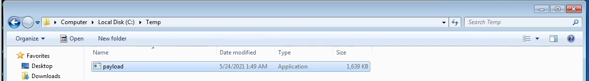
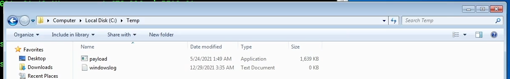
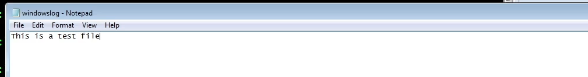
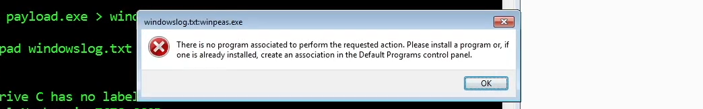
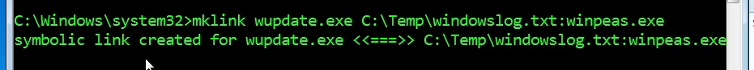
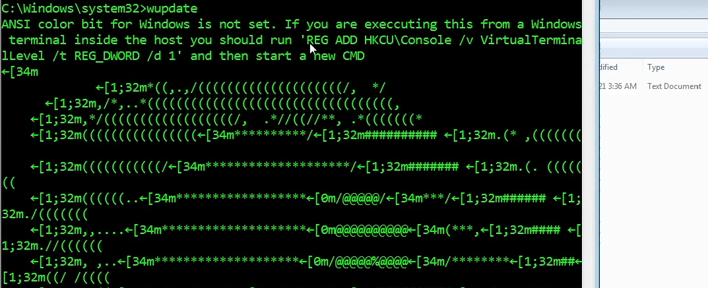

# Alternate Data Streams

**Classification:** Host & Network Penetration Testing / System & Host-Based Attacks<br>
**Target:** Windows host (local file system, `C:\Temp`)<br>
**Technique:** NTFS Alternate Data Streams (ADS) for hiding an executable

## 1. Executive Summary

NTFS **Alternate Data Streams** let a file carry hidden secondary streams that don't show
up in Explorer or a normal directory listing. Here we hide the WinPEAS privilege-escalation
executable inside the ADS of a harmless `windowslog.txt`, delete the original payload, and
then execute the hidden stream through a symbolic link (`wupdate.exe`), since ADS binaries
cannot be launched directly by path.

## 2. Staging the Payload

The payload (WinPEAS) is dropped to `C:\Temp`.



## 3. Hiding the Executable in an ADS

Piping the executable into an alternate data stream of a text file.

```cmd
type payload.exe > windowslog.txt:winpeas.exe
```


Explorer now shows only `windowslog.txt` (reported as 0 KB) — the executable is concealed
in the stream.



## 4. Confirming the Cover File & Removing the Original

Opening `windowslog.txt` shows ordinary text content, so it looks benign.



The original `payload.exe` is deleted — only the hidden stream remains.


## 5. Executing the Hidden Stream

A stream can't be opened/launched directly — Windows refuses it.

```cmd
notepad windowslog.txt:winpeas.exe      # no program associated
start windowslog.txt:winpeas.exe        # Access is denied
```




## 6. Symbolic Link Workaround

Creating a symbolic link to the ADS lets us invoke it by a normal name. This requires an
elevated prompt (`mklink` needs `SeCreateSymbolicLinkPrivilege`).

```cmd
mklink wupdate.exe C:\Temp\windowslog.txt:winpeas.exe
```

Without elevation it fails:


From an elevated command prompt the link is created:

```
symbolic link created for wupdate.exe <<===>> C:\Temp\windowslog.txt:winpeas.exe
```



## 7. Running the Hidden Executable

Now typing `wupdate` anywhere executes the hidden WinPEAS stream.

```cmd
wupdate
```



## 8. Remediation Recommendations

1. **Monitor for ADS creation/use** — EDR and Sysmon (FileCreateStreamHash) flag writes to
   `file:stream` and execution via streams; `dir /r` and `Get-Item -Stream *` reveal them.
2. **Application allow-listing** (WDAC/AppLocker) to block execution of unapproved binaries,
   including those reached via symbolic links.
3. **Restrict `SeCreateSymbolicLinkPrivilege`** to administrators only.
4. **Consider non-NTFS or policy controls** on sensitive shares where ADS is not needed.
