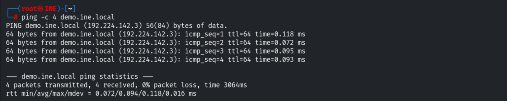
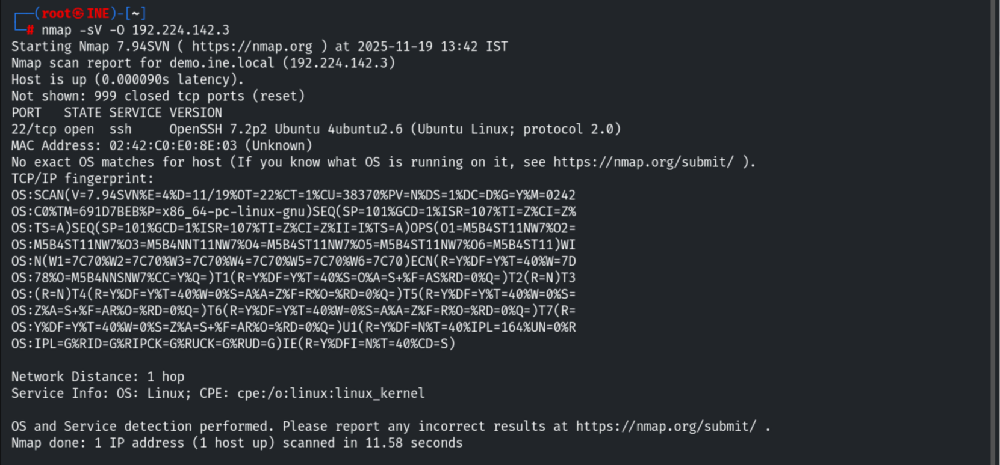
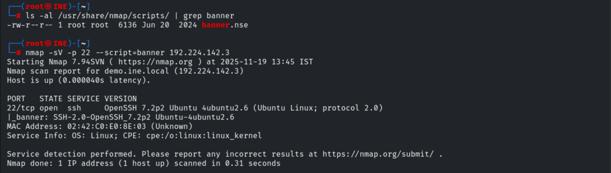
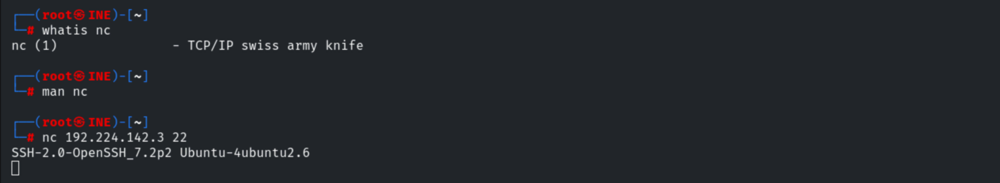
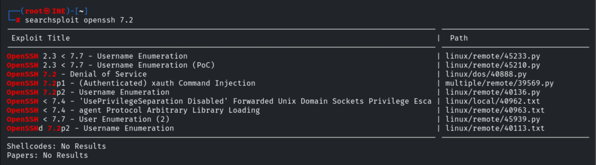
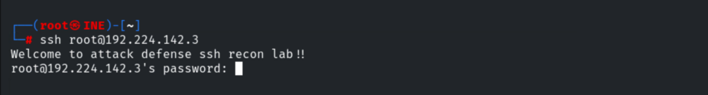

# Banner Grabbing

**Classification:** Host & Network Penetration Testing / Exploitation<br>
**Target:** demo.ine.local (192.224.142.3) — Ubuntu Linux, OpenSSH 7.2p2

## 1. Executive Summary

Banner grabbing reads the text a service announces on connection to fingerprint its exact
version. Here we identify **OpenSSH 7.2p2 (Ubuntu)** on port 22 with Nmap's `-sV` and the
`banner` NSE script, confirm it with Netcat, and use Searchsploit to map that version to
known vulnerabilities.

## 2. Recon

```bash
ping -c 4 demo.ine.local      # 192.224.142.3
nmap -sV -O 192.224.142.3
```

Port 22 — **OpenSSH 7.2p2 Ubuntu 4ubuntu2.6**.





## 3. Banner with Nmap NSE

```bash
ls -al /usr/share/nmap/scripts/ | grep banner
nmap -sV -p 22 --script=banner 192.224.142.3
```

```
|_banner: SSH-2.0-OpenSSH_7.2p2 Ubuntu-4ubuntu2.6
```



## 4. Banner with Netcat

```bash
nc 192.224.142.3 22
# SSH-2.0-OpenSSH_7.2p2 Ubuntu-4ubuntu2.6
```



## 5. Mapping to Exploits

```bash
searchsploit openssh 7.2
```

Several matches — notably **username enumeration** (OpenSSH 2.3 < 7.7, `40136.py` /
`45939.py`) and a DoS.



Attempting an SSH login to the banner-confirmed service.

```bash
ssh root@192.224.142.3
# "Welcome to attack defense ssh recon lab!!"
```



## 6. Remediation Recommendations

1. **Suppress or genericise service banners** (e.g. `DebianBanner no`, custom SSH banner) so
   exact versions aren't disclosed pre-auth.
2. **Keep services patched** — OpenSSH 7.2 has public username-enumeration issues; upgrade.
3. **Restrict SSH exposure** to trusted networks and prefer key-based auth with no root login.
4. **Monitor** for banner-grabbing / version-probing scans.
