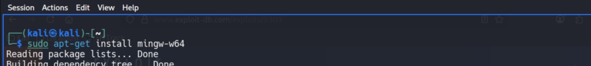
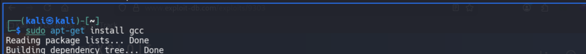
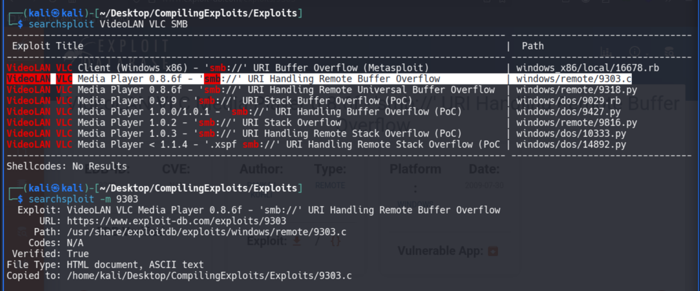
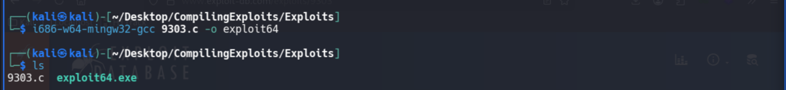
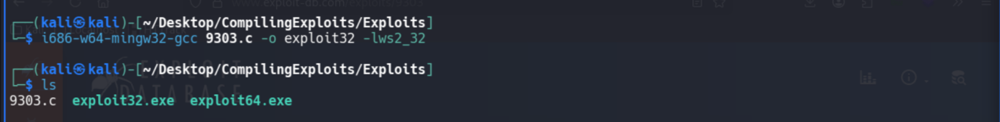
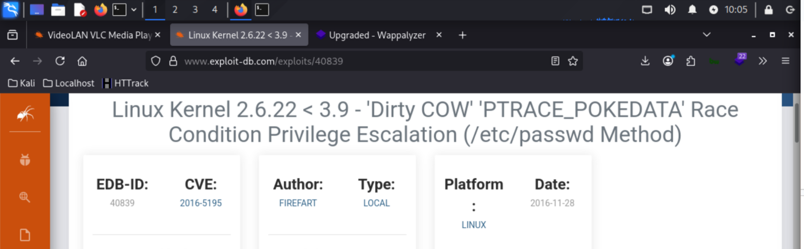
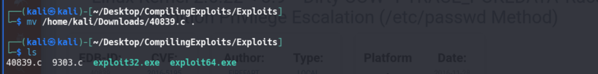
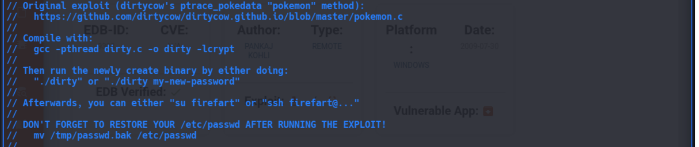
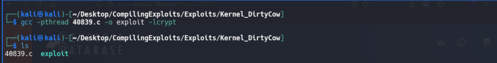

# Compiling Exploits

**Classification:** Host & Network Penetration Testing / Exploitation<br>
**Environment:** Kali (compiling, not attacking a live target)

## 1. Executive Summary

Public exploit code often ships as source that must be compiled for the right platform. We
set up the toolchains (`mingw-w64` for Windows, `gcc` for Linux), then compile two examples:
a **VideoLAN VLC SMB** buffer-overflow exploit cross-compiled to a Windows `.exe` (32- and
64-bit), and the **Dirty COW** Linux exploit built per its own in-source compile
instructions.

## 2. Toolchains

Installing the Windows cross-compiler and the Linux compiler.

```bash
apt install mingw-w64
apt install gcc
```





## 3. VLC SMB Exploit (Windows, Searchsploit)

Finding and copying the exploit source.

```bash
searchsploit VideoLAN VLC SMB
searchsploit -m 9303           # copies 9303.c locally
```



The source has no compile notes, so we use the default cross-compile (64-bit build).

```bash
i686-w64-mingw32-gcc 9303.c -o exploit64
ls                              # 9303.c  exploit64.exe
```



32-bit build, linking the Winsock library.

```bash
i686-w64-mingw32-gcc 9303.c -o exploit32 -lws2_32
ls                              # exploit32.exe  exploit64.exe
```



## 4. Dirty COW (Linux, Exploit-DB)

Downloading the exploit from Exploit-DB.





This one ships with explicit compile instructions in its header comments.

```c
// Compile with:
//   gcc -pthread dirty.c -o dirty -lcrypt
```



Compiling it accordingly.

```bash
gcc -pthread 40839.c -o exploit -lcrypt
ls                              # 40839.c  exploit
```



> Offensive Security also maintains a GitLab repo of pre-compiled binary exploits as a
> reference.

## 5. Notes & Good Practice

1. **Read the exploit source before compiling/running** — understand what it does and check
   for backdoors.
2. **Match the target architecture/ABI** (32 vs 64-bit, required libraries like `-lws2_32`
   or `-lcrypt`).
3. **Test in an isolated lab VM** — exploit PoCs can be destructive (Dirty COW even warns to
   restore `/etc/passwd`).
4. **Prefer trusted sources** (Exploit-DB verified entries, Offensive Security repos).
