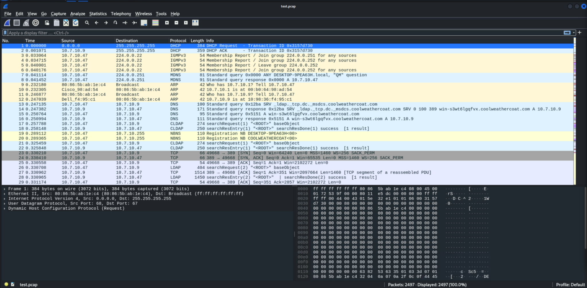
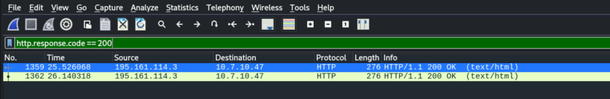
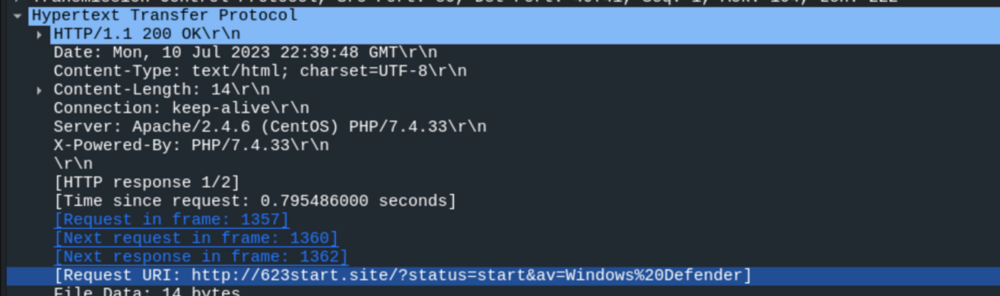
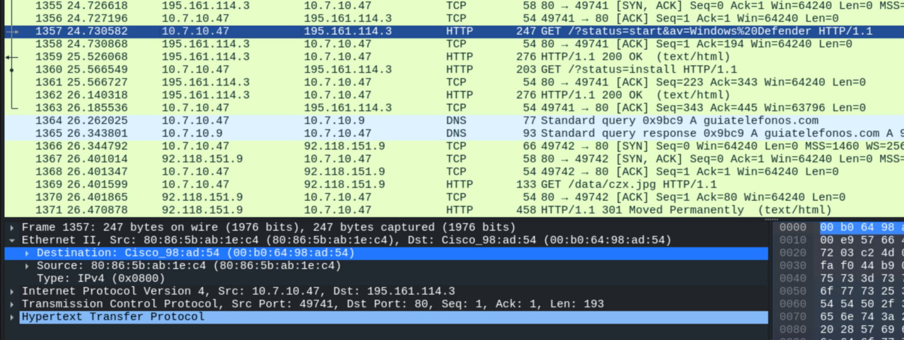
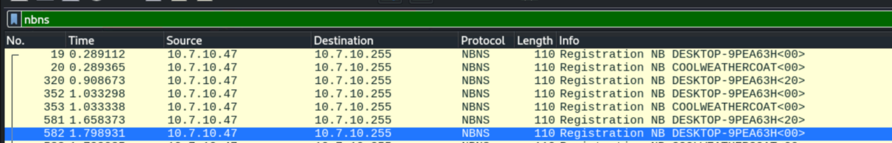
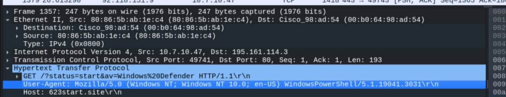
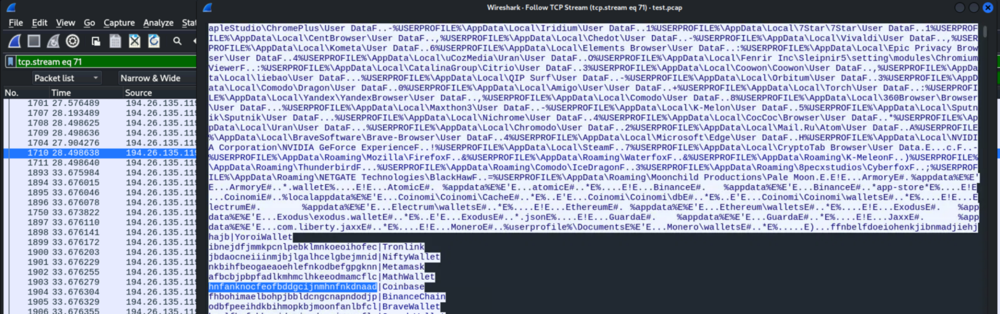

# CTF Report: Malware Traffic Analysis

**Classification:** Host & Network Penetration Testing / Network-Based Attacks<br>
**Capture:** `test.pcap` (2497 packets)<br>
**Infected host:** 10.7.10.47 (DESKTOP-9PEA63H)<br>
**Tool:** Wireshark

## 1. Executive Summary

This CTF provides a single packet capture (`test.pcap`) of a malware infection on an
internal network. Using Wireshark display filters we identify the first-stage download
domain, fingerprint the infected Windows client (IP/MAC/hostname), confirm the malicious
PowerShell User-Agent and recover the browser crypto-wallet extension IDs that the
info-stealer enumerated. Six flags in total.

## 2. Loading the Capture

We open `test.pcap` in Wireshark. The initial traffic (DHCP, NBNS, DNS/LDAP to a domain
controller) already shows the host `10.7.10.47` / `DESKTOP-9PEA63H`.



## 3. Flag 1 — First-Stage Domain (HTTP 200)

Filtering for successful HTTP responses isolates the C2/download traffic.

```
http.response.code == 200
```



Inspecting the response confirms the request URI — the infected host beaconed to
`623start.site` with its AV status.

```
Request URI: http://623start.site/?status=start&av=Windows%20Defender
Server: Apache/2.4.6 (CentOS) PHP/7.4.33
```



> **Flag 1:** `623start.site`

## 4. Flag 2 — Infected Client IP & MAC

Following the HTTP `GET /?status=start` request, the Ethernet and IP headers give the
client's addresses.

```
IP Src: 10.7.10.47
Ethernet Src: 80:86:5b:ab:1e:c4
```



> **Flag 2:** `10.7.10.47`, `80:86:5b:ab:1e:c4`

## 5. Flag 3 — Victim Hostname (NetBIOS)

The NetBIOS Name Service registrations reveal the hostname.

```
nbns
```



> **Flag 3:** filter `nbns` → hostname `DESKTOP-9PEA63H`

## 6. Flag 4 — Infected User

Correlating the SMB/Kerberos and script-download activity, the account that executed the
`mystery_file.ps1` PowerShell script is `Rwalters`.

> **Flag 4:** `Rwalters`

## 7. Flag 5 — PowerShell User-Agent

The malicious `GET` requests carry a PowerShell User-Agent string instead of a browser's.

```
User-Agent: Mozilla/5.0 (Windows NT; Windows NT 10.0; en-US) WindowsPowerShell/5.1.19041.3031
```



> **Flag 5:** `Mozilla/5.0 (Windows NT; Windows NT 10.0; en-US) WindowsPowerShell/5.1.19041.3031`

## 8. Flag 6 — Coinbase Wallet Extension ID

Following the TCP stream of the stealer's exfil shows it enumerating browser wallet
extensions. The Coinbase entry maps the extension ID to its name.

```
hnfanknocfeofbddgcijnmhnfnkdnaad|Coinbase
```



> **Flag 6:** `hnfanknocfeofbddgcijnmhnfnkdnaad`

## 9. Remediation Recommendations

1. **Block the malicious infrastructure** (`623start.site`, `195.161.114.3`) at the DNS
   resolver and perimeter firewall, and sweep other hosts for the same beacon.
2. **Constrain PowerShell:** enable Constrained Language Mode, script-block/module logging
   and AMSI so PowerShell-based downloaders are logged and blocked.
3. **Egress filtering & TLS inspection** to catch plaintext HTTP beacons leaving the network.
4. **Re-image the infected host** (`DESKTOP-9PEA63H`) and reset `Rwalters`' credentials and
   any crypto-wallet secrets that may have been exfiltrated.
