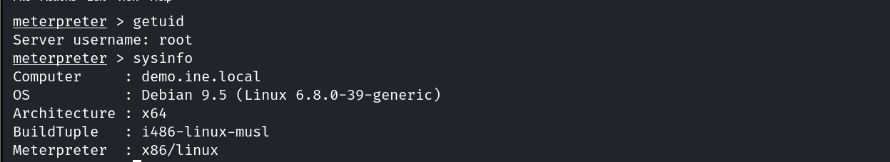
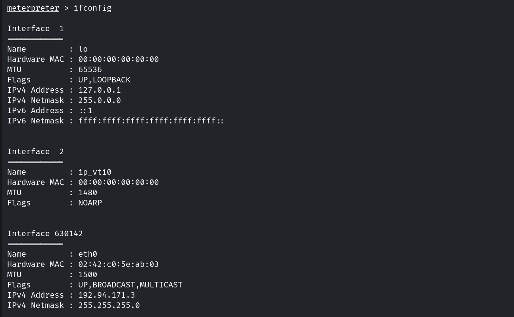
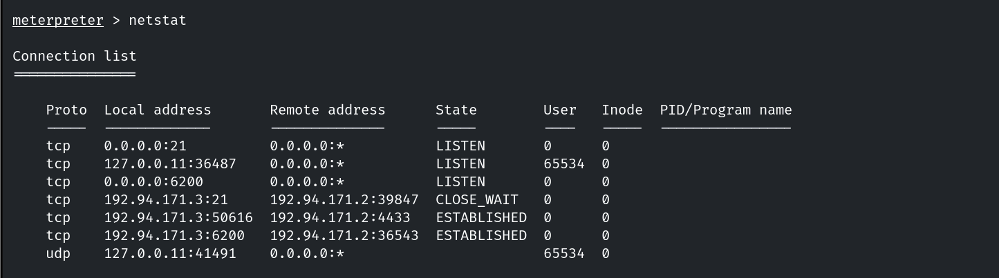
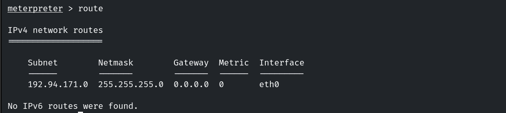
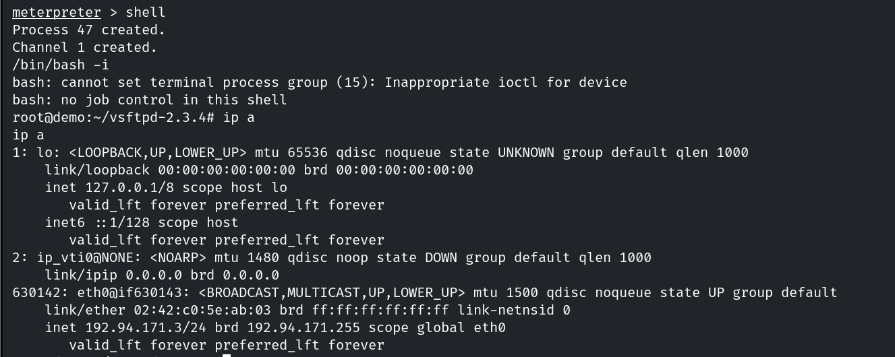
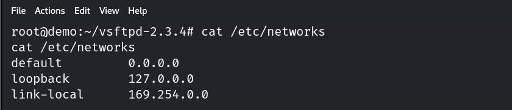
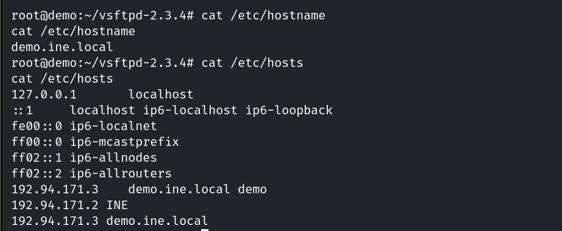
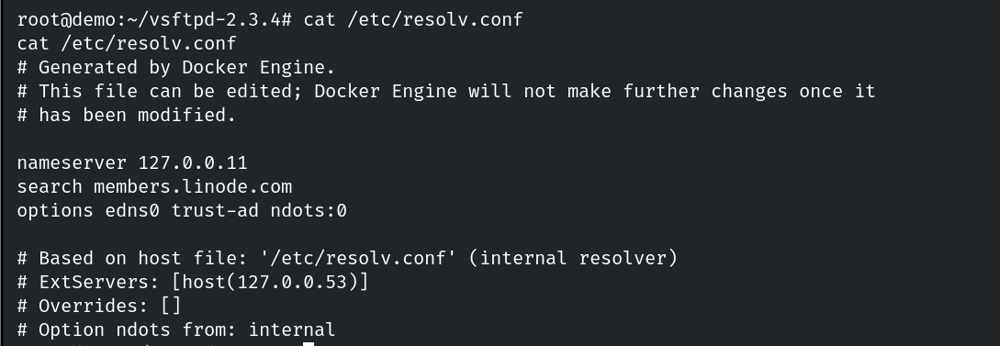
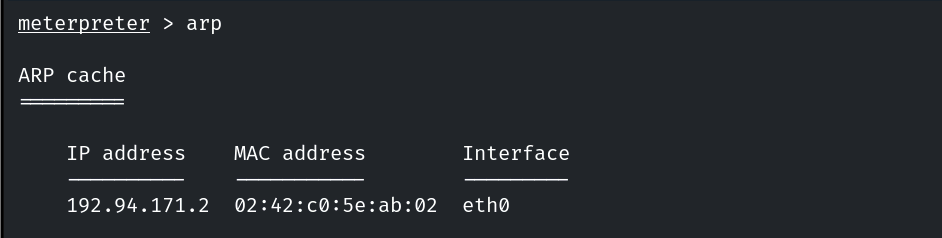

# Enumerating Network Information (Linux)

**Classification:** Host & Network Penetration Testing / Post-Exploitation<br>
**Target:** Linux host (root Meterpreter via vsFTPd)

## 1. Executive Summary

After exploiting the **vsFTPd** backdoor and upgrading to Meterpreter, we map the host's
network context — interfaces, connections, routing, DNS and neighbouring hosts — to plan
lateral movement and pivoting.

## 2. Foothold



## 3. Interfaces & Connections

```bash
ifconfig
netstat -antp
```





## 4. Routing

```bash
route -n        # or netstat -rn
```



```bash
shell
ip a s          # adapter details
```



## 5. Hosts, DNS & Neighbours

```bash
cat /etc/networks
```



```bash
hostname
cat /etc/hosts
```



```bash
cat /etc/resolv.conf
```



```bash
arp -a          # systems on the subnet (none here)
```



## 6. Notes

This network context (routes, DNS, neighbours) is the basis for autoroute/portfwd pivoting
to internal hosts.
