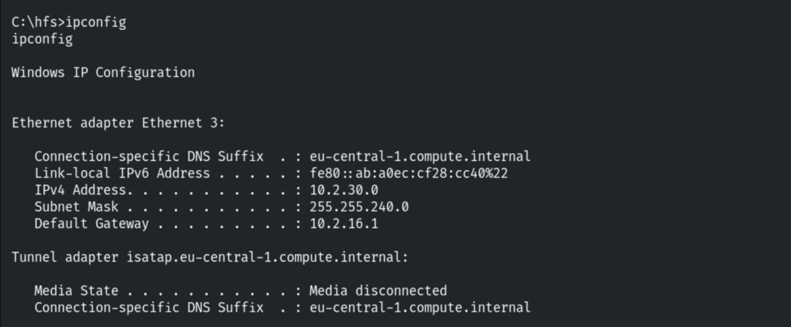
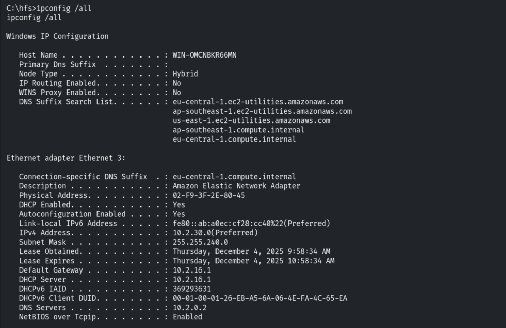
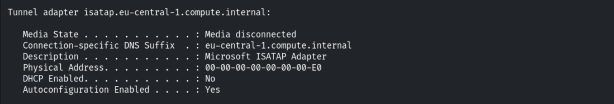
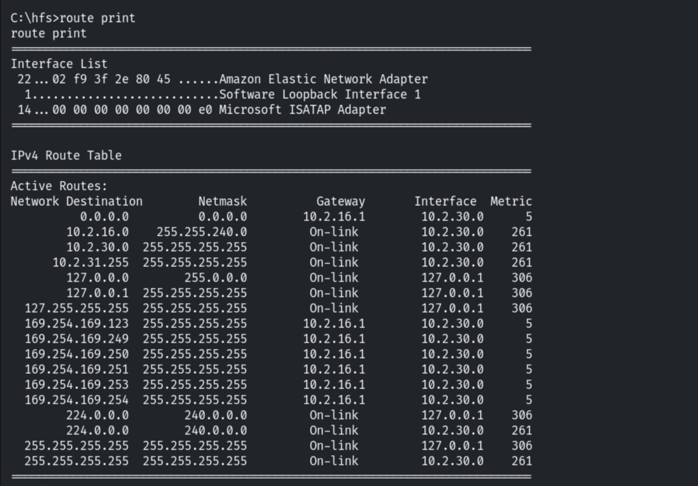
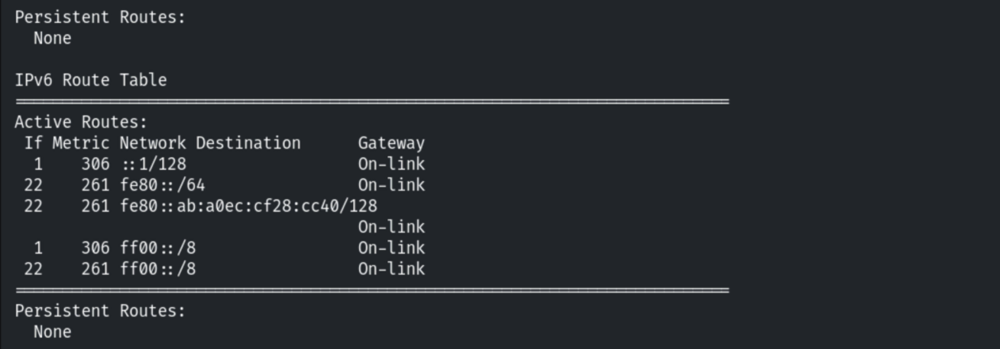
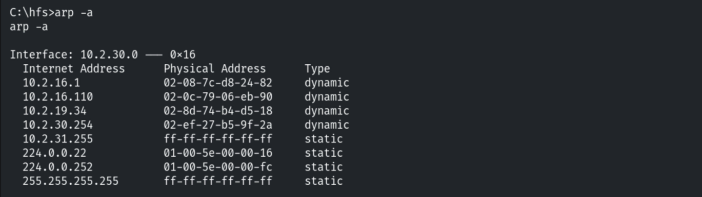
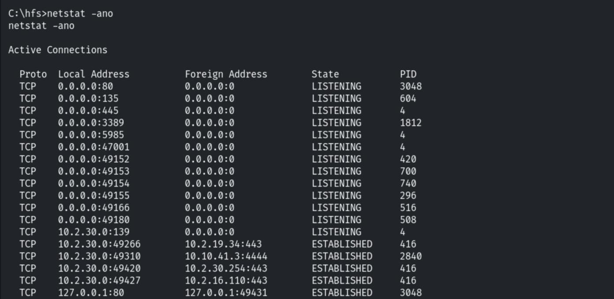
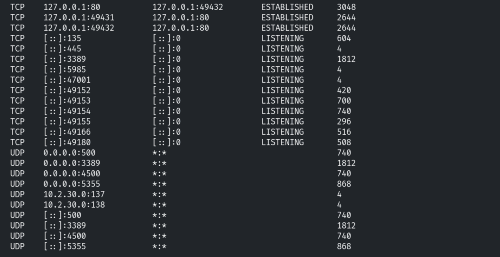
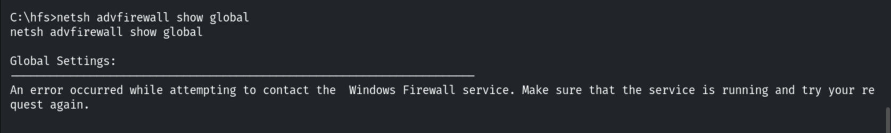
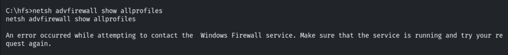

# Enumerating Network Information (Windows)

**Classification:** Host & Network Penetration Testing / Post-Exploitation<br>
**Target:** Windows host (Meterpreter via Rejetto HFS)

## 1. Executive Summary

After exploiting **Rejetto HFS**, we enumerate the Windows host's network context —
interfaces, routing, ARP neighbours, listening services and firewall state — to plan lateral
movement.

## 2. Interfaces

```cmd
shell
ipconfig
ipconfig /all
```







## 3. Routing & ARP

```cmd
route print
```





```cmd
arp -a
```



## 4. Listening Services

```cmd
netstat -ano
```





## 5. Firewall State

```cmd
netsh advfirewall show allprofiles
```

The firewall is not running here.





## 6. Notes

ARP neighbours and the routing table reveal reachable internal hosts; a disabled firewall
widens lateral-movement options.
