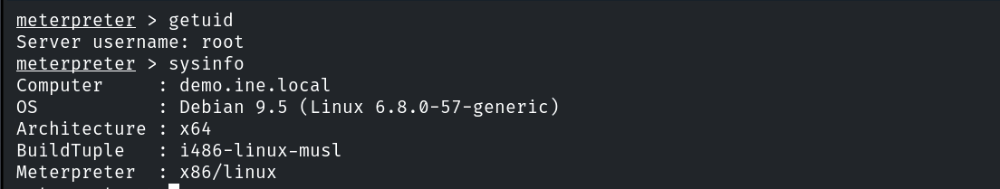
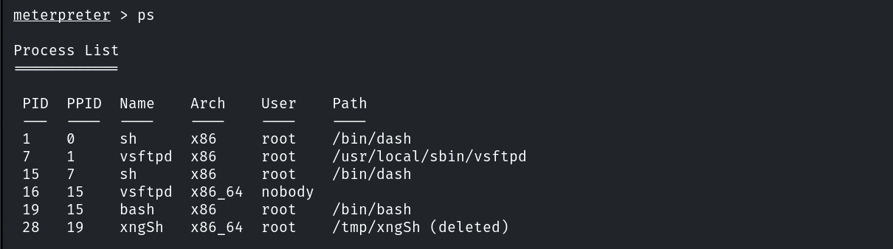
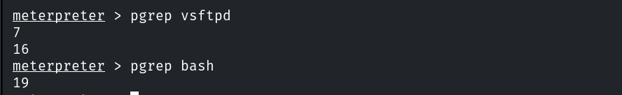
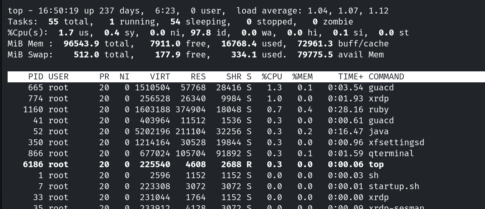
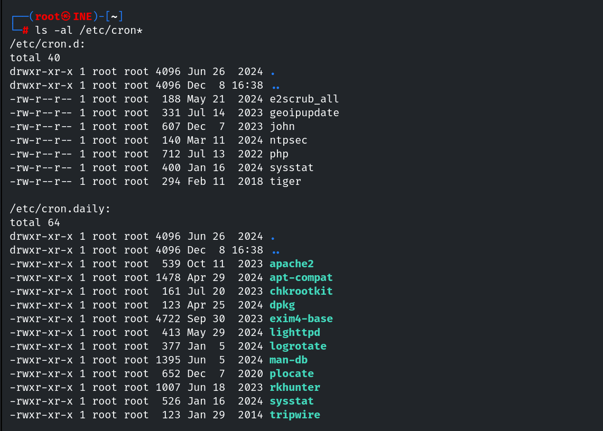
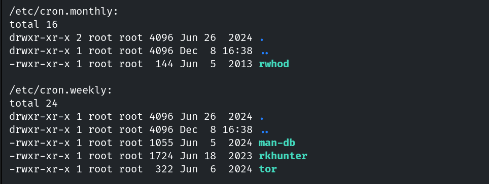

# Enumerating Processes & Cron Jobs

**Classification:** Host & Network Penetration Testing / Post-Exploitation<br>
**Target:** Linux host (root Meterpreter via vsFTPd)

## 1. Executive Summary

After exploiting the **vsFTPd** backdoor and upgrading to Meterpreter, we enumerate the
host's running processes and scheduled cron jobs — a key post-exploitation step for finding
privileged processes and abusable scheduled tasks.

## 2. Foothold

```bash
use exploit/unix/ftp/vsftpd_234_backdoor
# ... shell -> shell_to_meterpreter
```



## 3. Enumerating Processes

```bash
ps aux
```



Filtering for specific PIDs/processes.



```bash
top
```



## 4. Enumerating Cron Jobs

```bash
ls -al /etc/cron*
cat /etc/crontab
```

The cron directories (`/etc/cron.d`, `/etc/cron.daily`, ...) list scheduled jobs — check them
for user-writable scripts run as root.





## 5. Notes & Remediation

1. World-writable scripts invoked by root cron are a common privesc vector — keep cron
   scripts `root:root` and non-writable by others.
2. Monitor for unexpected processes and cron modifications (auditd / file integrity).
