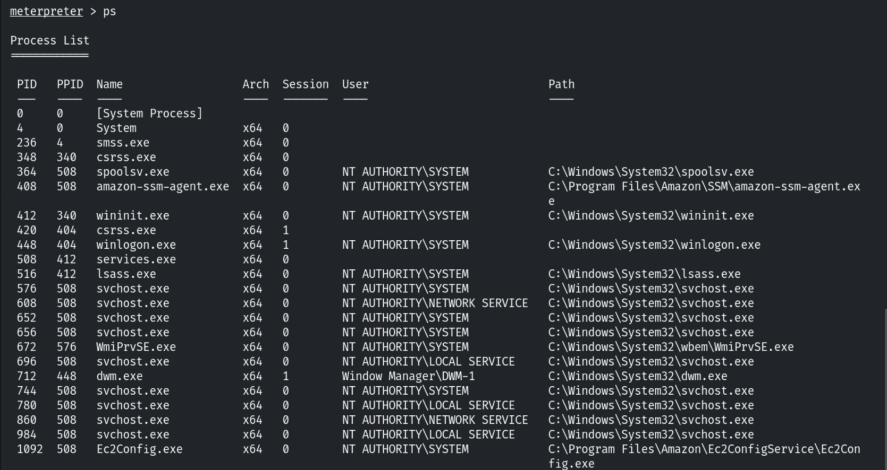
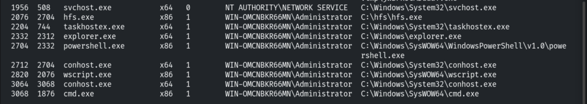
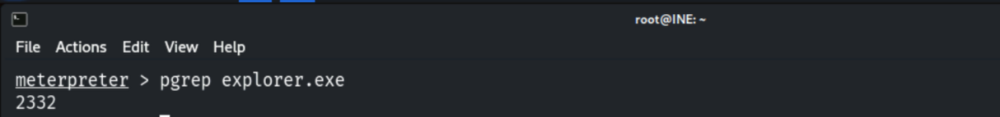
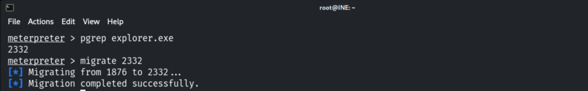
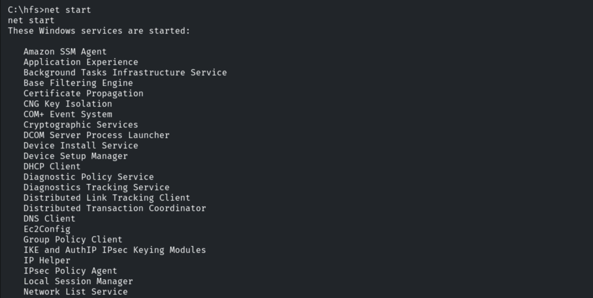
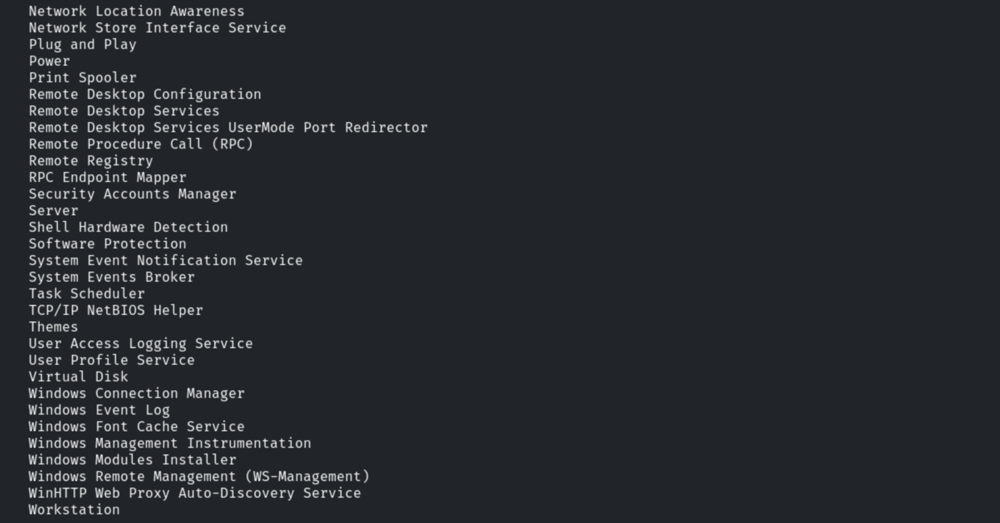
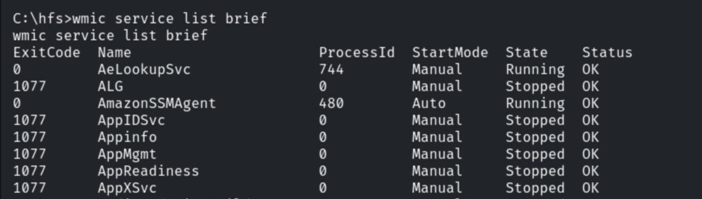
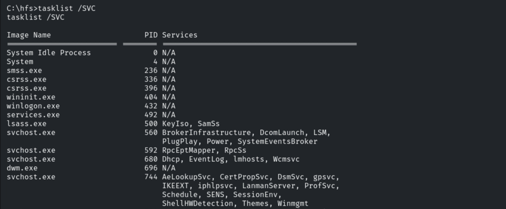
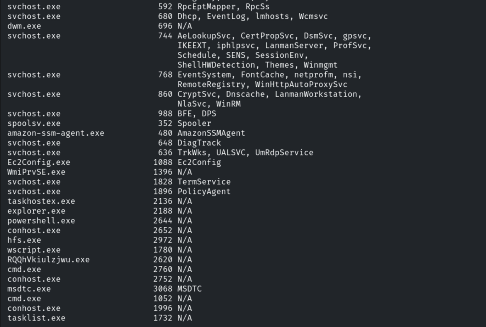
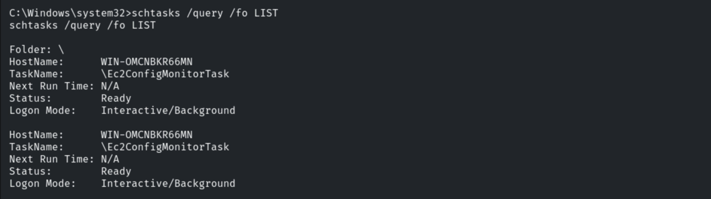

# Enumerating Processes & Services (Windows)

**Classification:** Host & Network Penetration Testing / Post-Exploitation<br>
**Target:** Windows host (Meterpreter via Rejetto HFS)

## 1. Executive Summary

After exploiting **Rejetto HFS**, we enumerate the host's running processes, Windows services
and scheduled tasks — identifying privileged/abusable services and persistence opportunities.

## 2. Processes

```bash
ps
```





Searching for a specific PID.



Migrating into an x64 process for a stable x64 session.

```bash
migrate <pid>
```



## 3. Services

```cmd
shell
net start
sc query
```





More detail (ExitCode, ProcessId, StartMode, State, Status) via WMIC.

```cmd
wmic service list brief
```



Mapping services to their hosting processes.

```cmd
tasklist /svc
```





## 4. Scheduled Tasks

```cmd
schtasks /query /fo LIST /v
```

(Best piped to a file given the volume.)



## 5. Notes

Services running as SYSTEM with weak permissions (unquoted paths, writable binaries) and
scheduled tasks are prime privilege-escalation and persistence targets.
