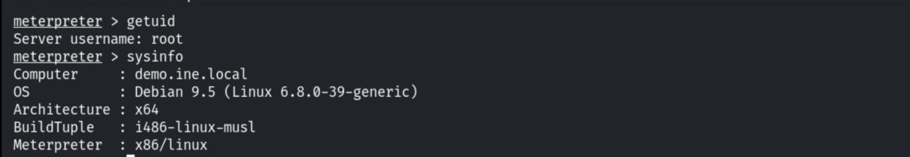
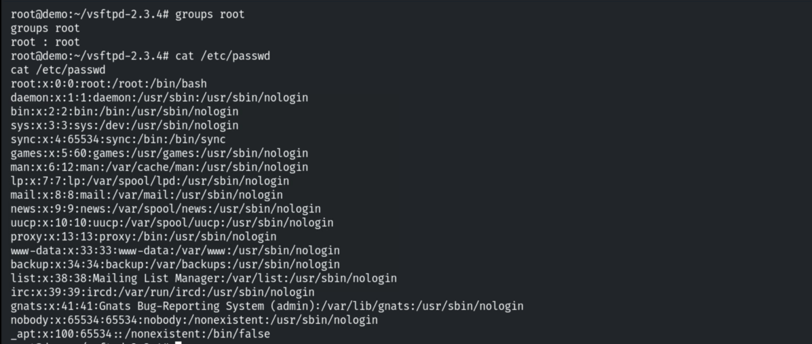
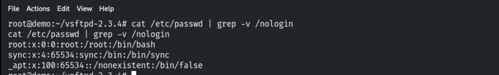
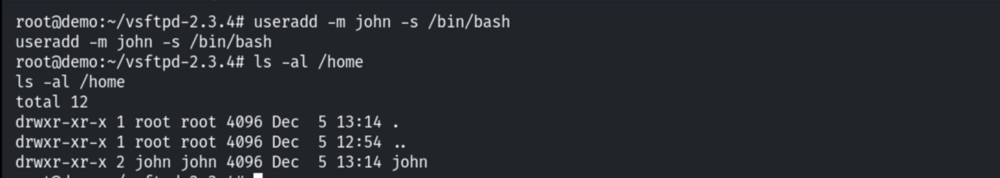
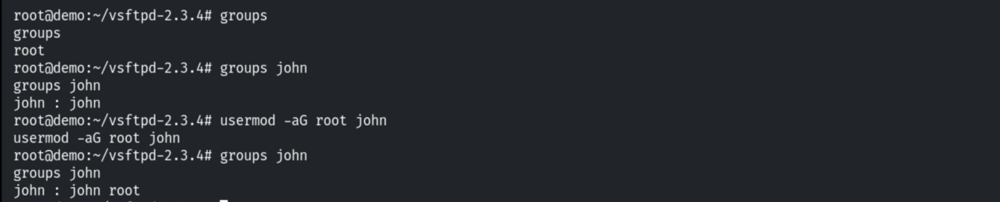
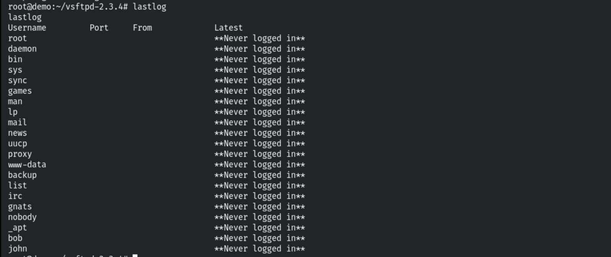

# Enumerating Users & Groups (Linux)

**Classification:** Host & Network Penetration Testing / Post-Exploitation<br>
**Target:** Linux host (root Meterpreter via vsFTPd)

## 1. Executive Summary

After exploiting the **vsFTPd** backdoor and upgrading to Meterpreter, we enumerate the
host's local users and groups, identify service/no-login accounts, demonstrate creating a
privileged account, and review login history.

## 2. Foothold



## 3. Users & Groups

```bash
cat /etc/passwd
cat /etc/group
```



Filtering for accounts without a login shell.

```bash
grep -E "nologin|false" /etc/passwd
```



## 4. Creating a Privileged Account (demo)

```bash
useradd john
ls -al /home/john
```



```bash
usermod -aG root john
groups john
```



## 5. Login History

```bash
last
who
```



## 6. Notes & Remediation

1. **Audit accounts** — alert on new users and unexpected membership in the root/sudo groups.
2. Service accounts should have `nologin` shells; apply least privilege.
3. Centralise auth logs so account creation and logins are visible off-host.
