# Enumerating Users & Groups (Windows)

**Classification:** Host & Network Penetration Testing / Post-Exploitation<br>
**Target:** Windows host (Meterpreter via Rejetto HFS)

## 1. Executive Summary

After exploiting **Rejetto HFS**, we enumerate the Windows host's users, privileges and
groups — identifying the current context, logged-on users, local accounts and
privileged-group membership (Administrators, Remote Desktop Users).

## 2. Foothold & Current User

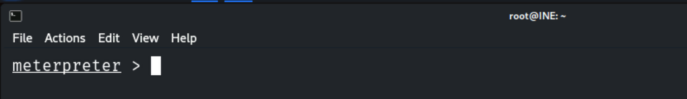

```bash
getuid
getprivs
```

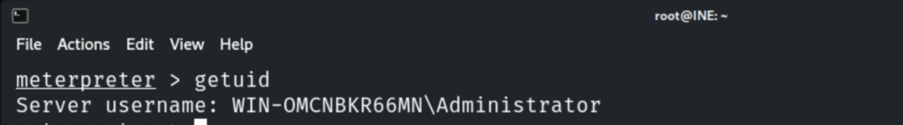

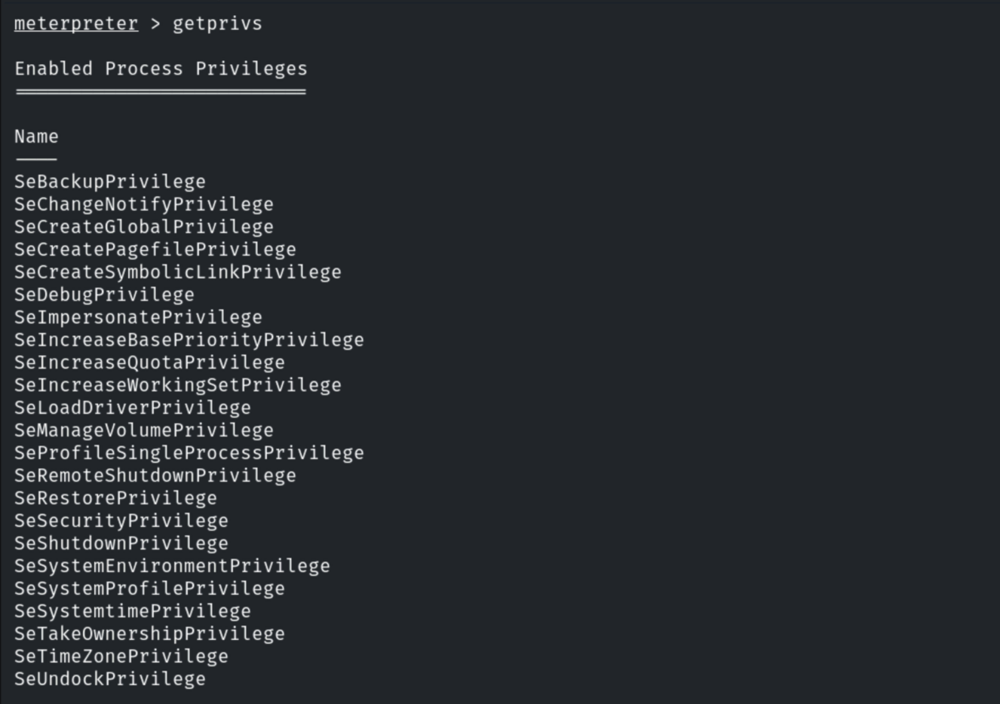

## 3. Logged-on Users

```bash
run post/windows/gather/enum_logged_on_users
```

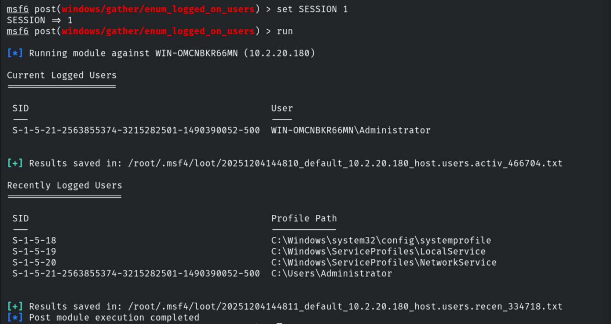

```cmd
shell
whoami /priv
```

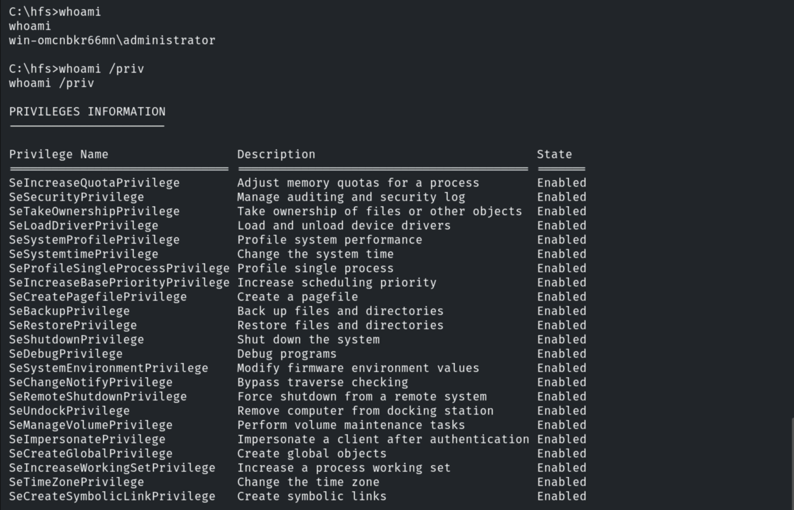

```cmd
query user
```

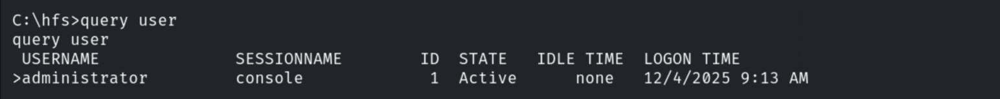

## 4. Local Accounts

```cmd
net user
```

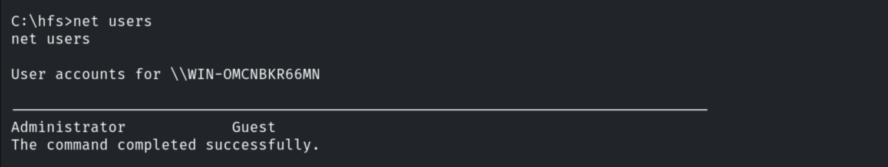

```cmd
net user administrator
```

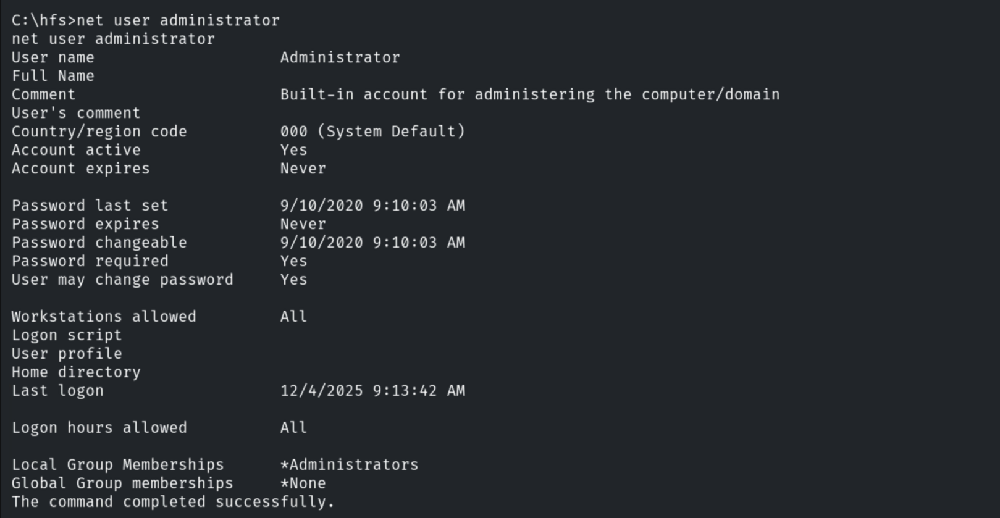

```cmd
net user guest
```

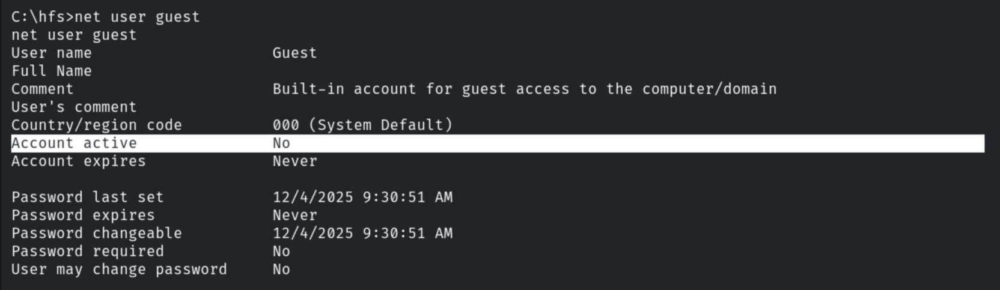

## 5. Groups

```cmd
net localgroup
```

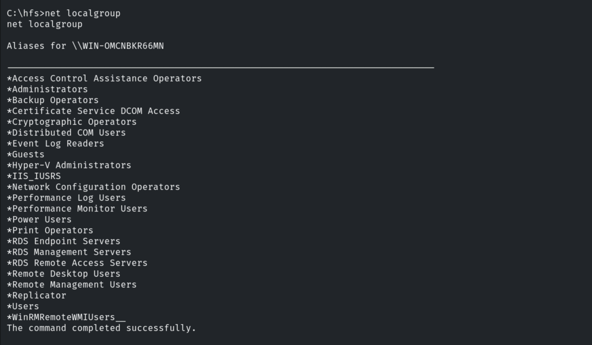

```cmd
net localgroup Administrators
```

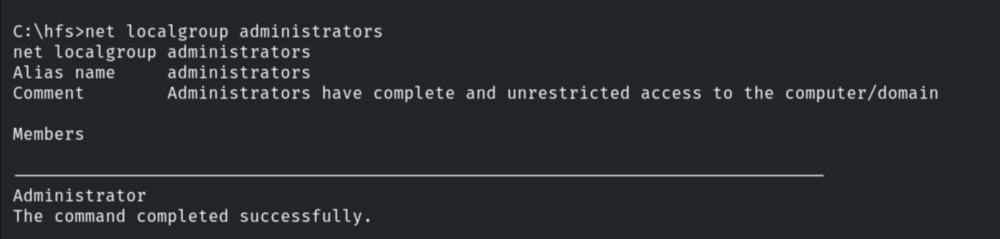

## 6. Notes

Membership in **Administrators** (full control), **Remote Desktop Users** (RDP logon) and
backup/privileged groups directly informs privilege escalation and lateral movement.
