# Let's GoPhishing

**Classification:** Host & Network Penetration Testing / Social Engineering 
**Environment:** Isolated lab (no internet); GoPhish server + a victim VM with Thunderbird

> This is an **authorized phishing-simulation exercise** in a closed lab. The same workflow is
> what blue teams use to run awareness campaigns and measure click/submit rates against their
> own employees — always with authorization.

## 1. Executive Summary

**GoPhish** is an open-source phishing-simulation framework. In this lab we run the full
campaign workflow against a lab mailbox: set up a sending profile, build a landing page and
email template, import a target group, schedule a campaign, and review the results GoPhish
tracks (opens, clicks, submissions).

## 2. Lab Setup

Two provided files: the email content and the target list.

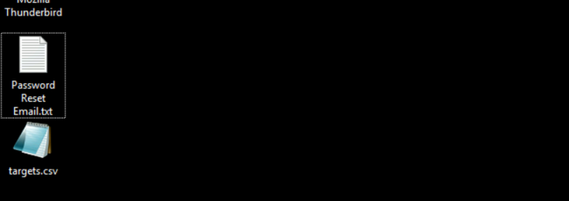

The victim VM uses Thunderbird as its mail client.

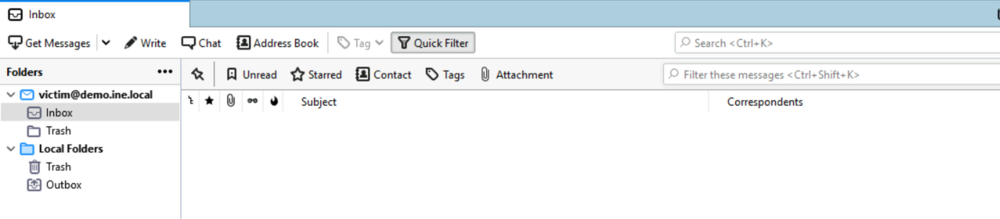

Because the lab is offline, we edit the `base.html` / `login.html` templates to remove the
external Google APIs calls, and check `config.json`.

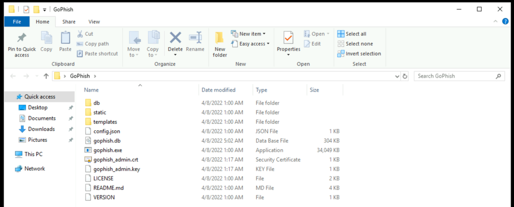

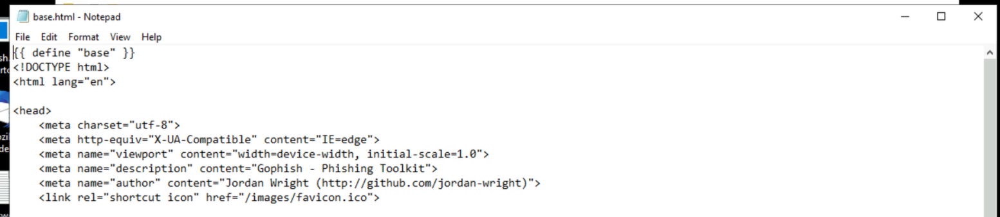

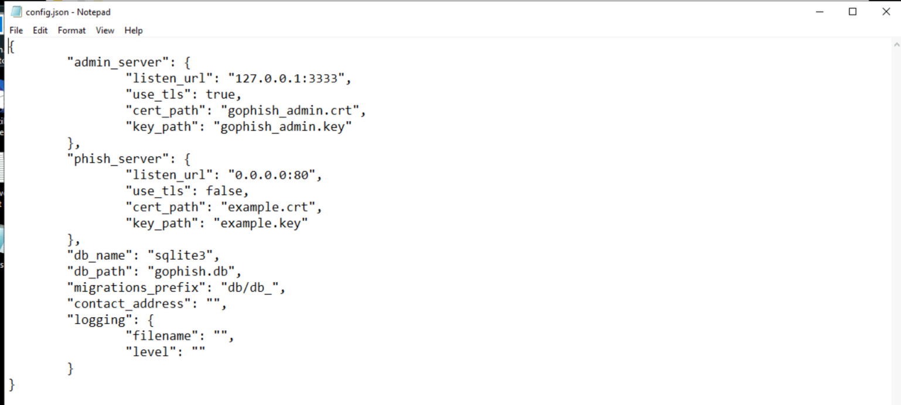

Starting GoPhish and opening its admin UI.

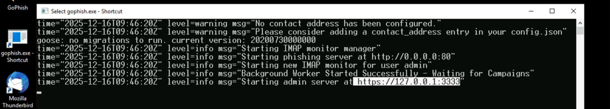

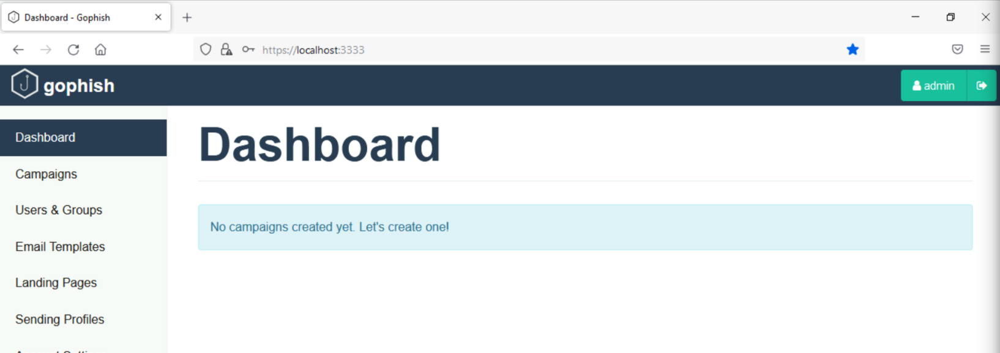

## 3. Sending Profile

Configuring the SMTP sending profile and sending a test email.

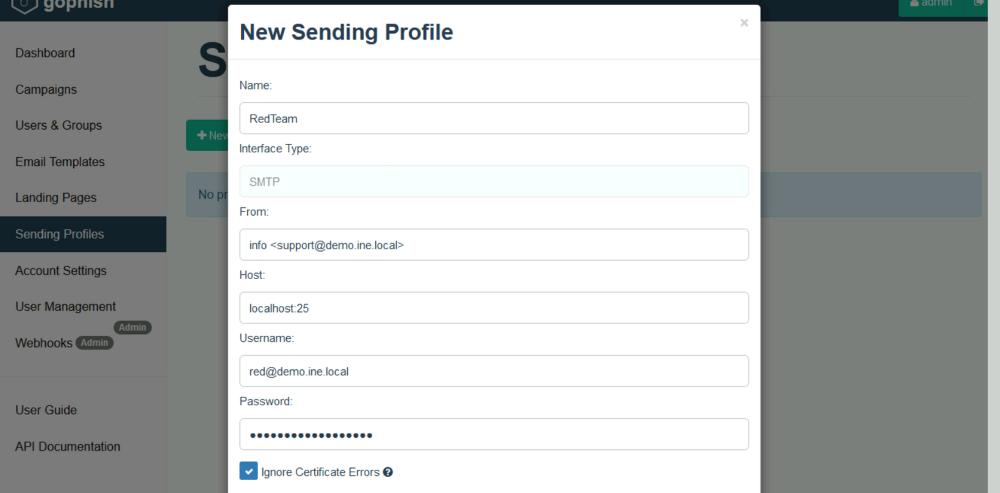

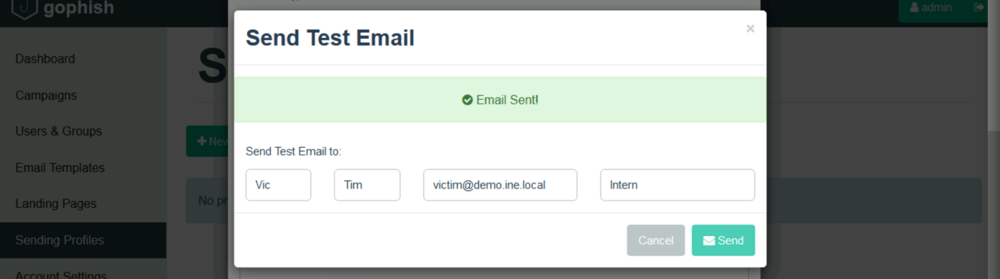

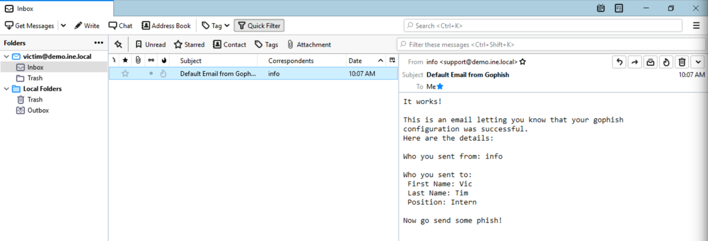

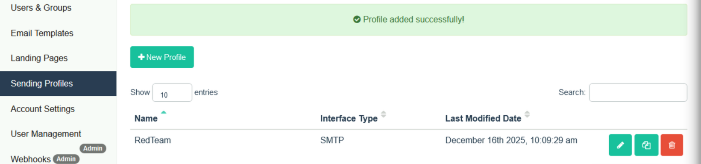

## 4. Landing Page

Cloning the INE "Reset Password" page as the landing page (hosted on `localhost:8080`).

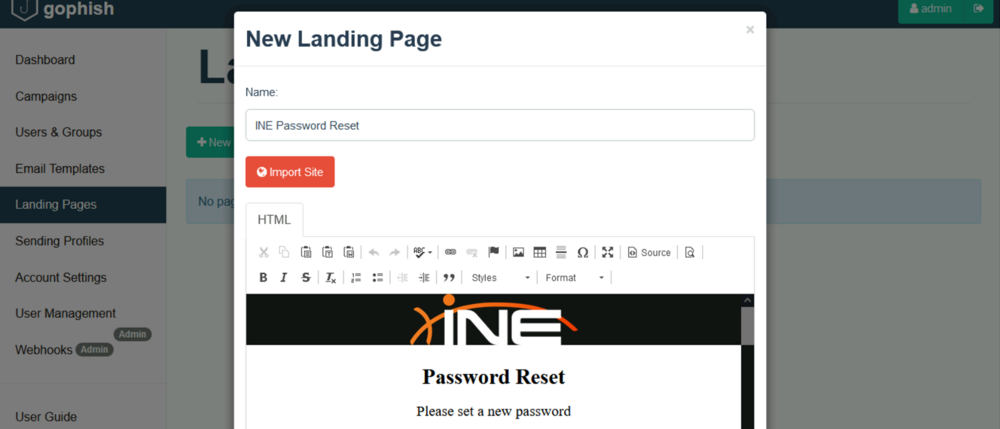

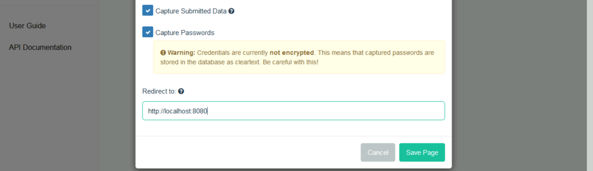

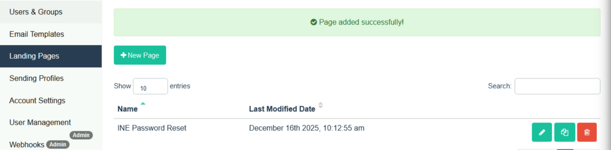

## 5. Email Template

Importing the provided `Password Reset Email.txt` as the email template.

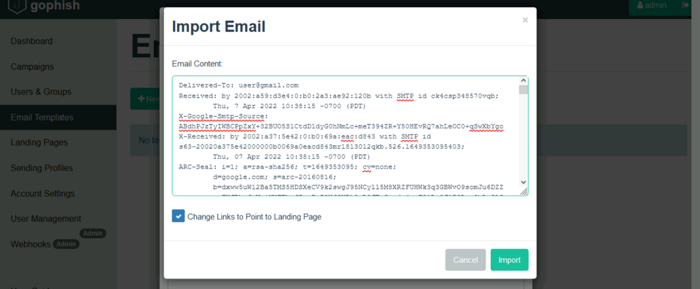

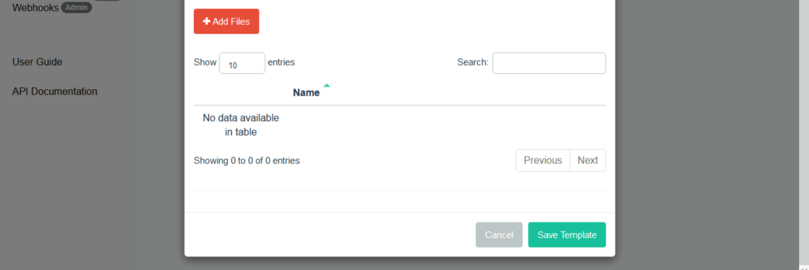

Templates can also carry attachments.

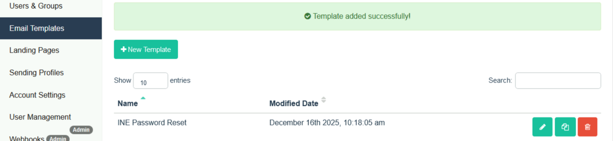

## 6. Target Group

Importing `targets.csv` as the recipient group.

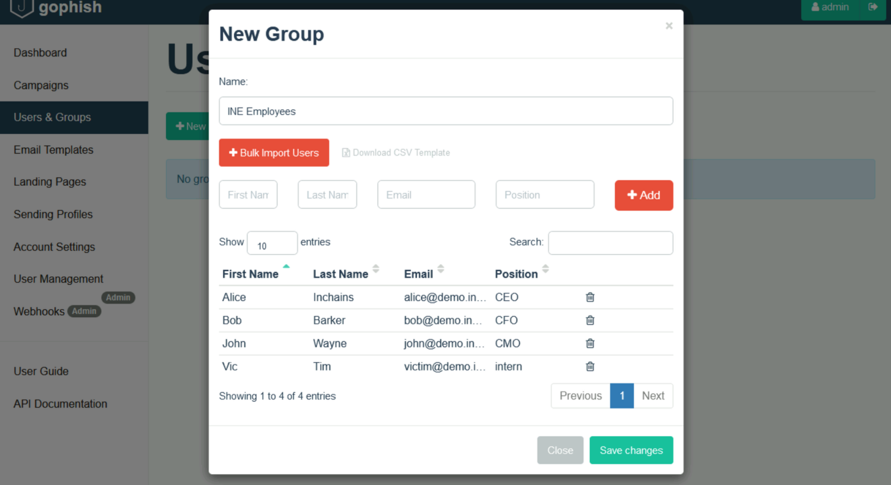

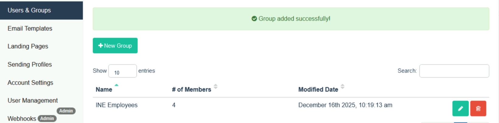

## 7. Launching the Campaign

Creating the campaign from the profile, landing page, template and group.

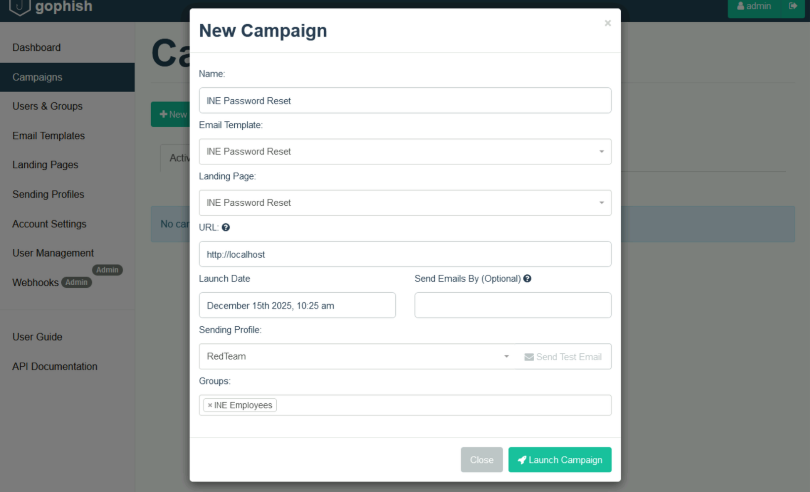

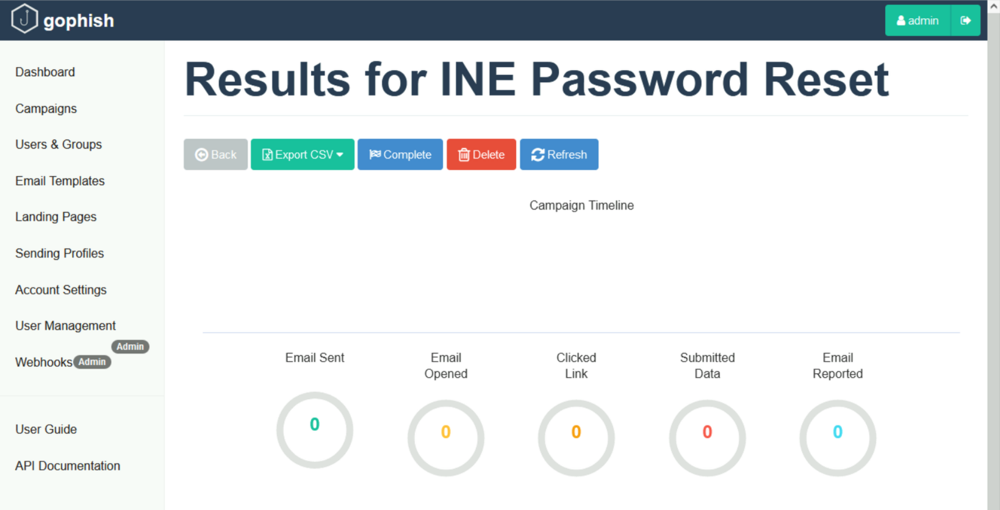

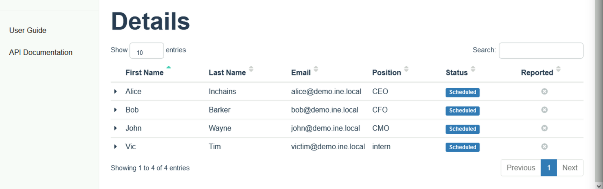

## 8. Results & Tracking

At the scheduled time the email arrives in the victim's mailbox.

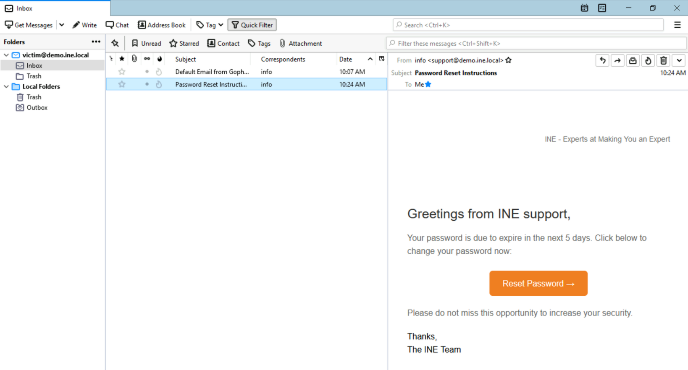

GoPhish registers the link click.

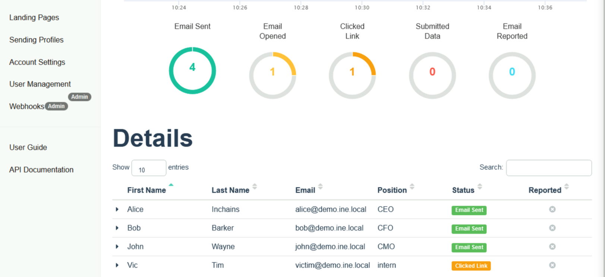

When the landing page loads and credentials are submitted, GoPhish records the event (in a
real simulation this is where the metric "credentials submitted" comes from).

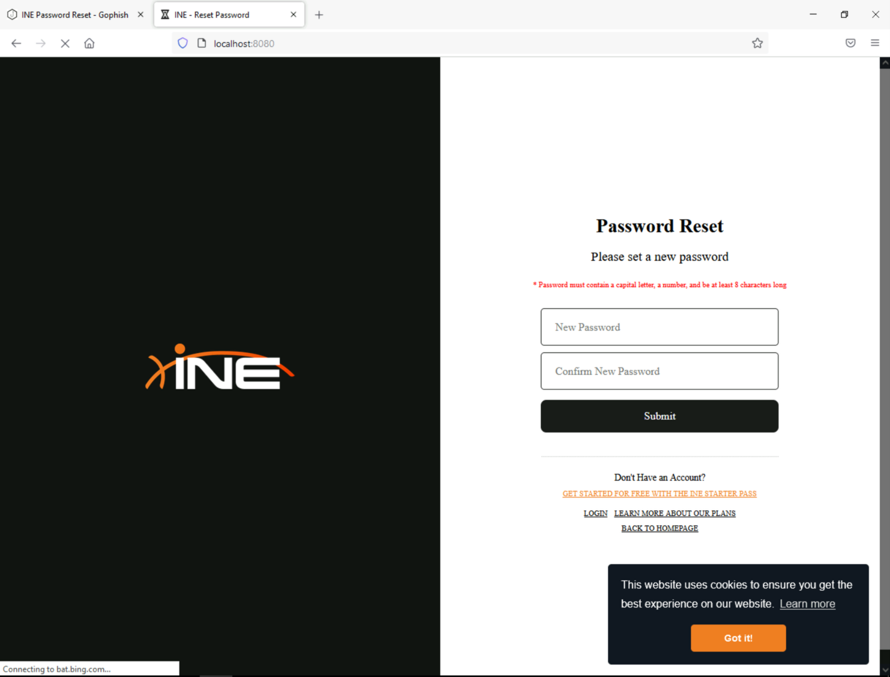

## 9. Defensive Takeaways

1. **User awareness training** is the primary control — measured, recurring phishing
   simulations (exactly this workflow) reduce click/submit rates over time.
2. **Technical controls:** SPF/DKIM/DMARC, external-sender banners, link rewriting/sandboxing,
   and MFA so a submitted password isn't sufficient.
3. **Reporting:** make it easy for users to report suspected phishing, and monitor for
   credential submission to look-alike pages.
